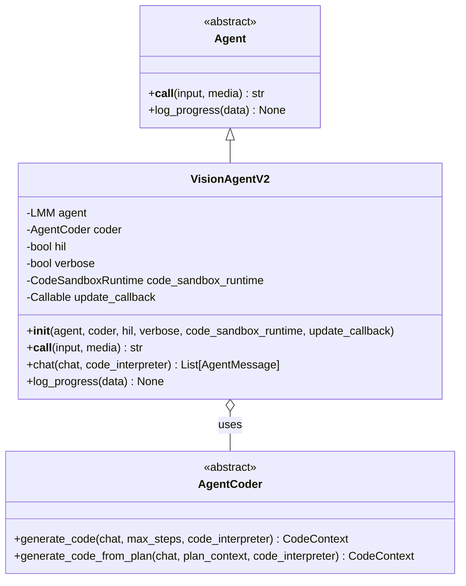
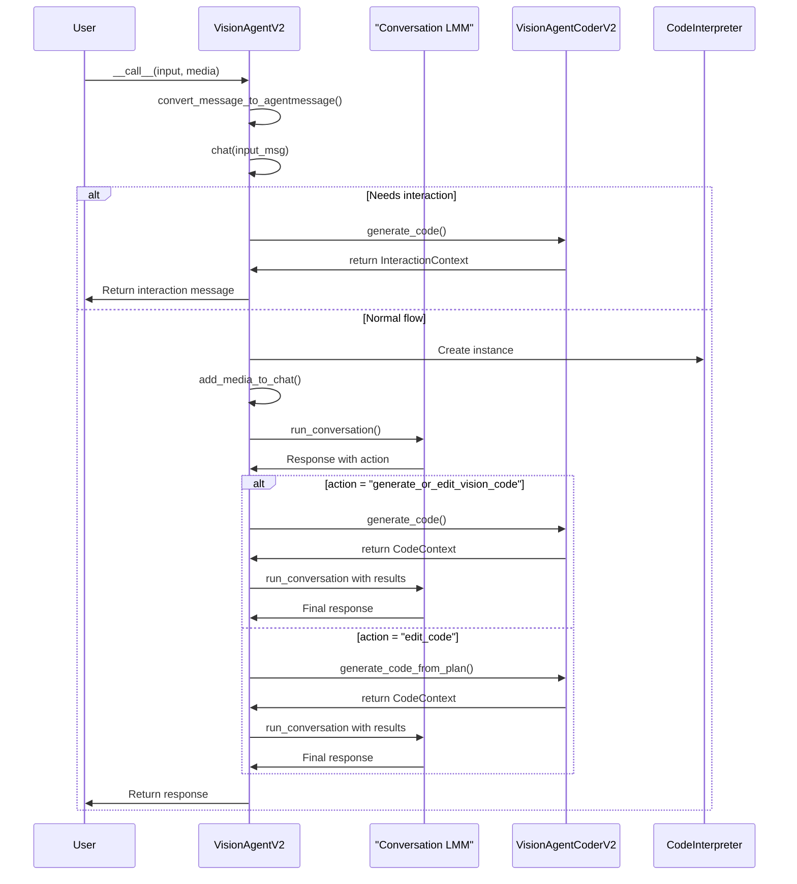
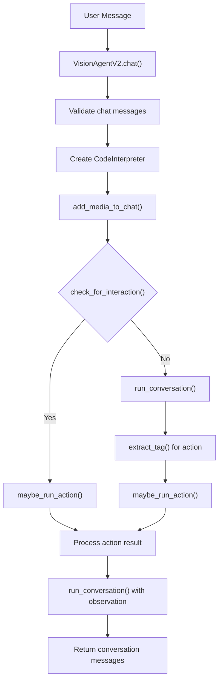
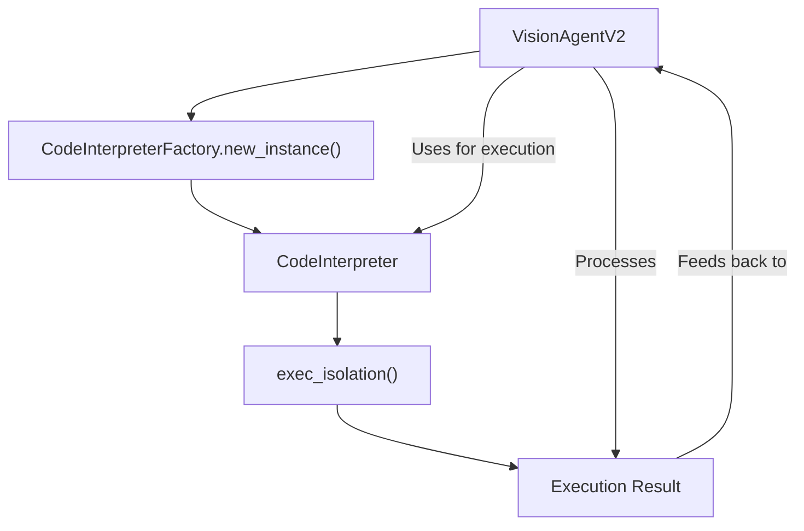
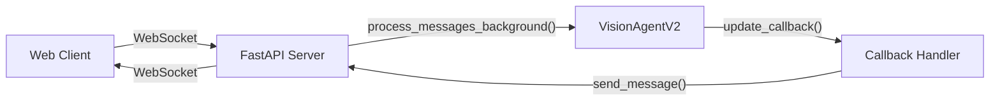

<!-- source: DeepWiki mcp.deepwiki.com · repo landing-ai/vision-agent · page 2.1 VisionAgentV2 · fetched 2026-10-26 -->

# VisionAgentV2

<details>
<summary>Relevant source files</summary>

The following files were used as context for generating this wiki page:

- [examples/chat/app.py](examples/chat/app.py)
- [vision_agent/agent/agent.py](vision_agent/agent/agent.py)
- [vision_agent/agent/vision_agent_coder_v2.py](vision_agent/agent/vision_agent_coder_v2.py)
- [vision_agent/agent/vision_agent_prompts_v2.py](vision_agent/agent/vision_agent_prompts_v2.py)
- [vision_agent/agent/vision_agent_v2.py](vision_agent/agent/vision_agent_v2.py)

</details>


VisionAgentV2 is the primary conversational agent in the vision-agent system, serving as the main orchestrator for user interactions involving vision code generation. This document details the VisionAgentV2 class, its architecture, and how it integrates with other system components.

For information about the code generation process specifically, see [VisionAgentCoderV2](#2.2). For information about the planning component, see [VisionAgentPlannerV2](#2.3).

## Purpose and Functionality

VisionAgentV2 acts as a conversational interface that allows users to:

1. Generate computer vision code based on natural language requests
2. Execute the generated code against provided images or videos
3. Engage in interactive debugging and code refinement
4. Receive human-readable explanations of the generated solutions

The agent handles the conversation flow, delegates code generation tasks to specialized components, and manages the execution of generated code.

Sources: [vision_agent/agent/vision_agent_v2.py:159-162]()

## Class Structure and Components



Sources: [vision_agent/agent/vision_agent_v2.py:159-202](), [vision_agent/agent/agent.py:16-30]()

## Constructor Parameters

VisionAgentV2 accepts the following parameters during initialization:

| Parameter | Type | Description | Default |
|-----------|------|-------------|---------|
| agent | LMM | Language model for conversation | Config default |
| coder | AgentCoder | Agent for code generation | VisionAgentCoderV2 |
| hil | bool | Enable human-in-the-loop mode | False |
| verbose | bool | Enable debug output | False |
| code_sandbox_runtime | str | Runtime for code execution | None (uses env var) |
| update_callback | Callable | Function for progress updates | lambda x: None |

Sources: [vision_agent/agent/vision_agent_v2.py:164-187]()

## Interaction Flow



Sources: [vision_agent/agent/vision_agent_v2.py:206-292](), [vision_agent/agent/vision_agent_v2.py:75-89](), [vision_agent/agent/vision_agent_v2.py:100-156]()

## Key Methods

### `__call__` Method

The `__call__` method serves as the primary entry point for user interaction:

```python
def __call__(self, input: Union[str, List[Message]], media: Optional[Union[str, Path]] = None) -> str:
    input_msg = convert_message_to_agentmessage(input, media)
    return self.chat(input_msg)[-1].content
```

This method takes either a string or a list of message objects, along with optional media files (images or videos), and returns the agent's response as a string.

Sources: [vision_agent/agent/vision_agent_v2.py:206-227]()

### `chat` Method

The `chat` method implements the core conversation logic:

1. Validates the input chat messages
2. Creates a code interpreter if not provided
3. Adds media to the chat messages
4. Determines if an interaction is needed
5. Runs the conversation through the LMM
6. Executes actions based on the LMM's response
7. Returns the conversation messages

This method is responsible for the entire workflow from user input to generating the response.

Sources: [vision_agent/agent/vision_agent_v2.py:229-292]()

## Message Processing Workflow



Sources: [vision_agent/agent/vision_agent_v2.py:229-292](), [vision_agent/agent/vision_agent_v2.py:92-97](), [vision_agent/agent/vision_agent_v2.py:30-73]()

## Action Handling

VisionAgentV2 supports several actions that can be triggered by the conversation LMM:

1. `generate_or_edit_vision_code`: Generates new code or edits existing code for vision tasks
2. `edit_code`: Specifically for editing existing code with minimal changes
3. `view_image`: For viewing images (placeholder, not implemented)

These actions are processed by the `maybe_run_action` function, which delegates to the appropriate AgentCoder methods.

Sources: [vision_agent/agent/vision_agent_v2.py:100-156](), [vision_agent/agent/vision_agent_prompts_v2.py:4-7]()

## Conversation Management

VisionAgentV2 uses a specialized conversation prompt template to guide the LMM's responses. The conversation flow is managed through the `run_conversation` function, which:

1. Extracts relevant messages from the chat history
2. Formats the conversation for the LMM
3. Sends the formatted prompt to the LMM
4. Returns the LMM's response

The agent maintains conversation context across multiple turns, allowing for interactive refinement of code.

Sources: [vision_agent/agent/vision_agent_v2.py:75-89](), [vision_agent/agent/vision_agent_prompts_v2.py:1-86]()

## Human-in-the-Loop Mode

When the `hil` parameter is set to `True`, VisionAgentV2 operates in human-in-the-loop mode, which:

1. Allows for interactive debugging sessions
2. Returns intermediate results for human feedback
3. Pauses execution at key points for user input
4. Enables more complex reasoning through human guidance

This mode is particularly useful for complex vision tasks that might require refinement.

Sources: [vision_agent/agent/vision_agent_v2.py:164-187](), [examples/chat/app.py:48-54]()

## Code Execution Security

VisionAgentV2 uses the CodeInterpreter system for executing generated code in a controlled environment:



The CodeInterpreter provides isolation and safety for executing the generated code, protecting both the system and user data.

Sources: [vision_agent/agent/vision_agent_v2.py:254-258](), [vision_agent/utils/execute.py]()

## Usage Example

A typical usage of VisionAgentV2 in an application:

```python
# Initialize the agent
agent = VisionAgentV2(
    verbose=True,
    update_callback=update_callback,
    hil=False,  # Set to True for human-in-the-loop mode
)

# Create a code interpreter
code_interpreter = CodeInterpreterFactory.new_instance()

# Use the agent
response = agent("Detect faces in this image", media="path/to/image.jpg")
```

For more complex scenarios, the `chat` method can be used directly with a list of AgentMessage objects to maintain conversation context.

Sources: [examples/chat/app.py:57-61](), [examples/chat/app.py:69-79]()

## Integration with Application Frameworks

VisionAgentV2 can be integrated into various application frameworks, such as FastAPI for web applications:



This enables real-time, interactive vision applications with a conversational interface.

Sources: [examples/chat/app.py:119-129](), [examples/chat/app.py:143-146]()

---

