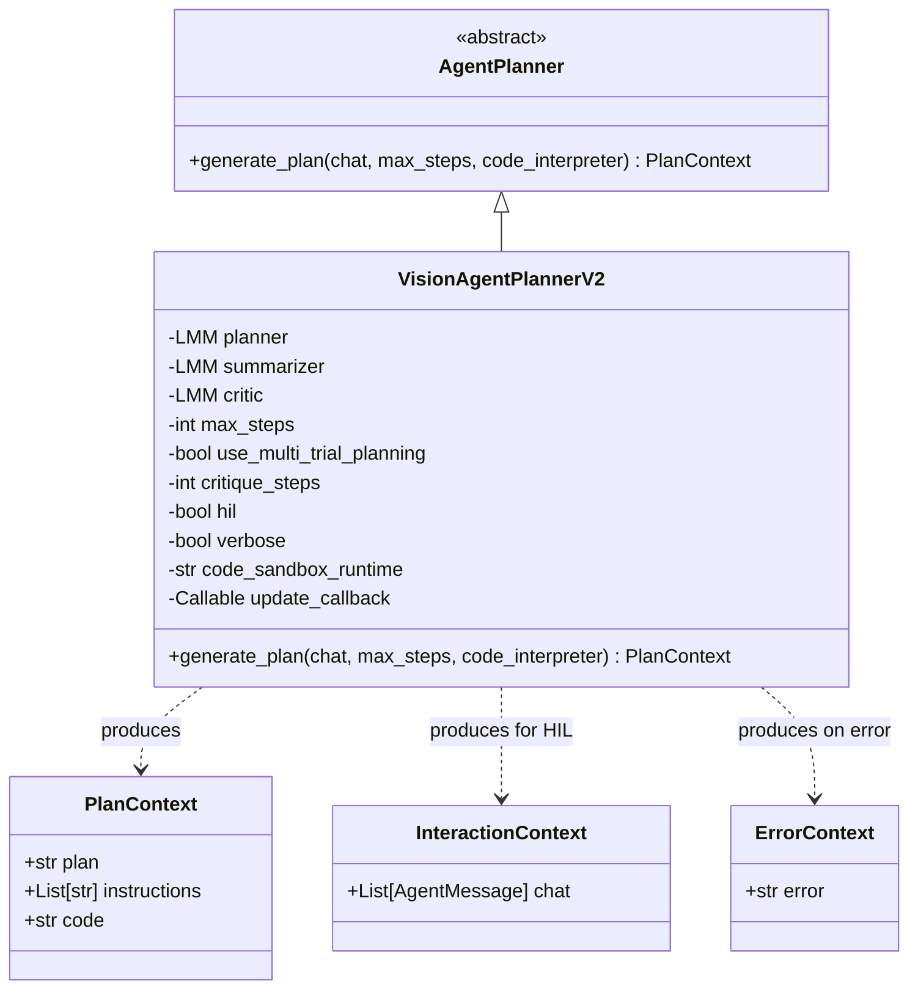
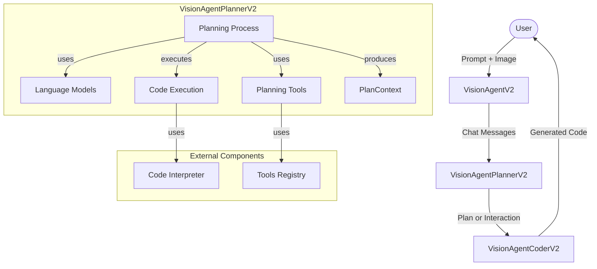
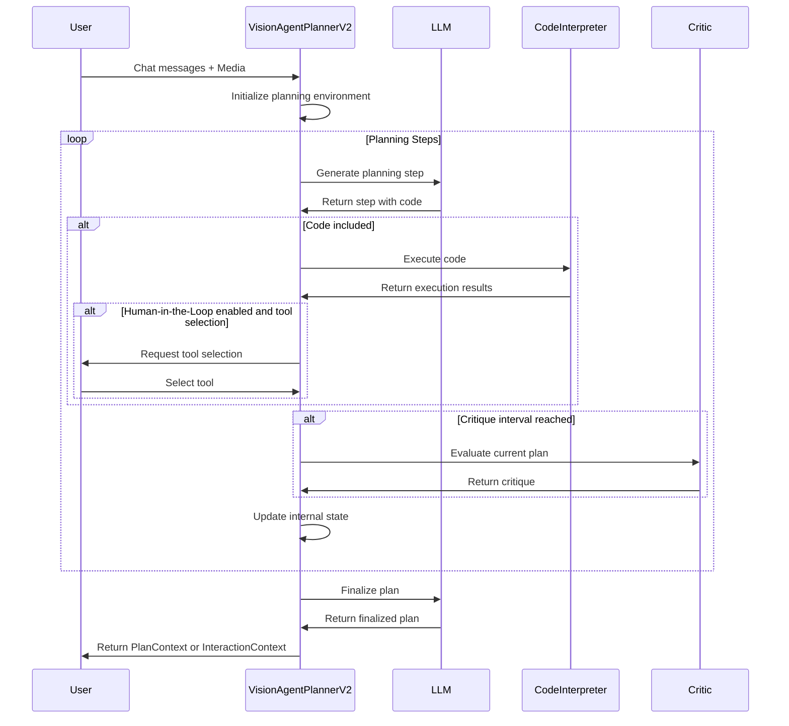
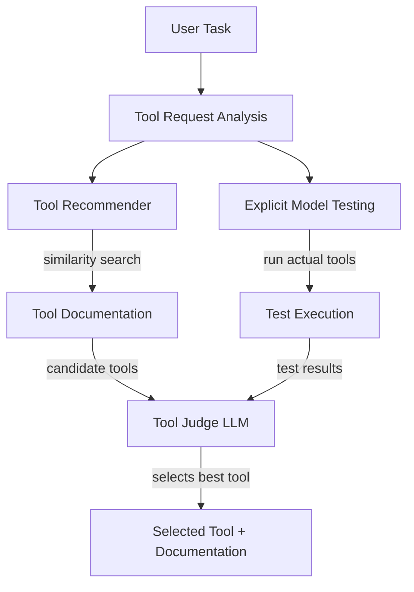

<!-- source: DeepWiki mcp.deepwiki.com · repo landing-ai/vision-agent · page 2.3 VisionAgentPlannerV2 · fetched 2026-10-26 -->

# VisionAgentPlannerV2

<details>
<summary>Relevant source files</summary>

The following files were used as context for generating this wiki page:

- [vision_agent/agent/vision_agent_coder_prompts_v2.py](vision_agent/agent/vision_agent_coder_prompts_v2.py)
- [vision_agent/agent/vision_agent_planner_prompts_v2.py](vision_agent/agent/vision_agent_planner_prompts_v2.py)
- [vision_agent/agent/vision_agent_planner_v2.py](vision_agent/agent/vision_agent_planner_v2.py)
- [vision_agent/tools/planner_tools.py](vision_agent/tools/planner_tools.py)

</details>


## Purpose and Scope

The `VisionAgentPlannerV2` is a crucial component of the Vision Agent system that generates plans to solve vision-related tasks. It serves as the strategic brain that breaks down complex vision problems into actionable steps, explores potential solutions through code execution, and produces a comprehensive plan that can be executed by the VisionAgentCoderV2 component.

This document covers the architecture, functionality, and implementation details of the planning system. For information about the code generation system that uses these plans, see [VisionAgentCoderV2](#2.2).

Sources: [vision_agent/agent/vision_agent_planner_v2.py:416-418]()

## System Architecture

`VisionAgentPlannerV2` implements the `AgentPlanner` abstract interface and operates as a distinct phase in the overall Vision Agent workflow, sitting between the initial user input and the code generation phase.



Sources: [vision_agent/agent/vision_agent_planner_v2.py:416-469]()

### Component Integration

The planner integrates with multiple components in the system:



Sources: [vision_agent/agent/vision_agent_planner_v2.py:497-606]()

## Planning Process

The planning process in `VisionAgentPlannerV2` is a sophisticated multi-step workflow that combines language model generation, code execution, and iterative refinement.

### Initialization

The planner is initialized with several LLMs and configuration parameters:

```python
def __init__(
    self,
    planner: Optional[LMM] = None,
    summarizer: Optional[LMM] = None,
    critic: Optional[LMM] = None,
    max_steps: int = 10,
    use_multi_trial_planning: bool = False,
    critique_steps: int = 11,
    hil: bool = False,
    verbose: bool = False,
    code_sandbox_runtime: Optional[str] = None,
    update_callback: Callable[[Dict[str, Any]], None] = lambda _: None,
) -> None:
```

- `planner`: The main LLM for generating planning steps
- `summarizer`: LLM for creating the final plan summary
- `critic`: LLM for evaluating and critiquing the plan
- `max_steps`: Maximum number of planning iterations
- `use_multi_trial_planning`: Whether to generate multiple plans and select the best one
- `critique_steps`: Interval for plan critiques
- `hil`: Human-in-the-loop mode for interactive planning
- `verbose`: Whether to output detailed logs
- `code_sandbox_runtime`: Configuration for code execution environment
- `update_callback`: Callback function for progress updates

Sources: [vision_agent/agent/vision_agent_planner_v2.py:419-469]()

### Planning Workflow

The core planning workflow is implemented in the `generate_plan` method:



Sources: [vision_agent/agent/vision_agent_planner_v2.py:497-606]()

## Key Components

### Planning-Specific Tools

The planner has access to specialized tools designed specifically for the planning phase:

| Tool | Purpose |
|------|---------|
| `get_tool_for_task` | Identifies appropriate vision tools for specific subtasks |
| `vqa` | Visual Question Answering for understanding image content |
| `suggestion` | Provides suggested approaches for solving a problem |

These tools are registered in `PLANNER_TOOLS` and are available only during the planning phase, not in the final generated code.

Sources: [vision_agent/tools/planner_tools.py:322-543]()

### Multi-Trial Planning

When enabled, the planner can generate multiple solutions in parallel and select the best one:

```python
def run_multi_trial_planning(
    chat: List[AgentMessage],
    media_list: List[Union[str, Path]],
    model: LMM,
) -> str:
    # ... code for generating multiple plans ...
    with ThreadPoolExecutor() as executor:
        futures = [
            executor.submit(lambda: model.chat([message], temperature=1.0))
            for _ in range(3)
        ]
        for future in as_completed(futures):
            responses.append(future.result())
    
    # ... code for selecting the best plan ...
    return cast(str, responses[best])
```

This approach generates three different plans with higher temperature (more creativity) and uses another LLM call to select the best one.

Sources: [vision_agent/agent/vision_agent_planner_v2.py:124-163]()

### Plan Critique and Refinement

At specified intervals, the planner can critique its own plan using a separate LLM:

```python
if critque_steps % self.critique_steps == 0:
    critique = run_critic(int_chat, media_list, self.critic)
    if critique is not None and int_chat[-1].role == "observation":
        # ... add critique to chat ...
        # if plan was critiqued, ensure we don't finish so we can
        # respond to the critique
        finished = False
```

This self-critique mechanism allows the planner to identify and fix potential issues before finalizing the plan.

Sources: [vision_agent/agent/vision_agent_planner_v2.py:576-586]()

### Tool Selection

One of the most important aspects of the planner is its ability to find appropriate tools for specific vision tasks:



The `get_tool_for_task` function orchestrates this process, running multiple tool trials and using an LLM to judge which tool performs best for the specific task.

Sources: [vision_agent/tools/planner_tools.py:322-409]()

## Human-in-the-Loop Mode

The planner supports a human-in-the-loop (HIL) mode, which allows user intervention during the planning process:

```python
if check_function_call(code, "get_tool_for_task") and hil:
    return return_chat + [create_hil_response(execution)]
```

In HIL mode, when the planner attempts to select a tool using `get_tool_for_task`, it pauses and requests input from the user. This enables users to guide the planning process by selecting specific tools or adjusting parameters.

Sources: [vision_agent/agent/vision_agent_planner_v2.py:315-316](), [vision_agent/tools/planner_tools.py:412-465]()

## Plan Finalization

The final step in the planning process is to create a structured plan that can be passed to the code generation phase:

```python
def create_finalize_plan(
    model: LMM,
    chat: List[AgentMessage],
    verbose: bool = False,
) -> Tuple[List[AgentMessage], Union[PlanContext, ErrorContext]]:
    # ... code to generate the final plan ...
    
    # parse the plan into a structured format
    plan = {
        "plan": plan_str,
        "instructions": [],
        "code": code_snippets if code_snippets is not None else ""
    }
    
    return return_chat, PlanContext(**plan)
```

The finalized plan includes:
- A natural language description of the solution
- Step-by-step instructions
- Code snippets that can be used in the final solution

Sources: [vision_agent/agent/vision_agent_planner_v2.py:329-370]()

## Safety Mechanisms

The planner implements several safety features to prevent potential issues:

### Code Safety

```python
def code_safeguards(code: str) -> str:
    code = remove_installs_from_code(code)
    if "get_tool_for_task" in code:
        # ... limit code that includes get_tool_for_task ...
    return code
```

This function prevents potentially harmful operations like package installations and truncates code at certain points to avoid issues.

Sources: [vision_agent/agent/vision_agent_planner_v2.py:190-200]()

### Response Safety

```python
def response_safeguards(response: str) -> str:
    if "<execute_python>" in response:
        response = response[
            : response.index("</execute_python>") + len("</execute_python>")
        ]
    return response
```

This ensures that responses are properly formatted and don't include extraneous or potentially harmful content.

Sources: [vision_agent/agent/vision_agent_planner_v2.py:202-208]()

## Conclusion

The `VisionAgentPlannerV2` represents a sophisticated planning system that combines language model reasoning with code execution to develop comprehensive plans for solving vision tasks. Its multi-step approach, ability to critique and refine its own plans, and specialized planning tools make it effective at breaking down complex problems into manageable steps.

By separating the planning phase from code generation, the system can explore the problem space efficiently and produce well-structured plans that can be implemented reliably by the code generation components.

---

