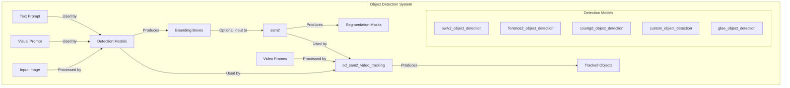
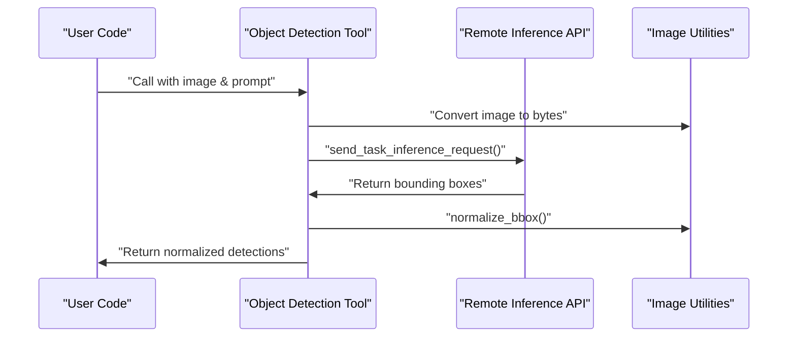
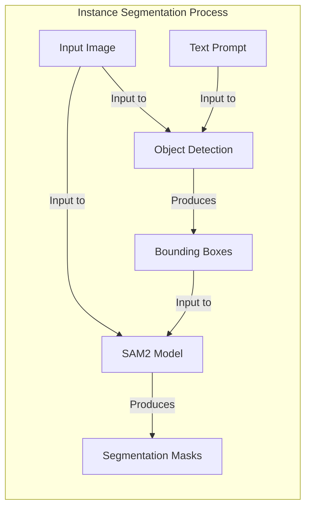
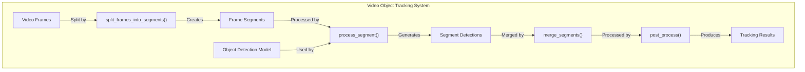

<!-- source: DeepWiki mcp.deepwiki.com · repo landing-ai/vision-agent · page 3.2 Object Detection Tools · fetched 2026-10-26 -->

# Object Detection Tools

<details>
<summary>Relevant source files</summary>

The following files were used as context for generating this wiki page:

- [tests/integ/test_tools.py](tests/integ/test_tools.py)
- [vision_agent/tools/tools.py](vision_agent/tools/tools.py)
- [vision_agent/utils/exceptions.py](vision_agent/utils/exceptions.py)
- [vision_agent/utils/video_tracking.py](vision_agent/utils/video_tracking.py)

</details>


## Purpose and Scope

This document details the object detection tools provided in the Vision Agent system. These tools enable detection, segmentation, and tracking of objects in images and videos using various AI models. For information about video-specific processing, see [Video Processing Tools](#3.3). For document analysis and OCR, see [Document Analysis Tools](#3.4).

The object detection tools provide capabilities for:
- Detecting objects from text prompts
- Segmenting detected objects with precise masks
- Tracking objects across video frames
- Counting multiple instances of objects
- Using custom fine-tuned detection models

## Object Detection System Overview



Sources: [vision_agent/tools/tools.py:72-1295](). [vision_agent/utils/video_tracking.py:1-20]().

## Available Object Detection Models

The Vision Agent system provides several object detection models, each with different strengths and use cases:

| Model | Function | Strengths | Typical Use Cases |
|-------|----------|-----------|-------------------|
| OwlV2 | `owlv2_object_detection` | Text-to-object grounding | General object detection, fine-grained categories |
| Florence2 | `florence2_object_detection` | Zero-shot detection with captions | General object detection, caption-based detection |
| CountGD | `countgd_object_detection` | Counting many instances of objects | Precise counting, inventory applications |
| Custom | `custom_object_detection` | Domain-specific fine-tuned models | Specialized applications with custom training |
| GLEE | `glee_object_detection` | Not detailed in code | General detection (mentioned in enum) |

Models can be selected based on the specific requirements of the task at hand.

Sources: [vision_agent/tools/tools.py:372-672](). [vision_agent/tools/tools.py:600-745](). [vision_agent/tools/tools.py:906-1296]().

## Basic Object Detection Workflow



Sources: [vision_agent/tools/tools.py:425-469](). [vision_agent/tools/tools.py:603-669]().

## Common Object Detection Tools

### OwlV2 Object Detection

The OwlV2 model specializes in detecting objects from text prompts and is particularly effective at fine-grained categories and visual grounding.

```python
# Example usage
detections = owlv2_object_detection(
    prompt="car, person",  # Comma-separated categories
    image=image_array,
    box_threshold=0.10  # Confidence threshold
)
```

Function signature:
```python
def owlv2_object_detection(
    prompt: str,
    image: np.ndarray,
    box_threshold: float = 0.10,
) -> List[Dict[str, Any]]
```

Returns a list of dictionaries with:
- `label`: The detected object class
- `bbox`: Normalized coordinates [xmin, ymin, xmax, ymax]
- `score`: Confidence score (0-1)

Sources: [vision_agent/tools/tools.py:375-472](). [tests/integ/test_tools.py:40-68]().

### Florence2 Object Detection

Florence2 offers object detection capabilities that work well with both categorical prompts and caption-based prompts.

```python
# Example usage
detections = florence2_object_detection(
    prompt="person looking at a coyote",  # Can be caption or categories
    image=image_array
)
```

Function signature:
```python
def florence2_object_detection(
    prompt: str,
    image: np.ndarray,
) -> List[Dict[str, Any]]
```

Returns the same format as OwlV2 but always assigns a score of 1.0 to detections.

Sources: [vision_agent/tools/tools.py:600-669](). [tests/integ/test_tools.py:130-147]().

### CountGD Object Detection

CountGD specializes in precise counting of many instances of the same object type, making it ideal for inventory or density analysis.

```python
# Example usage
detections = countgd_object_detection(
    prompt="flower",  # Object to count
    image=image_array,
    box_threshold=0.23  # Default threshold
)
```

Function signature:
```python
def countgd_object_detection(
    prompt: str,
    image: np.ndarray,
    box_threshold: float = 0.23,
) -> List[Dict[str, Any]]
```

CountGD also supports visual prompts through `countgd_visual_object_detection`, where you provide example bounding boxes instead of text.

Sources: [vision_agent/tools/tools.py:910-1012](). [vision_agent/tools/tools.py:1140-1239](). [tests/integ/test_tools.py:346-384]().

### Custom Object Detection

For domain-specific applications, you can use previously fine-tuned detection models:

```python
# Example usage
detections = custom_object_detection(
    deployment_id="your-model-id",  # ID of your fine-tuned model
    image=image_array,
    box_threshold=0.1
)
```

Function signature:
```python
def custom_object_detection(
    deployment_id: str,
    image: np.ndarray,
    box_threshold: float = 0.1,
) -> List[Dict[str, Any]]
```

Sources: [vision_agent/tools/tools.py:1299-1312](). [tests/integ/test_tools.py:498-505](). [vision_agent/utils/exceptions.py:54-57]().

## Instance Segmentation Tools

### SAM2 Segmentation

SAM2 (Segment Anything Model 2) provides precise instance segmentation masks from bounding boxes:



The system provides several combined detection-segmentation tools:

| Tool | Description | Use Case |
|------|-------------|----------|
| `owlv2_sam2_instance_segmentation` | Combines OwlV2 detection with SAM2 segmentation | When precise masks are needed |
| `florence2_sam2_instance_segmentation` | Combines Florence2 detection with SAM2 | Caption-based segmentation |
| `countgd_sam2_instance_segmentation` | Combines CountGD with SAM2 | Counting with precise instance masks |
| `countgd_sam2_visual_instance_segmentation` | Uses visual prompts with SAM2 | When examples are available |

All these tools return bounding boxes with the addition of a `mask` field containing a binary numpy array.

Sources: [vision_agent/tools/tools.py:126-231](). [vision_agent/tools/tools.py:475-532](). [vision_agent/tools/tools.py:672-745](). [vision_agent/tools/tools.py:1015-1072](). [vision_agent/tools/tools.py:1242-1296]().

## Video Tracking

The system includes tools for tracking and segmenting objects across video frames:



The main video tracking tools are:

| Tool | Description |
|------|-------------|
| `owlv2_sam2_video_tracking` | Tracks objects using OwlV2 and segments with SAM2 |
| `florence2_sam2_video_tracking` | Tracks objects using Florence2 and segments with SAM2 |
| `countgd_sam2_video_tracking` | Tracks objects using CountGD and segments with SAM2 |
| `od_sam2_video_tracking` | Generic function that can use any model from the `ODModels` enum |

Each returns a list of frames, where each frame contains a list of detected objects with labels, bounding boxes, masks, and scores. The video tracking tools assign consistent IDs to objects across frames, making them useful for counting unique objects.

Sources: [vision_agent/tools/tools.py:234-369](). [vision_agent/tools/tools.py:535-597](). [vision_agent/tools/tools.py:748-851](). [vision_agent/tools/tools.py:1074-1137](). [vision_agent/utils/video_tracking.py:22-347]().

## Implementation Details

### ODModels Enum

The system uses an enum to represent available detection models:

```python
class ODModels(str, Enum):
    COUNTGD = "countgd"
    FLORENCE2 = "florence2"
    OWLV2 = "owlv2"
    AGENTIC = "agentic"
    GLEE = "glee"
    CUSTOM = "custom"
```

This enum is used by the generic `od_sam2_video_tracking` function to select the appropriate detection model.

Sources: [vision_agent/utils/video_tracking.py:13-19]().

### Output Format

All object detection tools follow a consistent output format:

```json
[
    {
        "label": "person",
        "bbox": [0.1, 0.11, 0.35, 0.4],
        "score": 0.98
    },
    {
        "label": "car",
        "bbox": [0.2, 0.21, 0.45, 0.5],
        "score": 0.87
    }
]
```

Segmentation tools add a `mask` field containing a binary 2D numpy array.

Video tracking tools return a list of such lists, with one list per frame, and labels prefixed with consistent IDs (e.g., "0: person").

Sources: [vision_agent/tools/tools.py:425-472](). [vision_agent/tools/tools.py:180-231](). [vision_agent/utils/video_tracking.py:282-347]().

## Error Handling

The object detection tools include several validation checks:

1. Empty or invalid images return empty results rather than errors
2. Remote API failures raise `RemoteToolCallFailed` exceptions
3. For custom models, `FineTuneModelNotFound` exceptions may occur if the model ID is invalid

Sources: [vision_agent/tools/tools.py:998-1001](). [vision_agent/tools/tools.py:633-635](). [vision_agent/utils/exceptions.py:16-57]().

## Usage Considerations

When selecting an object detection tool, consider:

1. **Task requirements**: For precise counting, use CountGD; for general detection, use OwlV2 or Florence2
2. **Performance**: Florence2 always returns a score of 1.0, making it unsuitable for threshold filtering
3. **Prompt format**: 
   - OwlV2 and CountGD work best with comma-separated category names
   - Florence2 can handle more natural language description prompts
4. **Video tracking**: Use when unique counting across frames is needed, with the `chunk_length` parameter controlling how often new objects are detected

The object detection tools form the foundation for many of the vision agent's capabilities, providing building blocks that can be combined for complex visual analysis tasks.

---

