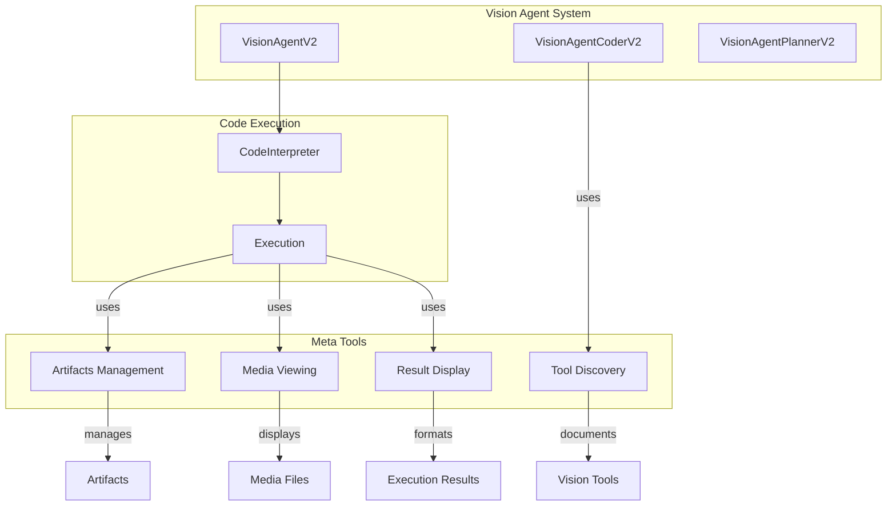
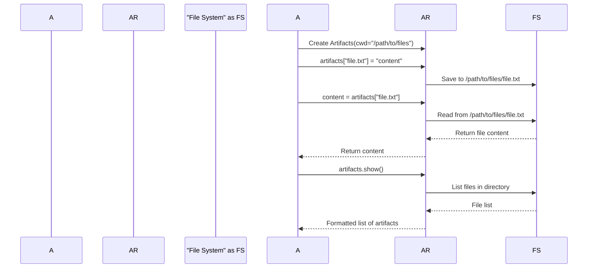
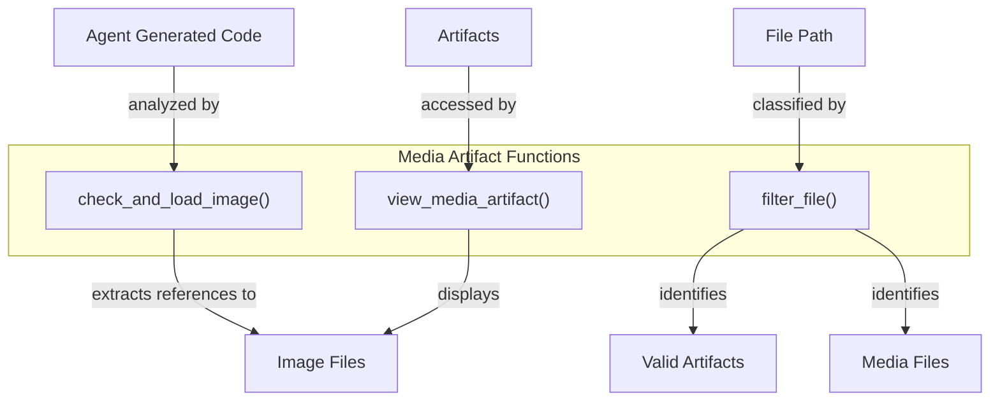
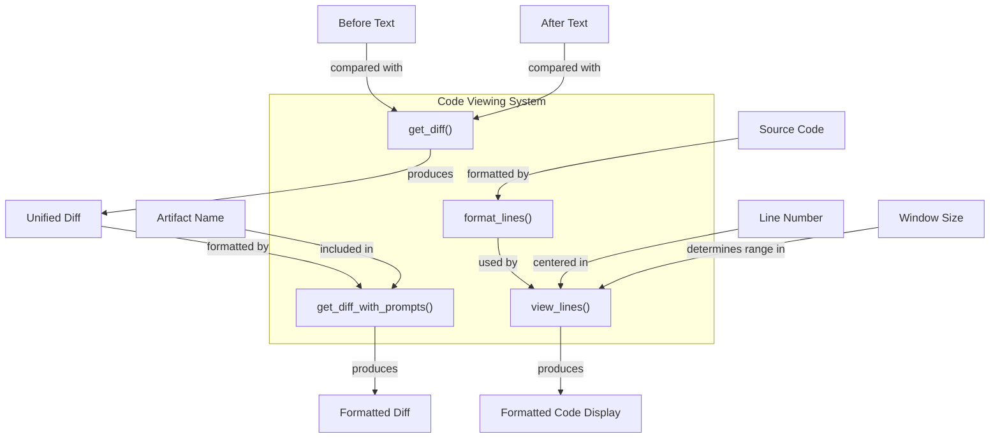
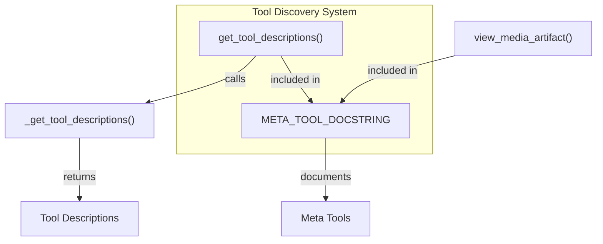
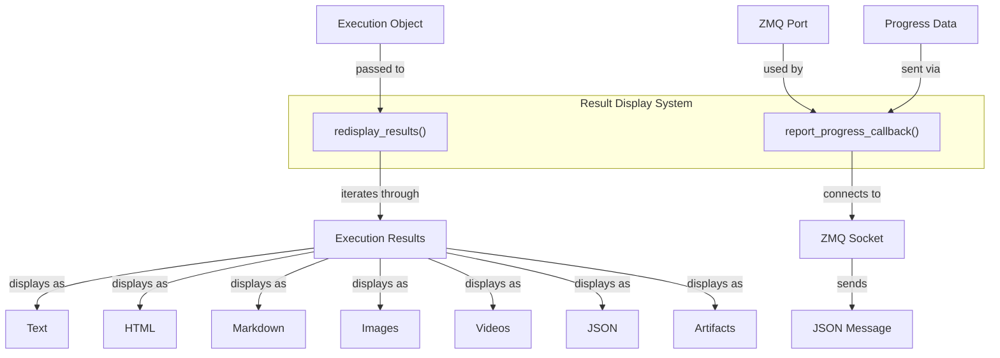
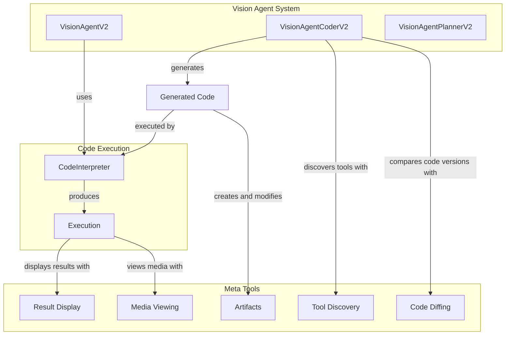

<!-- source: DeepWiki mcp.deepwiki.com · repo landing-ai/vision-agent · page 3.5 Meta Tools · fetched 2026-10-26 -->

# Meta Tools

<details>
<summary>Relevant source files</summary>

The following files were used as context for generating this wiki page:

- [tests/unit/test_meta_tools.py](tests/unit/test_meta_tools.py)
- [tests/unit/test_vac.py](tests/unit/test_vac.py)
- [vision_agent/tools/meta_tools.py](vision_agent/tools/meta_tools.py)

</details>


Meta Tools provide supporting functionality for the Vision Agent system, focusing on artifact management, media viewing, and tool discovery. Unlike standard vision tools that perform direct image processing, Meta Tools facilitate operations across the agent's workflow, such as managing files, displaying media, and accessing tool documentation.

## Overview

Meta Tools serve as a bridge between the agent's execution environment and its operational context. They enable the agent to:

1. Manage files and artifacts created during execution
2. View and inspect media artifacts
3. Discover available vision tools
4. Display execution results
5. Track progress of operations



Sources: [vision_agent/tools/meta_tools.py:1-201]()

## Artifact Management System

The Artifacts class provides a mechanism to synchronize files between the local environment where code is written and the remote environment where the Vision Agent executes code. This is particularly important when the agent adds or modifies images, files, or other artifacts.

### Artifacts Class

The `Artifacts` class implements a dictionary-like interface for managing files in a specific working directory:

```mermaid
classDiagram
    class "Artifacts" {
        +Path cwd
        +__init__(cwd: Union[str, Path])
        +show(): str
        +__iter__(): Any
        +__getitem__(name: str): Any
        +__setitem__(name: str, value: Any): None
        +__contains__(name: str): bool
    }
```

Key methods:
- `show()`: Lists all artifacts in the working directory
- `__getitem__()`: Retrieves file content by name
- `__setitem__()`: Writes content to a file
- `__contains__()`: Checks if an artifact exists

Sources: [vision_agent/tools/meta_tools.py:59-100]()

### File Operations Workflow



Sources: [vision_agent/tools/meta_tools.py:59-100](), [tests/unit/test_meta_tools.py:1-22]()

## Media Artifact Handling

Meta Tools include functions for viewing and handling media artifacts, which are essential for vision-based tasks.

### Media Functions

- `view_media_artifact(artifacts, name)`: Allows the agent to view a media artifact with the given name
- `check_and_load_image(code)`: Extracts image references from code by looking for calls to `view_media_artifact`
- `filter_file(file_name)`: Determines if a file is a valid artifact and whether it's a media file



Sources: [vision_agent/tools/meta_tools.py:103-172](), [tests/unit/test_meta_tools.py:9-22]()

## Code and Text Utilities

Meta Tools provide utilities for working with code and text, which help in debugging and visualization.

### Line Viewing and Diffing

- `format_lines(lines, start_idx)`: Formats a list of lines with line numbers
- `view_lines(lines, line_num, window_size, name, total_lines)`: Displays lines around a specified line number
- `get_diff(before, after)`: Generates a unified diff between two strings
- `get_diff_with_prompts(name, before, after)`: Formats a diff with prompts for display



Sources: [vision_agent/tools/meta_tools.py:117-192]()

## Tool Discovery

Meta Tools include functionality to discover and document available vision tools.

### Tool Description

- `get_tool_descriptions()`: Returns a description of all the tools that the Vision Agent has access to
- `META_TOOL_DOCSTRING`: Documentation string for Meta Tools

This functionality is crucial for the agent to understand what vision capabilities are available and how to use them.



Sources: [vision_agent/tools/meta_tools.py:175-200]()

## Result Display

Meta Tools facilitate the display of execution results, especially in notebook environments.

### Result Display System

- `redisplay_results(execution)`: Adds previous execution results to the current output
- `report_progress_callback(port, inp)`: Reports progress via ZMQ



Sources: [vision_agent/tools/meta_tools.py:19-56]()

## Integration with Vision Agent System

Meta Tools integrate with the Vision Agent system to provide essential supporting functionality for the agent's operations.



Sources: [vision_agent/tools/meta_tools.py:1-201]()

## Usage Patterns

Common usage patterns for Meta Tools in the Vision Agent system:

1. **Artifact Creation and Management**:
   ```python
   # Create an artifacts object for a specific working directory
   artifacts = Artifacts("/path/to/chat_files")
   
   # Save content to a file
   artifacts["result.txt"] = "Analysis results"
   
   # List all available artifacts
   artifacts.show()
   ```

2. **Media Viewing**:
   ```python
   # View a media artifact
   view_media_artifact(artifacts, "image.jpg")
   
   # Check for image references in code
   image_references = check_and_load_image(generated_code)
   ```

3. **Tool Discovery**:
   ```python
   # Get descriptions of available vision tools
   tool_descriptions = get_tool_descriptions()
   ```

4. **Result Display**:
   ```python
   # Display execution results
   redisplay_results(execution)
   ```

Sources: [vision_agent/tools/meta_tools.py:1-201]()

## Relationship to Other Systems

Meta Tools provide supporting functionality to several other systems in the Vision Agent architecture:

| System | Relationship to Meta Tools |
|--------|----------------------------|
| Vision Agent Core | Uses Meta Tools for artifact management and tool discovery |
| Code Execution | Uses Meta Tools to display execution results and manage files |
| Vision Tools | Documented and discovered through Meta Tools |
| Agent Coder | Uses Meta Tools for code comparison and debugging |

Meta Tools serve as a bridge between the core vision processing capabilities and the agent's operational environment, facilitating file management, result display, and tool discovery.

Sources: [vision_agent/tools/meta_tools.py:1-201]()

---

