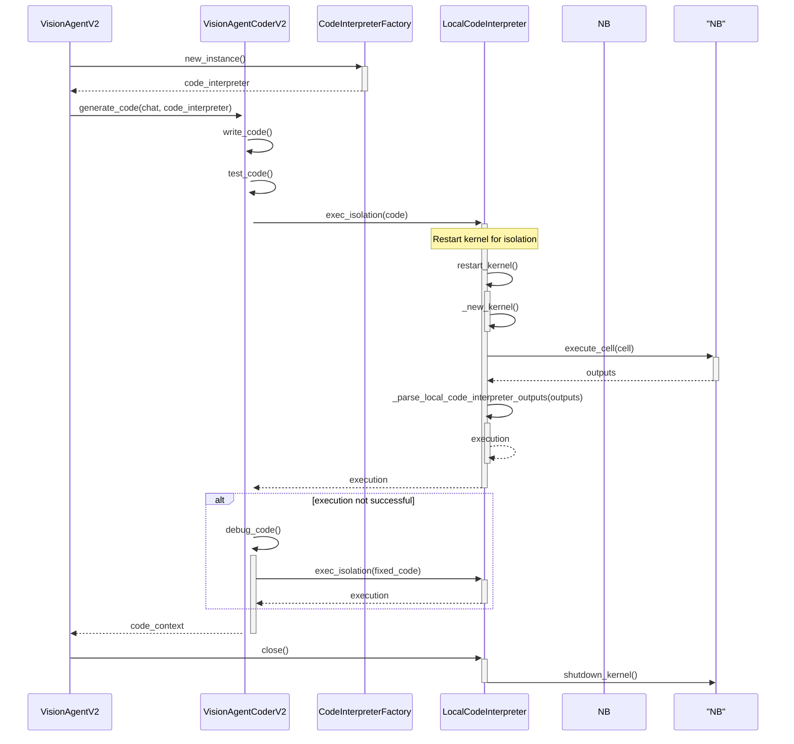
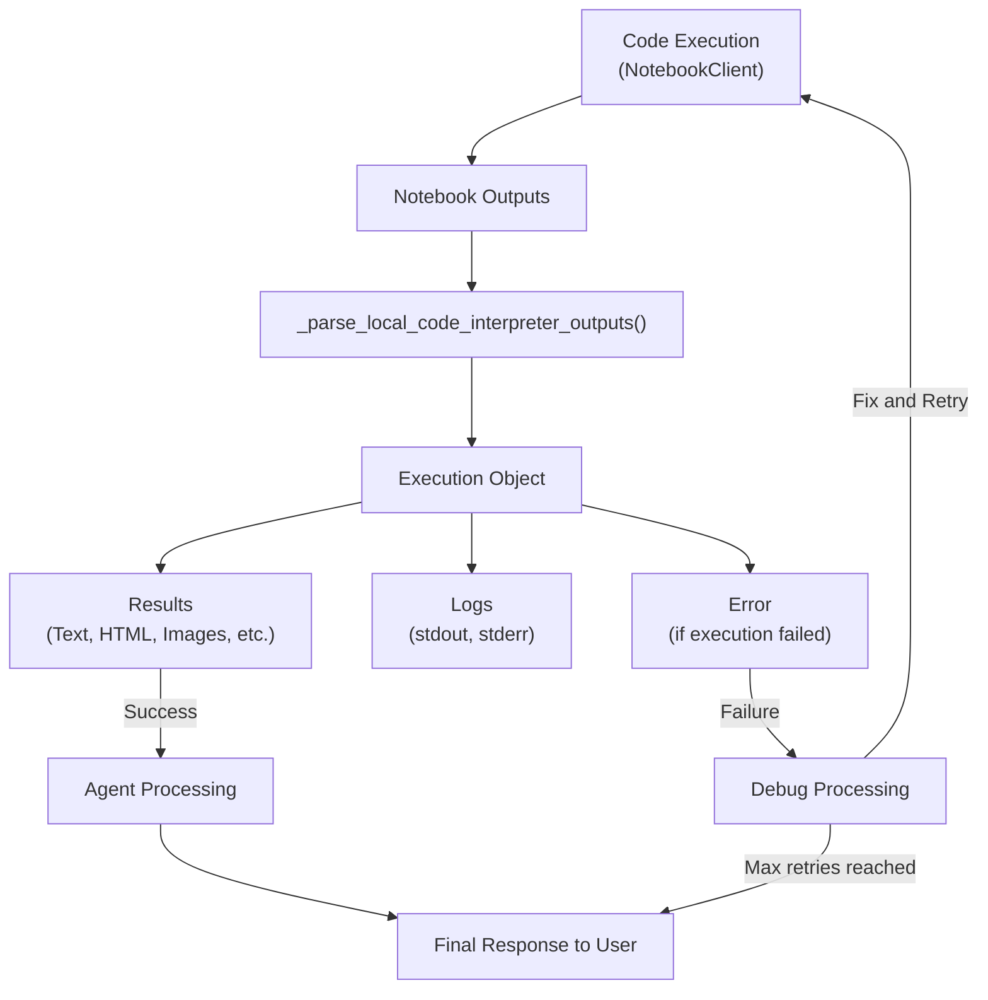
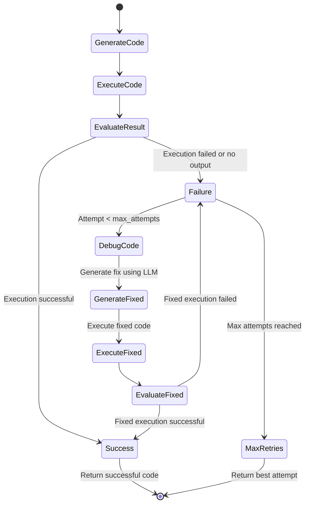
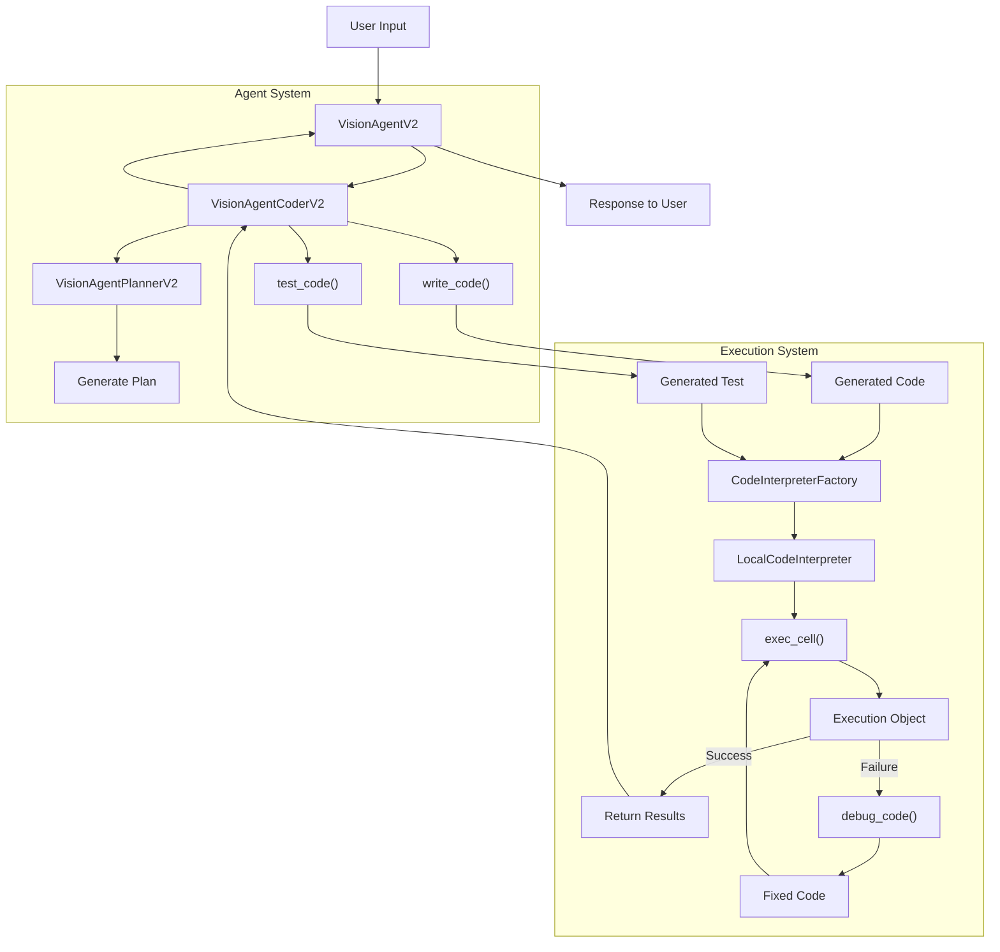

<!-- source: DeepWiki mcp.deepwiki.com · repo landing-ai/vision-agent · page 4.2 Execution Workflow · fetched 2026-10-26 -->

# Execution Workflow

<details>
<summary>Relevant source files</summary>

The following files were used as context for generating this wiki page:

- [poetry.lock](poetry.lock)
- [pyproject.toml](pyproject.toml)
- [vision_agent/agent/vision_agent_coder_v2.py](vision_agent/agent/vision_agent_coder_v2.py)
- [vision_agent/agent/vision_agent_prompts_v2.py](vision_agent/agent/vision_agent_prompts_v2.py)
- [vision_agent/agent/vision_agent_v2.py](vision_agent/agent/vision_agent_v2.py)
- [vision_agent/utils/execute.py](vision_agent/utils/execute.py)

</details>


This document explains how code is executed, tested, and debugged within the Vision Agent system. The execution workflow is a critical component that enables the Vision Agent to run generated code safely, capture outputs, handle errors, and debug issues.

For information about the Code Interpreter interface itself, see [Code Interpreter](#4.1).

## Execution System Architecture

The execution system in Vision Agent is responsible for running generated code in a controlled environment, capturing all outputs, errors, and results.

```mermaid
classDiagram
    class "CodeInterpreter" {
        <<abstract>>
        +exec_cell(code: str): Execution
        +exec_isolation(code: str): Execution
        +restart_kernel(): None
        +close(): None
    }
    
    class "LocalCodeInterpreter" {
        -nb: NotebookNode
        -nb_client: NotebookClient
        -resources: Dict
        -remote_path: Path
        +exec_cell(code: str): Execution
        +restart_kernel(): None
        +close(): None
    }
    
    class "CodeInterpreterFactory" {
        <<static>>
        +new_instance(): CodeInterpreter
        +get_default_instance(): CodeInterpreter
    }
    
    class "Execution" {
        +results: List[Result]
        +logs: Logs
        +error: Optional[Error]
        +text(): str
        +success: bool
        +get_main_result(): Result
    }
    
    class "Result" {
        +text: str
        +html: str
        +markdown: str
        +png: str
        +formats(): List[str]
    }
    
    class "Logs" {
        +stdout: List[str]
        +stderr: List[str]
        +to_json(): dict
    }
    
    class "Error" {
        +name: str
        +value: str
        +traceback_raw: List[str]
        +traceback(): str
    }
    
    "CodeInterpreter" <|-- "LocalCodeInterpreter"
    "CodeInterpreterFactory" --> "CodeInterpreter"
    "CodeInterpreter" --> "Execution"
    "Execution" o-- "Result"
    "Execution" o-- "Logs"
    "Execution" o-- "Error"
```

Sources:
- [vision_agent/utils/execute.py:345-389]() - CodeInterpreter abstract base class
- [vision_agent/utils/execute.py:391-511]() - LocalCodeInterpreter implementation
- [vision_agent/utils/execute.py:514-553]() - CodeInterpreterFactory
- [vision_agent/utils/execute.py:258-342]() - Execution class
- [vision_agent/utils/execute.py:70-203]() - Result class
- [vision_agent/utils/execute.py:205-223]() - Logs class
- [vision_agent/utils/execute.py:226-255]() - Error class

## Execution Workflow

The execution workflow follows a systematic process from code generation to execution and result handling:



Sources:
- [vision_agent/utils/execute.py:454-492]() - exec_cell method
- [vision_agent/utils/execute.py:376-378]() - exec_isolation method
- [vision_agent/agent/vision_agent_v2.py:254-258]() - Creating code interpreters
- [vision_agent/agent/vision_agent_coder_v2.py:223-227]() - Code execution in test_code

## Code Execution Process

The core of the execution workflow is implemented in the `LocalCodeInterpreter` class, which handles the execution of code in a Jupyter notebook environment:

1. The agent creates a code interpreter using `CodeInterpreterFactory.new_instance()`
2. Code is executed using `exec_cell()` or `exec_isolation()` methods
3. The `exec_cell()` method adds the code to a notebook and executes it using `NotebookClient`
4. Outputs from the cell execution are parsed into an `Execution` object
5. The execution result is returned to the calling agent

Key technical points about code execution:

1. **Isolation**: The `exec_isolation()` method restarts the kernel before executing code, ensuring a clean environment
2. **Tracing**: Code execution is wrapped with OpenTelemetry tracing for monitoring and debugging
3. **Timeout Handling**: Cell execution has a timeout (default 10 minutes) to prevent infinite loops
4. **Kernel Management**: The interpreter manages Jupyter kernels, including creation, restart, and shutdown

Sources:
- [vision_agent/utils/execute.py:419-423]() - _new_kernel method
- [vision_agent/utils/execute.py:445-452]() - restart_kernel method
- [vision_agent/utils/execute.py:454-492]() - exec_cell method
- [vision_agent/utils/execute.py:556-582]() - _parse_local_code_interpreter_outputs function

## Result Processing

Execution results are processed and represented through a hierarchy of classes:



The result processing system uses several specialized classes:

1. **Execution**: The top-level class representing the overall execution result
   - Contains `results`, `logs`, and optional `error`
   - Provides methods to access the main result and check for success/failure
   
2. **Result**: Represents individual outputs from the code execution
   - Supports multiple output formats (text, HTML, images, etc.)
   - Implements methods to access different representations of the data
   
3. **Logs**: Captures stdout and stderr outputs from the execution
   - Stores outputs in separate lists for stdout and stderr
   - Provides methods to access and format the logs
   
4. **Error**: Represents errors that occur during execution
   - Stores the error name, value, and traceback
   - Provides methods to access the formatted traceback

The system supports many output formats including text, HTML, Markdown, images (PNG, JPEG, SVG), videos, and JSON, enabling rich visual outputs essential for vision tasks.

Sources:
- [vision_agent/utils/execute.py:33-47]() - MimeType enum defining supported formats
- [vision_agent/utils/execute.py:70-203]() - Result class supporting multiple formats
- [vision_agent/utils/execute.py:258-342]() - Execution class combining results, logs, and errors

## Error Handling and Debugging Workflow

The execution system includes robust error handling and debugging capabilities to fix failing code:



The debugging process works as follows:

1. When code execution fails, the `test_code()` function initiates debugging
2. The `debug_code()` function is called with the failing code and error information
3. The debugging LLM analyzes the error and generates fixed code
4. The fixed code is executed to verify if the fix resolves the issue
5. This process repeats up to a maximum of 3 attempts if necessary
6. The best available code is returned, even if all debugging attempts fail

Key aspects of the debugging process:

1. **Error Analysis**: The LLM debugger receives the original code, test code, error message, and execution logs
2. **Structured Fix Generation**: The debugger generates both fixed code and explanatory thoughts
3. **Code Diffing**: Changes between original and fixed code are tracked using `get_diff()` function
4. **Progressive Debugging**: Each debugging attempt builds on previous attempts

Sources:
- [vision_agent/agent/vision_agent_coder_v2.py:116-192]() - debug_code function
- [vision_agent/agent/vision_agent_coder_v2.py:232-251]() - Debugging loop in test_code
- [vision_agent/utils/execute.py:332-342]() - Creating Execution from exceptions

## Integration with Agent System

The execution system is integrated with the broader Vision Agent system:



The integration points between the agent and execution systems include:

1. **Code Interpreter Creation**:
   - In `VisionAgentV2.chat()`, a code interpreter is created using `CodeInterpreterFactory.new_instance()`
   - The interpreter is passed to various agent methods for code execution

2. **Code Execution in Agents**:
   - `VisionAgentCoderV2.test_code()` uses the interpreter to execute generated code
   - `VisionAgentV2.maybe_run_action()` uses the interpreter to execute user-requested actions

3. **Result Handling**:
   - Execution results are processed by the agents to determine next steps
   - Successful results are formatted and returned to the user
   - Failed results trigger debugging attempts

4. **Resource Management**:
   - Code interpreters are used within context managers (`with` statements) to ensure proper cleanup
   - The `close()` method is called to shut down kernels and release resources

Sources:
- [vision_agent/agent/vision_agent_v2.py:254-258]() - Creating code interpreters in VisionAgentV2
- [vision_agent/agent/vision_agent_coder_v2.py:402-407]() - Using code interpreters in VisionAgentCoderV2
- [vision_agent/agent/vision_agent_coder_v2.py:223-227]() - Executing code in test_code
- [vision_agent/agent/vision_agent_v2.py:100-156]() - maybe_run_action function

## Execution Callbacks and Telemetry

The execution system includes callback mechanisms and telemetry features:

1. **Update Callbacks**:
   - The `VisionAgentCoderV2` class includes an `update_callback` function
   - After code execution, results are sent back through this callback
   - This enables real-time feedback during lengthy operations

2. **OpenTelemetry Tracing**:
   - The `exec_cell()` method is instrumented with OpenTelemetry tracing
   - Spans are created for each cell execution
   - Errors are recorded in the trace for debugging purposes

3. **Logging**:
   - Execution details are logged using Python's logging system
   - Includes information about initialization, errors, and results

The callback and telemetry systems provide visibility into the execution process, making it easier to debug and optimize the system.

Sources:
- [vision_agent/agent/vision_agent_coder_v2.py:493-505]() - Update callback in VisionAgentCoderV2
- [vision_agent/utils/execute.py:456-461]() - OpenTelemetry tracing in exec_cell
- [vision_agent/utils/execute.py:408-415]() - Logging in LocalCodeInterpreter initialization

## Execution Formats and MIME Types

The execution system supports a wide range of output formats through the `MimeType` enum:

| MIME Type | Description | Example Use Case |
|-----------|-------------|------------------|
| text/plain | Plain text output | Code execution results, textual data |
| text/html | HTML content | Formatted tables, rich text |
| text/markdown | Markdown content | Formatted documentation |
| image/svg+xml | SVG images | Vector graphics, plots |
| image/png | PNG images | Image processing results |
| image/jpeg | JPEG images | Photo analysis results |
| video/mp4/base64 | Base64-encoded MP4 videos | Video processing results |
| application/pdf | PDF documents | Document analysis |
| text/latex | LaTeX equations | Mathematical expressions |
| application/json | JSON data | Structured data results |
| application/artifact | Custom artifacts | Tool-specific outputs |

This support for multiple formats enables the Vision Agent to handle rich visual outputs that are essential for computer vision tasks.

Sources:
- [vision_agent/utils/execute.py:33-47]() - MimeType enum definition
- [vision_agent/utils/execute.py:70-203]() - Result class handling multiple formats

---

