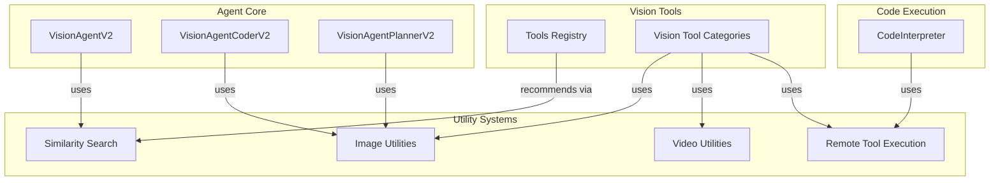
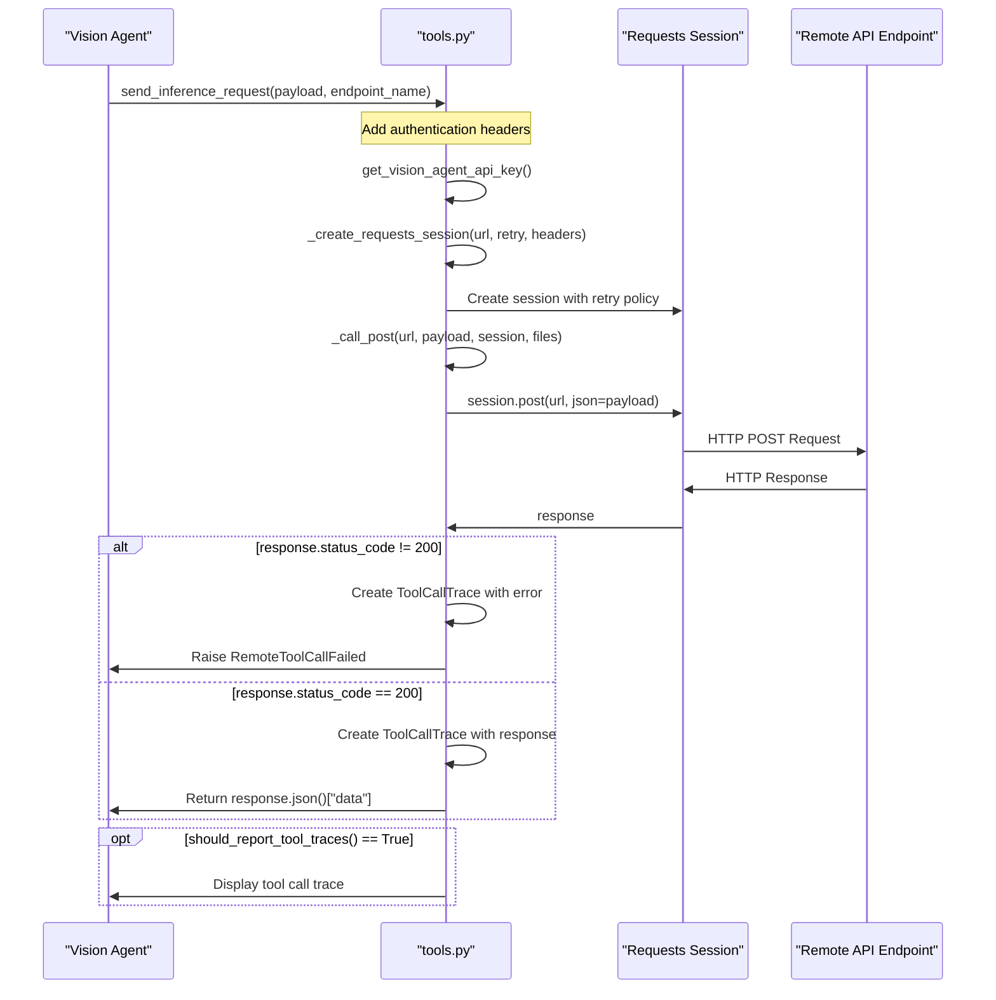
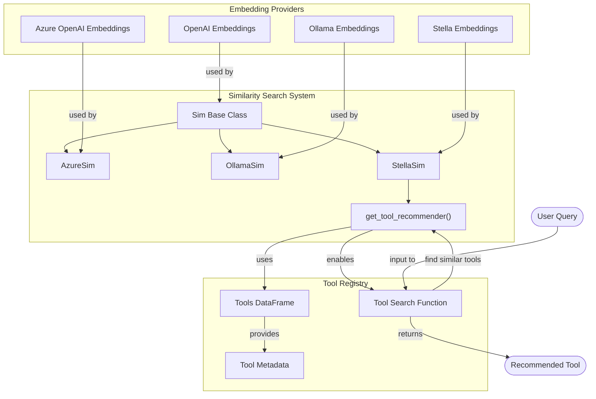

<!-- source: DeepWiki mcp.deepwiki.com · repo landing-ai/vision-agent · page 5 Utility Systems · fetched 2026-10-26 -->

# Utility Systems

<details>
<summary>Relevant source files</summary>

The following files were used as context for generating this wiki page:

- [.github/workflows/ci_cd.yml](.github/workflows/ci_cd.yml)
- [vision_agent/sim/sim.py](vision_agent/sim/sim.py)
- [vision_agent/utils/image_utils.py](vision_agent/utils/image_utils.py)
- [vision_agent/utils/tools.py](vision_agent/utils/tools.py)

</details>


The Utility Systems in Vision Agent provide foundational support functions that enable the core components to operate effectively. These utilities handle common tasks like image processing, remote tool execution, and similarity-based tool recommendation. This page documents the various utility systems, their architecture, and how they support the Vision Agent's operation.

For information about the core agent system, see [Agent System](#2). For information about vision tools, see [Vision Tools](#3).

## Overview of Utility Systems

The Vision Agent's utility systems serve as the infrastructure that supports the agent's operation across various contexts. These systems handle essential functions that are used repeatedly throughout the codebase, ensuring consistent behavior and reducing code duplication.



*Diagram: Utility Systems in the Vision Agent Architecture*

Sources: [.github/workflows/ci_cd.yml:1-126](), [vision_agent/utils/image_utils.py:1-401](), [vision_agent/utils/tools.py:1-258](), [vision_agent/sim/sim.py:1-325]()

## Image Utilities

The Image Utilities system provides a comprehensive suite of functions for working with images in various formats and representations. It handles conversions between different image formats, manipulates bounding boxes and masks, and provides visualization tools for overlaying information on images.

```mermaid
classDiagram
    class "ImageUtilities" {
        +convert_to_b64(data)
        +b64_to_pil(b64_str)
        +encode_media(media, resize)
        +get_image_size(data)
        +normalize_bbox(bbox, image_size)
        +denormalize_bbox(bbox, image_size)
        +overlay_bboxes(image, bboxes)
        +overlay_masks(image, masks, alpha)
        +overlay_heat_map(image, heat_map, alpha)
        +rle_decode(mask_rle, shape)
        +rle_decode_array(rle)
        +rle_encode_array(mask)
    }

    class "ImageFormats" {
        <<enumeration>>
        Path
        String
        Base64String
        NumpyArray
        PILImage
    }
    
    class "VisualizationUtilities" {
        +overlay_bboxes(image, bboxes)
        +overlay_masks(image, masks, alpha)
        +overlay_heat_map(image, heat_map, alpha)
    }
    
    class "BoundingBoxUtilities" {
        +normalize_bbox(bbox, image_size)
        +denormalize_bbox(bbox, image_size)
        +convert_quad_box_to_bbox(quad_box)
    }
    
    class "MaskUtilities" {
        +rle_decode(mask_rle, shape)
        +rle_decode_array(rle)
        +rle_encode_array(mask)
    }
    
    "ImageUtilities" --> "ImageFormats" : supports
    "ImageUtilities" --> "VisualizationUtilities" : includes
    "ImageUtilities" --> "BoundingBoxUtilities" : includes
    "ImageUtilities" --> "MaskUtilities" : includes
```

*Diagram: Image Utilities System Architecture*

Sources: [vision_agent/utils/image_utils.py:1-401]()

### Image Format Conversion

The image utilities system supports multiple image formats and provides functions to convert between them:

| Function | Description | Input Types | Output Type |
|----------|-------------|-------------|-------------|
| `convert_to_b64` | Converts image to base64 string | Path, String, NumPy array, PIL Image | Base64 string |
| `b64_to_pil` | Converts base64 string to PIL Image | Base64 string | PIL Image |
| `encode_media` | Encodes media (image/video) for agent input | Path, URL, NumPy array, PIL Image | Base64 string |
| `numpy_to_bytes` | Converts NumPy array to bytes | NumPy array | Bytes |
| `encode_image_bytes` | Converts image bytes to base64 string | Bytes | Base64 string |

Sources: [vision_agent/utils/image_utils.py:107-244]()

### Bounding Box Utilities

The bounding box utilities provide functions for working with bounding boxes, supporting both normalized (0-1) and absolute coordinate systems:

| Function | Description | Input | Output |
|----------|-------------|-------|--------|
| `normalize_bbox` | Normalizes bounding box coordinates to 0-1 range | Bounding box, Image size | Normalized bounding box |
| `denormalize_bbox` | Converts normalized coordinates to absolute pixels | Normalized bounding box, Image size | Absolute bounding box |
| `convert_quad_box_to_bbox` | Converts quadrilateral box to rectangular box | Quadrilateral box | Rectangular box |

Sources: [vision_agent/utils/image_utils.py:40-263](), [vision_agent/utils/tools.py:191-214]()

### Mask Utilities

For handling segmentation masks, the system provides run-length encoding (RLE) utilities:

| Function | Description | Input | Output |
|----------|-------------|-------|--------|
| `rle_decode` | Decodes run-length encoded mask | RLE string, Shape | Binary mask array |
| `rle_decode_array` | Decodes RLE array format | RLE dictionary | Binary mask array |
| `rle_encode_array` | Encodes binary mask to RLE format | Binary mask array | RLE dictionary |
| `add_bboxes_from_masks` | Generates bounding boxes from masks | Predictions with masks | Predictions with bboxes |

Sources: [vision_agent/utils/image_utils.py:52-104](), [vision_agent/utils/tools.py:191-214]()

### Visualization Utilities

The visualization utilities allow for overlaying detection results on images:

| Function | Description | Input | Output |
|----------|-------------|-------|--------|
| `overlay_bboxes` | Draws bounding boxes on image | Image, Bounding boxes | Annotated image |
| `overlay_masks` | Draws segmentation masks on image | Image, Masks, Alpha | Annotated image |
| `overlay_heat_map` | Draws heat map on image | Image, Heat map, Alpha | Annotated image |

Sources: [vision_agent/utils/image_utils.py:283-401]()

## Remote Tool Execution

The Remote Tool Execution system handles communication with external API endpoints for vision tasks that require server-side processing. It manages API requests, authentication, error handling, and tracing for tool calls.



*Diagram: Remote Tool Execution Flow*

Sources: [vision_agent/utils/tools.py:1-189]()

### API Request Management

The Remote Tool Execution system provides functions for making API requests to external vision tool endpoints:

| Function | Description | Key Parameters |
|----------|-------------|----------------|
| `send_inference_request` | Sends request to inference endpoint | payload, endpoint_name, files, v2 |
| `send_task_inference_request` | Sends request to task-specific endpoint | payload, task_name, files, metadata |
| `_call_post` | Internal function that handles the actual HTTP request | url, payload, session, files |
| `_create_requests_session` | Creates a requests session with retry functionality | url, num_retry, headers |

Sources: [vision_agent/utils/tools.py:48-134]()

### Authentication and Error Handling

The system manages authentication and handles errors for remote tool execution:

| Function/Class | Description |
|----------------|-------------|
| `get_vision_agent_api_key` | Retrieves the API key from environment variables |
| `should_report_tool_traces` | Checks if tool traces should be reported for debugging |
| `ToolCallTrace` | Pydantic model for tracking tool call details |
| `RemoteToolCallFailed` | Exception raised when a remote tool call fails |

Sources: [vision_agent/utils/tools.py:24-37](), [vision_agent/utils/tools.py:39-46]()

### Auxiliary Tool Functions

The system also provides supporting functions for processing tool outputs and working with bounding boxes:

| Function | Description |
|----------|-------------|
| `add_bboxes_from_masks` | Generates bounding boxes from segmentation masks |
| `calculate_iou` | Calculates Intersection over Union between two bounding boxes |
| `nms`, `single_nms` | Performs Non-Maximum Suppression on detection results |

Sources: [vision_agent/utils/tools.py:191-258]()

## Similarity Search System

The Similarity Search system provides semantic search functionality using embeddings, primarily for tool recommendation based on natural language queries. It supports multiple embedding providers and includes caching mechanisms to improve performance.



*Diagram: Similarity Search System Architecture*

Sources: [vision_agent/sim/sim.py:1-325]()

### Base Similarity Class

The `Sim` class provides the foundation for similarity search functionality:

| Method/Function | Description |
|-----------------|-------------|
| `__init__` | Initializes the similarity object with a dataframe and embedding function |
| `top_k` | Returns the top k most similar items to a query |
| `save` | Saves the similarity data to disk |
| `load` | Loads similarity data from disk |
| `check_load` | Checks if cached similarity data matches the current dataframe |

Sources: [vision_agent/sim/sim.py:78-186]()

### Embedding Providers

The system supports multiple embedding providers through specialized classes:

| Class | Description | Embedding Source |
|-------|-------------|-----------------|
| `Sim` | Base class using OpenAI embeddings | OpenAI API |
| `AzureSim` | Uses Azure OpenAI embeddings | Azure OpenAI API |
| `OllamaSim` | Uses local Ollama embeddings | Ollama API |
| `StellaSim` | Uses LandingAI's Stella embeddings | Landing AI API |

Sources: [vision_agent/sim/sim.py:78-324]()

### Tool Recommendation

The system includes functions specifically for tool recommendation:

| Function | Description |
|----------|-------------|
| `get_tool_recommender` | Returns a cached Sim object for tool recommendation |
| `load_cached_sim` | Loads or creates a cached similarity object |
| `get_embedding` | Gets embeddings for text with caching |
| `stella_embeddings` | Gets embeddings from Stella model |

Sources: [vision_agent/sim/sim.py:23-75]()

### Caching Mechanisms

The system implements several caching mechanisms to improve performance:

| Mechanism | Description |
|-----------|-------------|
| `@lru_cache` | Python's built-in LRU cache decorator used for functions |
| Disk caching | Similarity data saved to disk to avoid recalculation |
| Embedding caching | Embeddings cached to avoid repeated API calls |

Sources: [vision_agent/sim/sim.py:24-34](), [vision_agent/sim/sim.py:36-50](), [vision_agent/sim/sim.py:158-186]()

## Summary

The Utility Systems provide essential infrastructure for the Vision Agent, handling common tasks like image processing, remote API communication, and similarity search. These systems are designed to be modular, reusable, and efficient, enabling the core agent components to focus on their primary tasks without reimplementing common functionality.

---

