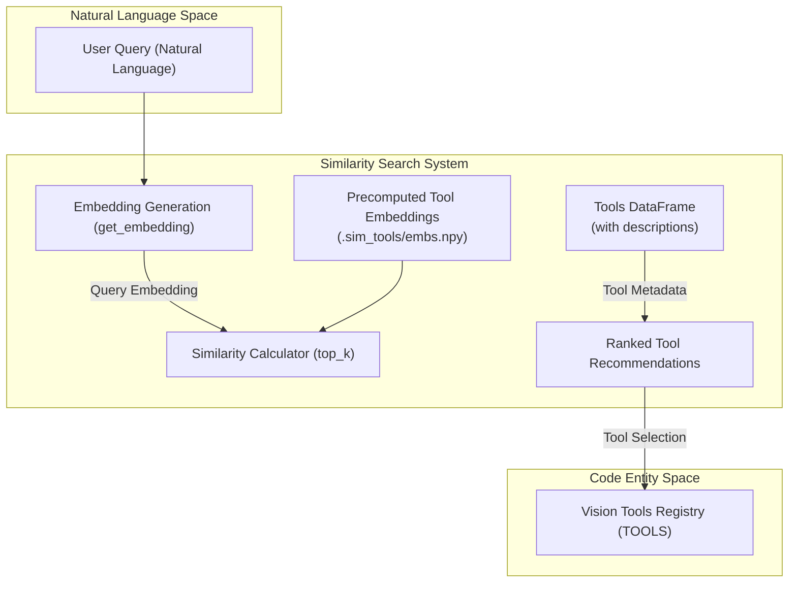
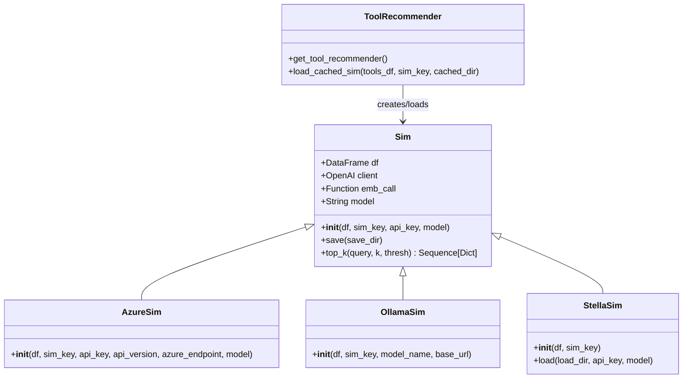
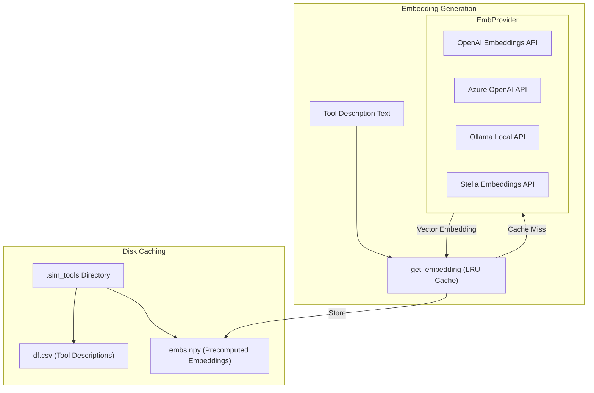
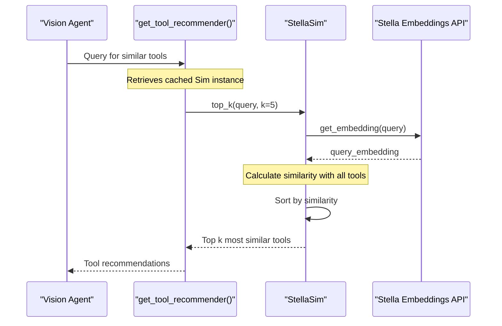
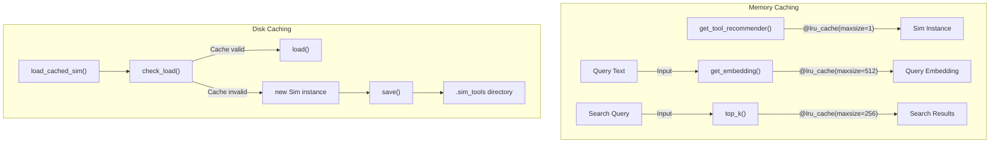
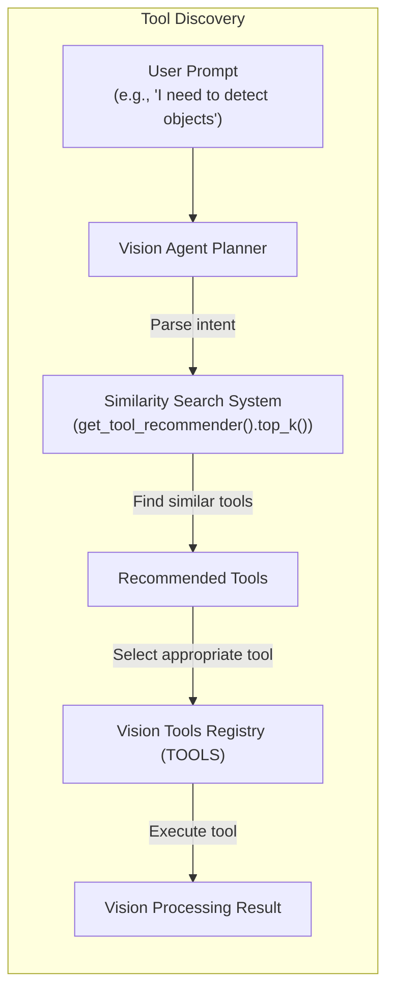

<!-- source: DeepWiki mcp.deepwiki.com · repo landing-ai/vision-agent · page 5.4 Similarity Search · fetched 2026-10-26 -->

# Similarity Search

<details>
<summary>Relevant source files</summary>

The following files were used as context for generating this wiki page:

- [vision_agent/.sim_tools/df.csv](vision_agent/.sim_tools/df.csv)
- [vision_agent/.sim_tools/embs.npy](vision_agent/.sim_tools/embs.npy)
- [vision_agent/sim/sim.py](vision_agent/sim/sim.py)
- [vision_agent/utils/tools.py](vision_agent/utils/tools.py)

</details>


## Purpose and Scope

The Similarity Search system provides semantic search capabilities for tool discovery and recommendation within the Vision Agent framework. It allows the agent to find the most appropriate vision tools based on natural language descriptions of tasks. The system embeds textual descriptions using language model embeddings and calculates cosine similarity to match user queries with available tools.

This document covers:
- The architecture of the similarity search system
- Available similarity search implementations
- How tool recommendations are generated
- Usage patterns for finding similar tools

For information about the vision tools themselves that are being searched, see [Vision Tools](#3).

## Architecture Overview

The similarity search system is designed around a core `Sim` class with specialized implementations for different embedding providers. The system maintains a database of tool descriptions with their pre-computed embeddings and provides efficient query mechanisms.



The system follows these key steps:
1. Tool descriptions are embedded and cached (during initialization)
2. User queries are embedded using the same embedding model
3. Similarity is calculated between the query and all tool descriptions
4. The most similar tools are returned ranked by similarity score

Sources: [vision_agent/sim/sim.py:78-186](), [vision_agent/.sim_tools/df.csv:1-723]()

## Core Components

### Sim Class

The `Sim` class is the core component of the similarity search system. It manages tool embeddings and provides methods for finding similar tools based on natural language queries.



Sources: [vision_agent/sim/sim.py:78-186](), [vision_agent/sim/sim.py:190-313]()

### Embedding and Caching

The system uses different embedding providers (OpenAI, Azure, Ollama, Stella) to convert text descriptions to vector embeddings. These embeddings are cached both in memory and on disk for efficiency.



Sources: [vision_agent/sim/sim.py:22-37](), [vision_agent/sim/sim.py:117-156]()

## Implementation Details

### Data Storage

The tools are stored in a pandas DataFrame with the following structure:

| Column | Description |
|--------|-------------|
| desc   | Short description of the tool's purpose |
| doc    | Full documentation including parameters and return values |
| name   | Tool function name (callable entity) |
| embs   | Vector embeddings of the tool description |

Each tool's description is embedded using the configured embedding model, and these embeddings are cached both in memory (via `lru_cache`) and on disk (as .npy files).

Sources: [vision_agent/.sim_tools/df.csv:1-723](), [vision_agent/sim/sim.py:117-156]()

### Similarity Calculation

The similarity between a query and tool descriptions is calculated using cosine similarity:

```
similarity = 1 - cosine(query_embedding, tool_embedding)
```

Higher values indicate greater similarity. The `top_k` method returns the k most similar tools, optionally filtering by a similarity threshold.

Sources: [vision_agent/sim/sim.py:159-186]()

## Specialized Implementations

The system provides several implementations to work with different embedding providers:

### 1. OpenAI Embeddings (Base Sim)

The base `Sim` class uses OpenAI's embedding models (default: `text-embedding-3-small`). It requires an OpenAI API key.

### 2. Azure OpenAI Embeddings

`AzureSim` uses Azure OpenAI's embedding models. It requires Azure-specific configuration including API key, endpoint, and deployment name.

### 3. Ollama Embeddings

`OllamaSim` connects to a local Ollama server for embeddings, defaulting to the `mxbai-embed-large` model.

### 4. Stella Embeddings

`StellaSim` uses Landing AI's Stella embedding model, which is the default implementation used in the Vision Agent system.

Sources: [vision_agent/sim/sim.py:190-313](), [vision_agent/sim/sim.py:53-75]()

## Usage

### Tool Recommendation

The primary use case for the Similarity Search system is tool recommendation. The `get_tool_recommender()` function provides a cached `Sim` instance configured with the tools registry:



Sources: [vision_agent/sim/sim.py:22-25](), [vision_agent/sim/sim.py:159-186]()

### Embedding Workflow

The system follows these steps to compute and use embeddings:

1. During initialization, all tool descriptions are embedded using the selected model
2. These embeddings are cached to disk in the `.sim_tools` directory
3. When a query is made, it is embedded using the same model
4. Cosine similarity is calculated between the query embedding and all tool embeddings
5. Tools are ranked by similarity and returned

Sources: [vision_agent/sim/sim.py:78-116](), [vision_agent/sim/sim.py:159-186]()

## Caching Mechanisms

The system implements several caching strategies to optimize performance:

1. **Function-level caching**: The `get_embedding` function is decorated with `lru_cache` to avoid repetitive API calls for the same text.
2. **Result caching**: The `top_k` method is decorated with `lru_cache` to cache search results for recurring queries.
3. **Disk caching**: Precomputed embeddings are stored in `.sim_tools/embs.npy` to avoid recalculation during initialization.



Sources: [vision_agent/sim/sim.py:22-37](), [vision_agent/sim/sim.py:117-156](), [vision_agent/sim/sim.py:159-186]()

## Integration with Tool Registry

The Similarity Search system integrates with the Vision Agent's Tools Registry to enable semantic search of available vision tools. This allows the agent to find appropriate tools based on natural language descriptions of tasks.



Sources: [vision_agent/sim/sim.py:22-25](), [vision_agent/utils/tools.py:14-17]()

## Configuration

The Similarity Search system can be configured in several ways:

1. **Embedding model**: Different embedding providers can be selected by using the appropriate `Sim` class.
2. **Similarity threshold**: A threshold can be specified when calling `top_k()` to filter results.
3. **Number of results**: The `k` parameter in `top_k()` controls how many similar tools are returned.
4. **API keys and endpoints**: Various API configurations can be provided when initializing the `Sim` classes.

Sources: [vision_agent/sim/sim.py:159-186](), [vision_agent/sim/sim.py:190-313]()

## Summary

The Similarity Search system provides a powerful mechanism for semantic search and tool recommendation in the Vision Agent framework. By embedding tool descriptions and calculating similarity with user queries, it helps bridge the gap between natural language instructions and executable vision tools. The system's efficient caching mechanisms and support for multiple embedding providers make it both performant and flexible.

---

