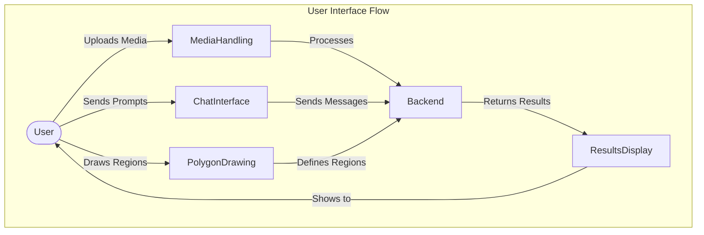
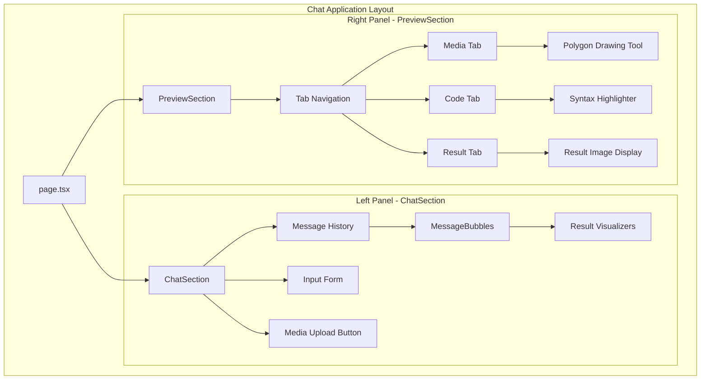
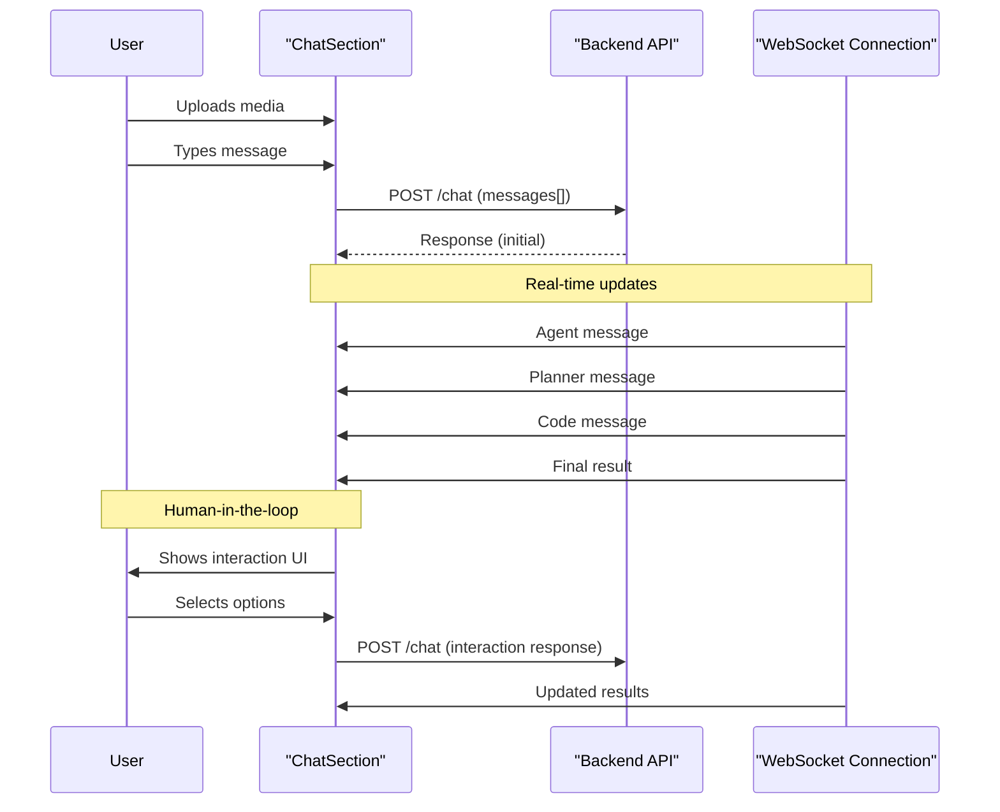
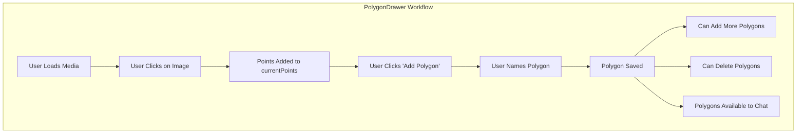
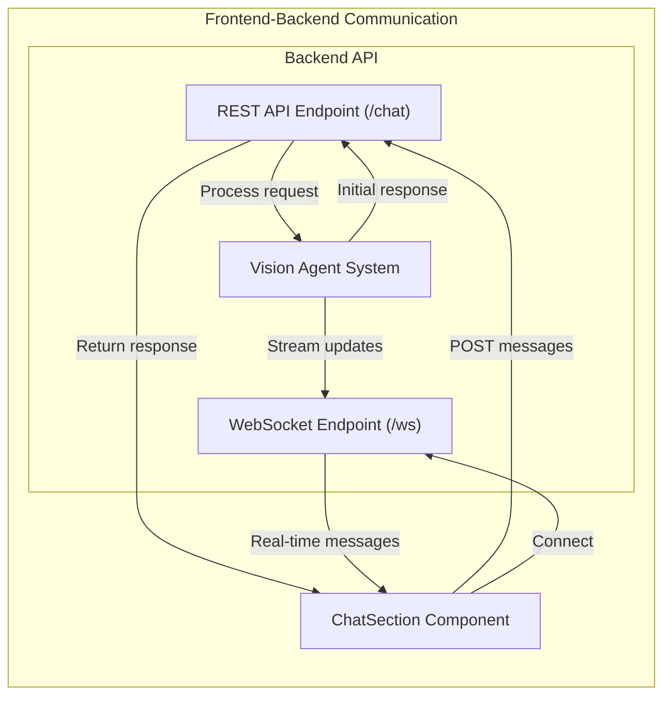

<!-- source: DeepWiki mcp.deepwiki.com · repo landing-ai/vision-agent · page 6 Frontend Applications · fetched 2026-10-26 -->

# Frontend Applications

<details>
<summary>Relevant source files</summary>

The following files were used as context for generating this wiki page:

- [.gitignore](.gitignore)
- [examples/chat/chat-app/ResultVisualizer.tsx](examples/chat/chat-app/ResultVisualizer.tsx)
- [examples/chat/chat-app/src/app/page.tsx](examples/chat/chat-app/src/app/page.tsx)
- [examples/chat/chat-app/src/components/ChatSection.tsx](examples/chat/chat-app/src/components/ChatSection.tsx)
- [examples/chat/chat-app/src/components/ImageVisualizer.tsx](examples/chat/chat-app/src/components/ImageVisualizer.tsx)
- [examples/chat/chat-app/src/components/PolygonDrawer.tsx](examples/chat/chat-app/src/components/PolygonDrawer.tsx)
- [examples/chat/chat-app/src/components/PreviewSection.tsx](examples/chat/chat-app/src/components/PreviewSection.tsx)
- [vision_agent/sim/__init__.py](vision_agent/sim/__init__.py)

</details>


This document provides an overview of the frontend applications in the vision-agent repository, focusing on the user interface components and how they interact with the backend system. The frontend application provides a visual interface for users to interact with the vision agent, upload media, and view processing results.

## Overview

The vision-agent repository includes a React-based chat application built with Next.js that serves as the primary user interface. This application allows users to have conversations with the vision agent, upload images or videos, draw polygons on media for region-specific processing, and view generated code and results.



Sources: [examples/chat/chat-app/src/app/page.tsx](), [examples/chat/chat-app/src/components/ChatSection.tsx]()

## Main Components

The frontend application is organized into several key components that work together to provide a cohesive user experience:

```mermaid
classDiagram
    class "page.tsx" {
        Main application component
        State management
        Component orchestration
    }
    
    class "ChatSection" {
        uploadedMedia: string
        uploadedFile: string
        uploadedResult: string
        polygons: Polygon[]
        messages: Message[]
        sendMessages()
        handleSubmit()
        interactionCallback()
    }
    
    class "PreviewSection" {
        uploadedMedia: string
        uploadedFile: string
        uploadedResult: string
        onPolygonsChange()
    }
    
    class "PolygonDrawer" {
        media: string
        polygons: Polygon[]
        currentPoints: Point[]
        handleSvgClick()
        handleFinishPolygon()
        handleDeletePolygon()
    }
    
    class "MessageBubble" {
        message: Message
        onSubmit: Function
        formatAssistantContent()
    }
    
    class "ImageVisualizer" {
        detectionItem: DetectionItem
        threshold: number
        drawBoundingBox()
    }
    
    "page.tsx" --> ChatSection
    "page.tsx" --> PreviewSection
    PreviewSection --> PolygonDrawer
    ChatSection --> MessageBubble
    ChatSection --> ImageVisualizer
```

Sources: [examples/chat/chat-app/src/app/page.tsx](), [examples/chat/chat-app/src/components/ChatSection.tsx](), [examples/chat/chat-app/src/components/PreviewSection.tsx](), [examples/chat/chat-app/src/components/PolygonDrawer.tsx](), [examples/chat/chat-app/src/components/ImageVisualizer.tsx]()

## Application Layout

The application utilizes a two-panel layout:



Sources: [examples/chat/chat-app/src/app/page.tsx:21-39]()

## Message Handling and Display

The chat interface manages different types of messages with specialized display formats:

| Message Role | Description | Display Format |
|--------------|-------------|----------------|
| `user` | User input messages | Text bubble aligned right |
| `assistant` | Main agent responses | Text with optional code blocks |
| `planner` | Planning messages from agent | Plan display with instructions |
| `coder` | Code generation messages | Text with syntax-highlighted code |
| `interaction` | Interactive tool calls | Visual tool results with UI controls |
| `observation` | System observations | Collapsible text blocks |

Sources: [examples/chat/chat-app/src/components/ChatSection.tsx:26-39](), [examples/chat/chat-app/src/components/ChatSection.tsx:158-181]()

## Component Functionality

### ChatSection

The `ChatSection` component handles:
- Message submission and display
- WebSocket communication with the backend
- Media upload functionality
- Message parsing and formatting
- Human-in-the-loop interactions



Sources: [examples/chat/chat-app/src/components/ChatSection.tsx:184-362](), [examples/chat/chat-app/src/components/ChatSection.tsx:195-231](), [examples/chat/chat-app/src/components/ChatSection.tsx:308-317]()

### PolygonDrawer

The `PolygonDrawer` component provides functionality for users to:
- Draw polygon regions on uploaded media
- Name and save multiple polygons
- Delete existing polygons
- Convert between displayed and intrinsic coordinates



Sources: [examples/chat/chat-app/src/components/PolygonDrawer.tsx]()

### PreviewSection

The `PreviewSection` component provides a tabbed interface displaying:
1. Media Tab - Uploaded media with polygon drawing capabilities
2. Code Tab - Generated Python code with syntax highlighting
3. Result Tab - Result images or visualizations

Sources: [examples/chat/chat-app/src/components/PreviewSection.tsx]()

## Communication with Backend

The frontend communicates with the backend through:

1. RESTful API Endpoints:
   - `POST /chat` - Sends messages and receives responses

2. WebSocket Connection:
   - Real-time updates during agent processing
   - Streaming results and intermediate steps



Sources: [examples/chat/chat-app/src/components/ChatSection.tsx:195-231](), [examples/chat/chat-app/src/components/ChatSection.tsx:308-317]()

## Human-in-the-Loop Interaction

The frontend supports human-in-the-loop interactions with the vision agent, allowing users to:

1. Review detection results with visual overlays
2. Adjust confidence thresholds for detections
3. Select specific functions to apply
4. Provide feedback to guide the agent

This functionality is implemented through the `interactionCallback` method and visualization components.

Sources: [examples/chat/chat-app/src/components/ChatSection.tsx:233-247](), [examples/chat/chat-app/ResultVisualizer.tsx]()

## Visualization Components

The application includes specialized components for visualizing different types of results:

1. `ImageVisualizer` - Displays images with:
   - Bounding boxes for object detections
   - Segmentation masks
   - Text overlays for labels and scores

2. `ResultVisualizer` - Interactive visualization with:
   - Confidence threshold sliders
   - Navigation for multiple results
   - Function selection buttons

Sources: [examples/chat/chat-app/src/components/ImageVisualizer.tsx](), [examples/chat/chat-app/ResultVisualizer.tsx]()

## State Management

The application uses React's useState hooks for state management:

| Component | State Variables | Purpose |
|-----------|----------------|---------|
| `page.tsx` | uploadedFile, uploadedImage, uploadedResult, polygons | Shared application state |
| ChatSection | messages | Chat message history |
| PolygonDrawer | polygons, currentPoints, previewPoint | Polygon drawing state |
| PreviewSection | N/A (receives props) | Display tabs state |

Sources: [examples/chat/chat-app/src/app/page.tsx:9-19](), [examples/chat/chat-app/src/components/ChatSection.tsx:193](), [examples/chat/chat-app/src/components/PolygonDrawer.tsx:27-31]()

## Frontend Technologies

The frontend application is built with:

- **Next.js** - React framework
- **TypeScript** - Type-safe JavaScript
- **TailwindCSS** - Utility-first CSS framework
- **shadcn/ui** - Component library (Button, Card, ScrollArea, etc.)
- **WebSockets** - Real-time communication
- **Canvas API** - Drawing visualizations

Sources: [examples/chat/chat-app/src/components/ChatSection.tsx:3-14](), [examples/chat/chat-app/src/components/PreviewSection.tsx:3-9]()

---

