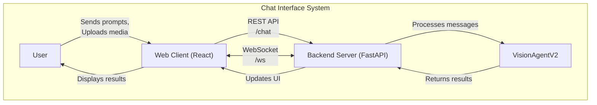
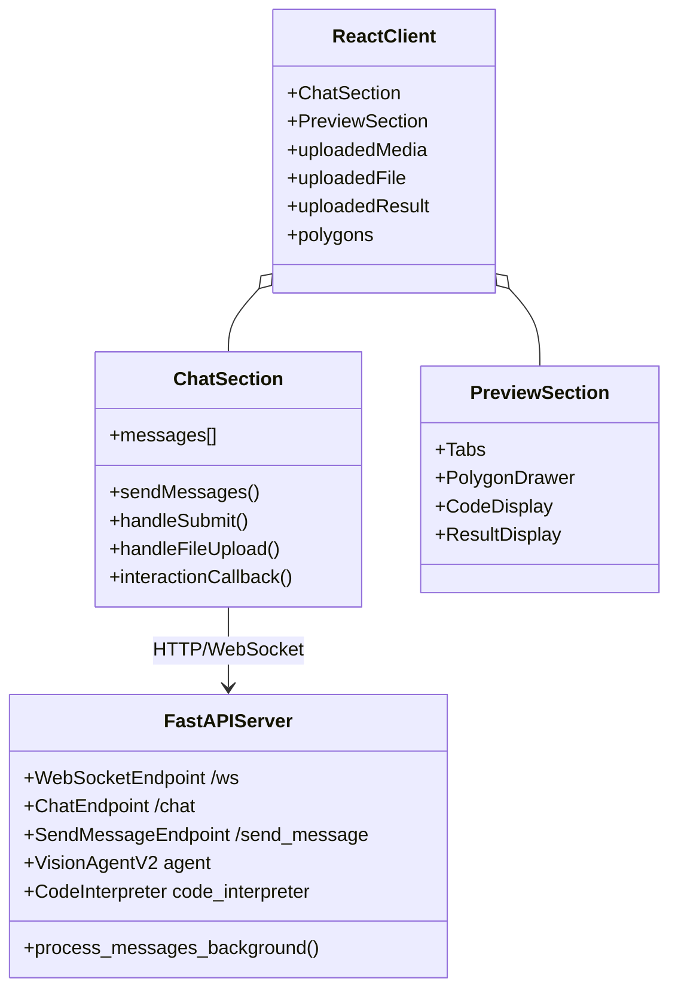
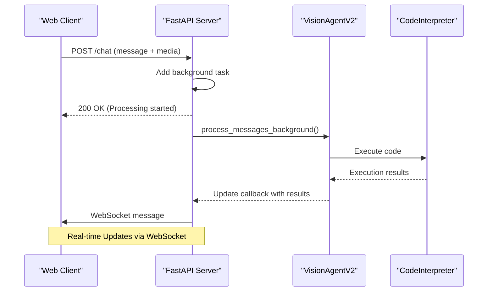
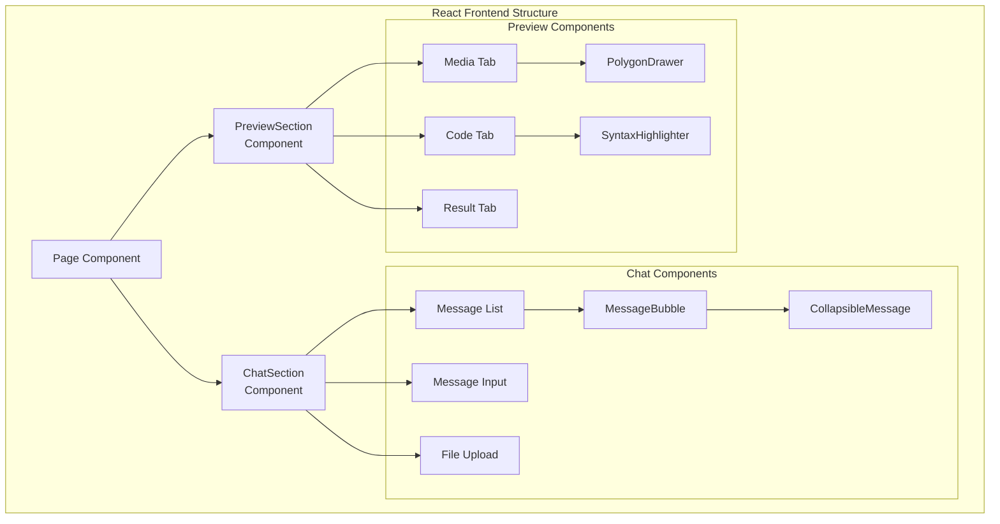
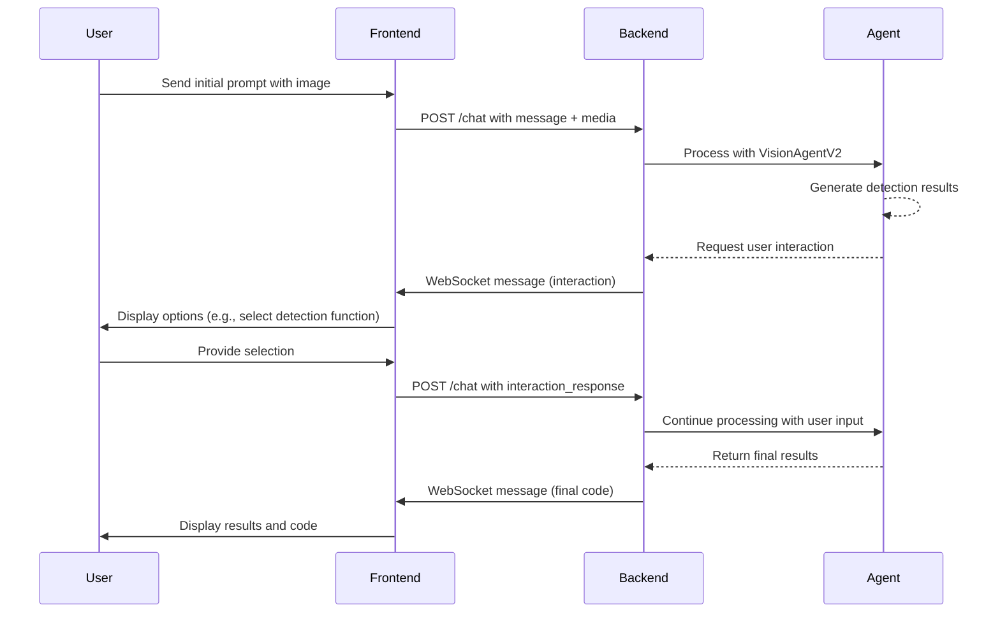
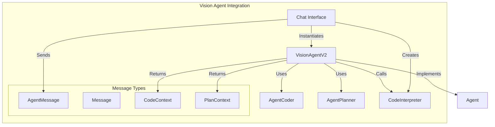

<!-- source: DeepWiki mcp.deepwiki.com · repo landing-ai/vision-agent · page 6.1 Chat Interface · fetched 2026-10-26 -->

# Chat Interface

<details>
<summary>Relevant source files</summary>

The following files were used as context for generating this wiki page:

- [examples/chat/app.py](examples/chat/app.py)
- [examples/chat/chat-app/src/app/page.tsx](examples/chat/chat-app/src/app/page.tsx)
- [examples/chat/chat-app/src/components/ChatSection.tsx](examples/chat/chat-app/src/components/ChatSection.tsx)
- [examples/chat/chat-app/src/components/ImageVisualizer.tsx](examples/chat/chat-app/src/components/ImageVisualizer.tsx)
- [examples/chat/chat-app/src/components/PreviewSection.tsx](examples/chat/chat-app/src/components/PreviewSection.tsx)
- [vision_agent/agent/agent.py](vision_agent/agent/agent.py)
- [vision_agent/sim/__init__.py](vision_agent/sim/__init__.py)

</details>


This document details the chat interface components in the Vision Agent system, which provides an interactive frontend for users to communicate with the vision agent, upload media files, and visualize results. The interface consists of a backend server and a React-based frontend application that communicate via WebSockets and REST API calls.

## Overview

The chat interface serves as the primary method for users to interact with the Vision Agent system. It provides:

1. A real-time chat application for sending prompts and receiving responses
2. Media upload capabilities for images and videos
3. Visualization of AI-generated results
4. Code generation and execution display
5. Interactive region selection through polygon drawing



Sources: [examples/chat/app.py:1-147](), [examples/chat/chat-app/src/app/page.tsx:1-41]()

## Architecture Components

The chat interface consists of two main components:

1. **Backend Server**: A FastAPI application that processes user requests, manages WebSocket connections, and interacts with the Vision Agent system
2. **Frontend Client**: A React application that provides the user interface for chat interaction, media uploads, and result visualization



Sources: [examples/chat/app.py:1-147](), [examples/chat/chat-app/src/app/page.tsx:1-41](), [examples/chat/chat-app/src/components/ChatSection.tsx:1-362](), [examples/chat/chat-app/src/components/PreviewSection.tsx:1-86]()

## Backend Server

The backend server is implemented using FastAPI and provides the following endpoints:

1. `/chat` - HTTP POST endpoint for receiving chat messages
2. `/ws` - WebSocket endpoint for real-time communication
3. `/send_message` - Internal endpoint for sending messages to connected clients

The server initializes a `VisionAgentV2` instance with human-in-the-loop (HIL) capability and a `CodeInterpreter` for executing generated code.



Sources: [examples/chat/app.py:18-62](), [examples/chat/app.py:119-147]()

### Key Components

#### VisionAgentV2 Configuration

```python
agent = VisionAgentV2(
    verbose=True,
    update_callback=update_callback,
    hil=True,  # Human-in-the-loop mode
)
```

The `update_callback` function sends progress updates to connected WebSocket clients, providing real-time feedback during processing.

#### Background Task Processing

Messages are processed in a background task to prevent blocking the API response:

```python
@app.post("/chat")
async def chat(
    messages: List[Message], background_tasks: BackgroundTasks
) -> Dict[str, Any]:
    background_tasks.add_task(
        process_messages_background, [elt.model_dump() for elt in messages]
    )
    return {
        "status": "Processing started",
        "message": "Your messages are being processed in the background",
    }
```

Sources: [examples/chat/app.py:119-129]()

## Frontend Client

The frontend is a React application that provides the user interface for interacting with the Vision Agent. It consists of two main sections:

1. **Chat Section**: Displays the conversation and provides input for messages
2. **Preview Section**: Shows uploaded media, generated code, and results



Sources: [examples/chat/chat-app/src/app/page.tsx:1-41](), [examples/chat/chat-app/src/components/ChatSection.tsx:1-362](), [examples/chat/chat-app/src/components/PreviewSection.tsx:1-86]()

### Chat Section

The Chat Section manages:

1. Message display and sending
2. File uploads
3. WebSocket communication
4. Message formatting and visualization

#### Message Types

The system supports different message roles with specific formatting:

| Role | Description | Visualization |
|------|-------------|---------------|
| `user` | User prompts | Right-aligned bubbles |
| `assistant` | Main agent responses | Left-aligned bubbles with optional code blocks |
| `conversation` | Conversational responses | Left-aligned with regular formatting |
| `interaction` | Tools requesting user input | Visual component with controls |
| `interaction_response` | User response to tool | Right-aligned bubble |
| `planner` | Planning phase messages | Left-aligned with special formatting |
| `coder` | Code generation messages | Left-aligned with code blocks |
| `observation` | System observations | Collapsible messages |

Sources: [examples/chat/chat-app/src/components/ChatSection.tsx:26-39](), [examples/chat/chat-app/src/components/ChatSection.tsx:158-182]()

### WebSocket Communication

The frontend establishes a WebSocket connection to receive real-time updates:

```typescript
useEffect(() => {
  const ws = new WebSocket("ws://localhost:8000/ws");
  ws.onmessage = (event) => {
    const data = JSON.parse(event.data);
    setMessages((prev) => [...prev, data]);
    handleFinalCode(data);
  };
  return () => ws.close();
}, []);
```

Sources: [examples/chat/chat-app/src/components/ChatSection.tsx:308-317]()

### Message Formatting

The system parses special message formats using regex patterns:

```typescript
const responseMatch = content.match(/<response>(.*?)<\/response>/s);
const thinkingMatch = content.match(/<thinking>(.*?)<\/thinking>/s);
const pythonMatch = content.match(/<execute_python>(.*?)<\/execute_python>/s);
const finalPlanJsonMatch = content.match(/<json>(.*?)<\/json>/s);
const interactionMatch = content.match(/<interaction>(.*?)<\/interaction>/s);
```

Sources: [examples/chat/chat-app/src/components/ChatSection.tsx:89-95]()

## Interactive Features

### Human-in-the-Loop (HIL) Mode

The system supports a human-in-the-loop mode where users can interactively provide input to guide the agent:



Sources: [examples/chat/app.py:48-61](), [examples/chat/chat-app/src/components/ChatSection.tsx:233-247]()

### Polygon Drawing

The system allows users to draw polygons on images to specify regions of interest:

```typescript
const [polygons, setPolygons] = useState<Polygon[]>([]);
const handlePolygonChange = (polygons: Polygon[]) => setPolygons(polygons);
```

When sending a message, polygon coordinates are appended to the user's message:

```typescript
if (polygons.length > 0 && lastMessage.role === "user") {
  const polygonStrings = polygons.map(polygon => 
    `${polygon.name}: [${polygon.points.map(p => `(${p.x}, ${p.y})`).join(', ')}]`
  );
  lastMessage.content += "\nPolygons: " + polygonStrings.join('; ');
}
```

Sources: [examples/chat/chat-app/src/app/page.tsx:18-19](), [examples/chat/chat-app/src/components/ChatSection.tsx:198-203]()

## Preview Section

The Preview Section provides tabs for:

1. **Media**: Displays uploaded images or videos with polygon drawing capabilities
2. **Code**: Shows the generated Python code with syntax highlighting
3. **Result**: Displays the output of the executed code (usually images)

```typescript
<Tabs defaultValue="media">
  <TabsList className="w-full justify-start border-b rounded-none">
    <TabsTrigger value="media">Media</TabsTrigger>
    <TabsTrigger value="code">Code</TabsTrigger>
    <TabsTrigger value="result">Result</TabsTrigger>
  </TabsList>
  <TabsContent value="media" className="p-4">
    {/* Media Display with PolygonDrawer */}
  </TabsContent>
  <TabsContent value="code" className="p-4">
    {/* Code Display with SyntaxHighlighter */}
  </TabsContent>
  <TabsContent value="result" className="p-4">
    {/* Result Display */}
  </TabsContent>
</Tabs>
```

Sources: [examples/chat/chat-app/src/components/PreviewSection.tsx:31-83]()

## Agent Integration

The chat interface integrates with the Vision Agent system through the `VisionAgentV2` class, which implements the `Agent` interface defined in the core system:



Sources: [examples/chat/app.py:48-61](), [vision_agent/agent/agent.py:1-62]()

## Communication Protocol

### Backend to Frontend

Messages from the backend to frontend follow this structure:

```json
{
  "role": "assistant",
  "content": "<thinking>Analyzing image...</thinking><response>I see several objects...</response>",
  "media": ["data:image/png;base64,..."]
}
```

Special markers in the content field are used for formatting:
- `<thinking>...</thinking>` - Agent's thought process
- `<response>...</response>` - Final response to display
- `<execute_python>...</execute_python>` - Python code
- `<json>...</json>` - Structured data
- `<interaction>...</interaction>` - User interaction requests
- `<final_code>...</final_code>` - Final code generated

Sources: [examples/chat/chat-app/src/components/ChatSection.tsx:89-95](), [examples/chat/chat-app/src/components/ChatSection.tsx:296-305]()

### Frontend to Backend

Messages from frontend to backend follow this structure:

```json
{
  "role": "user",
  "content": "Analyze this image and count the people",
  "media": ["data:image/png;base64,..."]
}
```

Interaction responses use this structure:

```json
{
  "role": "interaction_response",
  "content": "{\"function_name\":\"detect_people\",\"box_threshold\":0.5}"
}
```

Sources: [examples/chat/chat-app/src/components/ChatSection.tsx:237-247](), [examples/chat/chat-app/src/components/ChatSection.tsx:262-267]()

## Usage Example

A typical interaction flow consists of:

1. User uploads an image and sends a prompt
2. Agent processes the request and may ask for clarification
3. User provides additional input if needed
4. Agent generates and executes code
5. Results are displayed to the user

For example:

```
User: "Count the number of people in this image" + [uploaded image]
Agent: [Thinking process and detection visualization]
Agent: "I've detected 5 people in the image. Here's the code I used:"
Agent: [Python code block showing person detection]
```

Sources: [examples/chat/chat-app/src/components/ChatSection.tsx:323-331]()

## Starting the Chat Interface

To start the chat interface:

1. Start the FastAPI backend:
   ```bash
   python examples/chat/app.py
   ```

2. Start the React frontend:
   ```bash
   cd examples/chat/chat-app
   npm install
   npm run dev
   ```

3. Access the interface at http://localhost:3000

Sources: [examples/chat/app.py:1-147](), [examples/chat/chat-app/src/app/page.tsx:1-41]()

---

