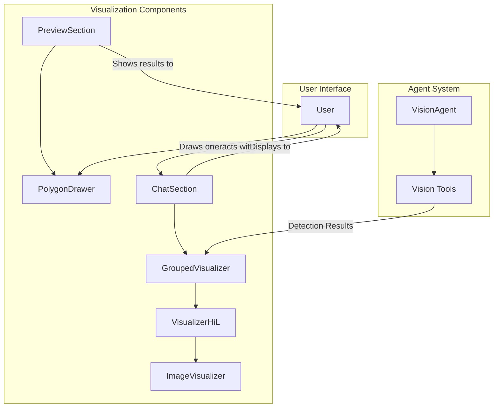
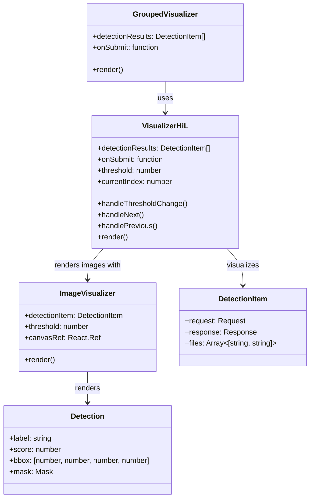
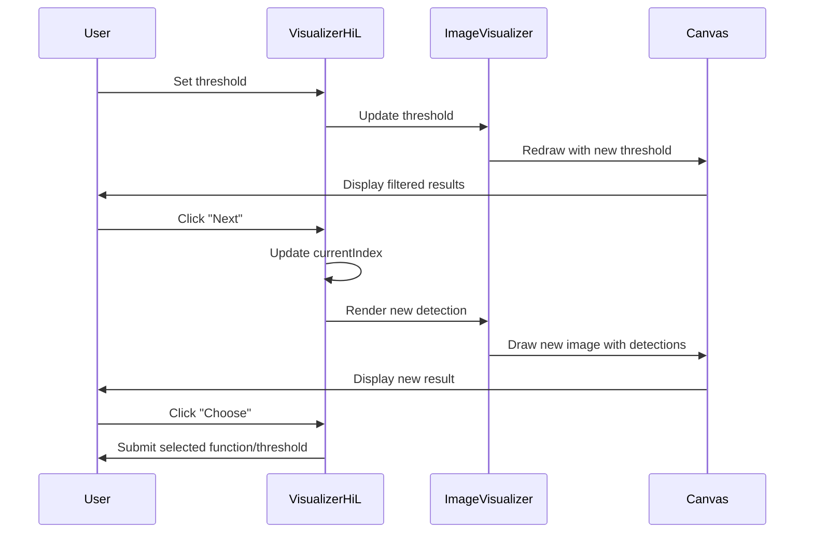
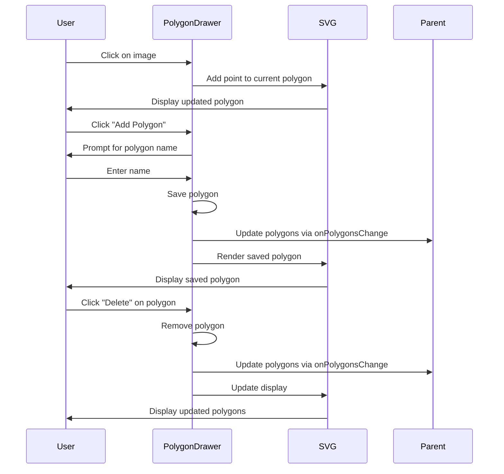
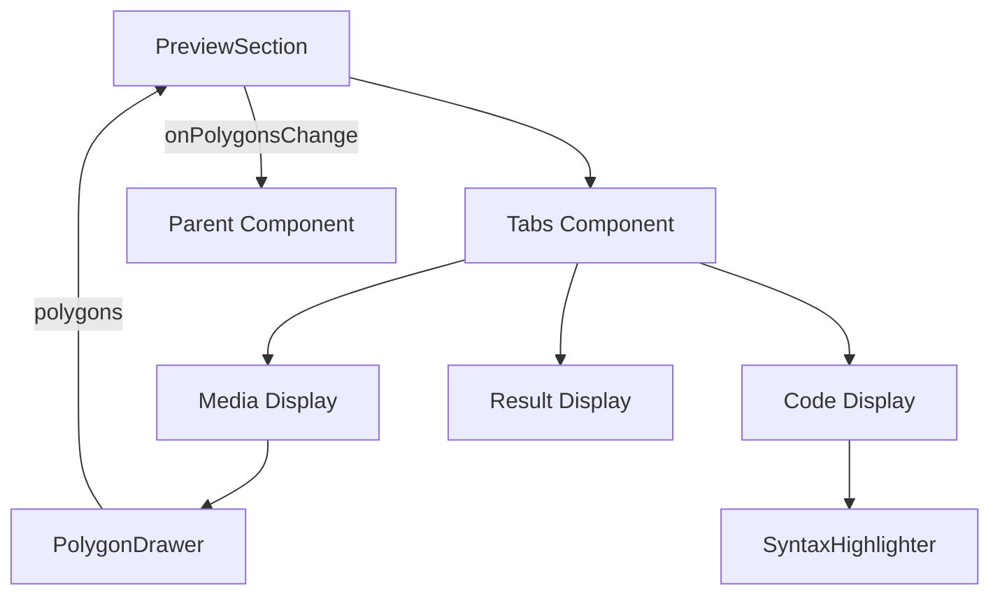
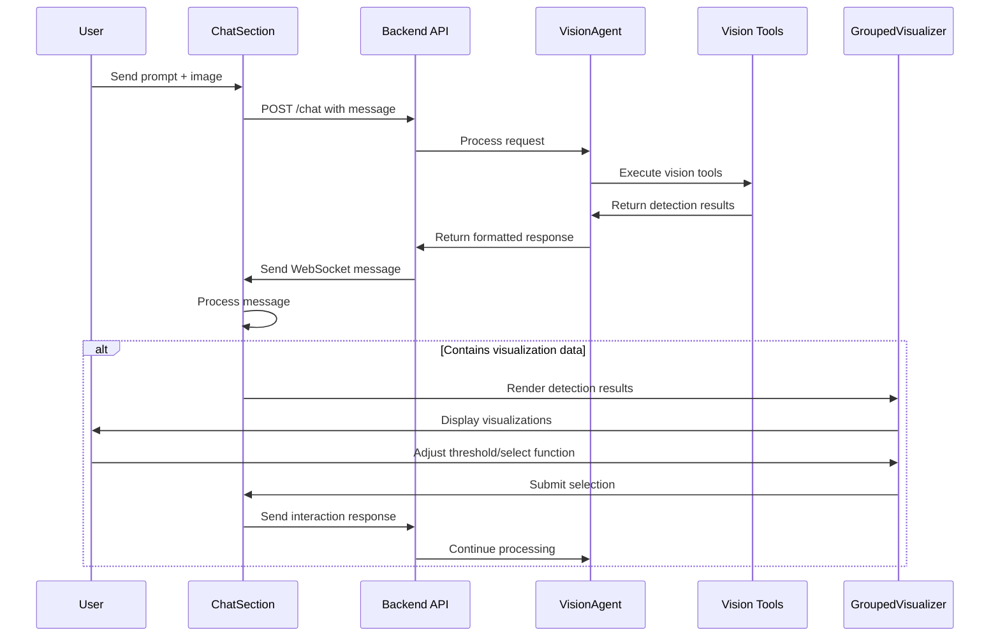
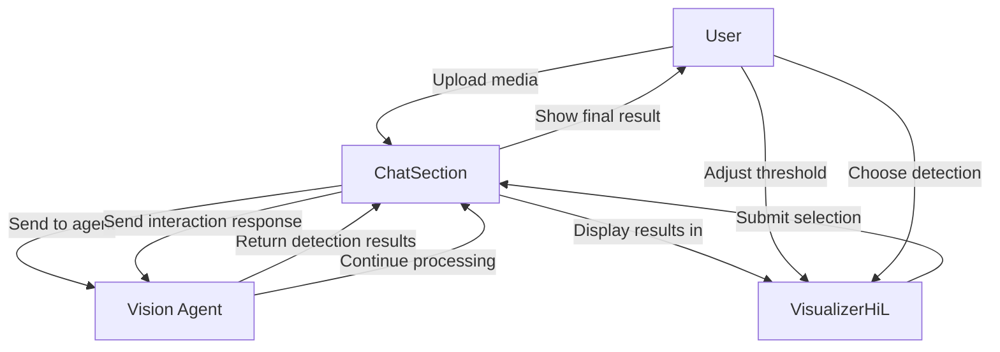
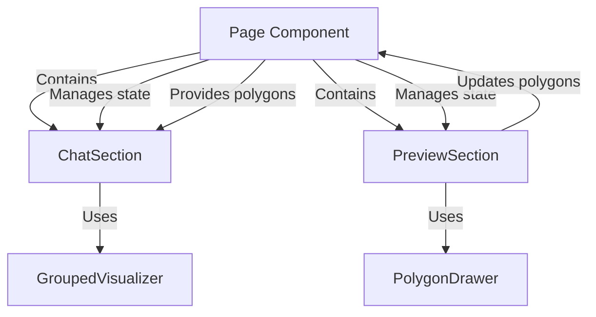

<!-- source: DeepWiki mcp.deepwiki.com · repo landing-ai/vision-agent · page 6.2 Visualization Components · fetched 2026-10-26 -->

# Visualization Components

<details>
<summary>Relevant source files</summary>

The following files were used as context for generating this wiki page:

- [.gitignore](.gitignore)
- [examples/chat/chat-app/ResultVisualizer.tsx](examples/chat/chat-app/ResultVisualizer.tsx)
- [examples/chat/chat-app/src/app/page.tsx](examples/chat/chat-app/src/app/page.tsx)
- [examples/chat/chat-app/src/components/ChatSection.tsx](examples/chat/chat-app/src/components/ChatSection.tsx)
- [examples/chat/chat-app/src/components/ImageVisualizer.tsx](examples/chat/chat-app/src/components/ImageVisualizer.tsx)
- [examples/chat/chat-app/src/components/PolygonDrawer.tsx](examples/chat/chat-app/src/components/PolygonDrawer.tsx)
- [examples/chat/chat-app/src/components/PreviewSection.tsx](examples/chat/chat-app/src/components/PreviewSection.tsx)
- [vision_agent/sim/__init__.py](vision_agent/sim/__init__.py)

</details>


## Purpose and Scope

This document details the visualization components of the Vision Agent system that render detection results, provide user annotation capabilities, and display processing results in the chat interface. These components are primarily part of the frontend application layer, enabling users to view and interact with computer vision analysis results.

For information about the chat interface itself, see [Chat Interface](#6.1).

## Component Overview

The visualization system consists of several specialized components that handle different aspects of rendering and interaction:

1. **Detection Visualizers** - Components for rendering object detection, segmentation, and other computer vision results
2. **Annotation Tools** - Components for user drawing and region selection
3. **Preview and Display Components** - Components for showing media, code, and results



Sources: [examples/chat/chat-app/src/components/ChatSection.tsx](), [examples/chat/chat-app/src/components/PolygonDrawer.tsx](), [examples/chat/chat-app/ResultVisualizer.tsx](), [examples/chat/chat-app/src/components/PreviewSection.tsx](), [examples/chat/chat-app/src/components/ImageVisualizer.tsx]()

## Detection Visualization Components

The detection visualization components are responsible for rendering computer vision results such as bounding boxes, segmentation masks, and labels.

### Component Hierarchy



Sources: [examples/chat/chat-app/ResultVisualizer.tsx](), [examples/chat/chat-app/src/components/ImageVisualizer.tsx](), [examples/chat/chat-app/src/components/ChatSection.tsx:125-128]()

### VisualizerHiL

The `VisualizerHiL` component (from ResultVisualizer.tsx) is the main component for visualizing detection results. It provides:

1. Canvas-based visualization of detection outputs
2. Threshold adjustment for filtering detection results
3. Navigation controls for multiple results
4. Support for both image and video content

Key functionality:

- Renders bounding boxes around detected objects
- Visualizes segmentation masks
- Displays confidence scores and labels
- Allows users to adjust the confidence threshold
- Provides a "Choose" button for human-in-the-loop interaction



Sources: [examples/chat/chat-app/ResultVisualizer.tsx:33-252]()

### ImageVisualizer

The `ImageVisualizer` component specializes in rendering image-based detection results. It handles:

1. Drawing bounding boxes for object detection
2. Rendering segmentation masks
3. Displaying text-based responses
4. Scaling visualizations to fit the available space

Key features:

- Canvas-based rendering
- Support for instance segmentation masks
- Text wrapping for text-based responses
- Filtering detections by confidence threshold

Sources: [examples/chat/chat-app/src/components/ImageVisualizer.tsx:1-144]()

## User Annotation Components

### PolygonDrawer

The `PolygonDrawer` component allows users to draw polygonal regions on images or videos. This is useful for:

1. Region of interest selection
2. Custom annotation
3. Area definition for processing

Key functionality:

- Interactive polygon drawing
- Named polygon storage and management
- Coordinate conversion between displayed and intrinsic coordinates
- Support for both images and videos



Key implementation details:

- Uses SVG for drawing and interaction
- Maintains two coordinate spaces: displayed (SVG) and intrinsic (media)
- Converts between coordinate spaces for accurate annotation
- Supports both video and image annotation

Sources: [examples/chat/chat-app/src/components/PolygonDrawer.tsx:1-313]()

## Display and Preview Components

### PreviewSection

The `PreviewSection` component provides a tabbed interface for users to view and interact with:

1. Media (images/videos) with annotation capabilities
2. Generated code with syntax highlighting
3. Processing results

It serves as the main workspace area in the chat application, allowing users to:
- Draw polygons on media using PolygonDrawer
- Review generated Python code
- View the results of code execution



Sources: [examples/chat/chat-app/src/components/PreviewSection.tsx:1-86]()

### ChatSection Visualization Handling

The `ChatSection` component integrates visualization into the chat interface by:

1. Rendering different message types with appropriate visualizations
2. Handling human-in-the-loop interactions with visualizers
3. Processing and formatting detection results for display

Key visualization-related functionality:

- `formatAssistantContent`: Formats different types of content including visualizations
- `MessageBubble`: Renders different message types with appropriate styling and visualization
- `interactionCallback`: Handles user interaction with visualization components

Table of Message Visualization Types:

| Message Role | Visualization Method | Description |
|--------------|----------------------|-------------|
| assistant | Text formatting + code blocks | Shows agent responses and code |
| interaction | GroupedVisualizer | Shows detection results with interactive controls |
| observation | CollapsibleMessage | Shows collapsible observation content |
| planner | Text + code formatting | Shows planning information |
| user | Simple text display | Shows user input |

Sources: [examples/chat/chat-app/src/components/ChatSection.tsx:41-182](), [examples/chat/chat-app/src/components/ChatSection.tsx:233-247]()

## Data Flow and Integration

The visualization components integrate with the agent system through a well-defined data flow:



### Detection Data Structure

The visualization components work with a standardized detection data structure:

```typescript
interface DetectionItem {
  request: {
    prompts: string | string[];
    confidence: number;
    function_name: string;
  };
  response: {
    data: Array<{
      label: string;
      score: number;
      bbox: [number, number, number, number];
      mask?: {
        counts: number[];
        size: number[];
      };
    }>;
  };
  files: Array<[string, string]>; // [type, base64data]
}
```

This structure allows the visualization components to render:
- Bounding boxes from `bbox` coordinates
- Labels and confidence scores
- Segmentation masks when available
- Original image/video for context

Sources: [examples/chat/chat-app/ResultVisualizer.tsx:6-26](), [examples/chat/chat-app/src/components/ChatSection.tsx:72-128]()

## Human-in-the-Loop (HIL) Interaction

The visualization components support human-in-the-loop interaction, allowing users to:

1. Review detection results
2. Adjust confidence thresholds
3. Select specific functions or detection outputs
4. Draw regions of interest

This interaction flow is critical for refining vision agent results and providing feedback to the system.



Sources: [examples/chat/chat-app/src/components/ChatSection.tsx:233-247](), [examples/chat/chat-app/ResultVisualizer.tsx:233-249]()

## Integration with Main Application

The visualization components are integrated into the main chat application through component composition:



The main application page manages shared state between components, including:
- Uploaded media
- Generated code
- Processing results
- User-drawn polygons

This state management ensures that all components have access to the data they need for visualization and interaction.

Sources: [examples/chat/chat-app/src/app/page.tsx:1-41]()

---

