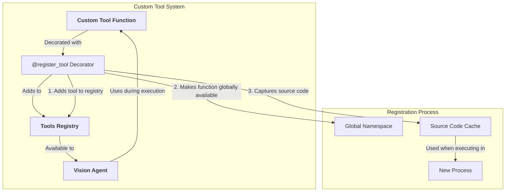
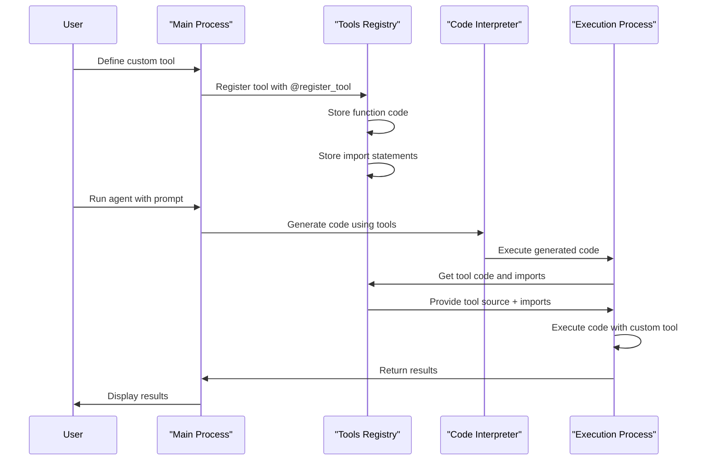
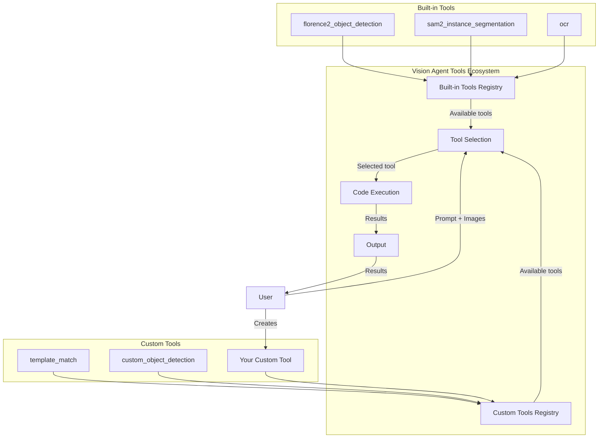

<!-- source: DeepWiki mcp.deepwiki.com · repo landing-ai/vision-agent · page 7.2 Custom Tools · fetched 2026-10-26 -->

# Custom Tools

<details>
<summary>Relevant source files</summary>

The following files were used as context for generating this wiki page:

- [examples/custom_tools/README.md](examples/custom_tools/README.md)
- [examples/custom_tools/run_custom_tool.py](examples/custom_tools/run_custom_tool.py)
- [vision_agent/tools/__init__.py](vision_agent/tools/__init__.py)

</details>


This page explains how to create and register custom tools to extend the Vision Agent's capabilities with your own vision-processing functions. Custom tools allow you to add domain-specific functionality beyond what's available in the built-in toolset. For information about the built-in tools system architecture, see [Vision Tools](#3).

## Tool Registration System

The Vision Agent uses a dynamic tool registration system that allows you to add your own tools to the agent's available toolset. When you register a custom tool, it becomes available for the agent to use when generating and executing code.



Sources: [vision_agent/tools/__init__.py:73-90]()

The tool registration works through the `register_tool` decorator, which:

1. Adds your function to the `TOOLS` list (the global tools registry)
2. Makes your function available in the global namespace
3. Captures the function source code and imports for execution in a new process

## Creating a Custom Tool

To create a custom tool, you need to define a function with proper documentation and register it using the `@register_tool` decorator.

### Required Structure

```mermaid
classDiagram
    class "Custom Tool Function" {
        +Documentation
        +Parameters
        +Processing Logic
        +Return Value
    }

    class "Documentation" {
        +Description
        +Parameter details
        +Return value details
        +Example usage
    }

    class "@register_tool" {
        +imports: List[str]
    }

    "Custom Tool Function" --|> "Documentation"
    "@register_tool" --|> "Custom Tool Function"
```

Sources: [examples/custom_tools/run_custom_tool.py:11-40]()

Your custom tool function should follow these requirements:

1. **Clear Function Signature**: Define input parameters with proper type hints
2. **Comprehensive Docstring**: Include description, parameters, return values, and examples
3. **Proper Return Value**: Return structured data that the agent can use
4. **Required Imports**: Specify all necessary imports in the decorator

## Example: Template Matching Tool

Here's an example of creating a custom template matching tool:

```python
@va.tools.register_tool(
    imports=[
        "import numpy as np",
        "from vision_agent.utils.image_utils import get_image_size, normalize_bbox",
        "from template_match import template_matching_with_rotation",
    ]
)
def template_match(target_image: np.ndarray, template_image: np.ndarray) -> dict:
    """'template_match' tool that finds the locations of the template image in the
    target image.

    Parameters:
        target_image (np.ndarray): The target image.
        template_image (np.ndarray): The template image.

    Returns:
        dict: A dictionary containing the bounding boxes of the matches.

    Example
    -------
    >>> import cv2
    >>> target_image = cv2.imread("pid.png")
    >>> template_image = cv2.imread("pid_template.png")
    >>> matches = template_match(target_image, template_image)
    """

    image_size = get_image_size(target_image)
    matches = template_matching_with_rotation(target_image, template_image)
    matches["bboxes"] = [normalize_bbox(box, image_size) for box in matches["bboxes"]]
    return matches
```

Sources: [examples/custom_tools/run_custom_tool.py:11-40]()

This example illustrates the key components:

1. The `@register_tool` decorator with required imports
2. Well-documented function with clear parameter types
3. A descriptive docstring with an example
4. Structured return value (a dictionary with bounding boxes)

## Import Requirements

When registering a custom tool, you must specify all necessary imports using the `imports` parameter of the `@register_tool` decorator. This is crucial because the code is executed in a separate process where imports from your current environment are not automatically available.



Sources: [examples/custom_tools/README.md:32-50](), [vision_agent/tools/__init__.py:73-90]()

The `imports` parameter should contain a list of import statements as strings. These imports will be added to the generated code before execution.

## Using Custom Tools

After registering your tool, you can use it with the Vision Agent. Sometimes, it helps to explicitly mention the tool in your prompt:

```python
import vision_agent as va

agent = va.agent.VisionAgentCoderV2(verbose=True)
result = agent.generate_code(
    [
        AgentMessage(
            role="user",
            content="Can you use the 'template_match' tool to find the locations of the template image in the target image?",
            media=["target.png", "template.png"],
        )
    ]
)
```

Sources: [examples/custom_tools/run_custom_tool.py:43-54](), [examples/custom_tools/README.md:19-30]()

## Best Practices

When creating custom tools, follow these best practices:

| Practice | Description |
|----------|-------------|
| **Descriptive Name** | Use a clear, descriptive name that indicates what the tool does |
| **Comprehensive Documentation** | Include detailed docstrings with examples |
| **Complete Imports** | List all required imports in the decorator |
| **Structured Returns** | Return structured data (dictionaries, lists) with clear keys |
| **Error Handling** | Implement proper error handling in your tool |
| **Input Validation** | Validate input parameters to avoid runtime errors |
| **Type Hints** | Use Python type hints for all parameters and return values |

Sources: [examples/custom_tools/README.md](), [examples/custom_tools/run_custom_tool.py]()

## Implementation Details

The `register_tool` decorator function performs three main actions:

1. Adds the tool function to the global `TOOLS` list
2. Makes the function available in the global namespace
3. Captures the source code of the function and appends it to `__new_tools__`

```python
def register_tool(imports: Optional[List] = None) -> Callable:
    def decorator(tool: Callable) -> Callable:
        import inspect

        global TOOLS, TOOLS_DF, TOOL_DESCRIPTIONS, TOOL_DOCSTRING, TOOLS_INFO
        from vision_agent.tools.tools import TOOLS

        if tool not in TOOLS:  # type: ignore
            TOOLS.append(tool)  # type: ignore

            globals()[tool.__name__] = tool
            if imports is not None:
                for import_ in imports:
                    __new_tools__.append(import_)
            __new_tools__.append(inspect.getsource(tool))
        return tool

    return decorator
```

Sources: [vision_agent/tools/__init__.py:73-90]()

When the generated code is executed in a new process, the contents of `__new_tools__` are prepended to the code, making your custom tools available during execution.

## Integration with Vision Agent

Custom tools integrate seamlessly with the Vision Agent system, appearing alongside built-in tools in the tool selection process.



Sources: [vision_agent/tools/__init__.py:3-65](), [examples/custom_tools/run_custom_tool.py:43-54]()

The Vision Agent first explores the available tools (both built-in and custom), then selects the appropriate tools based on the task requirements, and finally generates and executes code using these tools.

---

