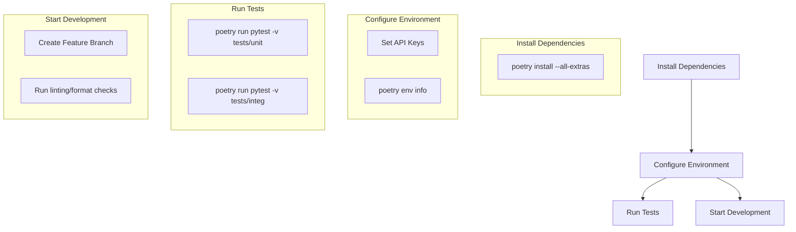
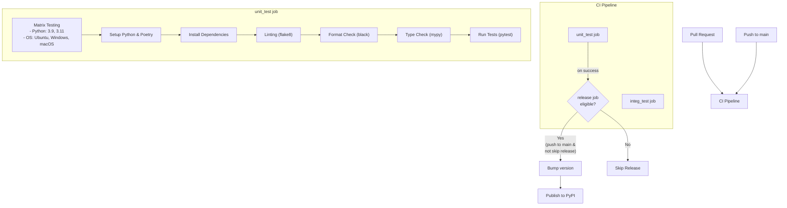
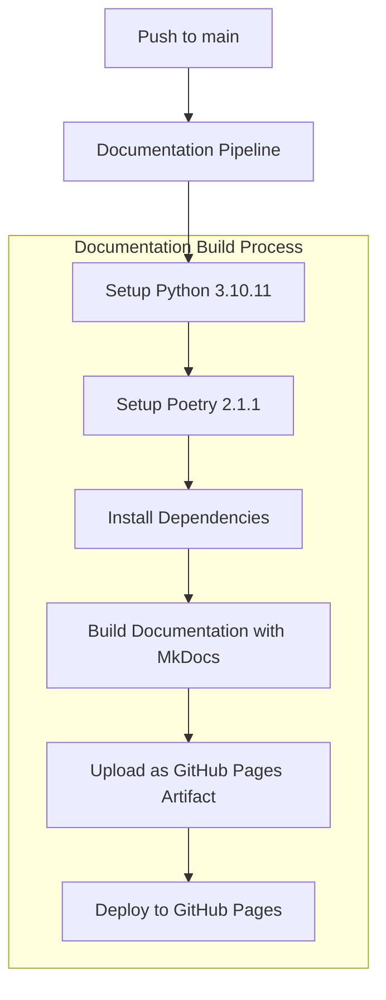
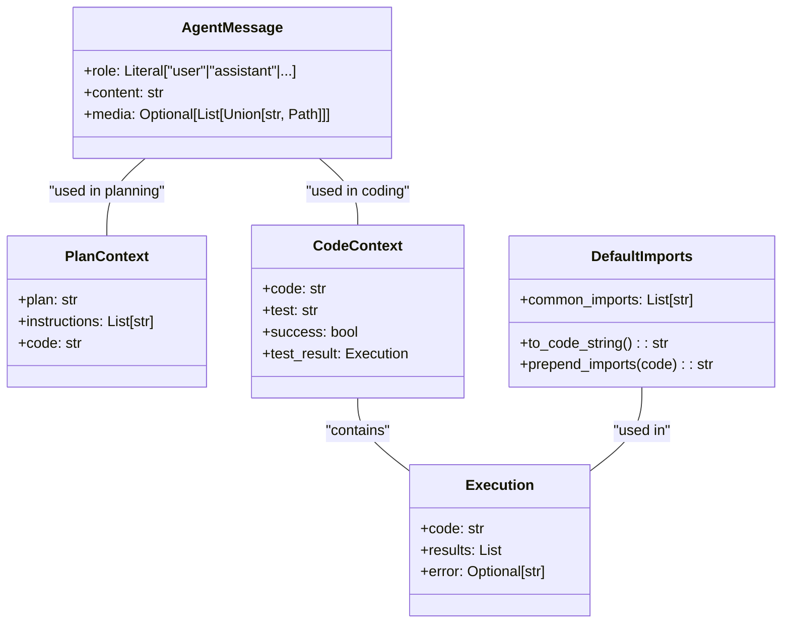
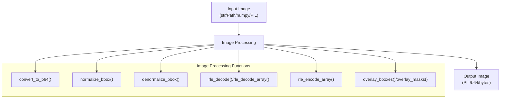
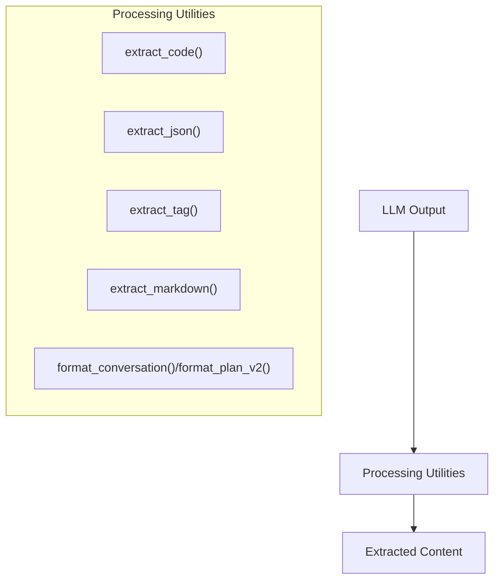

<!-- source: DeepWiki mcp.deepwiki.com · repo landing-ai/vision-agent · page 8 Developer Guide · fetched 2026-10-26 -->

# Developer Guide

<details>
<summary>Relevant source files</summary>

The following files were used as context for generating this wiki page:

- [.github/workflows/ci_cd.yml](.github/workflows/ci_cd.yml)
- [.github/workflows/docs.yml](.github/workflows/docs.yml)
- [vision_agent/models/__init__.py](vision_agent/models/__init__.py)
- [vision_agent/models/agent_types.py](vision_agent/models/agent_types.py)
- [vision_agent/utils/agent.py](vision_agent/utils/agent.py)
- [vision_agent/utils/image_utils.py](vision_agent/utils/image_utils.py)

</details>


This document provides essential information for developers working on the vision-agent codebase. It covers development workflows, continuous integration and deployment systems, documentation processes, and best practices. For information about specific system components, see [Agent System](#2) or [Vision Tools](#3).

## Development Environment Setup

The vision-agent project uses Poetry for dependency management. Before contributing, ensure you have Python 3.9+ and Poetry 2.1.1+ installed.



Sources: [.github/workflows/ci_cd.yml:26-45]()

## CI/CD Pipeline

The project uses GitHub Actions for continuous integration and deployment. The CI/CD pipeline automatically runs tests, checks code quality, and handles releases.



Sources: [.github/workflows/ci_cd.yml:15-125]()

### Automated Testing

The CI pipeline runs tests across multiple environments:

| Test Type | Python Versions | Operating Systems | Command |
|-----------|-----------------|-------------------|---------|
| Unit Tests | 3.9, 3.11 | Ubuntu, Windows, macOS | `pytest -s -vvv tests/unit` |
| Integration Tests | 3.11 | Ubuntu | `pytest -v tests/integ` |
| Linting | All | All | `flake8 . --exclude .venv,examples,tests --count --show-source --statistics` |
| Format Check | All | All | `black --check --diff --color vision_agent/` |
| Type Check | All | All | `mypy vision_agent` |

Sources: [.github/workflows/ci_cd.yml:46-58](), [.github/workflows/ci_cd.yml:86-88]()

### Release Process

The release process is automated and triggered when a push to the main branch occurs, unless the commit message contains "chore(release):" or "[skip release]".

Release workflow:
1. Bumps the version in `pyproject.toml` using `poetry version patch`
2. Commits the change with message "[skip ci] chore(release): {new_version}"
3. Pushes the commit to GitHub
4. Publishes the package to PyPI

Sources: [.github/workflows/ci_cd.yml:90-125]()

## Documentation System

The project documentation is built and deployed automatically using GitHub Actions.



Sources: [.github/workflows/docs.yml:1-48]()

### Documentation Workflow

When new changes are pushed to the main branch:

1. The documentation workflow is triggered
2. Python 3.10.11 and Poetry 2.1.1 are set up
3. Dependencies are installed with `poetry install --all-extras`
4. Documentation is built with `poetry run mkdocs build -f mkdocs.yml -d docs-build/`
5. Built documentation is uploaded as a GitHub Pages artifact
6. The artifact is deployed to GitHub Pages

Sources: [.github/workflows/docs.yml:15-48]()

## Code Architecture

The vision-agent uses a modular architecture with several key components that developers should understand.



Sources: [vision_agent/models/agent_types.py:1-93](), [vision_agent/utils/agent.py:195-217]()

### Core Data Models

The system defines several core data models that are used throughout the codebase:

| Model | Purpose | Attributes |
|-------|---------|------------|
| `AgentMessage` | Represents messages between components | `role`, `content`, `media` |
| `PlanContext` | Represents a planning context | `plan`, `instructions`, `code` |
| `CodeContext` | Represents code generation context | `code`, `test`, `success`, `test_result` |
| `InteractionContext` | Represents user interaction context | `chat` |
| `ErrorContext` | Represents error information | `error` |

Sources: [vision_agent/models/agent_types.py:9-93](), [vision_agent/models/__init__.py:1-17]()

## Image Utilities

The vision-agent provides utilities for image processing that are essential for many development tasks.



Sources: [vision_agent/utils/image_utils.py:1-401]()

### Key Image Utility Functions

| Function | Purpose | Input | Output |
|----------|---------|-------|--------|
| `convert_to_b64()` | Convert image to base64 | Image (various formats) | Base64 string |
| `b64_to_pil()` | Convert base64 to PIL | Base64 string | PIL Image |
| `normalize_bbox()` | Normalize bbox to 0-1 range | Bbox coordinates, image size | Normalized coordinates |
| `denormalize_bbox()` | Convert normalized bbox to absolute values | Normalized coordinates, image size | Absolute coordinates |
| `overlay_bboxes()` | Draw bounding boxes on image | Image, bboxes dict | PIL Image with boxes |
| `overlay_masks()` | Draw masks on image | Image, masks dict | PIL Image with masks |

Sources: [vision_agent/utils/image_utils.py:40-401]()

## Agent Utilities

The agent utility functions help with code extraction, JSON parsing, and other common operations when working with LLM outputs.



Sources: [vision_agent/utils/agent.py:1-444]()

### Code and Content Extraction

Several utility functions are provided for extracting content from LLM outputs:

| Function | Purpose | Input | Output |
|----------|---------|-------|--------|
| `extract_code()` | Extract code from markdown | Text with code blocks | Code string |
| `extract_json()` | Extract and parse JSON | Text with JSON | Python dict |
| `extract_tag()` | Extract content from HTML-like tags | Text with tags | Content string |
| `extract_markdown()` | Extract content from markdown blocks | Text with markdown | Content string |
| `remove_installs_from_code()` | Remove pip install commands | Code string | Cleaned code string |

Sources: [vision_agent/utils/agent.py:28-143]()

## Development Best Practices

When contributing to the vision-agent codebase, follow these best practices:

1. **Code Formatting**: Use Black to format your code
   ```bash
   poetry run black vision_agent/
   ```

2. **Type Checking**: Use mypy to check types
   ```bash
   poetry run mypy vision_agent
   ```

3. **Linting**: Use flake8 to lint your code
   ```bash
   poetry run flake8 vision_agent/
   ```

4. **Testing**: Write tests for new functionality
   ```bash
   poetry run pytest tests/unit
   ```

5. **Commit Messages**: Use semantic commit messages
   - `feat:` for new features
   - `fix:` for bug fixes
   - `docs:` for documentation changes
   - `chore:` for maintenance tasks
   - Add `[skip release]` to skip the release process

6. **Pull Requests**: Make sure CI passes before requesting review

7. **Documentation**: Update documentation for new features

Sources: [.github/workflows/ci_cd.yml:46-58]()

## Conclusion

This Developer Guide provides an overview of the key components and processes required for contributing to the vision-agent project. For more detailed information on specific system components, refer to the other sections of the wiki.

---

