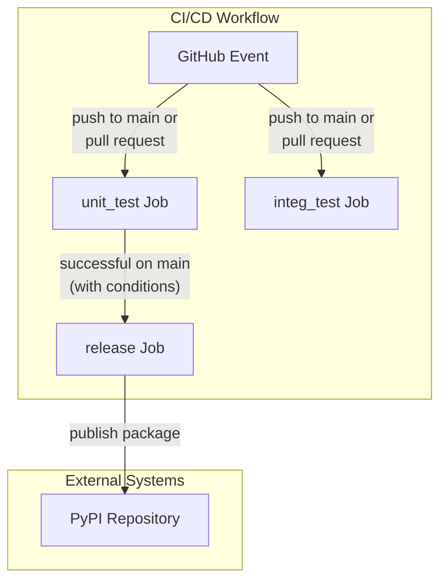
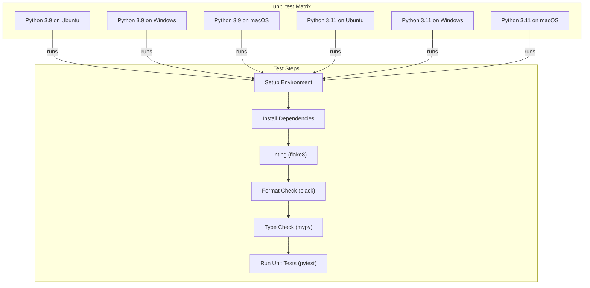
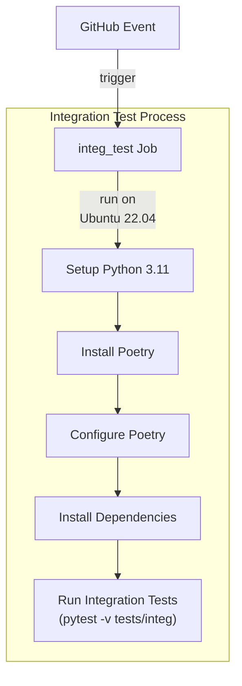
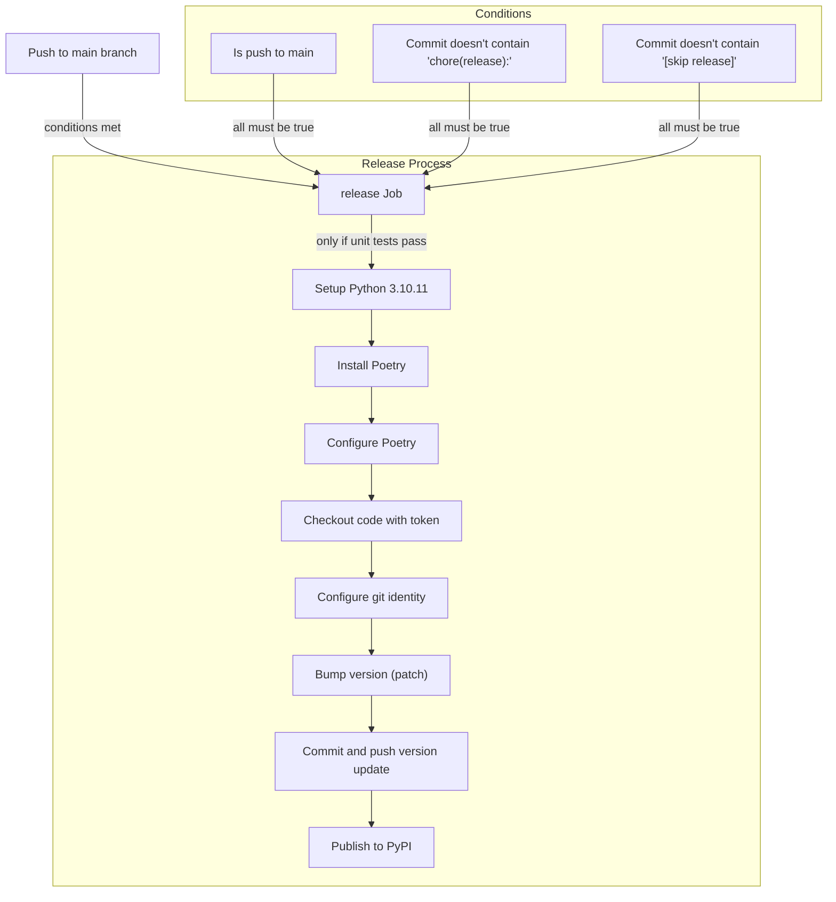
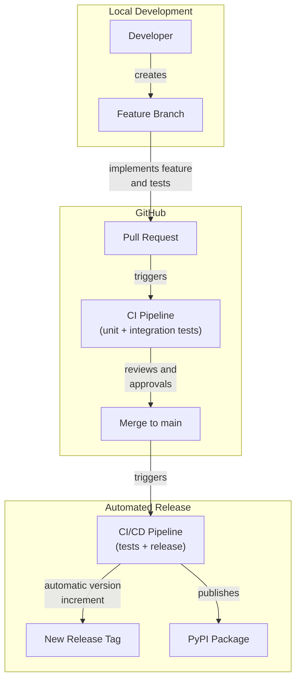

<!-- source: DeepWiki mcp.deepwiki.com · repo landing-ai/vision-agent · page 8.1 CI/CD Pipeline · fetched 2026-10-26 -->

# CI/CD Pipeline

Relevant source files

The following files were used as context for generating this wiki page:

- [.github/workflows/ci_cd.yml](.github/workflows/ci_cd.yml)
- [vision_agent/utils/image_utils.py](vision_agent/utils/image_utils.py)

This document describes the Continuous Integration and Continuous Deployment (CI/CD) pipeline implemented for the vision-agent repository. The pipeline automates testing, validation, and deployment processes to ensure code quality and streamline releases.

## Overview

The vision-agent project uses GitHub Actions to implement its CI/CD pipeline. The pipeline is defined in the workflow file [.github/workflows/ci_cd.yml]() and consists of three primary jobs: unit testing, integration testing, and automated releases.

Sources: [.github/workflows/ci_cd.yml:1-15](), [.github/workflows/ci_cd.yml:90-95]()

## Workflow Triggers

The CI/CD pipeline is triggered by the following events:

1. **Push to main branch**: Runs all jobs, including potential release
2. **Pull request to main branch**: Runs test jobs only

The workflow also defines environment variables that are used during execution:

| Environment Variable | Purpose |
|----------------------|---------|
| VISION_AGENT_API_KEY | Authentication for vision agent services |
| ANTHROPIC_API_KEY | Authentication for Anthropic API |
| OPENAI_API_KEY | Authentication for OpenAI API (set to test value) |
| PYTHONUTF8 | Ensures Python uses UTF-8 encoding |

Sources: [.github/workflows/ci_cd.yml:3-13]()

## Unit Test Job

The unit test job ensures that the code passes all basic quality checks and tests across multiple environments.

The unit test job:

1. **Runs a matrix strategy** testing on:
   - Python versions: 3.9 and 3.11 
   - Operating systems: Ubuntu 22.04, Windows 2022, and macOS 14

2. **Environment setup**:
   - Uses Poetry for dependency management
   - Configures a virtual environment within the project

3. **Quality checks**:
   - Linting with flake8 to catch syntax errors and undefined names
   - Format checking with black to ensure consistent code style
   - Type checking with mypy to verify type annotations

4. **Test execution**:
   - Runs unit tests using pytest with verbose output

Sources: [.github/workflows/ci_cd.yml:16-58]()

## Integration Test Job

The integration test job validates that the system components work correctly together.

Unlike the unit test job, the integration test:
- Runs only on Ubuntu 22.04 with Python 3.11
- Executes the integration test suite located in the `tests/integ` directory
- Tests interactions between system components rather than individual units

Sources: [.github/workflows/ci_cd.yml:60-88]()

## Release Job

The release job handles versioning and publishing the package to PyPI.

The release job:

1. **Only runs when**:
   - The event is a push to the main branch
   - The commit message doesn't contain "chore(release):" (to avoid loops)
   - The commit message doesn't contain "[skip release]" (for manual skipping)
   - The unit tests have passed successfully

2. **Version management**:
   - Automatically increments the patch version
   - Creates a commit with the updated version
   - Pushes the commit to the repository

3. **Publication**:
   - Builds the package using Poetry
   - Publishes the package to PyPI using stored credentials

Sources: [.github/workflows/ci_cd.yml:90-125]()

## Development Workflow Integration

The CI/CD pipeline integrates with the project's development workflow as follows:

This workflow ensures:
1. All code changes are tested before they reach the main branch
2. The main branch is always in a deployable state
3. Releases are automated and consistent
4. Version management is handled systematically

## Package Publishing Details

When the release job runs, it:

1. Uses Poetry to bump the version in `pyproject.toml`
2. Commits the version change with a message prefixed with "[skip ci] chore(release):"
3. Builds the package distribution files
4. Authenticates with PyPI using a stored token
5. Publishes the package to the PyPI repository

The release uses semantic versioning and increments the patch version by default, meaning it's intended for backward compatible bug fixes and minor updates.

Sources: [.github/workflows/ci_cd.yml:114-125]()

## Environment Setup and Dependencies

The CI/CD pipeline uses Poetry for dependency management. This approach ensures consistent environments across different build configurations and simplifies the management of Python dependencies.

Key aspects of the environment setup:

1. **Poetry configuration**:
   - Uses Poetry version 2.1.1
   - Configures virtualenvs to be created within the project directory
   - Installs all dependencies including extras

2. **Dependency installation**:
   - Uses `poetry install --all-extras` to install all dependencies
   - Ensures test dependencies are available for running the test suites

Sources: [.github/workflows/ci_cd.yml:30-45]()

## Skipping CI or Releases

The pipeline provides mechanisms to skip certain processes:

1. **Skip release only**: Include `[skip release]` in the commit message
2. **Skip subsequent CI runs**: The automatic version bump commit includes `[skip ci]` to prevent triggering another workflow run

These features help prevent unnecessary processing and avoid infinite loops in the automation.

Sources: [.github/workflows/ci_cd.yml:94](), [.github/workflows/ci_cd.yml:120]()

---

