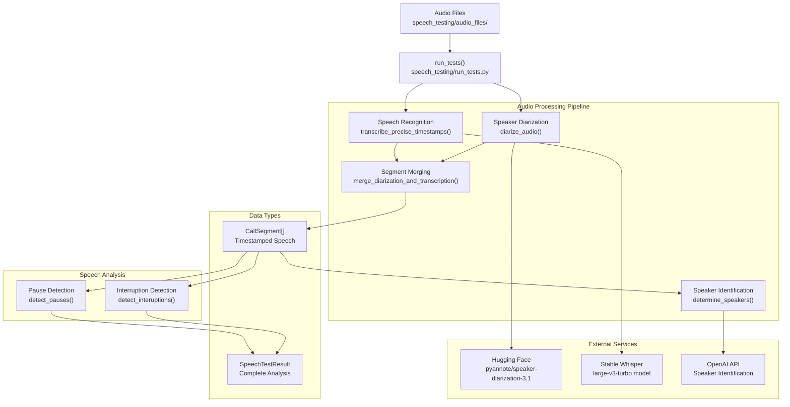
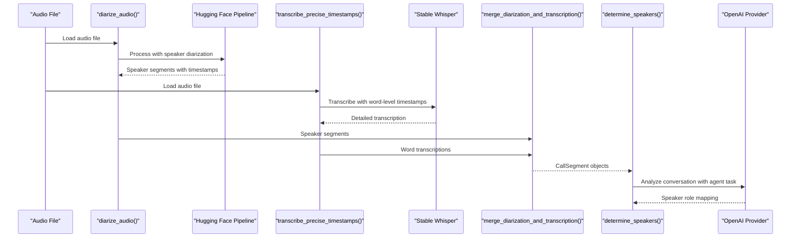
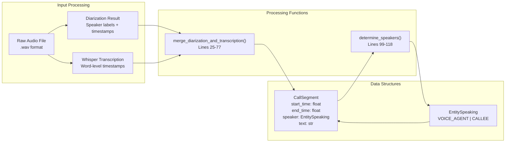
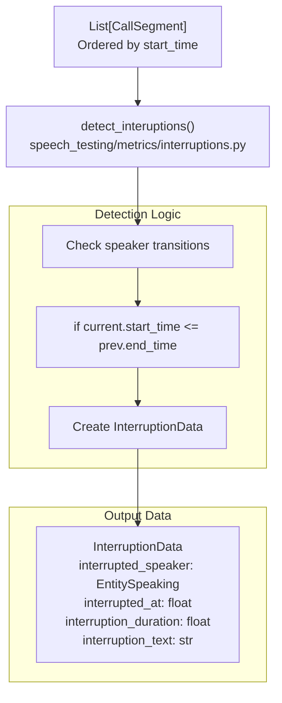
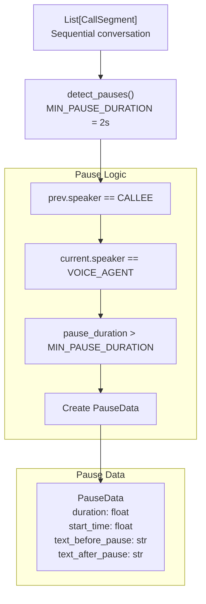
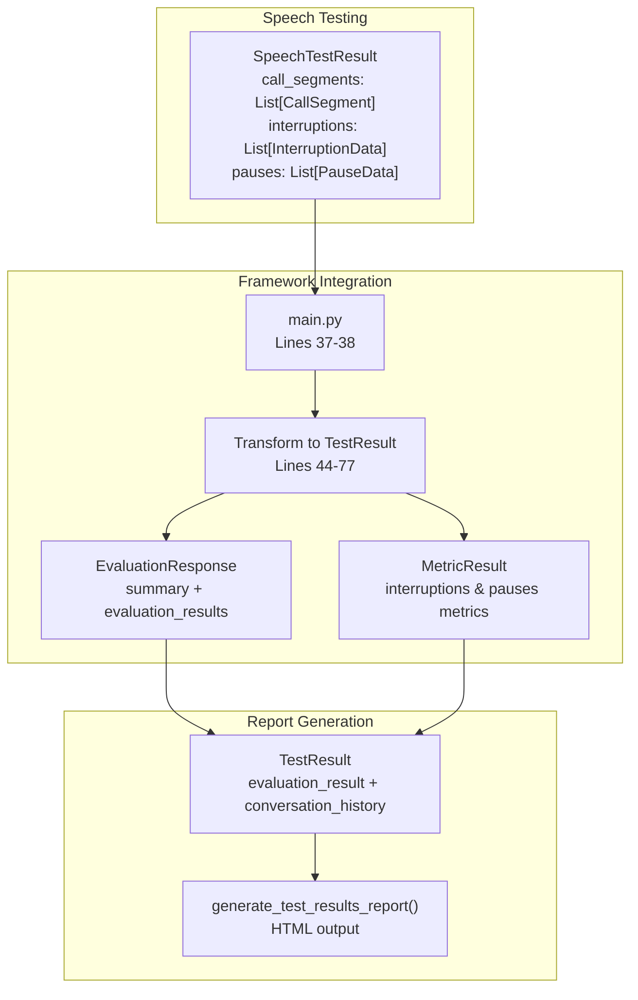
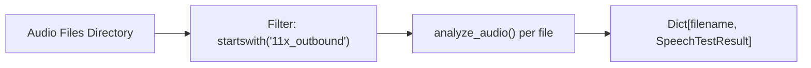

<!-- source: DeepWiki mcp.deepwiki.com · repo saharmor/voice-lab · page 3.3 Speech Analysis Testing · fetched 2026-10-26 -->

# Speech Analysis Testing

<details>
<summary>Relevant source files</summary>

The following files were used as context for generating this wiki page:

- [main.py](main.py)
- [speech_testing/example_test.py](speech_testing/example_test.py)
- [speech_testing/metrics/interruptions.py](speech_testing/metrics/interruptions.py)
- [speech_testing/metrics/interruptions_utils.py](speech_testing/metrics/interruptions_utils.py)
- [speech_testing/metrics/pauses.py](speech_testing/metrics/pauses.py)
- [speech_testing/run_tests.py](speech_testing/run_tests.py)

</details>


This document covers the speech analysis testing system within Voice Lab, which processes audio recordings of voice agent conversations to detect speech quality issues like interruptions and excessive pauses. The system uses advanced audio processing techniques including speaker diarization, speech recognition, and automated speech pattern analysis.

For information about testing LLM conversations without audio analysis, see [LLM Conversation Testing](#3.1). For web-based chatbot evaluation, see [Web Chatbot Evaluation](#3.2).

## System Architecture

The speech analysis testing system processes audio files through a multi-stage pipeline that combines speech recognition, speaker identification, and behavioral analysis to evaluate voice agent performance.



Sources: [speech_testing/run_tests.py:192-210](), [speech_testing/run_tests.py:167-188]()

## Audio Processing Pipeline

### Speaker Diarization and Transcription

The system uses a two-step approach to process audio files: speaker diarization to identify who is speaking when, followed by speech recognition to generate transcripts with precise timestamps.

| Component | Technology | Purpose |
|-----------|------------|---------|
| Speaker Diarization | pyannote/speaker-diarization-3.1 | Identify speaker segments |
| Speech Recognition | Stable Whisper large-v3-turbo | Generate timestamped transcripts |
| Speaker Identification | OpenAI GPT-4o-mini | Map speaker labels to agent/callee |



Sources: [speech_testing/run_tests.py:80-96](), [speech_testing/run_tests.py:22-23](), [speech_testing/run_tests.py:25-77](), [speech_testing/run_tests.py:99-118]()

### Data Flow and Segment Processing

The `CallSegment` data structure represents the fundamental unit of processed speech, containing speaker identity, timing information, and transcript text.



Sources: [speech_testing/data_types.py](), [speech_testing/run_tests.py:25-77](), [llm_testing/core/data_types.py]()

## Speech Metrics Analysis

### Interruption Detection

The interruption detection system identifies when one speaker begins talking before another speaker has finished, which is a key indicator of conversational flow problems.



The core interruption detection algorithm:

| Step | Logic | Implementation |
|------|-------|----------------|
| Speaker Transition | Check if `current_speaker != prev_speaker` | [interruptions.py:18]() |
| Timing Overlap | Validate `res.start_time <= prev_end_time` | [interruptions.py:20]() |
| Interruption Classification | Determine who interrupted whom | [interruptions.py:31]() |

Sources: [speech_testing/metrics/interruptions.py:8-38]()

### Pause Detection

The pause detection system identifies unnaturally long silences after callee responses, which may indicate agent processing delays or conversation flow issues.



Sources: [speech_testing/metrics/pauses.py:5-34]()

## Integration with Test Framework

### Result Integration

The speech analysis system integrates with the broader Voice Lab framework through standardized data types and result formatting.



### Metric Conversion

The system converts speech analysis results into the standard evaluation format used across all Voice Lab testing modalities:

| Speech Metric | Conversion Logic | Success Criteria |
|---------------|------------------|------------------|
| Interruptions | `"true" if len(interruptions) == 0 else "false"` | Zero interruptions |
| Pauses | `"true" if len(pauses) == 0 else "false"` | No excessive pauses |

Sources: [main.py:44-77](), [core/data_types.py]()

## Usage Patterns

### Basic Test Execution

The primary entry point for speech testing is through the `run_tests` function:

```python
# From main.py example
tests_result = run_speech_tests("speech_testing/audio_files", 
                               "Qualify leads for a new voice agent called Jordan")
```

### Test Configuration

| Parameter | Type | Purpose | Example |
|-----------|------|---------|---------|
| `audio_files_dir` | `str` | Directory containing audio files | `"speech_testing/audio_files"` |
| `agent_task` | `str` | Description of agent's role for speaker ID | `"Qualify leads for a voice agent"` |

### File Processing

The system processes audio files with specific naming patterns and formats:



Sources: [speech_testing/run_tests.py:192-210](), [speech_testing/run_tests.py:196-198]()

## System Dependencies

### External Services

| Service | Purpose | Configuration |
|---------|---------|---------------|
| Hugging Face | Speaker diarization models | `HUGGING_FACE_TOKEN` environment variable |
| OpenAI API | Speaker identification via LLM | `OPENAI_API_KEY` environment variable |
| Stable Whisper | Speech-to-text transcription | Model loaded locally |

### Audio Processing Libraries

The system relies on several specialized audio processing libraries integrated through the processing pipeline:

- **pyannote.audio**: Speaker diarization pipeline
- **stable-whisper**: Enhanced Whisper implementation with precise timestamps  
- **torchaudio**: Audio file loading and tensor operations

Sources: [speech_testing/run_tests.py:15-19](), [speech_testing/run_tests.py:81-83](), [speech_testing/run_tests.py:100-102]()

---

