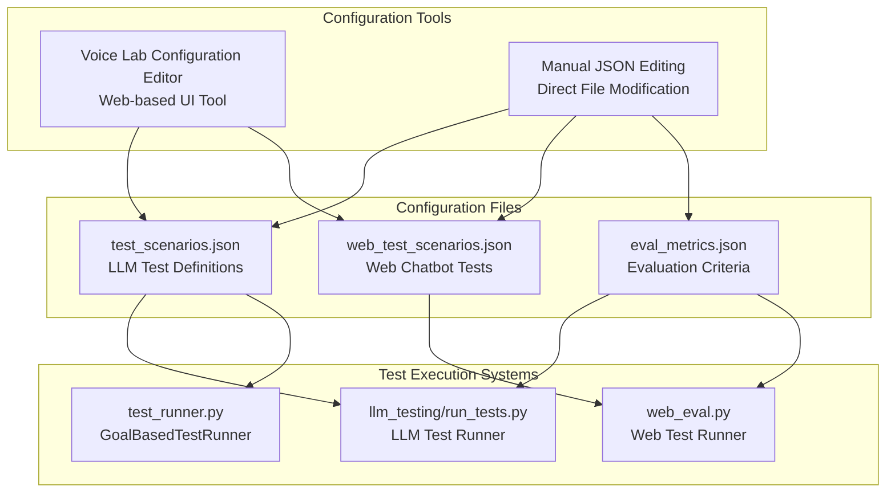
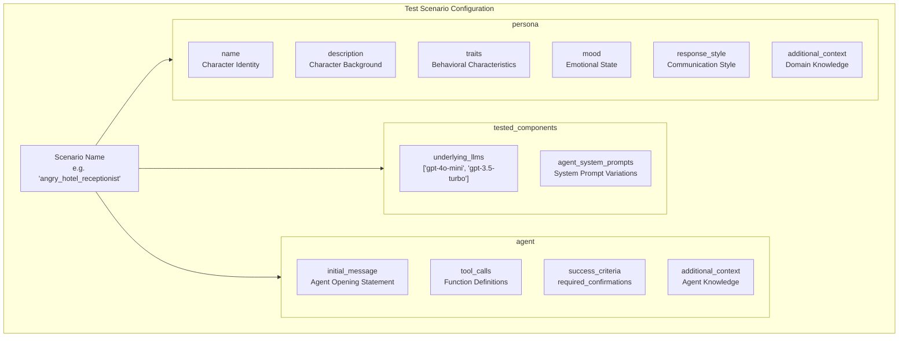
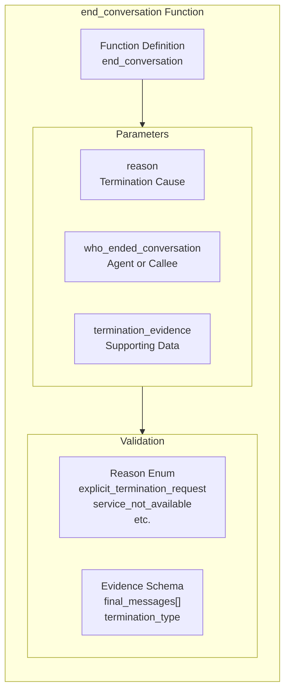
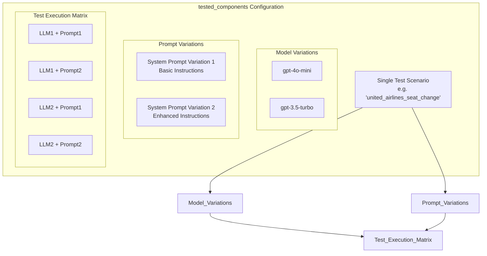

<!-- source: DeepWiki mcp.deepwiki.com · repo saharmor/voice-lab · page 4 Test Configuration · fetched 2026-10-26 -->

# Test Configuration

<details>
<summary>Relevant source files</summary>

The following files were used as context for generating this wiki page:

- [.DS_Store](.DS_Store)
- [LICENSE](LICENSE)
- [README.md](README.md)
- [llm_testing/.DS_Store](llm_testing/.DS_Store)
- [llm_testing/config/test_scenarios.json](llm_testing/config/test_scenarios.json)

</details>


This document covers the configuration system used to define and manage test scenarios across Voice Lab's different testing modalities. Test configuration enables you to specify agent behaviors, personas, success criteria, and evaluation parameters that drive automated testing workflows.

For detailed configuration of specific test types, see [LLM Test Scenarios](#4.1) and [Web Test Scenarios](#4.2). For information about evaluation metrics configuration, see [Evaluation & Metrics](#5).

## Configuration Architecture

Voice Lab uses JSON-based configuration files to define test scenarios across multiple testing systems. The configuration architecture separates test definitions from execution logic, enabling easy modification and reuse of test scenarios.



Sources: [README.md:71-72](), [llm_testing/config/test_scenarios.json:1-279]()

## Test Scenario Structure

Each test scenario defines a complete testing interaction between an AI agent and a simulated persona. The configuration structure supports complex, goal-based conversations with detailed success criteria.



Sources: [llm_testing/config/test_scenarios.json:2-98](), [llm_testing/config/test_scenarios.json:99-191]()

## Configuration Components

### Agent Configuration

The `agent` section defines the AI system being tested, including its initial behavior, available tools, and success criteria.

| Component | Purpose | Example |
|-----------|---------|---------|
| `initial_message` | Agent's opening statement | `"Hi, I'd like to book a room"` |
| `tool_calls` | Function definitions and schemas | `end_conversation` function |
| `success_criteria` | Required confirmations for success | `["booking_reference", "price"]` |
| `additional_context` | Agent background knowledge | Credit card details, preferences |

Sources: [llm_testing/config/test_scenarios.json:7-74]()

### Persona Configuration

The `persona` section defines the simulated character that interacts with the agent, including personality traits, background, and domain-specific knowledge.

| Component | Purpose | Example |
|-----------|---------|---------|
| `name` | Character identity | `"John Smith"` |
| `description` | Character background | `"Irritable hotel receptionist having a bad day"` |
| `traits` | Behavioral characteristics | `["impatient", "curt", "easily annoyed"]` |
| `mood` | Emotional state | `"ANGRY"` |
| `response_style` | Communication style | `"CURT"` |
| `additional_context` | Domain knowledge | Available dates, pricing information |

Sources: [llm_testing/config/test_scenarios.json:75-97]()

### Tool Function Definitions

Test scenarios include structured function definitions that define when and how conversations should end, with strict validation schemas.



Sources: [llm_testing/config/test_scenarios.json:9-59](), [llm_testing/config/test_scenarios.json:109-155]()

## Configuration Management

### Manual Configuration

Test scenarios can be created and modified by directly editing JSON configuration files. The structure follows a consistent schema across all test types.

```json
{
    "scenario_name": {
        "tested_components": {
            "underlying_llms": ["gpt-4o-mini"],
            "agent_system_prompts": ["Your system prompt here"]
        },
        "agent": {
            "initial_message": "Agent opening",
            "success_criteria": {
                "required_confirmations": ["key1", "key2"]
            }
        },
        "persona": {
            "name": "Character Name",
            "mood": "EMOTIONAL_STATE",
            "traits": ["trait1", "trait2"]
        }
    }
}
```

Sources: [README.md:73-145]()

### Voice Lab Configuration Editor

Voice Lab provides a web-based configuration editor that generates properly formatted JSON configuration files without requiring manual JSON editing.

| Tool | URL | Purpose |
|------|-----|---------|
| Configuration Editor | `https://saharmor.me/voice-lab-ui/` | Generate test scenarios |
| Manual Editing | Direct file modification | Advanced customization |

Sources: [README.md:71](), [README.md:74]()

## Multi-Model Testing

Test scenarios support testing multiple LLM models and system prompt variations within a single configuration, enabling comparative analysis across different AI systems.



Sources: [llm_testing/config/test_scenarios.json:100-106](), [llm_testing/config/test_scenarios.json:194-197]()

## Configuration File Locations

Voice Lab organizes configuration files in a structured directory layout that separates different types of test configurations.

| File Path | Purpose | Test Type |
|-----------|---------|-----------|
| `llm_testing/config/test_scenarios.json` | LLM conversation scenarios | LLM Testing |
| `web_eval/config/web_test_scenarios.json` | Web chatbot scenarios | Web Testing |
| `config/eval_metrics.json` | Evaluation criteria definitions | All Testing |

Sources: [llm_testing/config/test_scenarios.json:1]()

---

