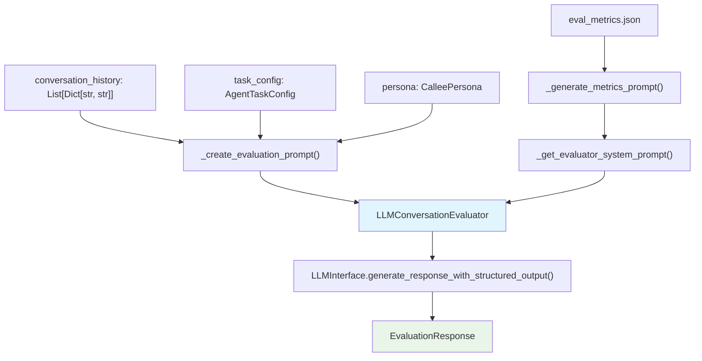
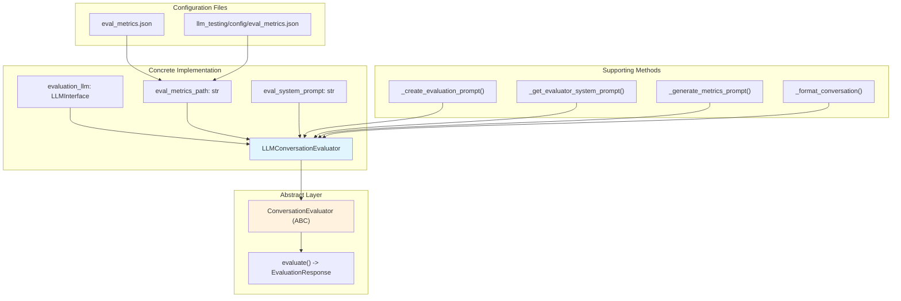
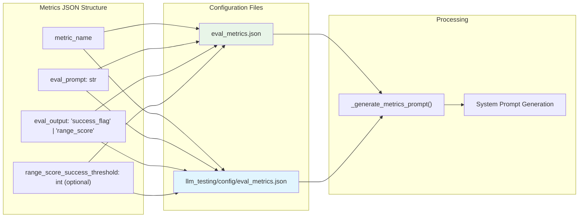
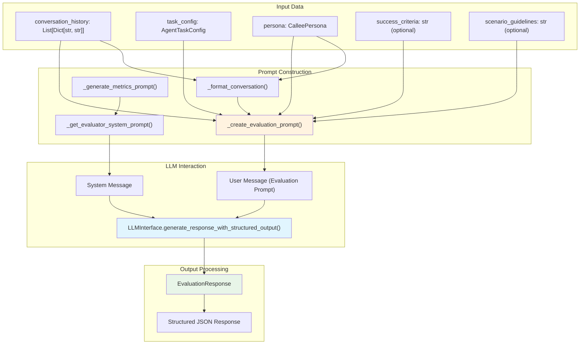

<!-- source: DeepWiki mcp.deepwiki.com · repo saharmor/voice-lab · page 5 Evaluation & Metrics · fetched 2026-10-26 -->

# Evaluation & Metrics

<details>
<summary>Relevant source files</summary>

The following files were used as context for generating this wiki page:

- [core/evaluator.py](core/evaluator.py)
- [core/utils/html_report_style.css](core/utils/html_report_style.css)
- [eval_metrics.json](eval_metrics.json)
- [llm_testing/config/eval_metrics.json](llm_testing/config/eval_metrics.json)

</details>


This document covers the evaluation system used across all Voice Lab testing modalities to assess conversation quality, goal achievement, and agent performance. The evaluation framework employs an LLM-as-a-Judge methodology with configurable metrics and structured scoring.

For information about how evaluation results are presented and formatted, see [Test Results & Reporting](#6). For details on the underlying data structures that store evaluation results, see [Data Types & Models](#7.1).

## LLM-as-a-Judge Methodology

Voice Lab uses Large Language Models as evaluators to assess conversation quality and goal achievement. This approach leverages the natural language understanding capabilities of LLMs to evaluate complex conversational interactions that would be difficult to assess with traditional rule-based systems.

The core evaluation system is implemented in the `LLMConversationEvaluator` class, which takes conversation histories and applies configurable evaluation metrics through structured LLM prompts.

**LLM-as-a-Judge Evaluation Flow**



Sources: [core/evaluator.py:21-39](), [core/evaluator.py:52-59]()

## Evaluation Architecture

The evaluation system follows a pluggable architecture with abstract interfaces and configurable metrics. The `ConversationEvaluator` abstract base class defines the evaluation contract, while concrete implementations like `LLMConversationEvaluator` provide specific evaluation strategies.

**Core Evaluation Components**



Sources: [core/evaluator.py:12-19](), [core/evaluator.py:21-26]()

## Metrics Configuration

Voice Lab supports two types of evaluation metrics defined in JSON configuration files. Each metric specifies an evaluation prompt and output format that guides the LLM evaluator.

### Metric Types and Formats

| Metric Type | Output Format | Description | Success Determination |
|-------------|---------------|-------------|----------------------|
| `success_flag` | Boolean | Binary pass/fail evaluation | Direct boolean result |
| `range_score` | Integer (0-10) | Scaled scoring with threshold | Compared against `range_score_success_threshold` |

### Web Chatbot Metrics

The primary metrics configuration focuses on web chatbot evaluation:

| Metric | Type | Threshold | Purpose |
|--------|------|-----------|---------|
| `user_goal_achieved` | `success_flag` | N/A | Whether user's primary objective was met |
| `conciseness` | `range_score` | 8 | Agent provides focused, brief responses |
| `chatbot_persona_adherence` | `range_score` | 6 | Consistency with defined character/role |
| `not_jailbroken` | `success_flag` | N/A | Agent stays within task boundaries |

### LLM Testing Metrics

For LLM conversation testing, a specialized set of metrics is used:

| Metric | Type | Threshold | Purpose |
|--------|------|-----------|---------|
| `task_completion` | `success_flag` | N/A | Whether agent attempted task completion |
| `goal_achieved` | `success_flag` | N/A | Whether specific goal was reached |
| `not_role_switched` | `success_flag` | N/A | Agent maintains consistent role |
| `not_jailbreaked` | `success_flag` | N/A | Agent follows instructions |
| `character_adherence` | `range_score` | 6 | Persona consistency throughout conversation |

**Metrics Configuration Structure**



Sources: [eval_metrics.json:1-20](), [llm_testing/config/eval_metrics.json:1-23](), [core/evaluator.py:41-50]()

## Evaluation Workflow

The evaluation process combines conversation context, task configuration, and metrics to generate structured assessments. The workflow integrates multiple data sources to provide comprehensive evaluation context to the LLM judge.

**Complete Evaluation Process**



Sources: [core/evaluator.py:28-39](), [core/evaluator.py:61-76](), [core/evaluator.py:78-83]()

## Scoring and Result Types

The evaluation system produces structured results that combine multiple metrics into comprehensive assessments. Each metric evaluation includes both a score and explanatory reasoning.

### EvaluationResponse Structure

The `EvaluationResponse` data type encapsulates all evaluation results with the following components:

- **Metric-specific scores**: Each configured metric produces either a boolean `success_flag` or integer `range_score`  
- **Explanatory reasoning**: LLM-generated explanations for each metric assessment
- **Structured format**: Consistent JSON schema for programmatic processing

### Success Determination Logic

For metrics using `range_score` output format, success is determined by comparing the score against the configured `range_score_success_threshold`:

```
success = (range_score >= range_score_success_threshold)
```

For `success_flag` metrics, the boolean value directly indicates success or failure.

Sources: [core/evaluator.py:33-37](), [eval_metrics.json:8-14]()

## Integration with Testing Systems

The evaluation framework integrates across all Voice Lab testing modalities through the `ConversationEvaluator` interface. Each testing system uses the same evaluation methodology while providing system-specific context.

### Cross-System Integration Points

| Testing System | Evaluation Integration | Context Provided |
|----------------|----------------------|------------------|
| LLM Testing | `GoalBasedTestRunner` → `LLMConversationEvaluator` | Task configuration, personas, success criteria |
| Web Evaluation | Web test scenarios → `LLMConversationEvaluator` | User personas, conversation transcripts |
| Speech Analysis | Audio processing → Evaluation metrics | Interruption data, pause analysis |
| Real-time Voice | Live conversation → Post-interaction evaluation | Real-time conversation logs |

The consistent evaluation interface allows results from different testing modalities to be compared and aggregated in unified reports.

Sources: [core/evaluator.py:12-19](), [core/evaluator.py:28-39]()

---

