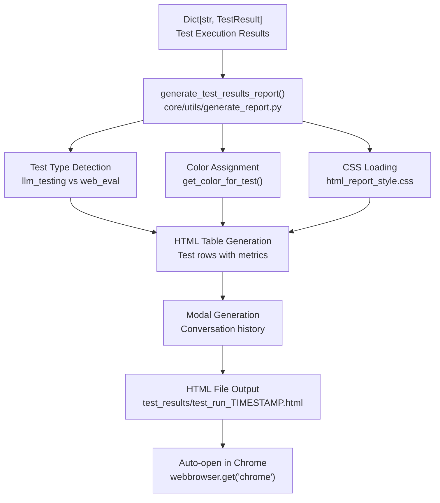
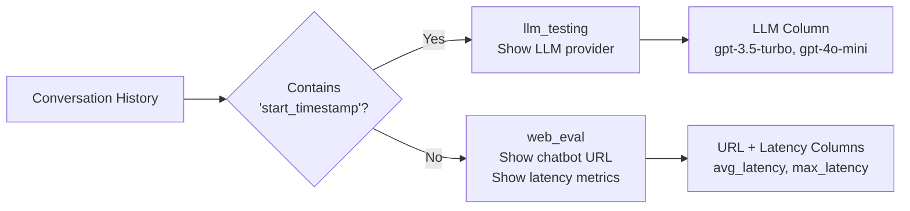
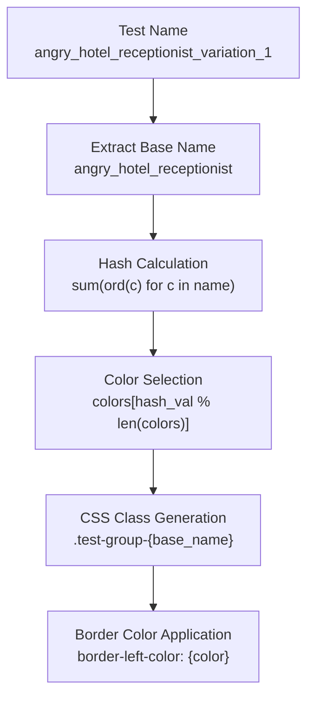
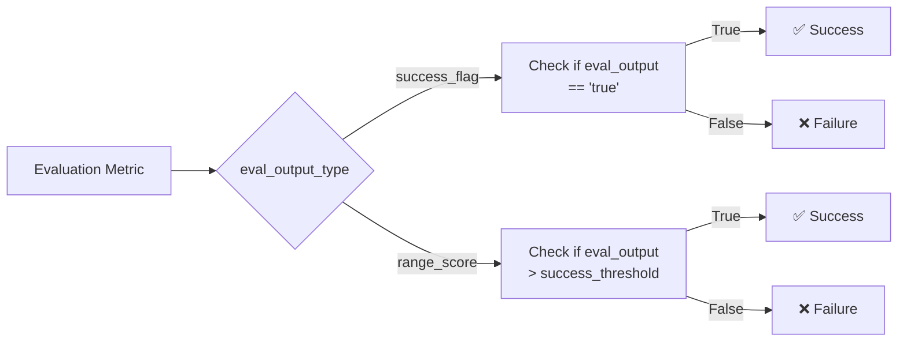
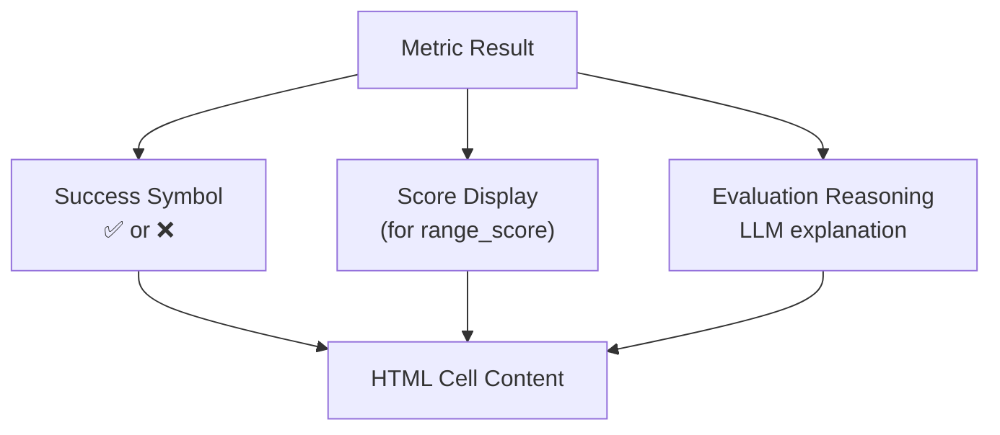
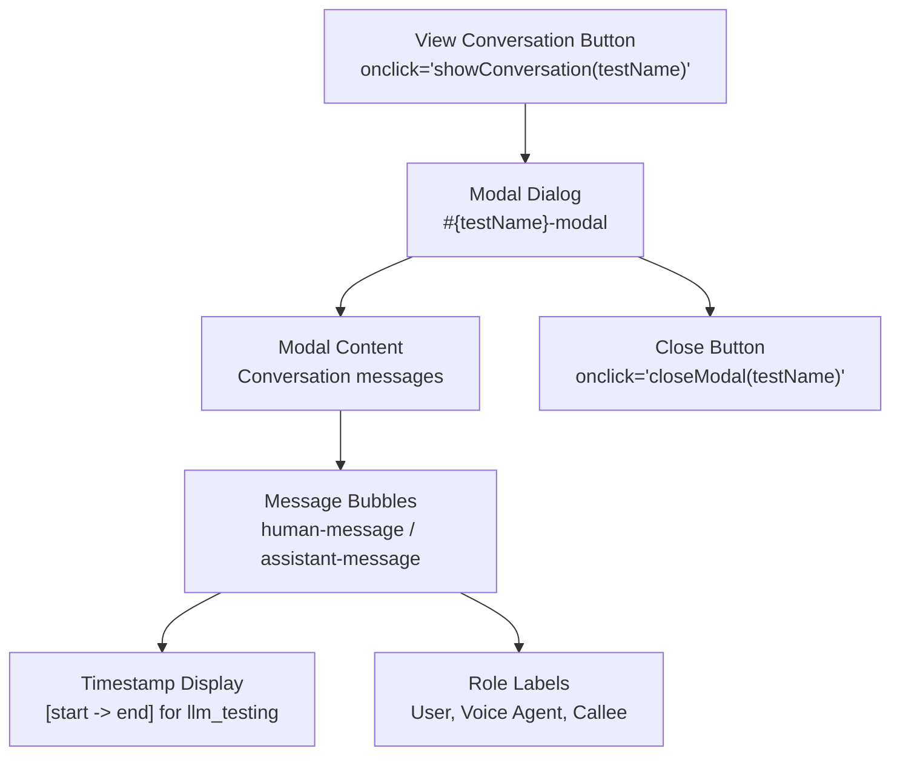
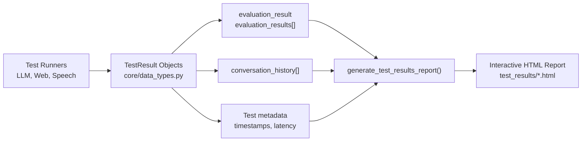

<!-- source: DeepWiki mcp.deepwiki.com · repo saharmor/voice-lab · page 6 Test Results & Reporting · fetched 2026-10-26 -->

# Test Results & Reporting

<details>
<summary>Relevant source files</summary>

The following files were used as context for generating this wiki page:

- [core/utils/generate_report.py](core/utils/generate_report.py)
- [test_results/test_run_example.html](test_results/test_run_example.html)

</details>


This document covers the test results generation and HTML reporting system in Voice Lab. The reporting system transforms test execution results into interactive HTML reports that provide comprehensive analysis of voice agent performance across all testing modalities.

For information about test execution and evaluation metrics, see [Evaluation & Metrics](#5). For details on test configuration, see [Test Configuration](#4).

## Overview

The Voice Lab reporting system generates interactive HTML reports from test execution results. The system processes `TestResult` objects containing conversation history, evaluation metrics, and metadata to create visually organized reports with drill-down capabilities for detailed analysis.

## Report Generation Process

The report generation is handled by the `generate_test_results_report()` function in [core/utils/generate_report.py:16-256](). This function takes a dictionary of test results and produces timestamped HTML files in the `test_results/` directory.



**Sources:** [core/utils/generate_report.py:16-256]()

## Report Structure and Components

### Main Table Structure

The generated HTML reports contain a structured table with the following columns:

| Column | Description | Source Code Reference |
|--------|-------------|----------------------|
| Test Name | Test scenario identifier | [core/utils/generate_report.py:96-99]() |
| Conversation | Interactive button to view full conversation | [core/utils/generate_report.py:141-145]() |
| LLM/Chatbot URL | Provider information or target URL | [core/utils/generate_report.py:102-108]() |
| Metric Columns | Dynamic columns for each evaluation metric | [core/utils/generate_report.py:109-118]() |

### Test Type Detection

The system automatically detects test types based on conversation history structure:



**Sources:** [core/utils/generate_report.py:20-21](), [core/utils/generate_report.py:102-108]()

### Color Coding System

Tests are visually grouped using consistent color coding based on base test names:



**Sources:** [core/utils/generate_report.py:23-46](), [core/utils/generate_report.py:62-68]()

## Metric Evaluation Display

### Success Indicators

The system converts evaluation results into visual success indicators using the `get_metric_success_indicator()` function:



**Sources:** [core/utils/generate_report.py:8-13]()

### Metric Display Format

Each metric cell contains:
- Success/failure emoji and text
- Score value (for range_score metrics)
- Detailed reasoning from the evaluator



**Sources:** [core/utils/generate_report.py:172-189]()

## Interactive Features

### Conversation Modal System

Each test row includes an interactive "View Conversation" button that opens a modal dialog with complete conversation history:



**Sources:** [core/utils/generate_report.py:74-90](), [core/utils/generate_report.py:194-228]()

### Message Format Handling

The system handles different message formats between test types:

| Test Type | Message Structure | Timestamp Display |
|-----------|------------------|-------------------|
| `llm_testing` | `start_timestamp`, `end_timestamp` | `[1.2s -> 3.4s]` format |
| `web_eval` | `content`, `role` | No timestamps |

**Sources:** [core/utils/generate_report.py:202-217]()

## File Organization and Output

### Directory Structure

```
test_results/
├── test_run_20240315_143022.html
├── test_run_20240315_151045.html
└── ...
```

### File Naming Convention

HTML files are generated with timestamp-based naming: `test_run_{YYYYMMDD_HHMMSS}.html`

**Sources:** [core/utils/generate_report.py:245-251]()

### Auto-Launch Behavior

Generated reports are automatically opened in Chrome browser using the `webbrowser` module:

```python
webbrowser.get('chrome').open(html_path, new=2)
```

**Sources:** [core/utils/generate_report.py:255]()

## CSS Styling System

The reports use embedded CSS loaded from `html_report_style.css` with dynamic color generation for test grouping. Key styling elements include:

- Responsive table design with horizontal scrolling
- Modal overlay system for conversation viewing
- Color-coded test grouping with border accents
- Success/failure status styling with distinct colors

**Sources:** [core/utils/generate_report.py:48-51](), [test_results/test_run_example.html:4-166]()

## Integration with Testing Framework

The reporting system integrates with the broader Voice Lab architecture through standardized data types:



**Sources:** [core/utils/generate_report.py:1-2](), [core/utils/generate_report.py:16]()

---

