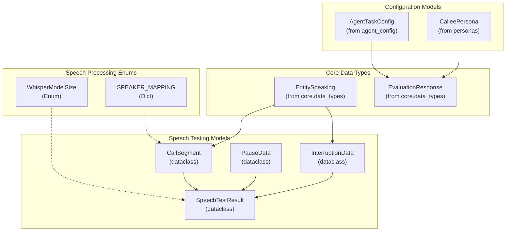
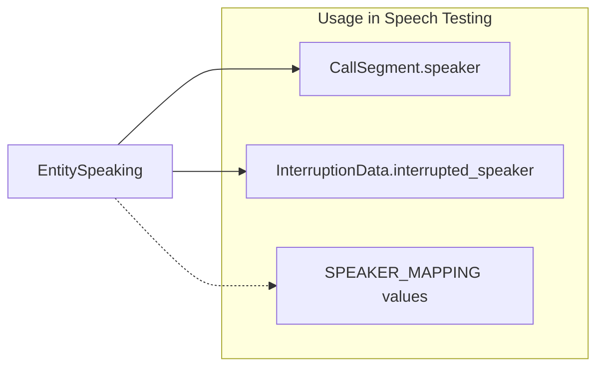
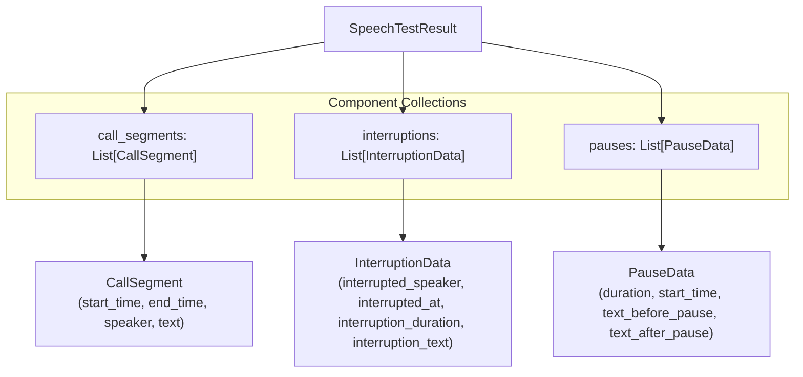
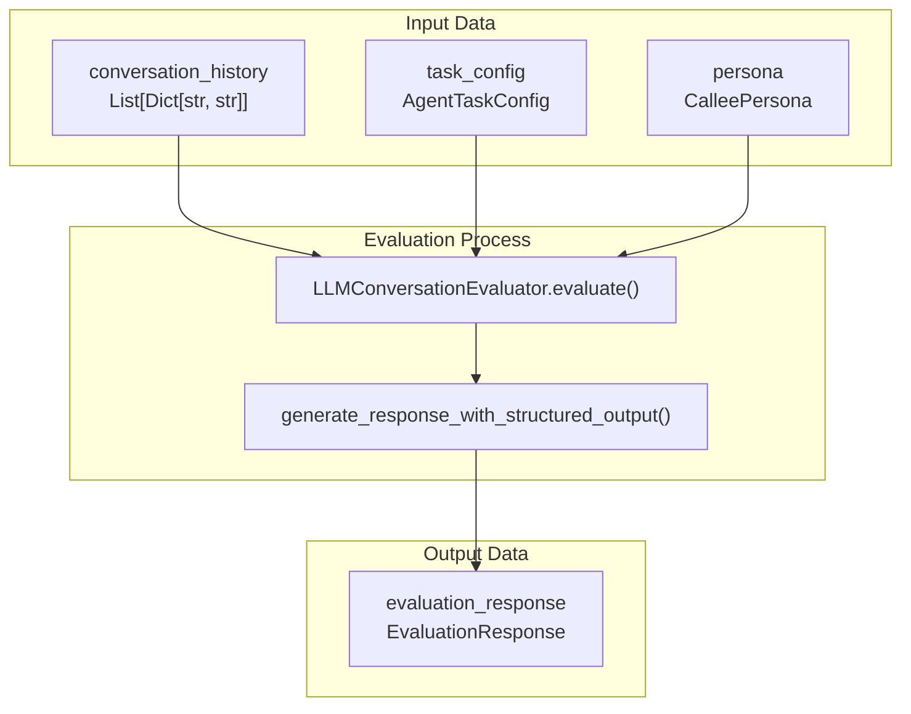
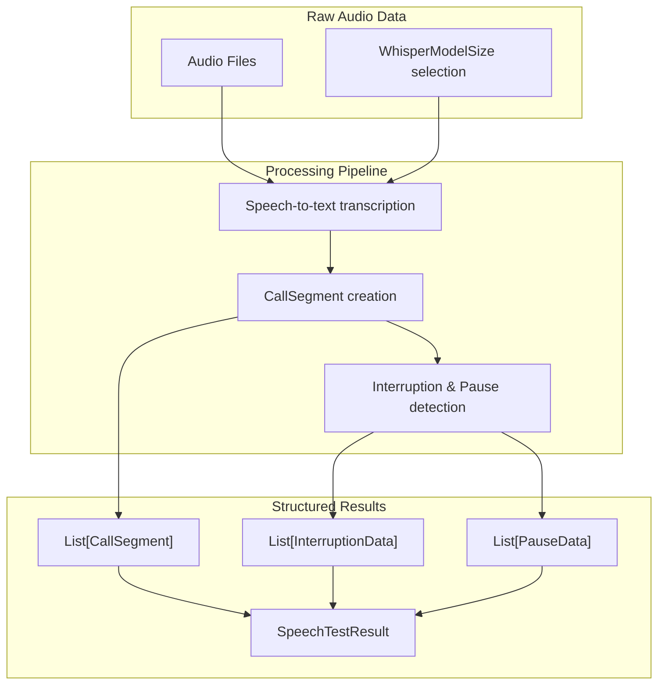

<!-- source: DeepWiki mcp.deepwiki.com · repo saharmor/voice-lab · page 7.1 Data Types & Models · fetched 2026-10-26 -->

# Data Types & Models

<details>
<summary>Relevant source files</summary>

The following files were used as context for generating this wiki page:

- [core/evaluator.py](core/evaluator.py)
- [speech_testing/data_types.py](speech_testing/data_types.py)

</details>


This document covers the core data structures and models used throughout the Voice Lab testing framework. These data types provide the foundation for representing test scenarios, conversation data, evaluation results, and speech analysis metrics across all testing modalities.

For information about how these data types are used in specific testing systems, see [LLM Conversation Testing](#3.1), [Web Chatbot Evaluation](#3.2), and [Speech Analysis Testing](#3.3). For details on the evaluation system that consumes many of these data types, see [Evaluation & Metrics](#5).

## Core Data Structure Overview

The Voice Lab framework uses a hierarchical set of data models that support different testing modalities while maintaining consistency across the system. The data types are organized into several categories based on their purpose and scope.

### Data Type Architecture



**Sources:** [core/evaluator.py:1-86](), [speech_testing/data_types.py:1-51]()

## Entity Identification Types

The framework uses consistent entity identification across different testing modalities to track speakers and participants in conversations.

### EntitySpeaking Enumeration

The `EntitySpeaking` type is imported from the core data types module and used throughout the speech testing system to identify conversation participants.



**Sources:** [speech_testing/data_types.py:5](), [speech_testing/data_types.py:11](), [speech_testing/data_types.py:34]()

## Speech Analysis Data Models

The speech testing system defines specialized data structures for analyzing audio conversations and detecting interaction patterns.

### Call Segment Structure

The `CallSegment` dataclass represents individual speaking segments within a conversation:

| Field | Type | Purpose |
|-------|------|---------|
| `start_time` | `float` | Segment start timestamp in seconds |
| `end_time` | `float` | Segment end timestamp in seconds |
| `speaker` | `EntitySpeaking` | Identity of the speaking entity |
| `text` | `str` | Transcribed text content |

**Sources:** [speech_testing/data_types.py:8-12]()

### Interruption Detection

The `InterruptionData` dataclass captures instances where one speaker interrupts another:

| Field | Type | Purpose |
|-------|------|---------|
| `interrupted_speaker` | `EntitySpeaking` | Entity that was interrupted |
| `interrupted_at` | `float` | Timestamp when interruption occurred |
| `interruption_duration` | `float` | Duration of the interruption |
| `interruption_text` | `str` | Text content of the interruption |

**Sources:** [speech_testing/data_types.py:33-37]()

### Pause Analysis

The `PauseData` dataclass identifies significant pauses in conversation flow:

| Field | Type | Purpose |
|-------|------|---------|
| `duration` | `float` | Length of pause in seconds |
| `start_time` | `float` | When the pause began |
| `text_before_pause` | `str` | Context before pause |
| `text_after_pause` | `str` | Context after pause |

**Sources:** [speech_testing/data_types.py:40-44]()

### Comprehensive Speech Results

The `SpeechTestResult` dataclass aggregates all speech analysis metrics:



**Sources:** [speech_testing/data_types.py:47-51]()

## Audio Processing Configuration

### Whisper Model Configuration

The `WhisperModelSize` enum defines available speech recognition models:

| Model Size | Enum Value | Purpose |
|------------|------------|---------|
| Tiny | `TINY` | Fastest, least accurate |
| Tiny English | `TINY_ENGLISH` | English-optimized tiny model |
| Base | `BASE` | Balanced speed/accuracy |
| Small | `SMALL` | Good accuracy, moderate speed |
| Medium | `MEDIUM` | Higher accuracy |
| Large variants | `LARGE_V1`, `LARGE_V2`, `LARGE_V3` | Highest accuracy models |

**Sources:** [speech_testing/data_types.py:15-26]()

### Speaker Identification Mapping

The `SPEAKER_MAPPING` dictionary provides fallback identification for unknown speakers:

```python
SPEAKER_MAPPING = {
    -1: "unknown"
}
```

**Sources:** [speech_testing/data_types.py:28-30]()

## Evaluation Data Types

The evaluation system uses structured data types to represent assessment results and configuration.

### Evaluation Response Structure

The `EvaluationResponse` type is used by the `LLMConversationEvaluator` to return structured evaluation results. This type is imported from the core data types module and used with structured output generation.

### Configuration Data Types

The evaluation system integrates with several configuration types:

- `AgentTaskConfig`: Defines task parameters and success criteria
- `CalleePersona`: Specifies persona characteristics for role-playing scenarios

**Sources:** [core/evaluator.py:6-9](), [core/evaluator.py:28-29]()

## Data Flow Integration

The data types work together to support the complete testing workflow from configuration through execution to evaluation.

### LLM Evaluation Data Flow



**Sources:** [core/evaluator.py:28-39]()

### Speech Analysis Data Flow



**Sources:** [speech_testing/data_types.py:8-51]()

---

