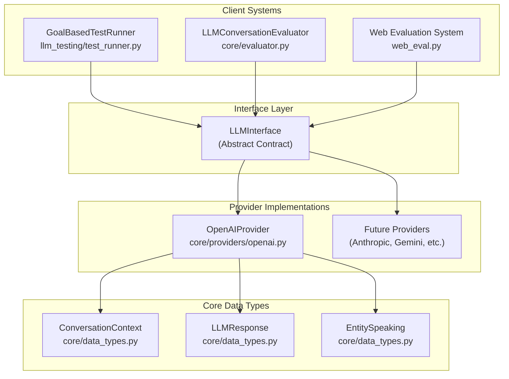
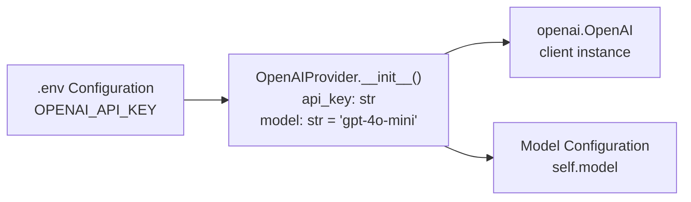
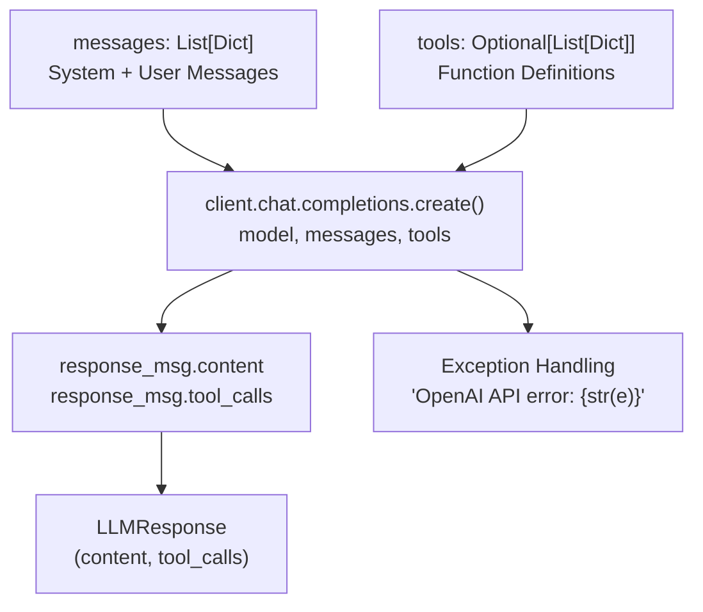
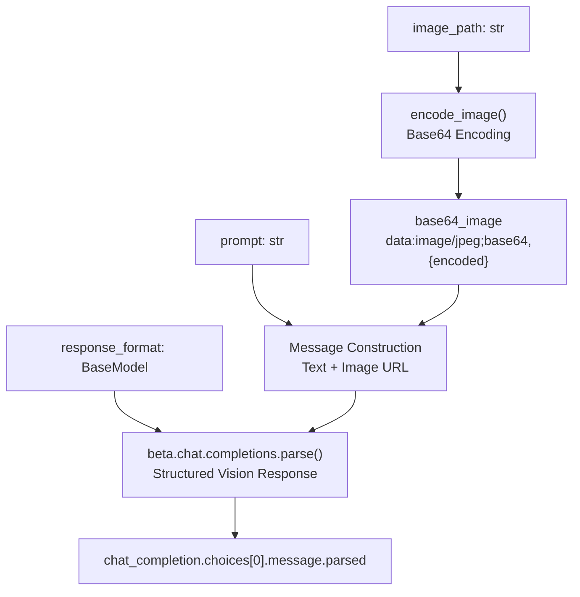
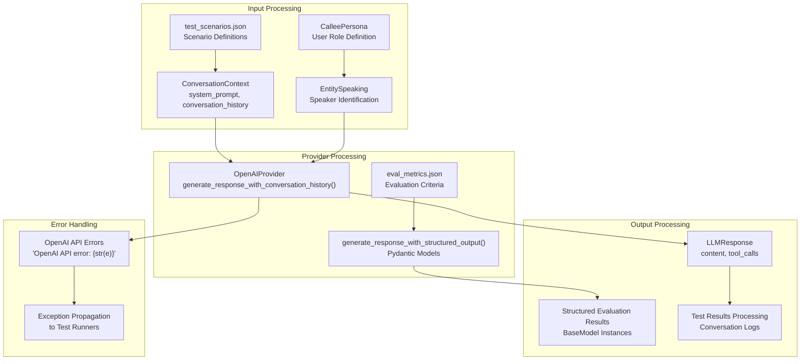

<!-- source: DeepWiki mcp.deepwiki.com · repo saharmor/voice-lab · page 7.2 LLM Providers & Interfaces · fetched 2026-10-26 -->

# LLM Providers & Interfaces

Relevant source files

The following files were used as context for generating this wiki page:

- [.example.env](.example.env)
- [core/providers/openai.py](core/providers/openai.py)

This document covers the abstraction layer that enables Voice Lab to interact with different LLM services. The provider system defines a common interface (`LLMInterface`) that abstracts away implementation details of specific LLM APIs, with the primary implementation being the OpenAI provider. This architecture allows the framework to easily swap between different LLM services while maintaining consistent behavior across all testing modalities.

For information about the core data structures used by these providers, see [Data Types & Models](#7.1). For details on how these providers are used in testing scenarios, see [LLM Conversation Testing](#3.1) and [Evaluation & Metrics](#5).

## Provider Architecture Overview

The LLM provider system follows a clean interface-based design that separates the contract definition from specific implementations.

**Sources:** [core/providers/openai.py:1-85]()

## LLM Interface Contract

The `LLMInterface` defines the contract that all LLM providers must implement. While the interface definition isn't directly visible in the provided files, we can infer its structure from the `OpenAIProvider` implementation:

| Method | Purpose | Input Types | Return Type |
|--------|---------|-------------|-------------|
| `plain_call` | Simple LLM call with system prompt | `system_prompt: str`, `messages: List[Dict]`, `tools: Optional[List[Dict]]` | `LLMResponse` |
| `generate_response_with_conversation_history` | Context-aware response generation | `ConversationContext`, `EntitySpeaking`, `tools`, `user_input` | `List[Dict[str, Any]]` |
| `generate_response_with_structured_output` | Structured response using Pydantic models | `messages: List[Dict]`, `response_format: BaseModel` | Parsed BaseModel instance |
| `generate_response` | Core response generation | `messages: List[Dict]`, `tools: Optional[List[Dict]]` | `str` |
| `analyze_image` | Vision model integration | `image_path: str`, `prompt: str`, `response_format: BaseModel` | `str` |

**Sources:** [core/providers/openai.py:15-82]()

## OpenAI Provider Implementation

The `OpenAIProvider` class serves as the primary LLM provider implementation, handling all interactions with OpenAI's API.

### Initialization and Configuration

The provider initializes with an API key and optional model specification, defaulting to `gpt-4o-mini` [core/providers/openai.py:10-13]().

**Sources:** [core/providers/openai.py:10-13](), [.example.env:1]()

### Core Method Implementations

#### Basic Response Generation

The `generate_response` method [core/providers/openai.py:44-55]() serves as the foundation for all LLM interactions:

#### Conversation History Integration

The `generate_response_with_conversation_history` method [core/providers/openai.py:18-30]() integrates with the framework's conversation tracking:

- Constructs message list from `ConversationContext.system_prompt`
- Maps conversation history based on `EntitySpeaking` enum
- Appends new user input if provided
- Delegates to core `generate_response` method

#### Structured Output Support

The `generate_response_with_structured_output` method [core/providers/openai.py:32-42]() leverages OpenAI's structured output capabilities:

- Uses `client.beta.chat.completions.parse()` for Pydantic model parsing
- Returns parsed BaseModel instances directly
- Provides type-safe structured responses for evaluation systems

**Sources:** [core/providers/openai.py:18-42]()

### Vision Model Integration

The `analyze_image` method [core/providers/openai.py:57-82]() provides vision capabilities:

**Sources:** [core/providers/openai.py:57-82]()

## Data Flow and Integration Patterns

The provider system integrates with multiple framework components through well-defined data types:

**Sources:** [core/providers/openai.py:18-55]()

## Environment Configuration

The provider system requires proper API key configuration through environment variables:

| Variable | Purpose | Required |
|----------|---------|----------|
| `OPENAI_API_KEY` | OpenAI API authentication | Yes |
| `HUGGING_FACE_TOKEN` | Hugging Face model access (for speech components) | Conditional |

The `.example.env` file provides the template for required environment variables [.example.env:1-2]().

**Sources:** [.example.env:1-2](), [core/providers/openai.py:10-13]()

## Error Handling and Reliability

The OpenAI provider implements consistent error handling patterns:

- All API calls are wrapped in try-catch blocks [core/providers/openai.py:41-42, 54-55]()
- Exceptions are re-raised with descriptive prefixes: `"OpenAI API error: {str(e)}"`
- Error propagation allows higher-level components to handle failures gracefully
- No automatic retry logic - delegated to calling systems

**Sources:** [core/providers/openai.py:41-42](), [core/providers/openai.py:54-55]()

## Extension Points

The interface-based design facilitates easy extension:

1. **New Provider Implementation**: Implement `LLMInterface` for other services (Anthropic, Google, etc.)
2. **Custom Response Processing**: Override specific methods while maintaining interface compliance
3. **Enhanced Tool Support**: Extend tool calling capabilities through the existing `tools` parameter
4. **Multimodal Extensions**: Follow the `analyze_image` pattern for additional modalities

The clean separation between interface and implementation ensures that adding new providers doesn't require changes to existing test runners or evaluation systems.

**Sources:** [core/providers/openai.py:1-85]()

---

