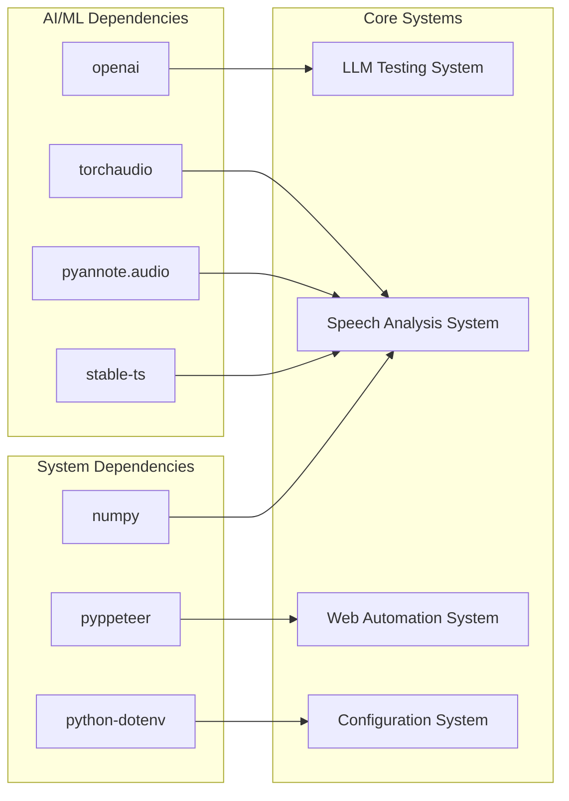
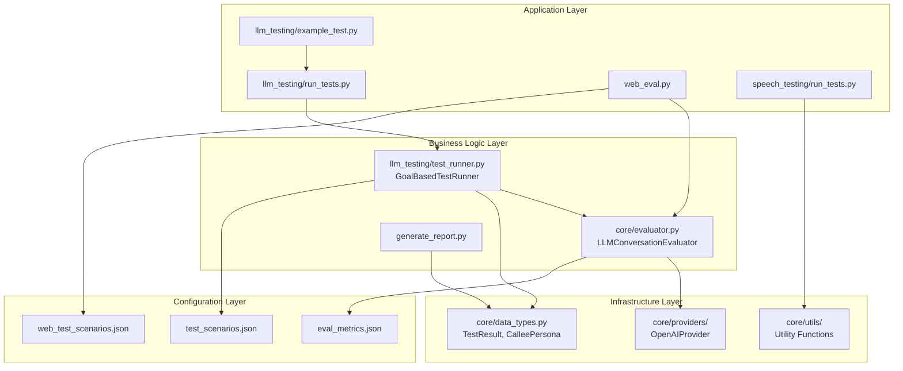

<!-- source: DeepWiki mcp.deepwiki.com · repo saharmor/voice-lab · page 9 Development Guide · fetched 2026-10-26 -->

# Development Guide

<details>
<summary>Relevant source files</summary>

The following files were used as context for generating this wiki page:

- [.gitignore](.gitignore)
- [core/utils.py](core/utils.py)
- [core/utils/__init__.py](core/utils/__init__.py)
- [requirements.txt](requirements.txt)

</details>


This document provides developer-focused guidance for working with the Voice Lab codebase, including project structure, development patterns, utilities, and contribution guidelines. It is intended for developers who want to understand, modify, or extend the Voice Lab testing framework.

For information about setting up and running tests, see [Getting Started](#2). For details about the internal architecture and core components, see [Core Architecture](#7).

## Project Structure Overview

Voice Lab follows a modular architecture organized around four main testing systems, with shared core components and utilities.

### High-Level Organization

```mermaid
graph TD
    VoiceLab["voice-lab/"]
    
    subgraph "Core Infrastructure"
        Core["core/"]
        CoreDT["core/data_types.py"]
        CoreEval["core/evaluator.py"] 
        CoreProv["core/providers/"]
        CoreUtils["core/utils/"]
    end
    
    subgraph "Testing Systems"
        LLMTest["llm_testing/"]
        WebEval["web_eval.py"]
        SpeechTest["speech_testing/"]
        EvalAgent["eval_agent/"]
    end
    
    subgraph "Configuration"
        TestScenarios["test_scenarios.json"]
        WebScenarios["web_test_scenarios.json"]
        EvalMetrics["eval_metrics.json"]
    end
    
    subgraph "Output & Utilities"
        TestResults["test_results/"]
        GenReport["generate_report.py"]
        Requirements["requirements.txt"]
        GitIgnore[".gitignore"]
    end
    
    VoiceLab --> Core
    VoiceLab --> LLMTest
    VoiceLab --> WebEval
    VoiceLab --> SpeechTest
    VoiceLab --> EvalAgent
    VoiceLab --> TestScenarios
    VoiceLab --> WebScenarios
    VoiceLab --> EvalMetrics
    VoiceLab --> TestResults
    VoiceLab --> GenReport
    VoiceLab --> Requirements
    VoiceLab --> GitIgnore
    
    Core --> CoreDT
    Core --> CoreEval
    Core --> CoreProv
    Core --> CoreUtils
```



Sources: [.gitignore:1-172](), [requirements.txt:1-8](), [core/utils/__init__.py:1](), [core/utils.py:1-7]()

### Directory Structure Patterns

The codebase follows these organizational patterns:

| Directory | Purpose | Key Files |
|-----------|---------|-----------|
| `core/` | Shared infrastructure and interfaces | `data_types.py`, `evaluator.py`, `providers/` |
| `llm_testing/` | LLM conversation testing system | `run_tests.py`, `test_runner.py`, `example_test.py` |
| `speech_testing/` | Audio analysis and speech processing | `run_tests.py`, `audio_files/` |
| `eval_agent/` | Real-time voice interaction system | `gemini_connection.py` |
| `test_results/` | Generated HTML reports and output | `*.html` files |
| `core/utils/` | Shared utility functions | Helper modules |

## Development Environment

### Core Dependencies

The framework requires several key dependencies for different functionality areas:



Sources: [requirements.txt:1-8]()

### Git Configuration

The project excludes several categories of files from version control:

- **Generated Content**: `test_results/*` (except example), `speech_testing/audio_files/*`
- **Development Files**: `demo_*`, `test.wav`, `airtop_test.py`, `screenshots/*`
- **Standard Python Exclusions**: `__pycache__/`, `.env`, virtual environments
- **System Files**: `.DS_Store`

Sources: [.gitignore:163-172]()

## Core Development Patterns

### Module Organization

The codebase uses a layered architecture where core components provide shared functionality to specialized testing systems:



Sources: Based on system architecture diagrams and file structure analysis

### Utility Functions

The framework includes shared utilities in the `core/utils` module. Currently implemented utilities include system interaction functions:

```python
# core/utils.py example
def play_beep():
    os.system( "say 'ready'" )
```

The `play_beep()` function provides audio feedback during development and testing workflows.

Sources: [core/utils.py:4-6]()

## Code Extension Patterns

### Adding New Testing Modalities

To add a new testing system, follow the established pattern:

1. **Create Module Directory**: Follow naming pattern like `new_testing/`
2. **Implement Core Interface**: Use `core/data_types.py` structures
3. **Add Configuration Support**: Extend JSON scenario format
4. **Integrate with Reporting**: Use `generate_report.py` patterns
5. **Update Dependencies**: Add to `requirements.txt` if needed

### Provider Integration

New LLM providers should be added under `core/providers/` following the established interface patterns. The current OpenAI provider serves as the reference implementation.

### Utility Development

Shared utilities should be added to `core/utils/` with appropriate module organization. The `__init__.py` file manages module exports.

Sources: [core/utils/__init__.py:1]()

## Development Workflow

### File Exclusions

When developing, be aware of these excluded patterns:

- **Audio Files**: `speech_testing/audio_files/*` are excluded to avoid large binary commits
- **Test Results**: `test_results/*` except example files  
- **Demo Content**: `demo_*` prefixed files for experimentation
- **Screenshots**: `screenshots/*` directory for development artifacts

### Environment Management

The framework uses `python-dotenv` for configuration management. Environment variables should be stored in `.env` files (excluded from version control).

Sources: [.gitignore:125,163-172](), [requirements.txt:2]()

## Testing and Quality Assurance

### Test Structure

The framework includes multiple test entry points:

- `llm_testing/example_test.py` - Example LLM test implementation
- `llm_testing/run_tests.py` - Main LLM test orchestration  
- `speech_testing/run_tests.py` - Speech analysis test runner

### Output Management

Test results are generated in `test_results/` directory with HTML format. The `test_run_example.html` file is preserved as a reference example.

Sources: [.gitignore:163-164]()

## Contribution Guidelines

### Code Organization Principles

1. **Separation of Concerns**: Keep testing systems modular and independent
2. **Shared Infrastructure**: Use `core/` for common functionality
3. **Configuration-Driven**: Externalize test scenarios and metrics to JSON
4. **Consistent Interfaces**: Follow established patterns in `core/data_types.py`

### Development Dependencies

Ensure all required dependencies are specified in `requirements.txt`:

- **AI/ML Stack**: `openai`, `torchaudio`, `pyannote.audio`, `stable-ts`
- **Web Automation**: `pyppeteer`
- **Utilities**: `python-dotenv`, `numpy`

Sources: [requirements.txt:1-8]()

### File Management

Follow the established `.gitignore` patterns to avoid committing:
- Generated test results and audio files
- Environment configuration
- Development artifacts and demo files
- System-specific files

Sources: [.gitignore:1-172]()

---

