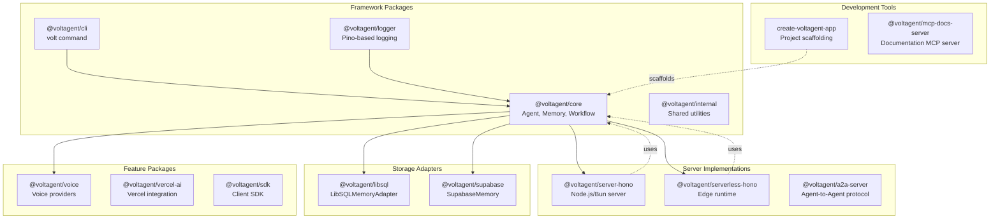
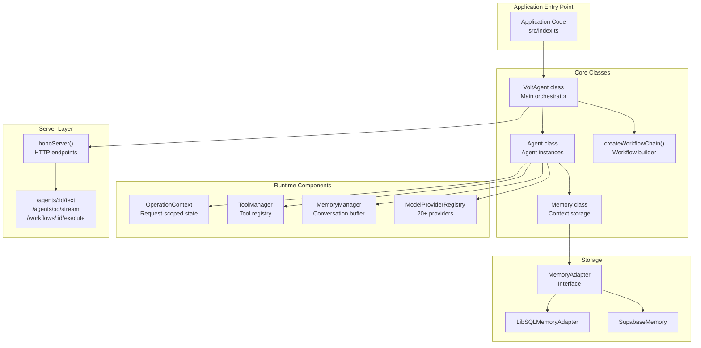
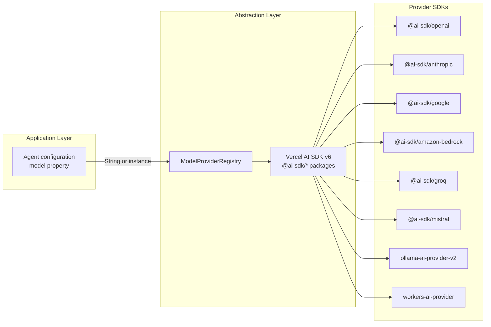
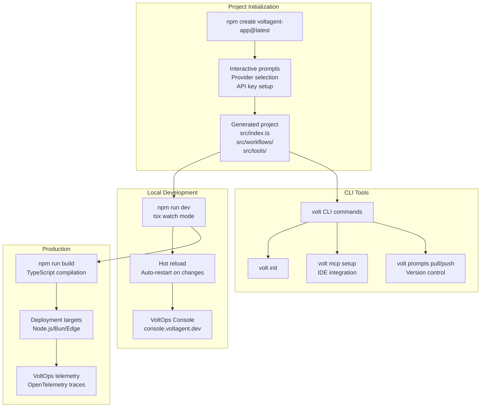

<!-- source: DeepWiki mcp.deepwiki.com · repo VoltAgent/voltagent · page 1 Overview · fetched 2026-10-26 -->

# Overview

<details>
<summary>Relevant source files</summary>

The following files were used as context for generating this wiki page:

- [CHANGELOG.md](CHANGELOG.md)
- [README.md](README.md)
- [changelog.sh](changelog.sh)
- [examples/base/src/index.ts](examples/base/src/index.ts)
- [examples/with-google-ai/package.json](examples/with-google-ai/package.json)
- [examples/with-google-vertex-ai/package.json](examples/with-google-vertex-ai/package.json)
- [examples/with-groq-ai/package.json](examples/with-groq-ai/package.json)
- [examples/with-mcp/package.json](examples/with-mcp/package.json)
- [examples/with-nextjs/package.json](examples/with-nextjs/package.json)
- [i18n/README-cn-bsc.md](i18n/README-cn-bsc.md)
- [i18n/README-cn-traditional.md](i18n/README-cn-traditional.md)
- [i18n/README-jp.md](i18n/README-jp.md)
- [i18n/README-kr.md](i18n/README-kr.md)
- [packages/cli/README.md](packages/cli/README.md)
- [packages/cli/package.json](packages/cli/package.json)
- [packages/core/README.md](packages/core/README.md)
- [packages/core/package.json](packages/core/package.json)
- [packages/create-voltagent-app/CHANGELOG.md](packages/create-voltagent-app/CHANGELOG.md)
- [packages/create-voltagent-app/package.json](packages/create-voltagent-app/package.json)
- [packages/supabase/README.md](packages/supabase/README.md)
- [packages/voice/CHANGELOG.md](packages/voice/CHANGELOG.md)
- [packages/voice/README.md](packages/voice/README.md)
- [packages/voice/package.json](packages/voice/package.json)
- [pnpm-lock.yaml](pnpm-lock.yaml)

</details>


VoltAgent is an end-to-end AI Agent Engineering Platform consisting of two main components: an open-source TypeScript framework for building intelligent agents with memory, tools, and multi-step workflows, and the VoltOps Console (cloud or self-hosted) for observability, automation, and deployment. This document provides a high-level introduction to the system architecture, package organization, and core concepts.

For detailed information about specific subsystems:
- Agent system implementation: see [Core Agent System](#2)
- Architecture and orchestration: see [Architecture Overview](#1.1)
- Monorepo package structure: see [Package Ecosystem](#1.2)
- Workflow orchestration: see [Workflow System](#3)
- Multi-agent coordination: see [Sub-Agent and Supervisor Patterns](#4)
- Platform features: see [VoltOps Platform](#9)
- Quick start guide: see [Getting Started](#1.3)

## System Components

VoltAgent is organized as a monorepo containing framework packages, server implementations, storage adapters, specialized features, and 40+ example applications. The framework provides the runtime and abstractions for building agents, while VoltOps Console provides production-ready observability and operations.



**Sources:** [pnpm-lock.yaml:1-110](), [packages/core/package.json:1-112](), [README.md:43-66]()

## Core Framework Architecture

The framework centers around the `Agent` class from `@voltagent/core`, which serves as the primary abstraction for building AI agents. Applications instantiate the `VoltAgent` class to register agents and workflows, then attach a server implementation to expose them via HTTP.



**Sources:** [README.md:85-124](), [examples/base/src/index.ts:1-31](), [packages/core/package.json:1-112]()

## Application Structure

A typical VoltAgent application follows this initialization pattern, as generated by `create-voltagent-app`:

| Component | Purpose | Configuration |
|-----------|---------|---------------|
| `Agent` | Define agent behavior | `name`, `instructions`, `model`, `tools`, `memory` |
| `Memory` | Persistent conversation storage | Storage adapter (LibSQL, Supabase, etc.) |
| `createPinoLogger` | Structured logging | Log level, output format |
| `honoServer()` | HTTP server | Port, CORS, middleware |
| `VoltAgent` | Main orchestrator | Agents map, workflows map, server instance |

The framework uses dependency injection—agents receive a `Memory` instance, tools receive lifecycle hooks, and the `VoltAgent` class coordinates all components. Agents execute via `generateText()` or `streamText()` methods that handle the full LLM interaction lifecycle.

**Sources:** [README.md:85-124](), [examples/base/src/index.ts:1-31](), [packages/core/package.json:1-112]()

## Multi-Provider Architecture

VoltAgent abstracts model providers through Vercel AI SDK v6, supporting 20+ providers via a unified interface. Applications reference models using string identifiers (`"provider/model-name"`) or direct SDK instances, enabling provider switching through configuration rather than code changes.



The framework also supports model fallback arrays for resilience and automatic failover if the primary model is unavailable or rate-limited.

**Sources:** [packages/core/package.json:6-50](), [pnpm-lock.yaml:113-224]()

## Development Workflow

VoltAgent provides a complete development toolchain from project creation through production deployment:



**Sources:** [README.md:73-143](), [packages/create-voltagent-app/package.json:1-61](), [CHANGELOG.md:16-28]()

## Observability Integration

VoltAgent includes built-in observability through OpenTelemetry instrumentation and VoltOps Console integration. The framework automatically exports traces and logs for agent executions, tool calls, and workflow steps.

| Component | Technology | Purpose |
|-----------|------------|---------|
| Trace Export | `@opentelemetry/exporter-trace-otlp-http` | Distributed tracing |
| Log Export | `@opentelemetry/exporter-logs-otlp-http` | Structured logging |
| Semantic Conventions | `@opentelemetry/semantic-conventions` | Standardized attributes |
| VoltOpsClient | Custom integration | Console connectivity |

Applications receive automatic instrumentation. VoltOps Console displays real-time execution traces, performance metrics, conversation history, and workflow visualization.

**Sources:** [packages/core/package.json:27-38](), [README.md:46-48]()

## Example Applications

The monorepo contains 40+ example applications demonstrating integration patterns, provider usage, and advanced features.

- **Basic patterns**: `examples/base` [examples/base/src/index.ts:1-31]()
- **Provider integrations**: `examples/with-google-ai`, `examples/with-groq-ai`, `examples/with-google-vertex-ai`
- **Advanced features**: `examples/with-mcp`, `examples/with-nextjs`
- **Voice capabilities**: Demonstrated via `@voltagent/voice` [packages/voice/package.json:1-57]()

**Sources:** [pnpm-lock.yaml:111-224](), [README.md:19-20]()

## Getting Started

New projects use the `create-voltagent-app` scaffolding tool:

```bash
npm create voltagent-app@latest
```

This generates a fully configured project with TypeScript compilation, development server with hot reload, memory persistence (e.g., LibSQL), and structured logging. For more details, see [Getting Started](#1.3).

**Sources:** [README.md:73-83](), [packages/create-voltagent-app/package.json:1-8]()

---

