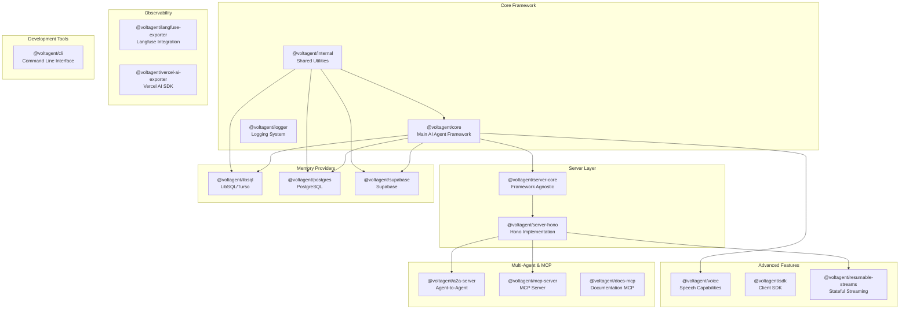
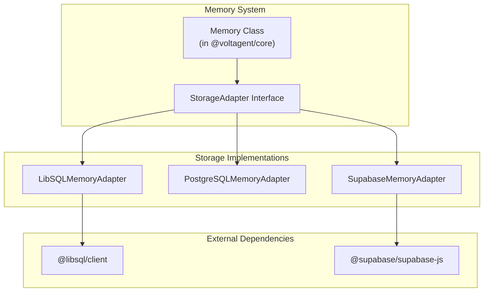
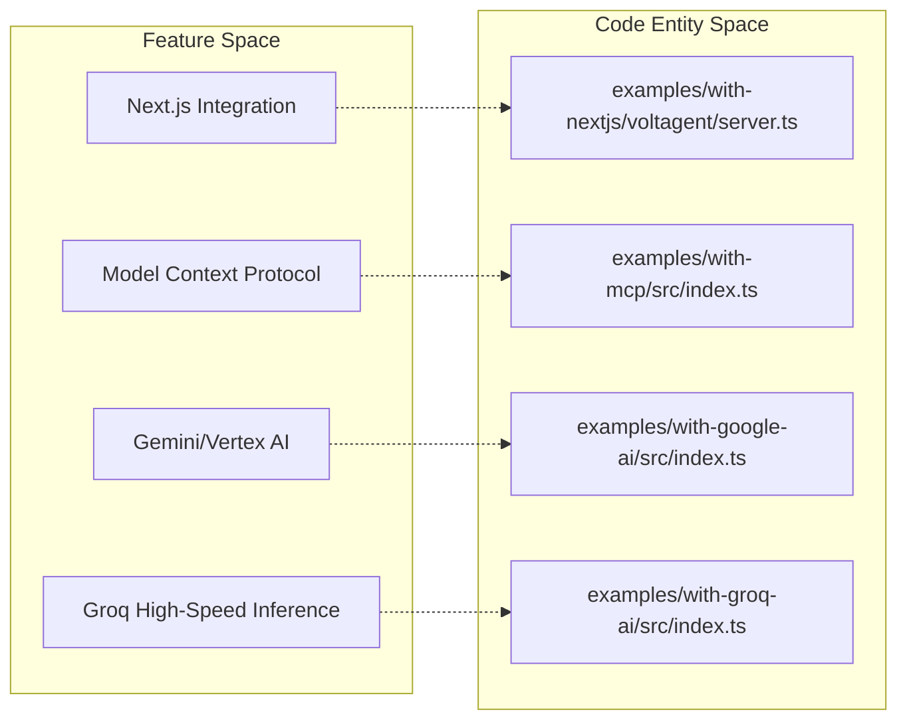
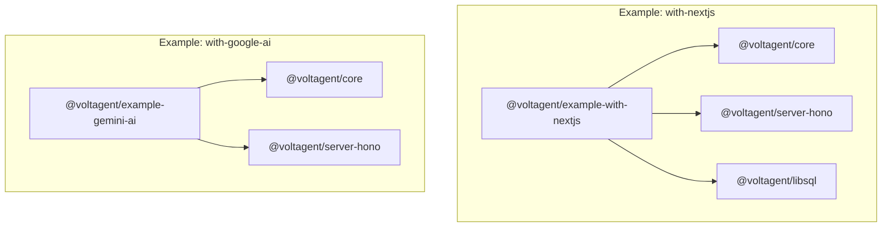

<!-- source: DeepWiki mcp.deepwiki.com · repo VoltAgent/voltagent · page 1.2 Package Ecosystem · fetched 2026-10-26 -->

# Package Ecosystem

Relevant source files

The following files were used as context for generating this wiki page:

- [examples/with-google-ai/package.json](examples/with-google-ai/package.json)
- [examples/with-google-vertex-ai/package.json](examples/with-google-vertex-ai/package.json)
- [examples/with-groq-ai/package.json](examples/with-groq-ai/package.json)
- [examples/with-mcp/package.json](examples/with-mcp/package.json)
- [examples/with-nextjs/package.json](examples/with-nextjs/package.json)
- [packages/core/package.json](packages/core/package.json)
- [packages/langfuse-exporter/CHANGELOG.md](packages/langfuse-exporter/CHANGELOG.md)
- [packages/langfuse-exporter/package.json](packages/langfuse-exporter/package.json)
- [packages/libsql/package.json](packages/libsql/package.json)
- [packages/sdk/CHANGELOG.md](packages/sdk/CHANGELOG.md)
- [packages/sdk/package.json](packages/sdk/package.json)
- [packages/server-core/CHANGELOG.md](packages/server-core/CHANGELOG.md)
- [packages/server-core/package.json](packages/server-core/package.json)
- [packages/server-hono/package.json](packages/server-hono/package.json)
- [packages/supabase/CHANGELOG.md](packages/supabase/CHANGELOG.md)
- [packages/supabase/package.json](packages/supabase/package.json)
- [packages/vercel-ai-exporter/CHANGELOG.md](packages/vercel-ai-exporter/CHANGELOG.md)
- [packages/vercel-ai-exporter/package.json](packages/vercel-ai-exporter/package.json)
- [pnpm-lock.yaml](pnpm-lock.yaml)

This document provides a comprehensive overview of all packages in the VoltAgent monorepo, their purposes, relationships, and integration patterns. The VoltAgent framework is organized as a monorepo containing core framework packages, memory providers, server implementations, observability tools, and development utilities.

For information about the overall system architecture, see [Architecture Overview](#1.1). For getting started with package installation and usage, see [Getting Started](#1.3).

## Package Organization

The VoltAgent monorepo contains over 15 packages organized into distinct categories, each serving specific roles in the AI agent framework ecosystem.

### Package Categories Diagram

Sources: [pnpm-lock.yaml:1-110](), [packages/core/package.json:1-50](), [packages/server-hono/package.json:1-17]()

## Core Framework Packages

### @voltagent/core

The foundational package providing the core AI agent framework with agent orchestration, memory management, tool execution, and workflow capabilities. It acts as the primary interface for developers to build autonomous agents.

**Key Features:**
- `Agent` class for AI agent creation and management [packages/core/package.json:2-3]().
- `Memory` system with pluggable storage adapters.
- `ToolManager` for tool registration and execution.
- Model Provider Registry supporting 20+ providers including OpenAI, Anthropic, Google, and Bedrock [packages/core/package.json:6-22]().
- OpenTelemetry integration for observability [packages/core/package.json:27-38]().

**Dependencies:**
- `@modelcontextprotocol/sdk` for MCP integration [packages/core/package.json:25-25]().
- `@opentelemetry/*` packages for telemetry [packages/core/package.json:27-38]().
- `@voltagent/internal` for shared utilities [packages/core/package.json:39-39]().
- `ts-pattern` for pattern matching [packages/core/package.json:44-44]().
- `zod-from-json-schema` for schema conversion [packages/core/package.json:48-49]().

Sources: [packages/core/package.json:1-112]()

### @voltagent/internal

Shared internal utilities used across VoltAgent packages, providing common functionality for serialization, validation, and helper functions.

Sources: [packages/core/package.json:39-39](), [packages/libsql/package.json:7-7](), [packages/server-core/package.json:8-8]()

### @voltagent/logger

Logging system providing structured logging capabilities for VoltAgent applications with configurable output formats and levels. It is an optional peer dependency for core and storage packages.

Sources: [packages/core/package.json:81-89](), [packages/supabase/package.json:36-36](), [packages/libsql/package.json:45-45]()

## Memory Provider Packages

Memory providers implement the storage adapter interface to persist agent conversations, working memory, and history across different database systems.

### Package Dependencies Diagram

Sources: [packages/libsql/package.json:1-8](), [packages/supabase/package.json:1-9]()

### @voltagent/libsql

LibSQL/Turso memory provider implementing persistent storage using LibSQL databases, supporting both local SQLite and distributed Turso deployments.

**Key Features:**
- `LibSQLMemoryAdapter` implementing `StorageAdapter`.
- Local SQLite and remote Turso support [packages/libsql/package.json:6-6]().
- Edge-ready exports for Cloudflare Workers/Vercel Edge [packages/libsql/package.json:26-35]().

Sources: [packages/libsql/package.json:1-68]()

### @voltagent/supabase

Supabase memory provider enabling cloud-native persistence with real-time capabilities and PostgreSQL storage.

**Key Features:**
- `SupabaseMemoryAdapter` for Supabase integration.
- Built-in authentication and Row Level Security (RLS) support [packages/supabase/package.json:6-6]().

Sources: [packages/supabase/package.json:1-56]()

## Server and API Packages

### @voltagent/server-core

Framework-agnostic server core providing HTTP API functionality, WebSocket support, and MCP integration without dependency on specific web frameworks. It handles the heavy lifting of request/response parsing and security.

**Key Features:**
- REST API route handlers for agents and workflows.
- JWT authentication middleware [packages/server-core/package.json:10-10]().
- `createServerCoreSchemas` factory for Zod-based validation [packages/server-core/CHANGELOG.md:18-22]().
- Support for request-scoped headers in dynamic agent configurations [packages/server-core/CHANGELOG.md:31-40]().

Sources: [packages/server-core/package.json:1-65](), [packages/server-core/CHANGELOG.md:1-50]()

### @voltagent/server-hono

Hono-based server implementation providing a complete HTTP server with OpenAPI documentation and production-ready features.

**Key Features:**
- `HonoVoltAgentServer` class.
- OpenAPI/Swagger documentation generation [packages/server-hono/package.json:7-7]().
- Integration with `@voltagent/resumable-streams` for stateful client connections [packages/server-hono/package.json:12-12]().

Sources: [packages/server-hono/package.json:1-57]()

## Example Projects Structure

The monorepo includes comprehensive example projects demonstrating various VoltAgent capabilities.

### Natural Language to Code Mapping

The following diagram maps high-level features to their implementation examples in the codebase.

Sources: [examples/with-nextjs/package.json:43-43](), [examples/with-mcp/package.json:28-28](), [examples/with-google-ai/package.json:32-32](), [examples/with-groq-ai/package.json:32-32]()

### Dependency Mapping for Integration

This diagram shows how specific integration examples pull in the necessary packages from the ecosystem.

Sources: [examples/with-nextjs/package.json:8-13](), [examples/with-google-ai/package.json:5-11]()

### Example Categories

| Category | Examples | Purpose |
|----------|----------|---------|
| **Framework Base** | `examples/base` | Minimal setup with OpenAI and LibSQL [examples/base/package.json:111-136](). |
| **Frontend Integration** | `examples/with-nextjs` | Next.js 16 + React 19 implementation [examples/with-nextjs/package.json:15-19](). |
| **LLM Providers** | `with-google-ai`, `with-groq-ai`, `with-google-vertex-ai` | Dedicated provider configurations [examples/with-google-ai/package.json:1-12](). |
| **Protocol Support** | `examples/with-mcp` | Demonstrating MCP filesystem server integration [examples/with-mcp/package.json:2-3](). |
| **Serverless** | `examples/github-star-stories` | Cloudflare Workers + Wrangler deployment [examples/github-star-stories/package.json:202-210](). |

Sources: [examples/base/package.json:1-147](), [examples/with-nextjs/package.json:1-46](), [examples/with-mcp/package.json:1-34](), [examples/github-star-stories/package.json:188-224]()

---

