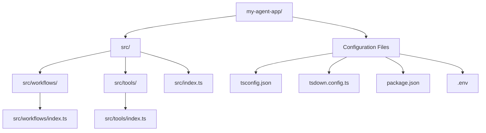
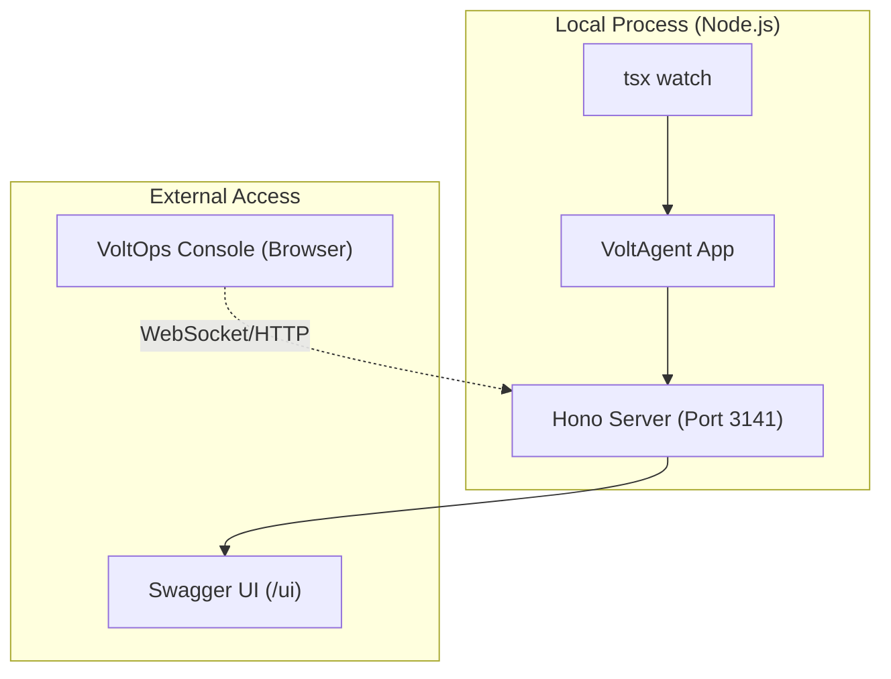
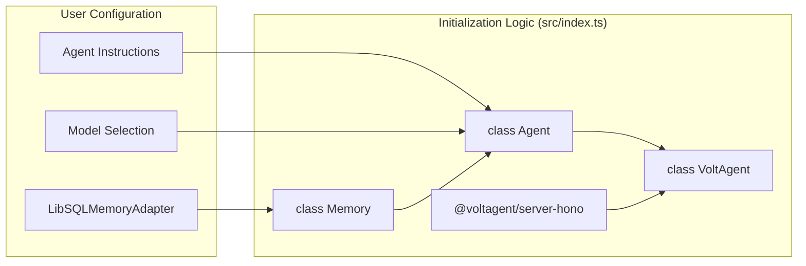

<!-- source: DeepWiki mcp.deepwiki.com · repo VoltAgent/voltagent · page 1.3 Getting Started · fetched 2026-10-26 -->

# Getting Started

<details>
<summary>Relevant source files</summary>

The following files were used as context for generating this wiki page:

- [CONSOLE.md](CONSOLE.md)
- [examples/base/package.json](examples/base/package.json)
- [examples/github-repo-analyzer/package.json](examples/github-repo-analyzer/package.json)
- [examples/with-rag-chatbot/package.json](examples/with-rag-chatbot/package.json)
- [examples/with-retrieval/package.json](examples/with-retrieval/package.json)
- [examples/with-subagents/package.json](examples/with-subagents/package.json)
- [examples/with-supabase/package.json](examples/with-supabase/package.json)
- [examples/with-tools/package.json](examples/with-tools/package.json)
- [examples/with-vercel-ai/package.json](examples/with-vercel-ai/package.json)
- [examples/with-voice-elevenlabs/package.json](examples/with-voice-elevenlabs/package.json)
- [examples/with-voice-openai/package.json](examples/with-voice-openai/package.json)
- [packages/core/src/tool/manager/BaseToolManager.ts](packages/core/src/tool/manager/BaseToolManager.ts)
- [packages/core/src/tool/manager/ToolkitManager.ts](packages/core/src/tool/manager/ToolkitManager.ts)
- [packages/create-voltagent-app/README.md](packages/create-voltagent-app/README.md)
- [packages/create-voltagent-app/src/cli.integration.spec.ts](packages/create-voltagent-app/src/cli.integration.spec.ts)
- [packages/create-voltagent-app/src/cli.ts](packages/create-voltagent-app/src/cli.ts)
- [packages/create-voltagent-app/src/project-creator.ts](packages/create-voltagent-app/src/project-creator.ts)
- [packages/create-voltagent-app/src/types.ts](packages/create-voltagent-app/src/types.ts)
- [packages/create-voltagent-app/src/utils/analytics.ts](packages/create-voltagent-app/src/utils/analytics.ts)
- [packages/create-voltagent-app/src/utils/animation.ts](packages/create-voltagent-app/src/utils/animation.ts)
- [packages/create-voltagent-app/src/utils/dependency-installer.ts](packages/create-voltagent-app/src/utils/dependency-installer.ts)
- [packages/create-voltagent-app/src/utils/env-manager.ts](packages/create-voltagent-app/src/utils/env-manager.ts)
- [packages/create-voltagent-app/src/utils/package-manager.ts](packages/create-voltagent-app/src/utils/package-manager.ts)
- [packages/create-voltagent-app/src/utils/templates.ts](packages/create-voltagent-app/src/utils/templates.ts)
- [packages/create-voltagent-app/templates/base/.dockerignore.template](packages/create-voltagent-app/templates/base/.dockerignore.template)
- [packages/create-voltagent-app/templates/base/README.md.template](packages/create-voltagent-app/templates/base/README.md.template)
- [packages/create-voltagent-app/templates/base/index.ts.template](packages/create-voltagent-app/templates/base/index.ts.template)
- [packages/create-voltagent-app/templates/base/tools/index.ts.template](packages/create-voltagent-app/templates/base/tools/index.ts.template)
- [packages/create-voltagent-app/templates/base/tsconfig.json.template](packages/create-voltagent-app/templates/base/tsconfig.json.template)
- [packages/create-voltagent-app/templates/base/tsdown.config.ts.template](packages/create-voltagent-app/templates/base/tsdown.config.ts.template)
- [packages/create-voltagent-app/templates/base/workflows/index.ts.template](packages/create-voltagent-app/templates/base/workflows/index.ts.template)
- [website/docs/getting-started/manual-setup.md](website/docs/getting-started/manual-setup.md)
- [website/docs/getting-started/overview.md](website/docs/getting-started/overview.md)
- [website/docs/getting-started/quick-start.md](website/docs/getting-started/quick-start.md)
- [website/src/components/docs-widgets/EnterpriseCard.tsx](website/src/components/docs-widgets/EnterpriseCard.tsx)
- [website/src/components/docs-widgets/WorkflowDiagramFlow.tsx](website/src/components/docs-widgets/WorkflowDiagramFlow.tsx)
- [website/src/theme/DocHeaderMobile/index.tsx](website/src/theme/DocHeaderMobile/index.tsx)
- [website/src/theme/DocRoot/Layout/Main/index.tsx](website/src/theme/DocRoot/Layout/Main/index.tsx)
- [website/src/theme/DocRoot/Layout/Main/styles.module.css](website/src/theme/DocRoot/Layout/Main/styles.module.css)
- [website/src/theme/Navbar/Content/index.js](website/src/theme/Navbar/Content/index.js)
- [website/src/theme/Navbar/index.js](website/src/theme/Navbar/index.js)
- [website/tailwind.config.js](website/tailwind.config.js)

</details>


This page guides you through creating your first VoltAgent project using the `create-voltagent-app` CLI tool. You'll learn how to scaffold a project, configure an AI provider, and run your first agent.

---

## Prerequisites

Before creating a VoltAgent application, ensure your environment meets the following requirements:

| Requirement | Minimum Version | Notes |
|-------------|----------------|-------|
| Node.js | 20.19+ | Generated `tsdown` build requires Node 20.19+ for ESM resolution [website/docs/getting-started/quick-start.md:61-63]() |
| Package Manager | npm, pnpm, or yarn | Supported for project scaffolding [website/docs/getting-started/quick-start.md:31-53]() |
| TypeScript | 5.8+ | Used in examples and templates [examples/base/package.json:18-18]() |

**AI Provider Access**: You'll need an API key from at least one supported provider (OpenAI, Anthropic, Google, Groq, Mistral). The CLI will prompt you to select a provider and enter your API key during project setup [website/docs/getting-started/quick-start.md:55-55]().

Sources: [website/docs/getting-started/quick-start.md:31-63](), [examples/base/package.json:14-18]()

---

## Automatic Setup (Recommended)

### Running the Generator

The `create-voltagent-app` CLI provides an interactive wizard that guides you through project setup:

```bash
npm create voltagent-app@latest my-agent-app
```

This command downloads the latest version of the scaffolding tool and launches an interactive prompt.

Sources: [website/docs/getting-started/quick-start.md:27-36](), [CONSOLE.md:96-103]()

### Interactive Configuration Flow

The CLI prompts for:

1. **Project Name**: Directory name for the project (e.g., `my-agent-app`).
2. **AI Provider**: Select from OpenAI, Anthropic, Google, Groq, or Mistral [website/docs/getting-started/quick-start.md:71-117]().
3. **API Key**: Optional prompt to enter your provider's API key. If skipped, you must add it to `.env` later [website/docs/getting-started/quick-start.md:67-70]().

Sources: [website/docs/getting-started/quick-start.md:55-117]()

### Generated Project Structure

The scaffolded project is based on the `voltagent-example-base` template.



**Key Generated Files**:

| File | Purpose | Key Components |
|------|---------|----------------|
| `src/index.ts` | Main application entry point | Agent definitions, VoltAgent initialization, server startup [examples/base/package.json:33-33]() |
| `package.json` | Project metadata | Scripts (`dev`, `build`, `start`), dependencies [examples/base/package.json:1-38]() |
| `.env` | Environment variables | Provider API keys (e.g., `OPENAI_API_KEY`) [website/docs/getting-started/quick-start.md:69-77]() |

Sources: [examples/base/package.json:1-38](), [website/docs/getting-started/quick-start.md:67-77]()

---

## Configuration

### Environment Variables

Create or edit `.env` in the project root to provide your API keys:

```bash
# Example for OpenAI
OPENAI_API_KEY=your-api-key-here

# Example for Anthropic
ANTHROPIC_API_KEY=your-api-key-here
```

| Provider | Env Variable | API Key Location |
|----------|--------------|------------------|
| OpenAI | `OPENAI_API_KEY` | [platform.openai.com](https://platform.openai.com/api-keys) |
| Anthropic | `ANTHROPIC_API_KEY` | [console.anthropic.com](https://console.anthropic.com/settings/keys) |
| Google Gemini | `GOOGLE_GENERATIVE_AI_API_KEY` | [aistudio.google.com](https://aistudio.google.com/app/apikey) |
| Groq | `GROQ_API_KEY` | [console.groq.com](https://console.groq.com/keys) |
| Mistral | `MISTRAL_API_KEY` | [console.mistral.ai](https://console.mistral.ai/api-keys) |

Sources: [website/docs/getting-started/quick-start.md:71-117]()

---

## Running the Application

### Development Mode

Start the development server with hot-reload using `tsx`:

```bash
npm run dev
```

The `dev` script executes `tsx watch --env-file=.env ./src` [examples/base/package.json:33-33]().

**Expected Output**:

```bash
══════════════════════════════════════════════════
  VOLTAGENT SERVER STARTED SUCCESSFULLY
══════════════════════════════════════════════════
  ✓ HTTP Server:  http://localhost:3141
  ✓ Swagger UI:   http://localhost:3141/ui

  Test your agents with VoltOps Console: https://console.voltagent.dev
══════════════════════════════════════════════════
```

Sources: [website/docs/getting-started/quick-start.md:149-162](), [CONSOLE.md:113-124]()

### Server Architecture

The server, typically powered by `@voltagent/server-hono`, exposes endpoints for interaction and observability.



Sources: [examples/base/package.json:10-10](), [CONSOLE.md:119-128]()

---

## Interacting with Your Agent

### VoltOps Console Connection

The VoltOps Console connects directly to your local agent process via your browser.

1. Open [console.voltagent.dev](https://console.voltagent.dev/).
2. Click **Agents & Workflows** in the sidebar [website/docs/getting-started/quick-start.md:177-177]().
3. Communication happens directly between the browser and `http://localhost:3141`. No data is sent to external servers [CONSOLE.md:128-131]().

Sources: [CONSOLE.md:122-131](), [website/docs/getting-started/quick-start.md:177-177]()

### Manual Setup (Reference)

If you are building a project from scratch without the CLI, your `package.json` should include these core dependencies:

| Package | Purpose |
|---------|---------|
| `@voltagent/core` | Core agent and workflow logic [examples/base/package.json:7-7]() |
| `@voltagent/server-hono` | HTTP server implementation [examples/base/package.json:10-10]() |
| `@voltagent/libsql` | Default SQLite memory adapter [examples/base/package.json:8-8]() |
| `@voltagent/logger` | Structured logging [examples/base/package.json:9-9]() |
| `ai` | Vercel AI SDK core [examples/base/package.json:11-11]() |

Sources: [examples/base/package.json:4-13]()

---

## Code Entity Space: Initialization

This diagram maps the natural language setup steps to the code entities initialized in a standard project.



Sources: [examples/base/package.json:4-13](), [examples/with-supabase/package.json:4-12]()

---

