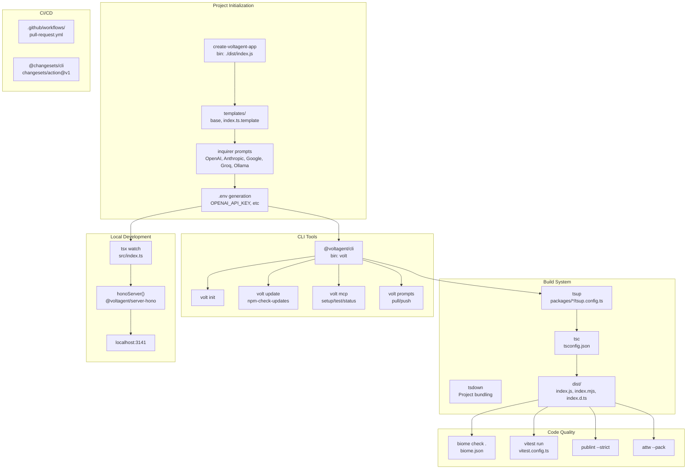
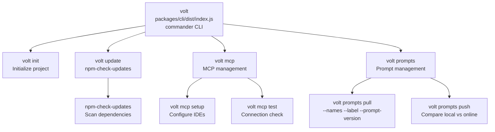
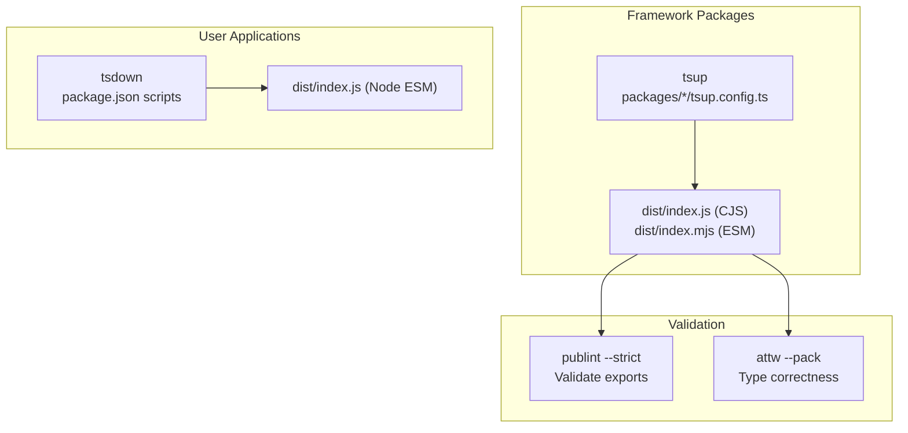

<!-- source: DeepWiki mcp.deepwiki.com · repo VoltAgent/voltagent · page 10 Development Tools · fetched 2026-10-26 -->

# Development Tools

Relevant source files

The following files were used as context for generating this wiki page:

- [CHANGELOG.md](CHANGELOG.md)
- [changelog.sh](changelog.sh)
- [examples/base/src/index.ts](examples/base/src/index.ts)
- [packages/cli/package.json](packages/cli/package.json)
- [packages/create-voltagent-app/CHANGELOG.md](packages/create-voltagent-app/CHANGELOG.md)
- [packages/create-voltagent-app/README.md](packages/create-voltagent-app/README.md)
- [packages/create-voltagent-app/package.json](packages/create-voltagent-app/package.json)
- [packages/create-voltagent-app/src/cli.integration.spec.ts](packages/create-voltagent-app/src/cli.integration.spec.ts)
- [packages/create-voltagent-app/src/cli.ts](packages/create-voltagent-app/src/cli.ts)
- [packages/create-voltagent-app/src/project-creator.ts](packages/create-voltagent-app/src/project-creator.ts)
- [packages/create-voltagent-app/src/types.ts](packages/create-voltagent-app/src/types.ts)
- [packages/create-voltagent-app/src/utils/analytics.ts](packages/create-voltagent-app/src/utils/analytics.ts)
- [packages/create-voltagent-app/src/utils/animation.ts](packages/create-voltagent-app/src/utils/animation.ts)
- [packages/create-voltagent-app/src/utils/dependency-installer.ts](packages/create-voltagent-app/src/utils/dependency-installer.ts)
- [packages/create-voltagent-app/src/utils/env-manager.ts](packages/create-voltagent-app/src/utils/env-manager.ts)
- [packages/create-voltagent-app/src/utils/package-manager.ts](packages/create-voltagent-app/src/utils/package-manager.ts)
- [packages/create-voltagent-app/src/utils/templates.ts](packages/create-voltagent-app/src/utils/templates.ts)
- [packages/create-voltagent-app/templates/base/.dockerignore.template](packages/create-voltagent-app/templates/base/.dockerignore.template)
- [packages/create-voltagent-app/templates/base/README.md.template](packages/create-voltagent-app/templates/base/README.md.template)
- [packages/create-voltagent-app/templates/base/index.ts.template](packages/create-voltagent-app/templates/base/index.ts.template)
- [packages/create-voltagent-app/templates/base/tools/index.ts.template](packages/create-voltagent-app/templates/base/tools/index.ts.template)
- [packages/create-voltagent-app/templates/base/tsconfig.json.template](packages/create-voltagent-app/templates/base/tsconfig.json.template)
- [packages/create-voltagent-app/templates/base/tsdown.config.ts.template](packages/create-voltagent-app/templates/base/tsdown.config.ts.template)
- [packages/create-voltagent-app/templates/base/workflows/index.ts.template](packages/create-voltagent-app/templates/base/workflows/index.ts.template)
- [packages/voice/CHANGELOG.md](packages/voice/CHANGELOG.md)
- [packages/voice/package.json](packages/voice/package.json)

## Purpose and Scope

This document provides an overview of the development tools that power the VoltAgent framework ecosystem. It covers project scaffolding, the command line interface, build system architecture, code quality tooling, CI/CD pipelines, and local development workflows.

For detailed information about specific tools:
- CLI command reference: see [CLI Reference](#10.1)
- Project setup and templates: see [Project Scaffolding](#10.2)
- Build configuration details: see [Build System and Tooling](#10.3)
- Testing and CI workflows: see [Testing and Quality Assurance](#10.4)
- Development server setup: see [Local Development Workflow](#10.5)

---

## Development Tooling Ecosystem

The VoltAgent framework provides a comprehensive suite of development tools designed to streamline the entire development lifecycle from project initialization through production deployment.

**Development Tooling Ecosystem Diagram**

**Sources:**
- [packages/create-voltagent-app/package.json:1-61]()
- [packages/cli/package.json:1-74]()
- [packages/create-voltagent-app/src/utils/dependency-installer.ts:52-60]()

---

## Project Scaffolding

The `create-voltagent-app` package provides an interactive CLI for scaffolding new VoltAgent projects with pre-configured templates, AI provider selection, and automatic dependency installation.

**Project Scaffolding Flow**

```mermaid
graph LR
    Start["npx create-voltagent-app"] --> ProjectName["inquirer.prompt()<br/>Project Name"]
    ProjectName --> ServerSelect["inquirer.prompt()<br/>Hono or Elysia"]
    ServerSelect --> PKGManager["inquirer.prompt()<br/>npm/pnpm/yarn/bun"]
    PKGManager --> BaseInstall["createBaseDependencyInstaller()<br/>Install @voltagent/core"]
    BaseInstall --> ProviderSelect["inquirer.prompt()<br/>Select AI Provider"]
    ProviderSelect --> APIKey["promptForApiKey()<br/>API Key (optional)"]
    APIKey --> Generate["processTemplateFile()<br/>templates/ to project/"]
    Generate --> Complete["showSuccessMessage()<br/>Run npm run dev"]
```

### Generated Project Structure

The scaffolding tool creates a standard project layout:

| File/Directory | Purpose | Key Contents |
|----------------|---------|--------------|
| `src/index.ts` | Main entry point with Agent configuration | `new Agent()`, `new VoltAgent()`, `honoServer()` |
| `src/workflows/` | Workflow definitions directory | `createWorkflowChain()` calls |
| `src/tools/` | Tool definitions directory | `weatherTool` example |
| `package.json` | Dependencies and scripts | `"dev": "tsx watch --env-file=.env ./src"` |
| `tsconfig.json` | TypeScript configuration | `"target": "ES2022"`, `"module": "ESNext"` |
| `.env` | Environment variables (API keys) | Provider-specific keys (e.g., `OPENAI_API_KEY`) |
| `.voltagent/` | Local persistence storage | `memory.db`, `observability.db` (LibSQL) |

**Sources:**
- [packages/create-voltagent-app/src/cli.ts:29-220]()
- [packages/create-voltagent-app/src/utils/dependency-installer.ts:24-42]()
- [packages/create-voltagent-app/templates/base/index.ts.template:1-53]()

---

## Command Line Interface

The `@voltagent/cli` package provides the `volt` command with subcommands for project management, MCP configuration, and prompt synchronization.

**CLI Command Architecture**

### Command Details

| Command | Purpose | Key Functionality |
|---------|---------|------------------|
| `volt init` | Initialize VoltAgent project | Sets up base configuration and directory structure |
| `volt update` | Check and update dependencies | Uses `npm-check-updates` to align with latest framework versions |
| `volt mcp setup` | Configure MCP for IDE integration | Supports Cursor, Windsurf, and VS Code [packages/create-voltagent-app/src/cli.ts:163-178]() |
| `volt prompts pull` | Sync prompts from VoltOps | Supports versions and labels [CHANGELOG.md:19-24]() |
| `volt prompts push` | Upload local prompts | Compares local Markdown files with online versions [CHANGELOG.md:14-15]() |

**Sources:**
- [packages/cli/package.json:1-74]()
- [CHANGELOG.md:7-28]()
- [packages/create-voltagent-app/src/project-creator.ts:205-210]()

---

## Build System Architecture

The framework uses `tsup` for package bundling and `tsdown` for end-user application bundling.

**Build Pipeline Flow**

### Build Tools

- **tsup**: Used within the monorepo to build individual packages like `@voltagent/core` and `@voltagent/voice` [packages/voice/package.json:47-48]().
- **tsdown**: Used in scaffolded project templates to bundle applications for production without manual `.js` extension requirements [packages/create-voltagent-app/CHANGELOG.md:88-89]().
- **tsx**: Used for local development execution and hot reloading [packages/create-voltagent-app/src/utils/dependency-installer.ts:53-66]().

**Sources:**
- [packages/create-voltagent-app/package.json:50-56]()
- [packages/voice/package.json:45-51]()

---

## Code Quality and Testing

The framework enforces code quality through Biome linting, Vitest testing, and package export validation.

| Tool | Purpose | Command |
|------|---------|---------|
| **Biome** | Linting and formatting | `biome check .` [packages/cli/package.json:67]() |
| **Vitest** | Unit and integration testing | `vitest` [packages/voice/package.json:52]() |
| **Publint** | NPM package structure validation | `publint --strict` [packages/cli/package.json:69]() |
| **ATTW** | TypeScript export validation | `attw --pack` [packages/cli/package.json:64]() |

For details, see [Testing and Quality Assurance](#10.4).

**Sources:**
- [packages/create-voltagent-app/package.json:54-59]()
- [packages/voice/package.json:49-53]()

---

## Local Development Workflow

The local development environment is optimized for rapid iteration using file watchers and persistent local databases.

1. **Hot Reloading**: Uses `tsx watch` to restart the server on file changes [packages/create-voltagent-app/src/utils/dependency-installer.ts:53]().
2. **Persistent State**: Uses LibSQL (SQLite) for local memory and observability, ensuring traces and conversation history survive restarts [packages/create-voltagent-app/templates/base/index.ts.template:15-28]().
3. **Offline Prompts**: Supports local Markdown files for prompt management under `.voltagent/prompts/` [CHANGELOG.md:10-13]().

For details, see [Local Development Workflow](#10.5).

**Sources:**
- [packages/create-voltagent-app/templates/base/index.ts.template:1-53]()
- [CHANGELOG.md:50-56]()

---

