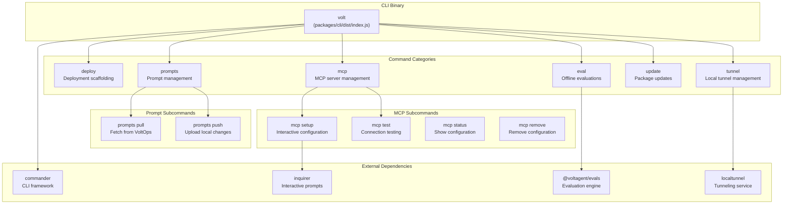
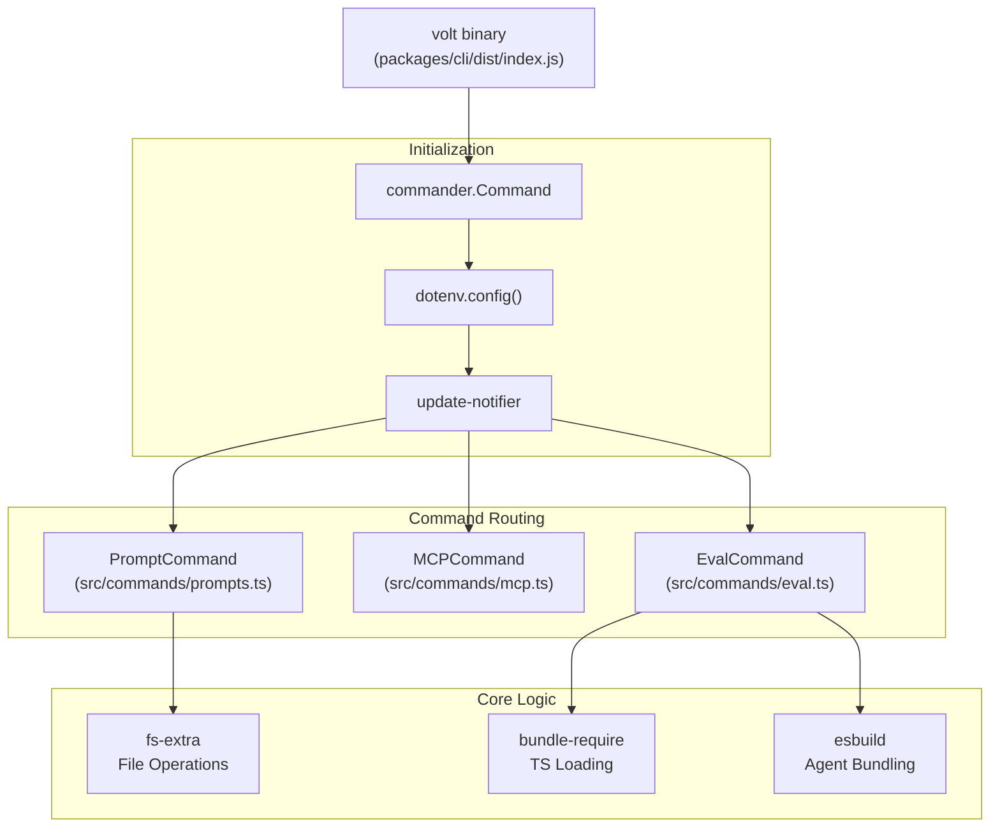

<!-- source: DeepWiki mcp.deepwiki.com · repo VoltAgent/voltagent · page 10.1 CLI Reference · fetched 2026-10-26 -->

# CLI Reference

<details>
<summary>Relevant source files</summary>

The following files were used as context for generating this wiki page:

- [.syncpackrc](.syncpackrc)
- [CHANGELOG.md](CHANGELOG.md)
- [changelog.sh](changelog.sh)
- [examples/base/src/index.ts](examples/base/src/index.ts)
- [packages/cli/package.json](packages/cli/package.json)
- [packages/cli/src/commands/mcp.ts](packages/cli/src/commands/mcp.ts)
- [packages/create-voltagent-app/CHANGELOG.md](packages/create-voltagent-app/CHANGELOG.md)
- [packages/create-voltagent-app/package.json](packages/create-voltagent-app/package.json)
- [packages/create-voltagent-app/src/utils/mcp-config.ts](packages/create-voltagent-app/src/utils/mcp-config.ts)
- [packages/docs-mcp/CHANGELOG.md](packages/docs-mcp/CHANGELOG.md)
- [packages/docs-mcp/README.md](packages/docs-mcp/README.md)
- [packages/docs-mcp/package.json](packages/docs-mcp/package.json)
- [packages/docs-mcp/src/index.ts](packages/docs-mcp/src/index.ts)
- [packages/docs-mcp/src/tools.ts](packages/docs-mcp/src/tools.ts)
- [packages/docs-mcp/tsup.config.ts](packages/docs-mcp/tsup.config.ts)
- [packages/server-hono/src/routes/path-params.ts](packages/server-hono/src/routes/path-params.ts)
- [packages/server-hono/src/zod-openapi-compat.ts](packages/server-hono/src/zod-openapi-compat.ts)
- [packages/voice/CHANGELOG.md](packages/voice/CHANGELOG.md)
- [packages/voice/package.json](packages/voice/package.json)

</details>


This document describes the command-line interface (CLI) tools provided by VoltAgent for development workflows. The primary CLI tool is `volt`, which provides commands for deployment, MCP server management, evaluation, prompt management, and updates. For project scaffolding, see [Project Scaffolding](#10.2).

**Related Documentation:**
- For creating new projects, see [Project Scaffolding](#10.2)
- For evaluation system details, see [Evaluation System](#8.3)
- For MCP protocol integration, see [Model Context Protocol (MCP)](#6.1)
- For deployment configurations, see [Deployment](#11)

---

## Installation

The CLI is distributed as the `@voltagent/cli` package:

```bash
npm install -g @voltagent/cli
# or
pnpm add -g @voltagent/cli
```

The `volt` command becomes available globally after installation.

**Sources:** [packages/cli/package.json:1-62]()

---

## CLI Command Architecture



**Sources:** [packages/cli/package.json:8-32](), [CHANGELOG.md:16-28]()

---

## Command Reference

### `volt prompts`

Manages offline-first local prompts. Supports versioning and label selection (e.g., `production`). Prompts are stored locally as Markdown files under `.voltagent/prompts/<promptName>/<version>.md`.

#### `volt prompts pull`

Fetches prompts from the VoltOps platform to your local directory.

**Syntax:**
```bash
volt prompts pull [options]
```

**Options:**

| Option | Description |
|--------|-------------|
| `--names` | Specific prompt names to pull |
| `--label` | Pull prompts with a specific label (e.g., `production`) |
| `--prompt-version` | Pull a specific numeric version |

**Sources:** [CHANGELOG.md:19-25]()

#### `volt prompts push`

Compares local prompt changes with the online version and creates new versions on VoltOps after a diff confirmation.

**Syntax:**
```bash
volt prompts push
```

**Sources:** [CHANGELOG.md:27-28]()

---

### `volt deploy`

Scaffolds deployment configuration files for serverless platforms. Generates platform-specific configuration with required compatibility flags.

**Syntax:**
```bash
volt deploy --target <platform>
```

**Options:**

| Option | Required | Values | Description |
|--------|----------|--------|-------------|
| `--target` | Yes | `cloudflare`, `vercel`, `netlify` | Target deployment platform |

**Behavior by Target:**

*   **Cloudflare Workers:** Generates `wrangler.toml` with `nodejs_compat` and `nodejs_compat_populate_process_env` flags.
*   **Vercel Edge Functions:** Generates `vercel.json` with edge runtime configuration.
*   **Netlify Functions:** Generates `netlify.toml` for Netlify's function environment.

**Sources:** [packages/cli/package.json:1-62](), [CHANGELOG.md:596-598]()

---

### `volt mcp`

Manages Model Context Protocol (MCP) server integration with IDEs like Cursor, Windsurf, or VS Code. This allows AI assistants to access VoltAgent documentation and tools.

#### `volt mcp setup`

Interactive configuration wizard for MCP server integration.

**Syntax:**
```bash
volt mcp setup
```

**Generated Configuration:**
The CLI writes a configuration entry to the IDE's MCP config file (e.g., `~/.cursor/mcp.json`):
```json
{
  "mcpServers": {
    "voltagent-docs": {
      "command": "npx",
      "args": ["-y", "@voltagent/docs-mcp"]
    }
  }
}
```

**Sources:** [packages/cli/src/commands/mcp.ts:1-50](), [packages/docs-mcp/package.json:1-10]()

---

### `volt eval`

Runs offline evaluations using the `@voltagent/evals` package. Executes test datasets against agents and generates quality metrics.

**Syntax:**
```bash
volt eval [options]
```

**Options:**

| Option | Type | Description |
|--------|------|-------------|
| `--config` | string | Path to evaluation configuration file |
| `--dataset` | string | Path to evaluation dataset |
| `--output` | string | Output directory for results |

**Execution Flow:**
1.  **Load Config:** Uses `bundle-require` to load `eval.config.ts`.
2.  **Import Agent:** Uses `esbuild` to dynamically import the agent module.
3.  **Run Tests:** Executes test cases from the dataset.
4.  **Apply Scorers:** Calculates metrics using `@voltagent/evals`.

**Sources:** [packages/cli/package.json:9-19]()

---

### `volt tunnel`

Starts a local tunnel using `localtunnel` to expose your local agent server to the internet. This is useful for testing webhooks or sharing your agent with external services.

**Syntax:**
```bash
volt tunnel [options]
```

**Options:**

| Option | Default | Description |
|--------|---------|-------------|
| `--port` | 3000 | The local port to expose |
| `--subdomain` | | Request a specific subdomain |

**Sources:** [packages/cli/package.json:24]()

---

### `volt update`

Updates VoltAgent packages to latest versions using `npm-check-updates`.

**Syntax:**
```bash
volt update [options]
```

**Behavior:**
1.  Scans `package.json` for `@voltagent/*` packages.
2.  Checks for newer versions on npm.
3.  Updates the version strings in `package.json`.
4.  Triggers the project's package manager to install updates.

**Sources:** [packages/cli/package.json:25]()

---

## CLI Execution Pipeline



**Sources:** [packages/cli/package.json:1-32]()

---

## Dependencies and Tools

The CLI package leverages these external tools:

| Package | Purpose |
|---------|---------|
| `commander` | CLI framework for command parsing |
| `inquirer` | Interactive prompts for `mcp setup` and `update` |
| `bundle-require` | Loading TypeScript configuration files |
| `esbuild` | Fast TypeScript compilation for evaluations |
| `localtunnel` | Exposing local servers for testing |
| `npm-check-updates` | Managing framework package updates |
| `fs-extra` | Advanced file system operations |
| `gray-matter` | Parsing front-matter in local prompts |

**Sources:** [packages/cli/package.json:8-32]()

---

## CLI Environment Variables

The CLI respects these environment variables:

| Variable | Purpose |
|----------|---------|
| `VOLTAGENT_PROMPTS_PATH` | Override the default path for local prompts (`./.voltagent/prompts`) |
| `VOLTAGENT_PUBLIC_KEY` | VoltOps API authentication |
| `VOLTAGENT_SECRET_KEY` | VoltOps API authentication |
| `DEBUG` | Enable verbose logging for CLI operations |

**Sources:** [CHANGELOG.md:54-56](), [packages/cli/package.json:16]()

---

