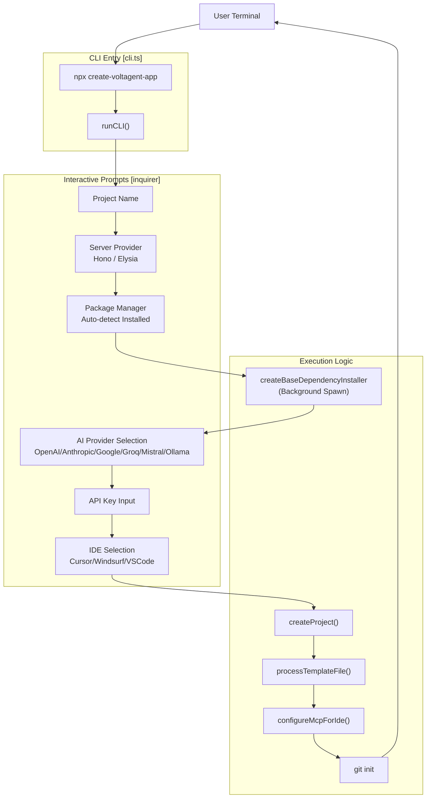
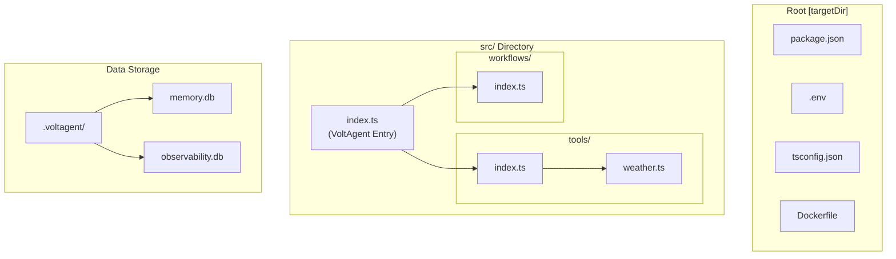

<!-- source: DeepWiki mcp.deepwiki.com · repo VoltAgent/voltagent · page 10.2 Project Scaffolding · fetched 2026-10-26 -->

# Project Scaffolding

<details>
<summary>Relevant source files</summary>

The following files were used as context for generating this wiki page:

- [packages/create-voltagent-app/README.md](packages/create-voltagent-app/README.md)
- [packages/create-voltagent-app/src/cli.integration.spec.ts](packages/create-voltagent-app/src/cli.integration.spec.ts)
- [packages/create-voltagent-app/src/cli.ts](packages/create-voltagent-app/src/cli.ts)
- [packages/create-voltagent-app/src/project-creator.ts](packages/create-voltagent-app/src/project-creator.ts)
- [packages/create-voltagent-app/src/types.ts](packages/create-voltagent-app/src/types.ts)
- [packages/create-voltagent-app/src/utils/analytics.ts](packages/create-voltagent-app/src/utils/analytics.ts)
- [packages/create-voltagent-app/src/utils/animation.ts](packages/create-voltagent-app/src/utils/animation.ts)
- [packages/create-voltagent-app/src/utils/dependency-installer.ts](packages/create-voltagent-app/src/utils/dependency-installer.ts)
- [packages/create-voltagent-app/src/utils/env-manager.ts](packages/create-voltagent-app/src/utils/env-manager.ts)
- [packages/create-voltagent-app/src/utils/package-manager.ts](packages/create-voltagent-app/src/utils/package-manager.ts)
- [packages/create-voltagent-app/src/utils/templates.ts](packages/create-voltagent-app/src/utils/templates.ts)
- [packages/create-voltagent-app/templates/base/.dockerignore.template](packages/create-voltagent-app/templates/base/.dockerignore.template)
- [packages/create-voltagent-app/templates/base/README.md.template](packages/create-voltagent-app/templates/base/README.md.template)
- [packages/create-voltagent-app/templates/base/index.ts.template](packages/create-voltagent-app/templates/base/index.ts.template)
- [packages/create-voltagent-app/templates/base/tools/index.ts.template](packages/create-voltagent-app/templates/base/tools/index.ts.template)
- [packages/create-voltagent-app/templates/base/tsconfig.json.template](packages/create-voltagent-app/templates/base/tsconfig.json.template)
- [packages/create-voltagent-app/templates/base/tsdown.config.ts.template](packages/create-voltagent-app/templates/base/tsdown.config.ts.template)
- [packages/create-voltagent-app/templates/base/workflows/index.ts.template](packages/create-voltagent-app/templates/base/workflows/index.ts.template)

</details>


This document describes the `create-voltagent-app` CLI tool, which provides interactive scaffolding for new VoltAgent projects. It covers the command invocation, interactive prompt flow, template generation, and the structure of generated projects with their pre-configured observability, logging, and AI provider integrations.

For information about the `volt` CLI commands used within existing projects, see [CLI Reference](). For details about the development workflow after project creation, see [Local Development Workflow]().

## Overview

The `create-voltagent-app` package provides a CLI that scaffolds new VoltAgent projects with production-ready configurations. The tool uses interactive prompts to collect user preferences for AI providers, REST API frameworks, and package managers, then generates a complete project with auto-configured observability, memory storage, and logging.

**Sources:** [packages/create-voltagent-app/src/cli.ts:39-43](), [packages/create-voltagent-app/src/types.ts:5-14]()

## Package Structure

The package consists of:

| Component | Purpose |
|-----------|---------|
| `src/cli.ts` | Main CLI logic and interactive prompt flow using `inquirer`. |
| `src/project-creator.ts` | Orchestrates template processing and git initialization. |
| `src/utils/templates.ts` | Resolves template paths and defines file transformations. |
| `src/utils/dependency-installer.ts` | Manages `package.json` creation and background `npm/pnpm/bun` install. |
| `templates/` | Source templates for `index.ts`, `README.md`, `Dockerfile`, etc. |

**Sources:** [packages/create-voltagent-app/src/cli.ts:7-27](), [packages/create-voltagent-app/src/utils/templates.ts:24-143]()

## Command Invocation Flow



**Diagram: create-voltagent-app Execution Pipeline**

The CLI uses `commander` for argument parsing [packages/create-voltagent-app/src/cli.ts:30-44](), `inquirer` for interactive prompts [packages/create-voltagent-app/src/cli.ts:67-178](), and `ora` for loading spinners [packages/create-voltagent-app/src/utils/animation.ts:64-70]().

**Sources:** [packages/create-voltagent-app/src/cli.ts:29-190](), [packages/create-voltagent-app/src/project-creator.ts:12-247]()

## Interactive Prompts

### Provider Selection

The tool prompts users to select an AI provider, which determines the default model and environment variables in the generated project.

| Provider | `AI_PROVIDER_CONFIG` Key | Default Model | `envVar` |
|----------|--------------------------|---------------|----------|
| OpenAI | `openai` | `openai/gpt-4o-mini` | `OPENAI_API_KEY` |
| Anthropic | `anthropic` | `anthropic/claude-3-5-sonnet` | `ANTHROPIC_API_KEY` |
| Google | `google` | `google/gemini-2.0-flash` | `GOOGLE_GENERATIVE_AI_API_KEY` |
| Groq | `groq` | `groq/llama-3.3-70b-versatile` | `GROQ_API_KEY` |
| Mistral | `mistral` | `mistral/mistral-large-latest` | `MISTRAL_API_KEY` |
| Ollama | `ollama` | `ollama/llama3.2` | N/A (Local) |

**Sources:** [packages/create-voltagent-app/src/types.ts:24-67](), [packages/create-voltagent-app/src/cli.ts:142-157]()

### Package Manager Detection

The CLI automatically detects installed package managers using `getInstalledPackageManagers` [packages/create-voltagent-app/src/utils/package-manager.ts:22-33](). It prioritizes them in the order: `pnpm` > `bun` > `yarn` > `npm` [packages/create-voltagent-app/src/utils/package-manager.ts:38-50]().

**Sources:** [packages/create-voltagent-app/src/utils/package-manager.ts:8-50](), [packages/create-voltagent-app/src/cli.ts:104-128]()

## Generated Project Structure



**Diagram: Generated Project File Structure**

The directory structure is initialized by `createBaseDependencyInstaller` [packages/create-voltagent-app/src/utils/dependency-installer.ts:24-29]() and populated by `createProject` using templates [packages/create-voltagent-app/src/project-creator.ts:31-41]().

**Sources:** [packages/create-voltagent-app/src/utils/dependency-installer.ts:24-29](), [packages/create-voltagent-app/src/utils/templates.ts:24-142]()

## Template Configuration

### VoltAgent and Agent Initialization

The generated `src/index.ts` template sets up the core framework components. It instantiates a `Memory` object with a `LibSQLMemoryAdapter` and a `VoltAgentObservability` object with a `LibSQLObservabilityAdapter` [packages/create-voltagent-app/templates/base/index.ts.template:15-28]().

```typescript
// Generated in src/index.ts
const agent = new Agent({
  name: "{{projectName}}",
  instructions: "A helpful assistant...",
  model: "{{modelId}}",
  tools: [weatherTool],
  memory,
});

new VoltAgent({
  agents: { agent },
  workflows: { expenseApprovalWorkflow },
  server: {{serverFactory}}(),
  logger,
  observability,
  voltOpsClient: new VoltOpsClient({
    publicKey: process.env.VOLTAGENT_PUBLIC_KEY || "",
    secretKey: process.env.VOLTAGENT_SECRET_KEY || "",
  }),
});
```

**Sources:** [packages/create-voltagent-app/templates/base/index.ts.template:30-52]()

### Dependency Installation

The `createBaseDependencyInstaller` function creates a `package.json` with essential dependencies including `@voltagent/core`, `@voltagent/libsql`, `@voltagent/logger`, and the selected server package (e.g., `@voltagent/server-hono`) [packages/create-voltagent-app/src/utils/dependency-installer.ts:34-44](). It then spawns the package manager install command in the background [packages/create-voltagent-app/src/utils/dependency-installer.ts:93-101]().

**Sources:** [packages/create-voltagent-app/src/utils/dependency-installer.ts:16-151]()

### IDE and MCP Configuration

If an IDE (Cursor, Windsurf, or VS Code) is selected during the prompt [packages/create-voltagent-app/src/cli.ts:163-178](), the `configureMcpForIde` function is called to set up the Model Context Protocol (MCP) configuration for that specific editor [packages/create-voltagent-app/src/project-creator.ts:206-210]().

**Sources:** [packages/create-voltagent-app/src/project-creator.ts:206-210](), [packages/create-voltagent-app/src/cli.integration.spec.ts:133-189]()

## Template Transformations

The `getBaseTemplates` function defines how template files are modified during project creation [packages/create-voltagent-app/src/utils/templates.ts:24-143]().

| Template | Key Transformations |
|----------|---------------------|
| `README.md` | Replaces project name, AI provider details, and package manager commands [packages/create-voltagent-app/src/utils/templates.ts:37-75](). |
| `index.ts` | Injects the server factory (e.g., `honoServer`), server package, and model ID [packages/create-voltagent-app/src/utils/templates.ts:80-97](). |
| `.env` | Configures the specific API key variable name and provides the URL to obtain it [packages/create-voltagent-app/src/utils/templates.ts:102-117](). |

**Sources:** [packages/create-voltagent-app/src/utils/templates.ts:24-143]()

## Workflow and Tool Examples

Generated projects include:
- **Tools**: A sample `weatherTool` in `src/tools/weather.ts` [packages/create-voltagent-app/templates/base/tools/weather.ts.template]().
- **Workflows**: A "Human-in-the-Loop Expense Approval Workflow" in `src/workflows/index.ts` [packages/create-voltagent-app/templates/base/workflows/index.ts.template:53-131]().

The expense approval workflow demonstrates:
1. **Input Validation**: Using Zod schemas [packages/create-voltagent-app/templates/base/workflows/index.ts.template:58-63]().
2. **Suspension**: Using `await suspend()` for amounts > $500 [packages/create-voltagent-app/templates/base/workflows/index.ts.template:94-103]().
3. **Resumption**: Handling `resumeData` when the manager provides a decision [packages/create-voltagent-app/templates/base/workflows/index.ts.template:82-91]().

**Sources:** [packages/create-voltagent-app/templates/base/workflows/index.ts.template:53-131](), [packages/create-voltagent-app/src/utils/templates.ts:120-133]()

---

