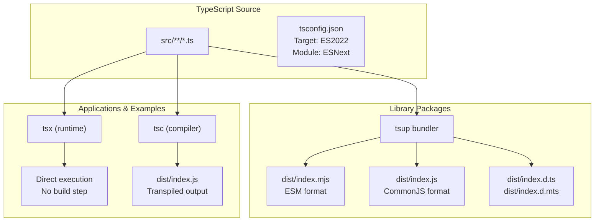
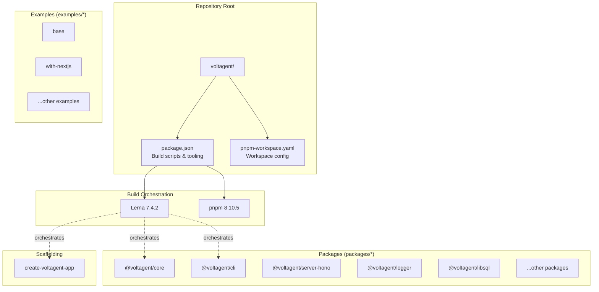
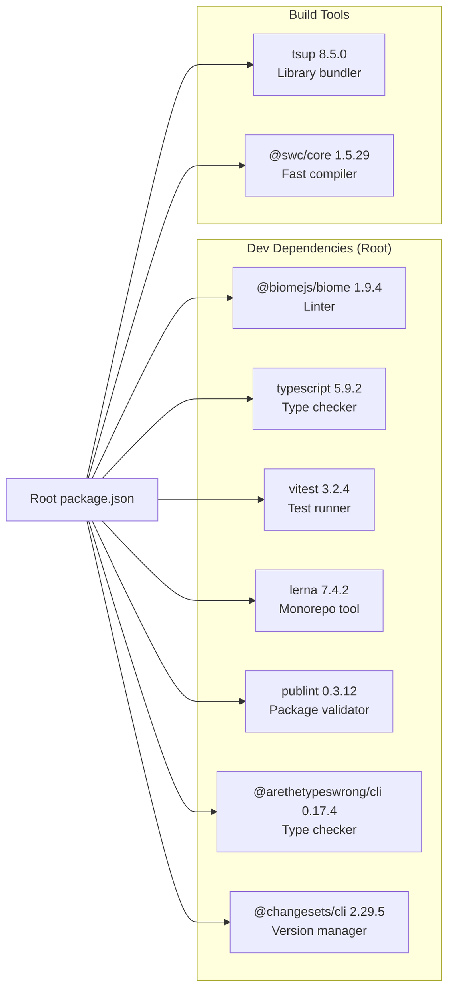
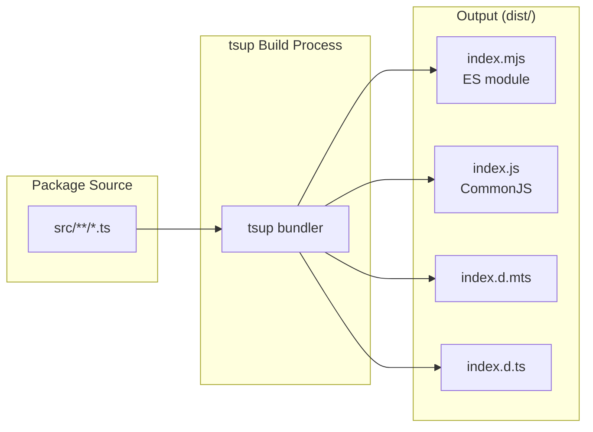
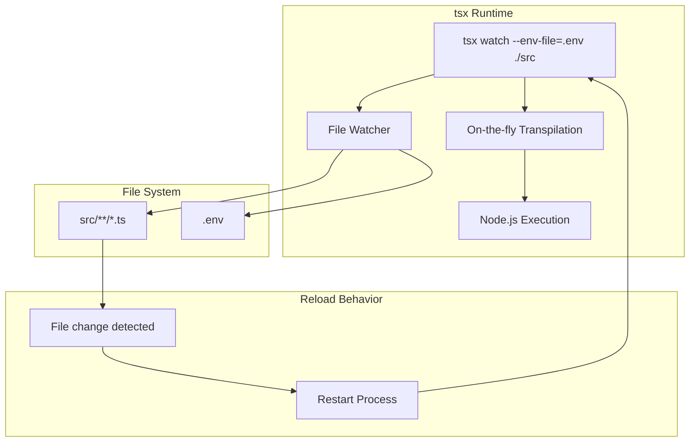
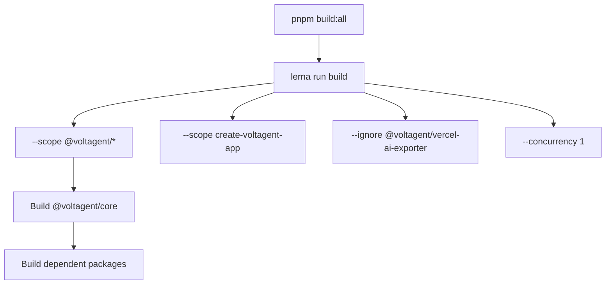
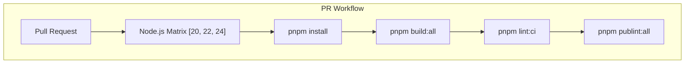
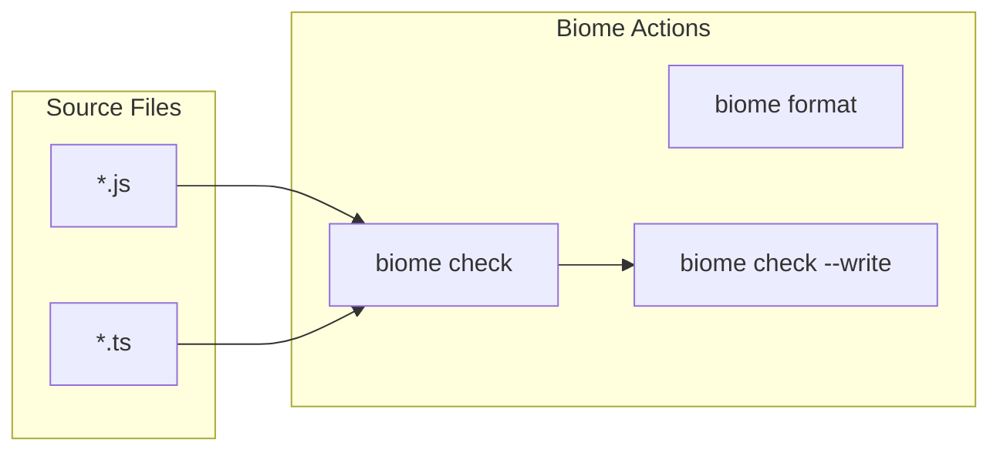

<!-- source: DeepWiki mcp.deepwiki.com · repo VoltAgent/voltagent · page 10.3 Build System and Tooling · fetched 2026-10-26 -->

# Build System and Tooling

Relevant source files

The following files were used as context for generating this wiki page:

- [.github/workflows/prerelease.yml](.github/workflows/prerelease.yml)
- [.github/workflows/pull-request.yml](.github/workflows/pull-request.yml)
- [.github/workflows/release.yml](.github/workflows/release.yml)
- [examples/with-google-ai/package.json](examples/with-google-ai/package.json)
- [examples/with-google-vertex-ai/package.json](examples/with-google-vertex-ai/package.json)
- [examples/with-groq-ai/package.json](examples/with-groq-ai/package.json)
- [examples/with-mcp/package.json](examples/with-mcp/package.json)
- [examples/with-nextjs/package.json](examples/with-nextjs/package.json)
- [package.json](package.json)
- [packages/core/package.json](packages/core/package.json)
- [packages/core/src/agent/conversation-buffer.spec.ts](packages/core/src/agent/conversation-buffer.spec.ts)
- [packages/core/src/agent/conversation-buffer.ts](packages/core/src/agent/conversation-buffer.ts)
- [packages/core/src/agent/memory-persistence.integration.spec.ts](packages/core/src/agent/memory-persistence.integration.spec.ts)
- [packages/e2e/src/message-persistence.libsql.e2e.spec.ts](packages/e2e/src/message-persistence.libsql.e2e.spec.ts)
- [pnpm-lock.yaml](pnpm-lock.yaml)
- [pnpm-workspace.yaml](pnpm-workspace.yaml)

## Purpose and Scope

This document describes VoltAgent's build system and development tooling, focusing on TypeScript compilation, `tsx` watch mode for hot reload development, and the development dependency stack. It covers how packages are built from TypeScript source to publishable npm packages and how developers work with the codebase during development.

For deployment configuration and runtime environments, see [Deployment](page://11). For testing patterns and quality assurance, see [Testing and Quality Assurance](page://10.4). For local development workflow patterns, see [Local Development Workflow](page://10.5).

## TypeScript Compilation

VoltAgent is written entirely in TypeScript and uses different compilation strategies for different purposes: **bundling for libraries** and **runtime execution for development**.

### Compilation Targets

**Compilation and Execution Flow**

**Sources:** [packages/core/package.json:95-99](), [examples/base/package.json:31-33](), [examples/with-google-ai/package.json:31-32]()

## Monorepo Architecture

VoltAgent uses a **pnpm workspace** with **Lerna** for build orchestration across multiple packages and examples.

**Monorepo Structural Overview**

**Sources:** [package.json:1-106](), [pnpm-lock.yaml:1-110]()

### Workspace Structure

The workspace is defined in `package.json` and `pnpm-lock.yaml`:

| Pattern | Purpose |
|---------|---------|
| `packages/*` | Framework packages with `@voltagent` scope |
| `examples/*` | Example applications (not published) |
| `examples/*/client` | Client-side example components |
| `examples/*/server` | Server-side example components |

**Sources:** [package.json:100-105]()

### Dependency Management

**Development Tooling Stack**

**Sources:** [package.json:6-39](), [pnpm-lock.yaml:10-109]()

## Build Tools

### tsup (Library Bundler)

All `@voltagent/*` packages use `tsup` for bundling. It provides dual ESM/CommonJS output and type declaration generation.

**Library Bundling Pipeline**

**Core package build configuration:**
[packages/core/package.json:97-98]() specifies `tsup` for both `build` and `dev` scripts. The `exports` map in [packages/core/package.json:60-70]() handles the routing for both `import` and `require` consumers.

**Sources:** [packages/core/package.json:60-70](), [packages/core/package.json:97-98]()

### TypeScript Compiler (tsc)

The TypeScript compiler `tsc` is used primarily for **type checking** across the monorepo and for transpiling simpler examples.

| Use Case | Tool | Output |
|----------|------|--------|
| Type checking | `tsc --noEmit` | None (validation only) |
| Library bundling | `tsup` | JavaScript + type declarations |
| App execution | `tsx` | Runtime execution |
| Example build | `tsc` | JavaScript files |

**Sources:** [packages/core/package.json:109](), [examples/with-google-ai/package.json:31]()

## tsx Watch Mode

The `tsx` tool (TypeScript Execute) is the primary development tool for VoltAgent applications. It provides zero-config TypeScript execution with automatic reloading.

**tsx Runtime and Watcher**

**Sources:** [examples/base/package.json:33](), [examples/with-google-ai/package.json:32](), [pnpm-lock.yaml:141-143]()

### tsx in Next.js Projects

Next.js projects use `tsx` for the VoltAgent server component separately from the Next.js dev server. [examples/with-nextjs/package.json:39-43]() defines `next dev` for the frontend and `voltagent:run` using `tsx` for the agent logic.

## Build Process Orchestration

### Production Build

Production builds use Lerna to orchestrate dependencies and ensure correct build order.

**Build Pipeline Sequence**

**Sources:** [package.json:65](), [.github/workflows/release.yml:118]()

### CI/CD Build Pipeline

GitHub Actions runs builds across multiple Node.js versions (20, 22, 24).

**CI/CD Workflow Steps**

**Sources:** [.github/workflows/pull-request.yml:44-68](), [.github/workflows/release.yml:113-124]()

## Biome Linting and Formatting

VoltAgent uses **Biome** for fast linting and formatting, replacing Prettier and ESLint for most tasks.

**Linting Pipeline**

**Sources:** [package.json:72-75](), [packages/core/package.json:100-101]()

## Development Scripts Reference

### Root-Level Scripts

| Script | Command | Purpose |
|--------|---------|---------|
| `build:all` | `lerna run build ...` | Build all packages for publishing |
| `dev` | `lerna run dev ...` | Watch mode for all framework packages |
| `lint:ci` | `biome ci .` | Strict linting for CI environment |
| `sp` | `syncpack` | Sync dependency versions across monorepo |
| `publint:all` | `lerna run publint ...` | Validate npm package structure |

**Sources:** [package.json:58-99]()

### Package-Level Scripts (e.g., @voltagent/core)

| Script | Command | Purpose |
|--------|---------|---------|
| `build` | `tsup` | Generate `dist/` artifacts |
| `test` | `vitest` | Run unit and type tests |
| `typecheck` | `tsc --noEmit` | Validate TypeScript types |
| `sync-docs` | `node scripts/sync-docs-mcp.js` | Synchronize MCP documentation |

**Sources:** [packages/core/package.json:95-110]()

---

