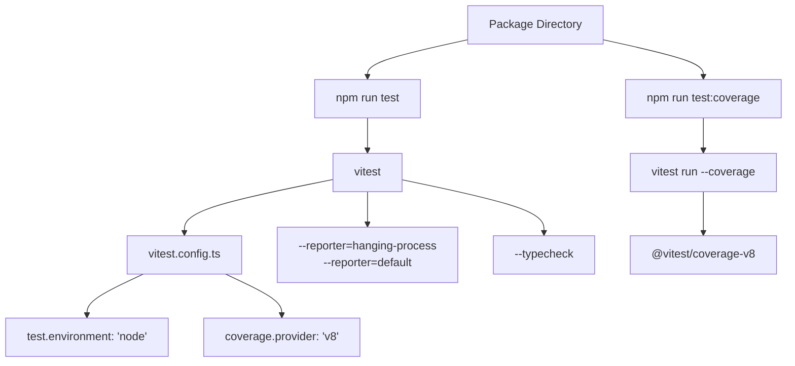
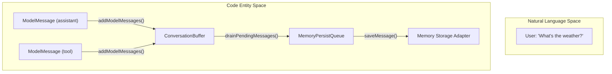
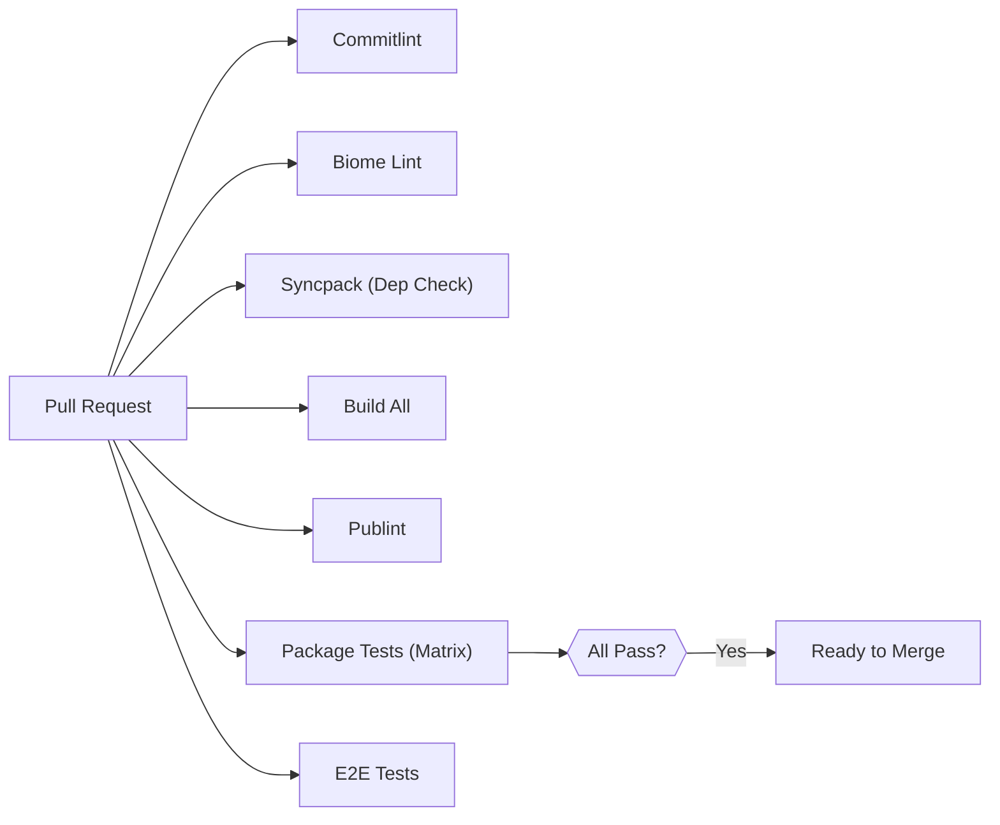

<!-- source: DeepWiki mcp.deepwiki.com · repo VoltAgent/voltagent · page 10.4 Testing and Quality Assurance · fetched 2026-10-26 -->

# Testing and Quality Assurance

<details>
<summary>Relevant source files</summary>

The following files were used as context for generating this wiki page:

- [.github/workflows/prerelease.yml](.github/workflows/prerelease.yml)
- [.github/workflows/pull-request.yml](.github/workflows/pull-request.yml)
- [.github/workflows/release.yml](.github/workflows/release.yml)
- [examples/with-research-assistant/package.json](examples/with-research-assistant/package.json)
- [examples/with-viteval/package.json](examples/with-viteval/package.json)
- [package.json](package.json)
- [packages/core/src/agent/conversation-buffer.spec.ts](packages/core/src/agent/conversation-buffer.spec.ts)
- [packages/core/src/agent/conversation-buffer.ts](packages/core/src/agent/conversation-buffer.ts)
- [packages/core/src/agent/memory-persistence.integration.spec.ts](packages/core/src/agent/memory-persistence.integration.spec.ts)
- [packages/e2e/src/message-persistence.libsql.e2e.spec.ts](packages/e2e/src/message-persistence.libsql.e2e.spec.ts)
- [pnpm-workspace.yaml](pnpm-workspace.yaml)

</details>


This document covers the testing infrastructure, code quality tools, and validation patterns used throughout the VoltAgent codebase. This includes Vitest test framework configuration, Biome linting, publint package validation, and evaluation framework integration.

For CI/CD workflows and deployment pipelines, see the CI/CD documentation. For build system configuration, see [Build System and Tooling](#10.3).

## Overview

VoltAgent employs a comprehensive quality assurance strategy across its monorepo:

- **Testing Framework**: Vitest for unit, integration, and E2E testing.
- **Code Quality**: Biome for linting and formatting.
- **Package Validation**: `publint` for export map verification and `attw` for type resolution.
- **Evaluation Framework**: `viteval` integration for systematic agent behavior assessment.
- **Dependency Management**: `syncpack` to ensure consistent dependency versions across the monorepo.

All packages use consistent tooling configurations to ensure code quality and reliability.

## Testing Framework Architecture

### Vitest Configuration

VoltAgent uses Vitest as its primary test framework. Vitest provides fast unit testing with native ESM support, TypeScript integration, and comprehensive coverage reporting.

**Standard Testing Infrastructure Diagram**



**Sources**: [package.json:24-39](), [packages/core/package.json:62-72](), [packages/voice/package.json:52-53]()

### Test Script Patterns

The monorepo root and individual packages follow consistent test script patterns:

| Script | Command | Purpose |
|--------|---------|---------|
| `test` | `lerna run test --stream` | Run tests across all packages |
| `test:all` | `lerna run test --scope @voltagent/*` | Run all scoped package tests |
| `test:coverage` | `pnpm test -- --coverage` | Generate coverage reports |

**Sources**: [package.json:94-97]()

### Core Testing Logic: ConversationBuffer

A critical component under heavy testing is the `ConversationBuffer`, which handles the merging of tool calls and results into unified `UIMessage` objects.

**Message Merging Logic Diagram**



The `ConversationBuffer` ensures that complex OpenAI-style tool sequences (call -> result -> text) are collapsed into a single assistant message for cleaner UI rendering and storage.

**Sources**: [packages/core/src/agent/conversation-buffer.ts:56-104](), [packages/core/src/agent/conversation-buffer.spec.ts:43-68]()

## Integration and E2E Testing

### PostgreSQL Integration

The `@voltagent/postgres` package includes integration tests that run against a real PostgreSQL instance. In CI, this is managed via a GitHub Actions service container.

```yaml
services:
  postgres:
    image: postgres:16
    env:
      POSTGRES_USER: test
      POSTGRES_PASSWORD: test
      POSTGRES_DB: voltagent_test
```

**Sources**: [.github/workflows/pull-request.yml:125-138](), [.github/workflows/release.yml:84-96]()

### LibSQL E2E Testing

The E2E suite validates full message persistence flows using `LibSQLMemoryAdapter`. These tests verify that `UIMessage` parts (reasoning, tools, and text) are correctly serialized to JSON and stored in the database.

**Sources**: [packages/e2e/src/message-persistence.libsql.e2e.spec.ts:22-75]()

## Code Quality Tools

### Biome Linter

VoltAgent uses Biome for linting and formatting. It is configured to run in CI and via git hooks.

**Biome Command Reference**

| Command | Description | Implementation |
|---------|-------------|----------------|
| `pnpm lint` | Check code quality | `biome check .` |
| `pnpm lint:ci` | Strict CI mode | `biome ci .` |
| `pnpm lint:fix` | Auto-fix issues | `biome check . --write` |

**Sources**: [package.json:72-75]()

### Publint and ATTW

To ensure package consumers have a seamless experience, VoltAgent uses `publint` to check `package.json` export maps and `attw` (Are The Types Wrong) to validate TypeScript resolution.

```bash
# Validate all packages
pnpm publint:all
pnpm attw:all
```

**Sources**: [package.json:89-91](), [.github/workflows/pull-request.yml:67-68]()

## Evaluation Framework Integration

### Viteval Integration

The framework supports systematic agent evaluation through `viteval`. This is demonstrated in the `with-viteval` example, allowing developers to run benchmarks against their agents.

**Evaluation Script Implementation**:
```json
{
  "scripts": {
    "eval": "viteval",
    "question": "tsx ./src/cli.ts"
  },
  "devDependencies": {
    "viteval": "^0.5.3"
  }
}
```

**Sources**: [examples/with-viteval/package.json:22-41]()

## CI/CD Quality Gates

Every Pull Request undergoes a battery of checks to maintain the "green" status of the `main` and `next` branches.

**CI Quality Pipeline**



**Sources**: [.github/workflows/pull-request.yml:6-117](), [package.json:91]()

### Matrix Testing
CI runs tests across a matrix of Node.js versions (20, 22, 24) and individual packages to ensure compatibility across the supported ecosystem.

**Sources**: [.github/workflows/pull-request.yml:21-26](), [.github/workflows/pull-request.yml:75-88]()

---

