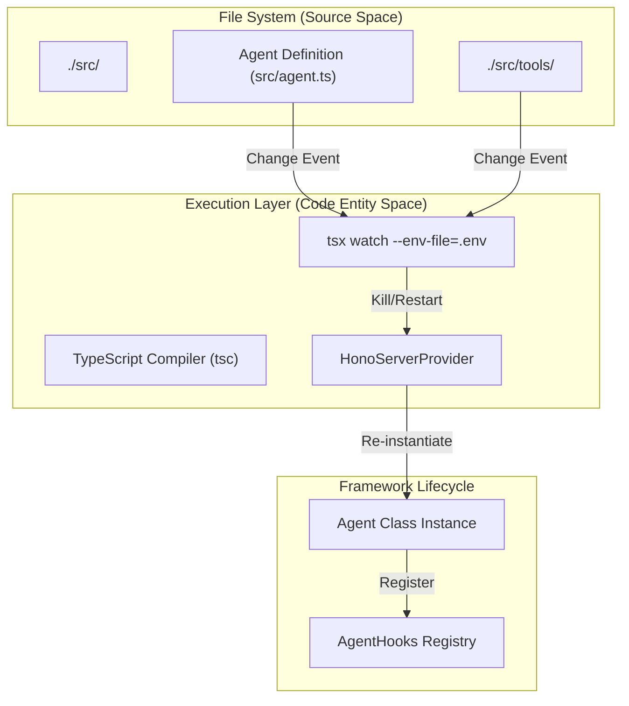
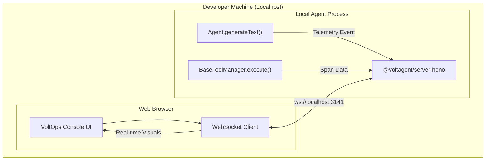

<!-- source: DeepWiki mcp.deepwiki.com · repo VoltAgent/voltagent · page 10.5 Local Development Workflow · fetched 2026-10-26 -->

# Local Development Workflow

<details>
<summary>Relevant source files</summary>

The following files were used as context for generating this wiki page:

- [CONSOLE.md](CONSOLE.md)
- [examples/base/package.json](examples/base/package.json)
- [examples/github-repo-analyzer/package.json](examples/github-repo-analyzer/package.json)
- [examples/with-rag-chatbot/package.json](examples/with-rag-chatbot/package.json)
- [examples/with-retrieval/package.json](examples/with-retrieval/package.json)
- [examples/with-subagents/package.json](examples/with-subagents/package.json)
- [examples/with-supabase/package.json](examples/with-supabase/package.json)
- [examples/with-tools/package.json](examples/with-tools/package.json)
- [examples/with-vercel-ai/package.json](examples/with-vercel-ai/package.json)
- [examples/with-voice-elevenlabs/package.json](examples/with-voice-elevenlabs/package.json)
- [examples/with-voice-openai/package.json](examples/with-voice-openai/package.json)
- [packages/core/src/tool/manager/BaseToolManager.ts](packages/core/src/tool/manager/BaseToolManager.ts)
- [packages/core/src/tool/manager/ToolkitManager.ts](packages/core/src/tool/manager/ToolkitManager.ts)
- [website/docs/getting-started/manual-setup.md](website/docs/getting-started/manual-setup.md)
- [website/docs/getting-started/overview.md](website/docs/getting-started/overview.md)
- [website/docs/getting-started/quick-start.md](website/docs/getting-started/quick-start.md)
- [website/src/components/docs-widgets/EnterpriseCard.tsx](website/src/components/docs-widgets/EnterpriseCard.tsx)
- [website/src/components/docs-widgets/WorkflowDiagramFlow.tsx](website/src/components/docs-widgets/WorkflowDiagramFlow.tsx)
- [website/src/theme/DocHeaderMobile/index.tsx](website/src/theme/DocHeaderMobile/index.tsx)
- [website/src/theme/DocRoot/Layout/Main/index.tsx](website/src/theme/DocRoot/Layout/Main/index.tsx)
- [website/src/theme/DocRoot/Layout/Main/styles.module.css](website/src/theme/DocRoot/Layout/Main/styles.module.css)
- [website/src/theme/Navbar/Content/index.js](website/src/theme/Navbar/Content/index.js)
- [website/src/theme/Navbar/index.js](website/src/theme/Navbar/index.js)
- [website/tailwind.config.js](website/tailwind.config.js)

</details>


This document describes the day-to-day development workflow for building VoltAgent applications locally, including running the dev server, hot reload, API testing, debugging, and real-time observability integration.

## Development Server

The VoltAgent development server uses `tsx` with watch mode to provide instant feedback during development. This eliminates manual restart cycles and enables rapid iteration on agent logic, tools, and workflows.

### Starting the Server

The `dev` script in `package.json` launches the development server. Most example projects and those generated by the CLI use the following configuration:

```json
{
  "scripts": {
    "dev": "tsx watch --env-file=.env ./src",
    "build": "tsc",
    "start": "node dist/index.js"
  }
}
```

**Key Components:**
- **tsx watch**: TypeScript execution with automatic file watching [examples/base/package.json:33]().
- **--env-file=.env**: Native Node.js environment variable loading from a `.env` file [examples/with-supabase/package.json:33]().
- **./src**: Directory entry point (resolves to `src/index.ts` or `src/index.js`) [examples/with-tools/package.json:34]().

When the server starts, the framework outputs a startup banner to the terminal:

```text
══════════════════════════════════════════════════
  VOLTAGENT SERVER STARTED SUCCESSFULLY
══════════════════════════════════════════════════
  ✓ HTTP Server:  http://localhost:3141
  ✓ Swagger UI:   http://localhost:3141/ui

  Test your agents with VoltOps Console: https://console.voltagent.dev
══════════════════════════════════════════════════
```

**Sources:** [examples/base/package.json:31-37](), [examples/with-voice-openai/package.json:35-40](), [website/docs/getting-started/quick-start.md:149-162]()

### Hot Reload Behavior

The `tsx watch` command monitors all source files and automatically restarts the server when changes are detected.

**Natural Language to Code Entity Space: Hot Reload Pipeline**


**Sources:** [examples/with-rag-chatbot/package.json:28-33](), [website/docs/getting-started/quick-start.md:123-147]()

### Port Configuration

The default development port is **3141**. This is the standard port expected by the VoltOps Console for local discovery.

**Sources:** [website/docs/getting-started/quick-start.md:155-160](), [CONSOLE.md:113-124]()

## Interactive API Documentation

VoltAgent automatically generates and serves interactive API documentation using Swagger UI, accessible at `http://localhost:3141/ui` during development.

### Swagger UI Features

The Swagger interface provides:

| Feature | Description | Usage |
|---------|-------------|-------|
| **Agent Endpoints** | Test agent text/stream/object generation | `/agents/:id/text`, `/agents/:id/stream` |
| **Try It Out** | Interactive request execution | Send real JSON payloads from the browser |
| **Response Inspection** | View detailed responses and errors | Debug `tool_calls` and `finish_reason` |

**Sources:** [website/docs/getting-started/quick-start.md:158](), [CONSOLE.md:120]()

## Real-Time Observability

Development mode includes zero-configuration observability through a direct WebSocket connection between your browser and the local server.

### Local Connection Architecture

**Natural Language to Code Entity Space: Local Observability Flow**



**Key Characteristics:**
- **Local Connection:** Communication happens directly between the console in your browser and your local agent process via port `3141` [CONSOLE.md:128-130]().
- **No Data Export:** During local development, no data is sent to external servers; the console acts as a viewer for your local process [CONSOLE.md:130-131]().
- **Real-time Data:** Observe agent activities, including tool execution and reasoning steps, as they happen [CONSOLE.md:132-132]().

**Sources:** [CONSOLE.md:126-132](), [website/docs/getting-started/quick-start.md:160-162]()

## Environment Configuration

Development environments use `.env` files for configuration. The `tsx --env-file=.env` flag automatically loads these variables into `process.env`.

### Required Environment Variables

Different providers require specific keys. VoltAgent supports standard environment variable names:

```bash
# OpenAI
OPENAI_API_KEY=sk-...

# Anthropic
ANTHROPIC_API_KEY=sk-ant-...

# Google Gemini
GOOGLE_GENERATIVE_AI_API_KEY=...

# Groq
GROQ_API_KEY=gsk_...

# Mistral
MISTRAL_API_KEY=...
```

**Sources:** [website/docs/getting-started/quick-start.md:71-117](), [examples/with-voice-openai/package.json:12]()

## Debugging

### Memory Inspection

During development, many developers use local storage adapters to inspect conversation history.

| Adapter | Package | Dev Use Case |
|---------|---------|--------------|
| `InMemoryMemoryAdapter` | `@voltagent/core` | Fastest, reset on restart |
| `LibSQLMemoryAdapter` | `@voltagent/libsql` | Local file-based persistence (`file:local.db`) |
| `SupabaseMemoryAdapter` | `@voltagent/supabase` | Testing cloud sync locally |

**Sources:** [examples/with-supabase/package.json:10](), [examples/with-rag-chatbot/package.json:8](), [examples/base/package.json:8]()

### Console Logging

VoltAgent uses a structured logger via `@voltagent/logger`. In development, this typically outputs formatted text to the terminal.

**Sources:** [examples/base/package.json:9](), [examples/with-voice-elevenlabs/package.json:8]()

## Common Development Tasks

### 1. Adding a New Tool
When you add a tool to an agent, `tsx watch` restarts the server. You can immediately see the new tool available in the Swagger UI and test it via the VoltOps Console [CONSOLE.md:126-127]().

### 2. Updating Instructions
Modifying the `instructions` string in your `Agent` definition triggers a reload. You can verify the prompt change impact instantly by re-running the same query in the Console [website/docs/getting-started/quick-start.md:177-182]().

### 3. Testing Sub-Agents
When using `delegate_task` or `SubAgentManager`, the local observability pipeline visualizes the hierarchy, allowing you to see exactly which sub-agent was called and what context was passed [CONSOLE.md:49-51]().

**Sources:** [examples/with-subagents/package.json:1-39](), [CONSOLE.md:49-51]()

---

