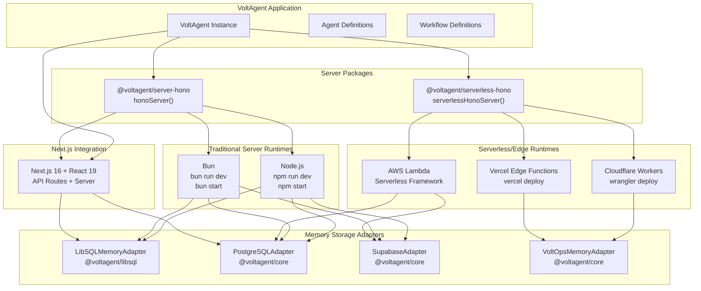
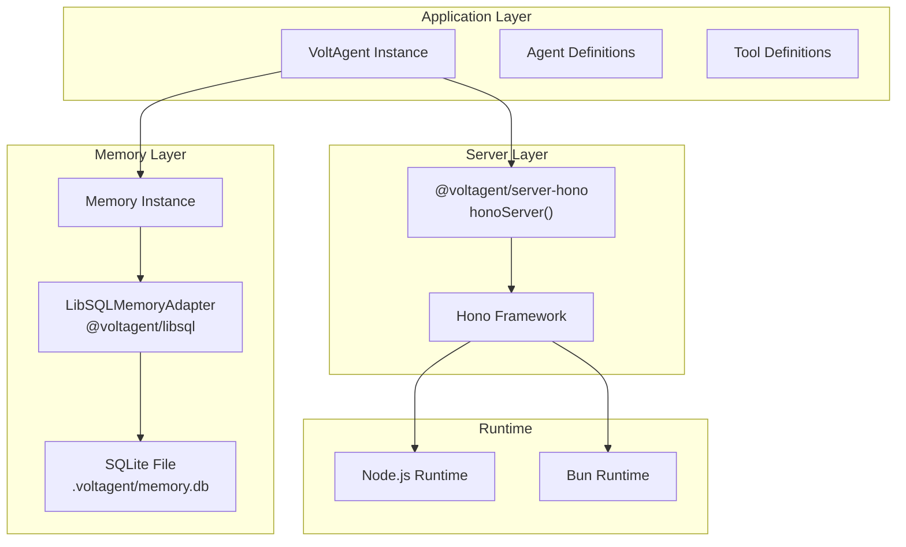
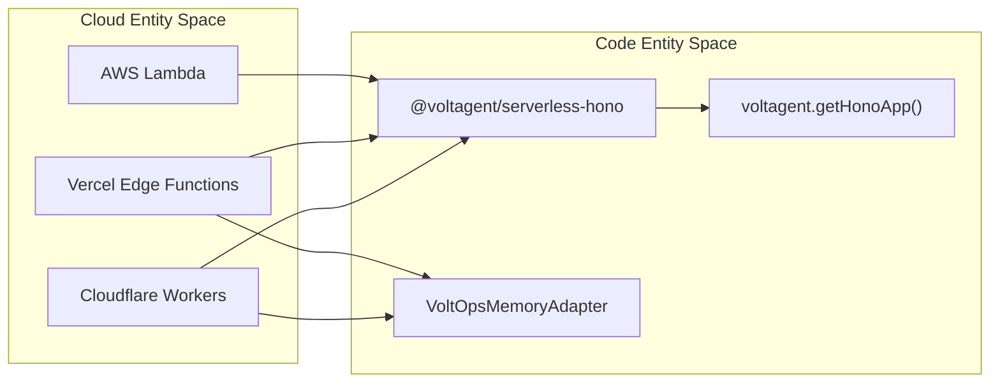

<!-- source: DeepWiki mcp.deepwiki.com · repo VoltAgent/voltagent · page 11 Deployment · fetched 2026-10-26 -->

# Deployment

<details>
<summary>Relevant source files</summary>

The following files were used as context for generating this wiki page:

- [examples/with-cloudflare-workers/package.json](examples/with-cloudflare-workers/package.json)
- [examples/with-google-ai/package.json](examples/with-google-ai/package.json)
- [examples/with-google-vertex-ai/package.json](examples/with-google-vertex-ai/package.json)
- [examples/with-groq-ai/package.json](examples/with-groq-ai/package.json)
- [examples/with-mcp/package.json](examples/with-mcp/package.json)
- [examples/with-netlify-functions/package.json](examples/with-netlify-functions/package.json)
- [examples/with-nextjs/package.json](examples/with-nextjs/package.json)
- [packages/core/package.json](packages/core/package.json)
- [pnpm-lock.yaml](pnpm-lock.yaml)

</details>


This document covers deployment options for VoltAgent applications across traditional servers, serverless platforms, and edge runtimes. It explains the package architecture, configuration patterns, and memory storage considerations for different deployment targets.

For information about the development workflow and local testing, see [Local Development Workflow](#10.5). For VoltOps-managed deployment infrastructure, see [VoltOps Console Integration](#9.3).

---

## Deployment Architecture Overview

VoltAgent provides two primary server packages optimized for different deployment environments:

### Deployment Flow: NL to Code Entity Space

This diagram maps deployment concepts to specific code entities and packages.



**Sources:** [packages/core/package.json:1-112](), [examples/base/package.json:1-46](), [examples/with-cloudflare-workers/package.json:1-48]()

### Server Package Comparison

| Feature | `@voltagent/server-hono` | `@voltagent/serverless-hono` |
|---------|--------------------------|------------------------------|
| **Target Runtimes** | Node.js, Bun | Cloudflare Workers, Vercel Edge, AWS Lambda |
| **Filesystem Access** | Full access | Limited/None |
| **Memory Adapters** | LibSQL, PostgreSQL, Supabase | VoltOps Managed Memory, PostgreSQL, Supabase |
| **Long-Running Processes** | Supported | Limited by platform timeout |
| **Build Requirements** | TypeScript compilation | Platform-specific bundling |

**Sources:** [examples/base/package.json:128-130](), [examples/with-cloudflare-workers/package.json:7-7]()

---

## Traditional Server Deployment

Traditional server deployment targets Node.js or Bun runtimes running on persistent server infrastructure. This approach provides full filesystem access and long-running process support.

For details, see [Traditional Server Deployment](#11.1).

### Architecture: Traditional Server Stack



**Sources:** [examples/base/package.json:119-130](), [examples/with-google-ai/package.json:30-35]()

---

## Serverless and Edge Functions

Serverless and edge deployments target platforms with limited execution time and restricted filesystem access. VoltAgent provides `@voltagent/serverless-hono` optimized for these environments.

For details, see [Serverless and Edge Functions](#11.2).

### Architecture: Serverless Entity Mapping

This diagram connects serverless deployment targets to the required package entities.



**Sources:** [examples/with-cloudflare-workers/package.json:1-48](), [examples/with-netlify-functions/package.json:1-45]()

---

## Next.js Integration

Next.js 16 with React 19 provides server-side rendering and built-in API routes. VoltAgent can run as a separate server or be integrated into Next.js API routes using `@ai-sdk/react`.

For details, see [Next.js Integration](#11.3).

### Next.js Integration Patterns

- **Standalone Server**: Run VoltAgent on a separate port (e.g., 3142) and proxy requests from Next.js.
- **Embedded API Routes**: Integrate VoltAgent directly into `app/api/` routes using the `serverlessHonoServer`.

**Sources:** [examples/with-nextjs/package.json:1-46](), [examples/next-js-chatbot-starter-template/package.json:227-232]()

---

## Memory Storage Selection by Deployment Type

| Deployment Type | Recommended Adapter | Reason |
|----------------|---------------------|---------|
| **Node.js/Bun** | `LibSQLMemoryAdapter` | Persistent local filesystem access available. |
| **Cloudflare Workers** | `VoltOpsMemoryAdapter` | No filesystem; requires HTTP-based storage. |
| **Vercel Edge** | `VoltOpsMemoryAdapter` | Optimized for global edge distribution. |
| **AWS Lambda** | `PostgreSQLAdapter` | Handles regional persistence and connection pooling. |

**Sources:** [examples/base/package.json:122-124](), [examples/with-cloudflare-workers/package.json:1-11](), [examples/with-nextjs/package.json:10-10]()

---

## Monitoring and Observability

All deployment types support VoltOps integration via the `VoltOpsClient` for production monitoring and telemetry.

```typescript
import { VoltAgent, VoltOpsClient } from "@voltagent/core";

const voltops = new VoltOpsClient({
  projectId: process.env.VOLTAGENT_PROJECT_ID,
  apiKey: process.env.VOLTAGENT_API_KEY,
});

const voltagent = new VoltAgent({
  agents: { /* ... */ },
  voltops, // Enable telemetry
});
```

**Sources:** [packages/core/package.json:27-38](), [examples/with-nextjs/package.json:11-12]()

---

