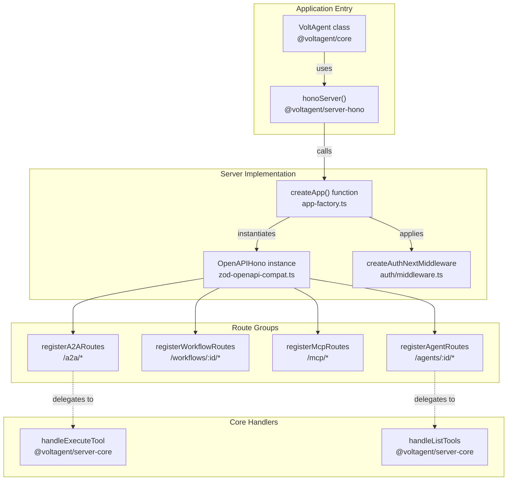
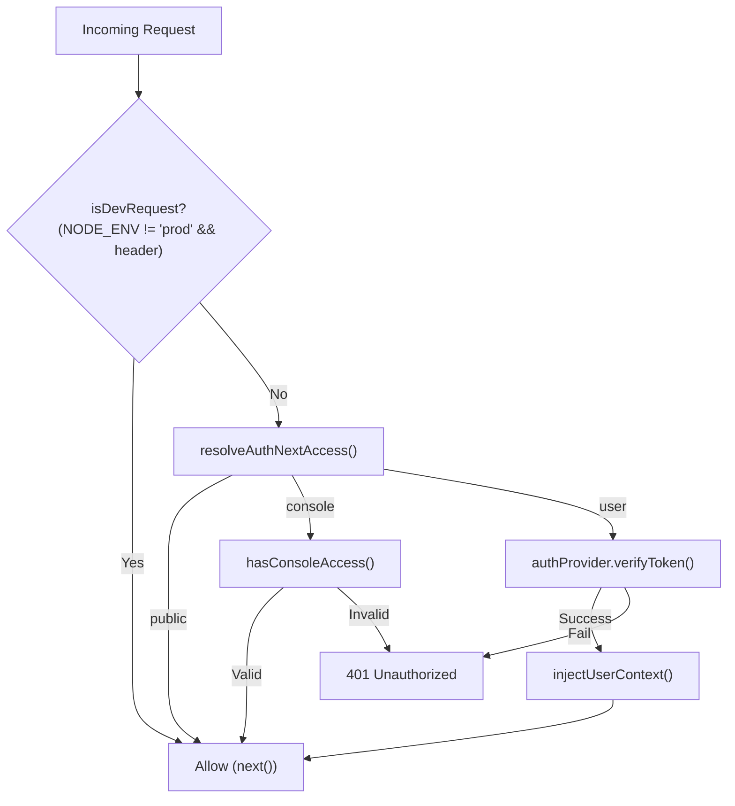

<!-- source: DeepWiki mcp.deepwiki.com · repo VoltAgent/voltagent · page 11.1 Traditional Server Deployment · fetched 2026-10-26 -->

# Traditional Server Deployment

Relevant source files

The following files were used as context for generating this wiki page:

- [examples/with-auth/src/index.ts](examples/with-auth/src/index.ts)
- [packages/server-core/CHANGELOG.md](packages/server-core/CHANGELOG.md)
- [packages/server-core/package.json](packages/server-core/package.json)
- [packages/server-core/src/auth/index.ts](packages/server-core/src/auth/index.ts)
- [packages/server-core/src/auth/next.spec.ts](packages/server-core/src/auth/next.spec.ts)
- [packages/server-core/src/auth/next.ts](packages/server-core/src/auth/next.ts)
- [packages/server-core/src/auth/utils.spec.ts](packages/server-core/src/auth/utils.spec.ts)
- [packages/server-core/src/auth/utils.ts](packages/server-core/src/auth/utils.ts)
- [packages/server-core/src/websocket/setup.ts](packages/server-core/src/websocket/setup.ts)
- [packages/server-hono/package.json](packages/server-hono/package.json)
- [packages/server-hono/src/app-factory.spec.ts](packages/server-hono/src/app-factory.spec.ts)
- [packages/server-hono/src/app-factory.ts](packages/server-hono/src/app-factory.ts)
- [packages/server-hono/src/auth/index.ts](packages/server-hono/src/auth/index.ts)
- [packages/server-hono/src/auth/middleware.spec.ts](packages/server-hono/src/auth/middleware.spec.ts)
- [packages/server-hono/src/auth/middleware.ts](packages/server-hono/src/auth/middleware.ts)
- [packages/server-hono/src/index.ts](packages/server-hono/src/index.ts)
- [packages/server-hono/src/routes/tool.routes.ts](packages/server-hono/src/routes/tool.routes.ts)
- [packages/server-hono/src/types.ts](packages/server-hono/src/types.ts)
- [website/docs/api/authentication.md](website/docs/api/authentication.md)
- [website/docs/api/custom-endpoints.md](website/docs/api/custom-endpoints.md)

## Purpose and Scope

This document covers deploying VoltAgent applications to traditional Node.js or Bun servers running on long-lived processes. This deployment model uses the `@voltagent/server-hono` package to create an HTTP server that exposes agent and workflow endpoints. Traditional server deployment provides full OpenTelemetry observability, support for Model Context Protocol (MCP) servers, and Agent-to-Agent (A2A) protocol capabilities. It is suitable for VM-based hosting, containerized environments, and on-premise installations where persistent processes are preferred over ephemeral functions.

## Overview

Traditional server deployment in VoltAgent refers to running a persistent process that handles HTTP requests through the Hono web framework. Unlike serverless functions that spin up per-request, traditional servers maintain long-running connections for observability, persistent memory state, and continuous process monitoring.

The architecture consists of three layers:
1.  **Server Framework**: `@voltagent/server-hono` implements the HTTP server using Hono and `@hono/node-server` [[packages/server-hono/package.json:2-6]]().
2.  **Core Routing**: `@voltagent/server-core` provides framework-agnostic route definitions for agents, workflows, and tools [[packages/server-core/package.json:3-13]]().
3.  **Process Runtime**: Node.js or Bun runtime with full OpenTelemetry instrumentation.

Sources: [packages/server-hono/package.json:1-17](), [packages/server-core/package.json:1-14]()

## Server Architecture Components

**Diagram: Server-Hono Package Architecture**

The `@voltagent/server-hono` package centers around `createApp`, which initializes an `OpenAPIHono` instance [[packages/server-hono/src/app-factory.ts:31-36]](). It mounts various route groups including Agents, Workflows, MCP, and A2A [[packages/server-hono/src/app-factory.ts:51-61]](). These routes delegate the actual logic to framework-agnostic handlers in `@voltagent/server-core`, such as `handleExecuteTool` [[packages/server-hono/src/routes/tool.routes.ts:144-150]]().

Sources: [packages/server-hono/src/app-factory.ts:31-146](), [packages/server-hono/src/routes/tool.routes.ts:137-151]()

## Server Configuration

The `honoServer()` function accepts a `HonoServerConfig` object to customize the runtime behavior [[packages/server-hono/src/types.ts:15-152]]().

| Property | Type | Default | Description |
| :--- | :--- | :--- | :--- |
| `port` | `number` | `3141` | The port the server binds to [[packages/server-hono/src/types.ts:16]](). |
| `hostname` | `string` | `"0.0.0.0"` | Hostname to bind the server to [[packages/server-hono/src/types.ts:43]](). |
| `cors` | `CORSOptions \| false` | `*` | CORS configuration. Set to `false` to disable [[packages/server-hono/src/types.ts:70]](). |
| `authNext` | `AuthNextConfig` | `undefined` | Next-gen authentication policy [[packages/server-hono/src/types.ts:144]](). |
| `configureApp` | `Function` | `undefined` | Callback for adding custom Hono routes/middleware [[packages/server-hono/src/types.ts:95]](). |
| `resumableStream`| `Object` | `undefined` | Config for `ResumableStreamAdapter` [[packages/server-hono/src/types.ts:21-24]](). |

### Custom Endpoints and Hooks
Developers can extend the server using `configureApp`. This allows adding health checks or custom business logic endpoints [[packages/server-hono/src/types.ts:80-94]](). If total control over the registration order is needed, `configureFullApp` can be used to manually trigger the registration of built-in routes and middlewares [[packages/server-hono/src/types.ts:106-137]]().

Sources: [packages/server-hono/src/types.ts:15-152](), [packages/server-hono/src/app-factory.ts:106-143]()

## Authentication and Security

VoltAgent uses a policy-based authentication model called `authNext` [[packages/server-core/src/auth/next.ts]]().

### Access Resolution
Requests are categorized into three access levels:
1.  **Public**: No authentication required (e.g., `/health`) [[packages/server-hono/src/auth/middleware.ts:120-122]]().
2.  **Console**: Requires a `VOLTAGENT_CONSOLE_ACCESS_KEY` [[packages/server-hono/src/auth/middleware.ts:124-136]]().
3.  **User**: Requires a valid JWT/Token from the configured `AuthProvider` [[packages/server-hono/src/auth/middleware.ts:142-177]]().

**Diagram: Authentication Flow (authNext)**

The `createAuthNextMiddleware` handles the logic of checking for development bypasses (via `isDevRequest`) before resolving the access level [[packages/server-hono/src/auth/middleware.ts:115-188]](). If a user is authenticated, `injectUserContext` attaches the user object to the Hono context and modifies `c.req.json` to automatically include the user in the agent's operation context [[packages/server-hono/src/auth/middleware.ts:191-217]]().

Sources: [packages/server-hono/src/auth/middleware.ts:109-217](), [packages/server-core/src/auth/utils.ts:33-91]()

### Development Bypass
In non-production environments (`NODE_ENV !== "production"`), authentication can be bypassed by sending the `x-voltagent-dev: true` header or the `?dev=true` query parameter [[packages/server-core/src/auth/utils.ts:33-47]]().

## WebSocket Support

The server supports persistent WebSocket connections for observability and real-time updates [[packages/server-core/src/websocket/setup.ts:202-215]]().

-   **Upgrade Handling**: The server listens for `upgrade` events and validates authentication before establishing the WebSocket connection [[packages/server-core/src/websocket/setup.ts:232-235]]().
-   **Console Access**: WebSocket connections to `/ws/observability` require the `VOLTAGENT_CONSOLE_ACCESS_KEY` passed via the `key` query parameter or `x-console-access-key` header [[packages/server-core/src/websocket/setup.ts:38-57]]().
-   **Context Injection**: Authenticated users are passed to the `handleWebSocketConnection` function to ensure agent operations within the socket are properly scoped [[packages/server-core/src/websocket/setup.ts:210-212]]().

Sources: [packages/server-core/src/websocket/setup.ts:1-235]()

## Deployment Checklist

When deploying to a traditional server environment:

1.  **Environment Variables**:
    -   `NODE_ENV`: Set to `production` to disable dev bypasses [[packages/server-core/src/auth/utils.ts:35-38]]().
    -   `VOLTAGENT_CONSOLE_ACCESS_KEY`: Required for securing management endpoints and VoltOps Console integration [[packages/server-core/src/auth/utils.ts:84]]().
    -   `PORT`: Defaults to `3141` but can be overridden [[packages/server-hono/src/types.ts:16]]().
2.  **CORS**: Ensure `cors` is configured if the agent will be accessed from a web browser [[packages/server-hono/src/types.ts:51-70]]().
3.  **Process Manager**: Use a manager like PM2 or systemd to ensure the process restarts on failure.
4.  **Graceful Shutdown**: The server should handle `SIGTERM` to close active agent operations and database connections.

Sources: [packages/server-hono/src/types.ts:15-152](), [packages/server-core/src/auth/utils.ts:33-91]()

---

