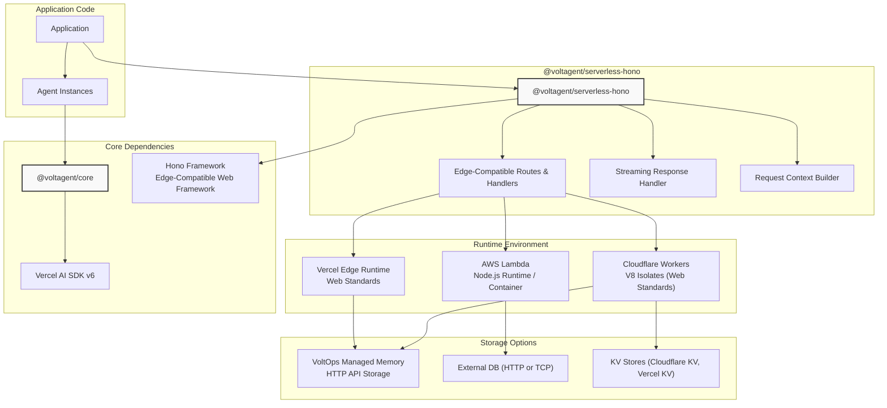
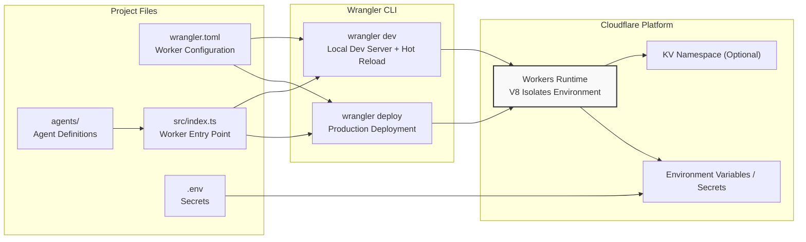
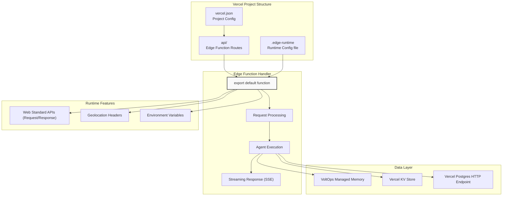
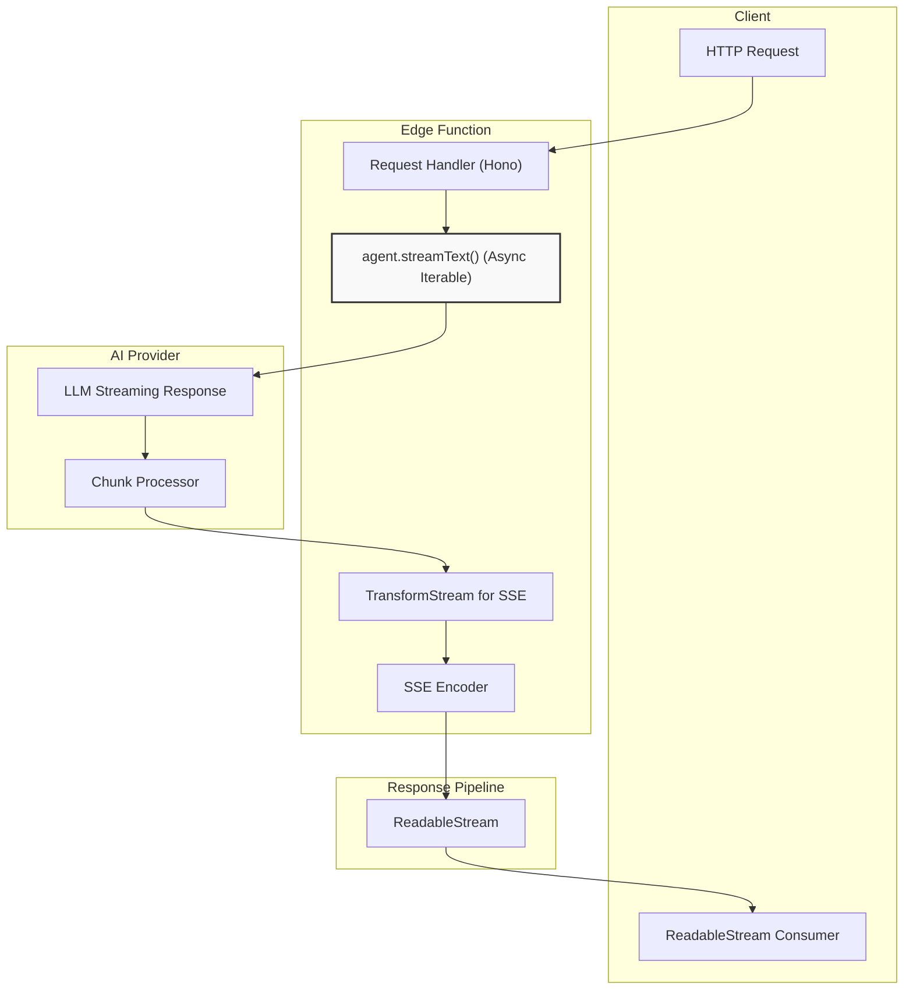
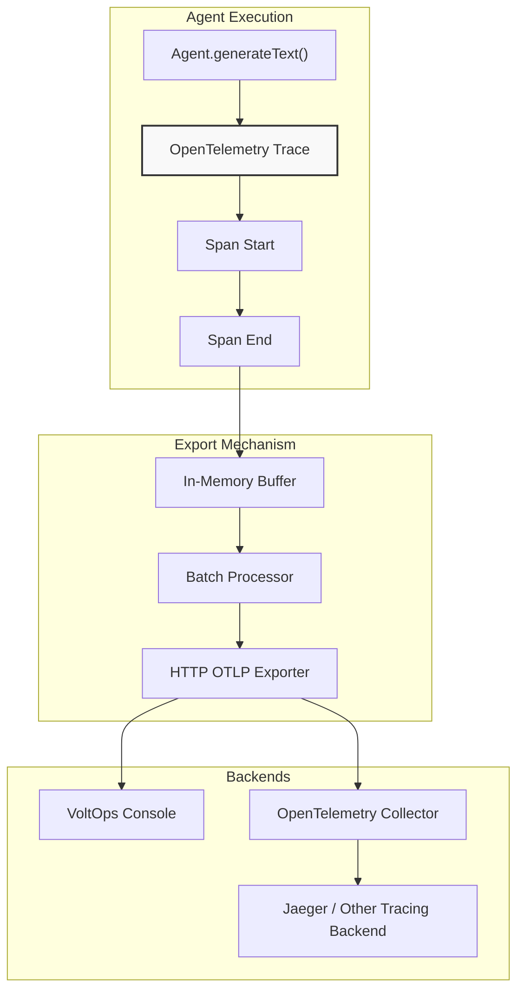

<!-- source: DeepWiki mcp.deepwiki.com · repo VoltAgent/voltagent · page 11.2 Serverless and Edge Functions · fetched 2026-10-26 -->

# Serverless and Edge Functions

<details>
<summary>Relevant source files</summary>

The following files were used as context for generating this wiki page:

- [examples/with-cloudflare-workers/package.json](examples/with-cloudflare-workers/package.json)
- [examples/with-netlify-functions/package.json](examples/with-netlify-functions/package.json)
- [packages/server-core/src/auth/defaults.spec.ts](packages/server-core/src/auth/defaults.spec.ts)
- [packages/server-core/src/auth/defaults.ts](packages/server-core/src/auth/defaults.ts)
- [packages/server-core/src/edge.ts](packages/server-core/src/edge.ts)
- [packages/server-core/src/handlers/workflow.handlers.ts](packages/server-core/src/handlers/workflow.handlers.ts)
- [packages/server-core/src/handlers/workflow.stream-attach.handlers.spec.ts](packages/server-core/src/handlers/workflow.stream-attach.handlers.spec.ts)
- [packages/server-core/src/routes/definitions.ts](packages/server-core/src/routes/definitions.ts)
- [packages/server-elysia/src/routes/workflow.routes.ts](packages/server-elysia/src/routes/workflow.routes.ts)
- [packages/server-hono/src/routes/agent.routes.ts](packages/server-hono/src/routes/agent.routes.ts)
- [packages/server-hono/src/routes/index.ts](packages/server-hono/src/routes/index.ts)
- [packages/serverless-hono/src/routes.ts](packages/serverless-hono/src/routes.ts)
- [website/docs/api/overview.md](website/docs/api/overview.md)

</details>


This page documents deployment of VoltAgent applications to serverless and edge computing platforms, specifically covering **Cloudflare Workers**, **Vercel Edge Functions**, and **AWS Lambda**. These platforms provide globally distributed compute with automatic scaling and pay-per-request pricing.

For traditional Node.js and Bun server deployments, see [Traditional Server Deployment](#11.1). For Next.js-specific integration patterns, see [Next.js Integration](#11.3).

---

## Overview

VoltAgent provides the `@voltagent/serverless-hono` package designed for deploying agents to edge runtimes and serverless functions. This package is distinct from `@voltagent/server-hono`, being optimized for the constraints of V8 isolate-based environments (such as Cloudflare Workers and Vercel Edge) and serverless containers like AWS Lambda.

The key differences include:

- Compatibility with **Web Standard APIs** (e.g. `Request`/`Response`, `ReadableStream`)
- Streaming response support using **Server-Sent Events** (SSE) with `ReadableStream`
- Context propagation suited for ephemeral environments
- Memory adapter integration compatible with serverless storage options

### Platform Comparison

| Platform            | Package                  | Runtime Environment     | Cold Start            | Memory Limits      | Deployment Tool               |
|---------------------|--------------------------|------------------------|-----------------------|--------------------|-------------------------------|
| Cloudflare Workers   | `@voltagent/serverless-hono` | V8 Isolates            | < 1 ms                | 128MB              | Wrangler                      |
| Vercel Edge Functions| `@voltagent/serverless-hono` | Edge Runtime           | < 1 ms                | Limited            | Vercel CLI                   |
| AWS Lambda          | `@voltagent/server-hono` or `@voltagent/serverless-hono` | Node.js Container      | 50-200 ms            | 128MB - 10GB       | AWS SAM/CDK                  |
| Node.js/Bun         | `@voltagent/server-hono` | Full Node.js API       | N/A                   | System RAM         | PM2 / systemd                 |

**Sources:** [examples/with-cloudflare-workers/package.json:1-11](), [examples/github-star-stories/package.json:202-210]()

---

## Package Architecture



The `@voltagent/serverless-hono` package exports Hono-based routes compatible with edge runtimes. It contains streaming handlers that output SSE event streams using `ReadableStream`. The package also provides utilities to merge context with environment bindings for metadata propagation.

**Sources:** [pnpm-lock.yaml:887-889](), [examples/with-cloudflare-workers/package.json:1-11]()

---

## Cloudflare Workers Deployment

### Project Layout

A typical Cloudflare Workers deployment project for VoltAgent includes:



**Sources:** [examples/with-cloudflare-workers/package.json:1-11](), [pnpm-lock.yaml:909-911]()

### Worker Entry Point Pattern

The main entry for a Cloudflare Worker using VoltAgent typically:

- Imports agent definitions from code or agents folder
- Calls `createServerlessHonoApp()` from `@voltagent/serverless-hono` to create the app
- Handles HTTP requests with the edge runtime handler export

This looks like:

```typescript
import { Agent } from '@voltagent/core';
import { createServerlessHonoApp } from '@voltagent/serverless-hono';

// Define agents, tools, etc.

const app = createServerlessHonoApp({
  agents: { /* agents here */ },
  memoryAdapter: /* appropriate edge-compatible adapter */
});

export default {
  fetch: app.fetch,
};
```

This enables streaming responses and request context management compatible with the V8 isolate environment.

**Sources:** [examples/with-cloudflare-workers/package.json:1-11]()

### Unique Constraints and Memory Storage

Cloudflare Workers have limitations:

| Constraint           | Limit                | Implications                             |
|----------------------|----------------------|----------------------------------------|
| Memory               | ~128MB               | In-memory state is limited and ephemeral |
| CPU Time             | ~50 ms (free) / ~30s (paid) | Long-running processes must be carefully designed |
| Node.js APIs         | **Not available**    | No `fs`, no native binaries, no sockets |
| Native SQLite Access | **Not available**    | Cannot use file-based SQLite adapters  |

The recommended storage adapters for Workers are typically:

- **VoltOps Managed Memory** — HTTP-based, globally replicated memory storage designed for serverless
- **Supabase Adapter** — Uses REST API to Postgres (HTTP)
- **Custom Cloudflare KV Adapter** — For simple key-value storage
- **Cloudflare D1 Adapter** — Requires a custom Driver but offers SQLite-like functionality

**Sources:** [pnpm-lock.yaml:882-912]()

### Development & Deployment commands

Typical Cloudflare Workers dev commands:

```bash
wrangler dev       # Local development with hot reload
wrangler deploy    # Deploy to Cloudflare
wrangler tail      # View live Worker logs
```

**Sources:** [examples/with-cloudflare-workers/package.json:1-11](), [pnpm-lock.yaml:909-911]()

---

## Vercel Edge Functions Deployment

### Edge Runtime Compatibility

Vercel Edge uses a similar sandbox to Cloudflare Workers with differences in API extensions (e.g., geolocation headers). VoltAgent leverages the same `@voltagent/serverless-hono` package for the shared code base.



**Sources:** [examples/github-star-stories/package.json:202-210]()

### Configuration for Edge Runtime

In your API routes, specify runtime as edge:

```typescript
export const runtime = 'edge';
export const dynamic = 'force-dynamic';

export default async function handler(req: Request) {
  // Use @voltagent/serverless-hono app.fetch internally
}
```

`@voltagent/serverless-hono` handles request body parsing, response streaming, and context propagation under the constraints of the edge runtime.

**Sources:** [examples/github-star-stories/package.json:202-210]()

### Next.js Integration

Vercel Edge Functions are often deployed with Next.js (see [Next.js Integration](#11.3)). VoltAgent supports this with patterns using server components and app/router API routes configured for edge.

**Sources:** [examples/with-nextjs/package.json:1-45]()

---

## AWS Lambda Deployment

### Package Selection and Runtime Types

AWS Lambda supports:

| Runtime            | Package                  | Use Case                                |
|--------------------|--------------------------|---------------------------------------|
| Node.js 18.x / 20.x | `@voltagent/server-hono` | Traditional Lambdas with Node.js APIs |
| Container Images    | `@voltagent/server-hono` | Custom container Lambdas               |
| Lambda@Edge        | `@voltagent/serverless-hono` | CloudFront edge functions (limited)   |

**Sources:** [pnpm-lock.yaml:128-146]()

### Lambda Handler Architecture

```mermaid
graph LR
    subgraph "Lambda Invocation"
        EVENT["Lambda Event"]
        CTX["Lambda Context"]
    end
    
    subgraph "VoltAgent Lambda Handler"
        ADAPTER["Event Adapter (HTTP -> Hono Request)"]
        HONO_APP["Hono Server Instance"]
        AGENT_ROUTER["Agent Router & Handlers"]
    end
    
    subgraph "Execution Flow"
        AGENT_GEN["Agent.generateText Handler"]
        MEM_LOAD["Load Conversation from Memory"]
        LLM_CALL["LLM Provider API Call"]
        MEM_SAVE["Persist Messages / Memory"]
    end
    
    subgraph "Response Flow"
        BUILD_RESP["Build HTTP Response"]
        LAMBDA_RESP["Lambda Response Object"]
    end
    
    EVENT --> ADAPTER
    CTX --> ADAPTER
    ADAPTER --> HONO_APP
    HONO_APP --> AGENT_ROUTER
    
    AGENT_ROUTER --> AGENT_GEN
    AGENT_GEN --> MEM_LOAD
    MEM_LOAD --> LLM_CALL
    LLM_CALL --> MEM_SAVE
    MEM_SAVE --> BUILD_RESP
    BUILD_RESP --> LAMBDA_RESP
    
    style HONO_APP fill:#f9f9f9,stroke:#333,stroke-width:2px
```



This uses the `@voltagent/server-hono` or `@voltagent/serverless-hono` server application with an adapter translating Lambda events to HTTP requests.

**Sources:** [examples/base/package.json:1-39]()

### Cold Start Optimization Techniques

To reduce Lambda cold starts:

- Use **Provisioned Concurrency** to keep warm instances
- Keep dependencies minimal, optimizing bundling & tree-shaking
- Use Lambda Layers for VoltAgent to decrease deploy package size
- Reuse database connections between invocations via global scope

The `@voltagent/core` package bundles all AI provider SDKs in a single dependency, so consider modular imports to improve cold start.

**Sources:** [packages/core/package.json:5-49]()

### Memory Adapter Usages on Lambda

Because AWS Lambda supports the full Node.js environment and has ephemeral local storage (`/tmp`), you can use:

- `LibSQLMemoryAdapter` — SQLite file-based in `/tmp`
- `PostgreSQLAdapter` — Remote PostgreSQL connection
- `SupabaseAdapter` — HTTP API access to Supabase
- `VoltOpsManagedMemory` — Recommended cloud-managed storage

**Sources:** [examples/base/package.json:4-12]()

---

## Storage Adapter Compatibility

### Adapter Compatibility Matrix

| Adapter               | Cloudflare Workers | Vercel Edge | AWS Lambda | Notes                                     |
|-----------------------|--------------------|-------------|------------|-------------------------------------------|
| `InMemoryAdapter`     | ✅                   | ✅          | ✅         | Lost on restart; dev only                  |
| `LibSQLMemoryAdapter` | ❌                   | ❌          | ✅         | Needs file system access                    |
| `PostgreSQLAdapter`   | ⚠️ (HTTP only)       | ⚠️ (HTTP only) | ✅         | Requires HTTP or TCP connection             |
| `SupabaseAdapter`     | ✅                   | ✅          | ✅         | Pure HTTP REST API                          |
| `VoltOps Managed`     | ✅                   | ✅          | ✅         | Recommended for edge & serverless           |

**Legend:**

- ✅ Fully supported  
- ⚠️ Supported with constraints (e.g., HTTP-only clients)  
- ❌ Not supported

**Sources:** [examples/with-supabase/package.json:1-39](), [examples/base/package.json:4-12]()

---

## VoltOps Managed Memory for Serverless

`VoltOps Managed Memory` is the recommended persistent conversation memory solution for serverless edge deployments. It is an HTTP-first API offering:

- Compatibility with all edge runtimes through HTTP
- Conversation summarization and pruning
- Global multi-region replication for low latency
- Direct integration with VoltAgent observability tools
- No cold start or file system limitations

Example configuration:

```typescript
import { Agent } from '@voltagent/core';

const agent = new Agent({
  name: 'my-agent',
  // other config...
  memory: {
    provider: 'voltops-managed',
    apiKey: process.env.VOLTOPS_API_KEY,
  },
});
```

**Sources:** [pnpm-lock.yaml:202-223]()

---

## Streaming Responses in Edge Environments

### Streaming Architecture



The streaming response leverages Web standard `ReadableStream` API. The serverless-hono package converts the generator of streaming data into SSE events that the client can consume in real-time.

**Sources:** [examples/with-cloudflare-workers/package.json:4-11]()

### Tool Execution During Streams

When the agent invokes tools during streaming responses:

1. Tool call events are emitted as special SSE payloads
2. The edge function may perform async external tool calls
3. Tool results are streamed back as SSE events
4. The agent response continues based on tool results

Since edge runtimes limit execution time (e.g., 25-30 seconds), tool calls and streaming must be efficient and possibly split across invocations.

**Sources:** [pnpm-lock.yaml:882-911]()

---

## Environment Variables and Secrets

### Secret Management Practices

| Platform             | Secret Storage          | Access Pattern                             |
|----------------------|------------------------|--------------------------------------------|
| Cloudflare Workers    | Wrangler Secrets        | `env.SECRET_NAME` within worker fetch handler |
| Vercel Edge          | Vercel Environment Variables | `process.env.SECRET_NAME` inside function    |
| AWS Lambda           | AWS Secrets Manager / Parameter Store | Access via AWS SDK in handler                 |

#### Cloudflare Workers Example:

```bash
wrangler secret put OPENAI_API_KEY
```

Inside Worker:

```typescript
export default {
  async fetch(request: Request, env: { OPENAI_API_KEY: string }) {
    const apiKey = env.OPENAI_API_KEY;
    // ...
  }
}
```

#### Vercel Environment Example:

```bash
vercel env add OPENAI_API_KEY
```

Usage in Edge Function:

```typescript
const apiKey = process.env.OPENAI_API_KEY;
```

**Sources:** [examples/with-cloudflare-workers/package.json:1-11](), [pnpm-lock.yaml:909-911]()

---

## OpenTelemetry in Serverless Environments

### Observability Export Pattern



**Challenges in Serverless:**

- No persistent background workers to batch exports
- Limited execution time to flush telemetry data
- Some exporters require Node.js or gRPC APIs not available in workers

**Solutions:**

- Use HTTP-based OTLP exporters without gRPC (e.g., VoltOpsClient)
- Export synchronously at request end for better fidelity
- Leverage lightweight layers and batch only minimal spans
- Use VoltOps observability integration designed for serverless

**Sources:** [packages/core/package.json:27-38]()

---

## Example: Multi-Platform Deployment

The `github-star-stories` example demonstrates deployment of the same codebase to both traditional Node.js servers and edge runtimes:

- Uses both `@voltagent/server-hono` for local/dev Node.js server
- Uses `@voltagent/serverless-hono` for Cloudflare Workers deployment
- Shares agent definitions and memory/storage adapter configurations
- Manages environment variables and secrets separately for each target

```typescript
// Example imports (partial)
import { createServerHonoApp } from '@voltagent/server-hono';    // For local dev server
import { createServerlessHonoApp } from '@voltagent/serverless-hono'; // For Workers
```

**Sources:** [examples/github-star-stories/package.json:1-23](), [pnpm-lock.yaml:188-223]()

---

## Best Practices

### 1. Bundle Size Optimization

Edge runtimes have strict size limits (compressed < 1MB to 5MB).

- Use dynamic imports for optional large dependencies
- Minimize provider SDKs included by explicit imports
- Use tree-shaking and bundler optimizations
- Store large models, prompts, or data externally

**Sources:** [packages/core/package.json:5-49]()

### 2. Timeout Management

Set agent and model timeouts conservatively to fit platform latency limits:

```typescript
const agent = new Agent({
  // ...
  maxSteps: 5,         // Prevent excessive tool invocations
  model: {
    temperature: 0.7,
    maxTokens: 2000,   // Limit response size for streaming
  }
});
```

**Sources:** [examples/with-cloudflare-workers/package.json:1-11]()

### 3. Error Handling

Design edge functions to gracefully handle errors:

- Catch API errors and return meaningful HTTP responses
- Use retries with exponential backoff cautiously
- Prefer circuit breakers or fail-fast behaviors on tool executions
- Log errors to external observability services

**Sources:** [pnpm-lock.yaml:882-911]()

### 4. Cold Start Reduction

To minimize cold start latency:

- Lazily initialize agent instances on first request
- Cache global singletons across invocations where possible
- Preload frequently used dependencies
- Use provisioned concurrency on AWS Lambda

**Sources:** [examples/base/package.json:1-39]()

### 5. Development Workflow

Maintain environment parity:

```bash
# Local development with Node.js server
npm run dev

# Deploy to Cloudflare workers
wrangler deploy

# Share identical agent config and secret env vars
```

**Sources:** [examples/github-star-stories/package.json:1-23]()

---

## Debugging and Logging

### Structured Logging in Edge Environments

The `@voltagent/logger` library supports edge-compatible logging using JSON format and console transport:

- Avoid Node.js-specific transports (e.g., file, syslog)
- Use console transport configured for structured JSON output
- Integrate with external log forwarders if available
- Example:

```typescript
import { createLogger } from '@voltagent/logger';

const logger = createLogger({
  level: 'info',
  transport: {
    target: 'pino/browser', // Browser-compatible console transport
  }
});
```

**Sources:** [examples/with-cloudflare-workers/package.json:1-11]()

### VoltOps Console for Trace Visualization

VoltOps Console supports trace visualization for serverless and edge deployments:

- Visualize agent execution timelines
- Inspect tool call sequences and LLM latency
- Correlate memory and workflow events
- Monitor resource usage and errors

**Sources:** [packages/core/package.json:27-38]()

---

## Migration from Traditional Servers to Serverless

### Migration Checklist

| Consideration            | Action                                                                                 |
|-------------------------|----------------------------------------------------------------------------------------|
| **Server package**       | Replace `@voltagent/server-hono` with `@voltagent/serverless-hono`                     |
| **Memory Adapter**       | Switch off local adapters (LibSQL) to HTTP-based adapters (VoltOps, Supabase, KV)      |
| **Environment Variables**| Use platform secret management (Wrangler secrets, Vercel env, AWS Secrets Manager)    |
| **File System Usage**    | Remove all `fs` and native Node.js API usage; rely on HTTP APIs                       |
| **Background Jobs**      | Move long-running or scheduled tasks to separate worker functions or cron triggers     |
| **Observability Export** | Use HTTP-based OTLP exporters synchronous in requests; avoid gRPC                      |
| **Streaming APIs**       | Use `ReadableStream` APIs from serverless-hono package for SSE                         |

**Sources:** [examples/base/package.json:1-39](), [examples/with-cloudflare-workers/package.json:1-11]()

### Code Modifications Example

```typescript
// Before (Node.js server)
import { createServerHonoApp } from '@voltagent/server-hono';
import { LibSQLMemoryAdapter } from '@voltagent/libsql';

const memory = new LibSQLMemoryAdapter({ url: 'file:///data/memory.db' });

// After (Serverless)
import { createServerlessHonoApp } from '@voltagent/serverless-hono';

const memory = {
  provider: 'voltops-managed',
  apiKey: process.env.VOLTOPS_API_KEY,
};
```

**Sources:** [pnpm-lock.yaml:122-130](), [pnpm-lock.yaml:887-889]()

---

# Summary

This page explained the usage of VoltAgent in serverless and edge computing contexts, focusing on the `@voltagent/serverless-hono` package that enables deployment to Cloudflare Workers, Vercel Edge Functions, and AWS Lambda.

It covered:

- Architecture and differences of serverless-hono vs server-hono
- Platform-specific deployment patterns and constraints
- Streaming and tool execution in edge environments
- Memory adapter compatibility and VoltOps Managed Memory
- Observability with OpenTelemetry in edge contexts
- Best practices for cold start, bundle size, error handling
- Migration checklist from traditional servers to serverless

VoltAgent's modular design and framework-agnostic routes support flexible deployments, enabling developers to run AI-powered agents anywhere from global edge locations to classic Lambda containers.

---

**Sources:**

- `examples/with-cloudflare-workers/package.json:1-11`  
- `examples/github-star-stories/package.json:202-210`  
- `pnpm-lock.yaml:882-912`  
- `packages/serverless-hono/src/routes.ts:1-270`  
- `packages/server-core/src/auth/defaults.ts:1-160`  
- `packages/server-core/src/routes/definitions.ts:1-154`  
- `examples/with-netlify-functions/package.json:1-44`  
- `packages/server-core/src/handlers/workflow.handlers.ts:1-247`

---

