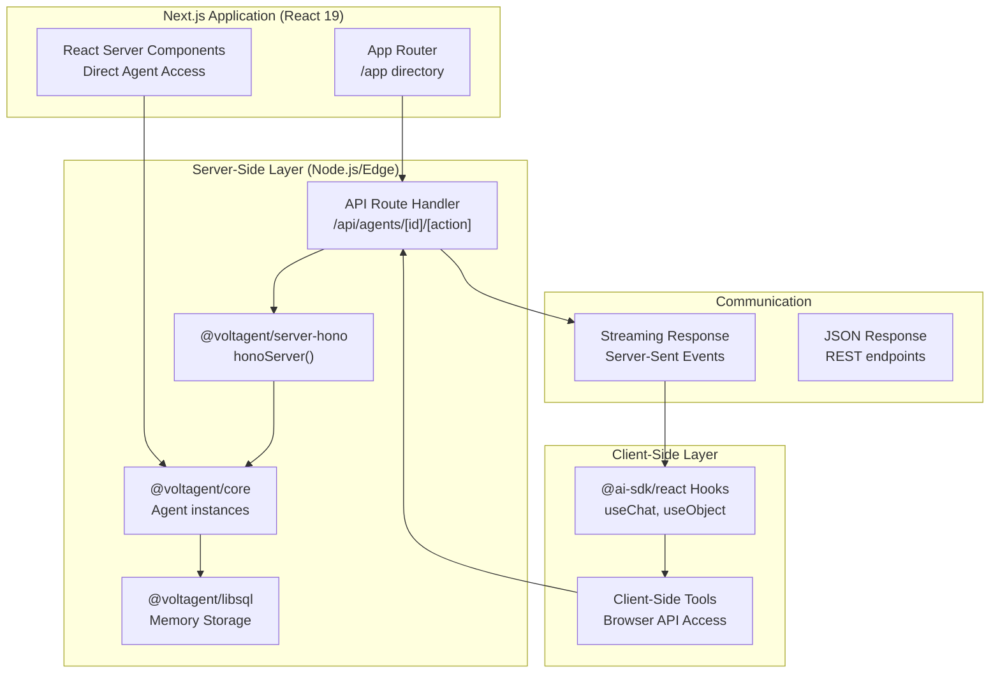
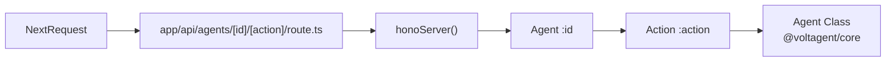
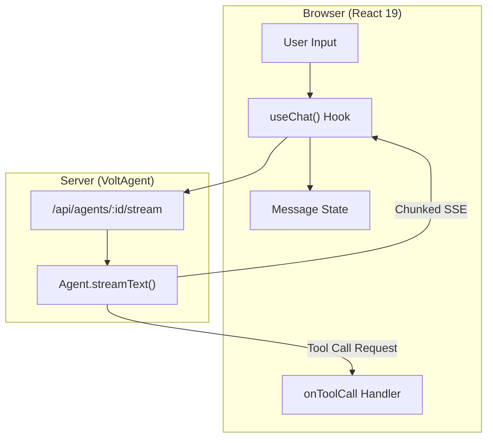

<!-- source: DeepWiki mcp.deepwiki.com · repo VoltAgent/voltagent · page 11.3 Next.js Integration · fetched 2026-10-26 -->

# Next.js Integration

Relevant source files

The following files were used as context for generating this wiki page:

- [examples/next-js-chatbot-starter-template/package.json](examples/next-js-chatbot-starter-template/package.json)
- [examples/with-google-ai/package.json](examples/with-google-ai/package.json)
- [examples/with-google-vertex-ai/package.json](examples/with-google-vertex-ai/package.json)
- [examples/with-groq-ai/package.json](examples/with-groq-ai/package.json)
- [examples/with-mcp/package.json](examples/with-mcp/package.json)
- [examples/with-nextjs/package.json](examples/with-nextjs/package.json)
- [packages/core/package.json](packages/core/package.json)
- [pnpm-lock.yaml](pnpm-lock.yaml)

This document explains how to integrate VoltAgent with Next.js applications, specifically targeting Next.js 16 and React 19. It covers API route configuration, App Router patterns, React Server Components, client-side hooks (`useChat`, `useObject`), and client-side tool execution.

VoltAgent provides first-class support for the Next.js ecosystem, building on top of the Vercel AI SDK v6 [packages/core/package.json:56-56]() and leveraging React 19 features like improved streaming and Server Components [examples/with-nextjs/package.json:15-19]().

---

## Architecture Overview

VoltAgent integrates with Next.js through three primary layers: server-side agent execution via API routes, client-side React hooks, and shared configuration for tools and memory.

Title: Next.js Integration Architecture

Sources: [examples/with-nextjs/package.json:1-23](), [packages/core/package.json:1-50]()

---

## Project Structure

A typical Next.js VoltAgent application (Next.js 16+) uses the following structure to separate AI logic from UI routing:

| Directory/File | Purpose |
|---|---|
| `voltagent/server.ts` | VoltAgent server setup with `honoServer()` and agent definitions [examples/with-nextjs/package.json:43-43]() |
| `app/api/agents/[id]/[action]/route.ts` | Catch-all API route handler forwarding to the Hono server |
| `app/page.tsx` | Main page component using React 19 hooks [examples/with-nextjs/package.json:18-18]() |
| `.env` | Environment variables for model providers and databases [examples/with-nextjs/package.json:43-43]() |

Sources: [examples/with-nextjs/package.json:1-45](), [examples/next-js-chatbot-starter-template/package.json:1-74]()

---

## Server Configuration

### API Route Handler (App Router)

In Next.js 16, API routes are defined in the `app/` directory. VoltAgent's `honoServer` handles the request logic, which is then exported via the Next.js route handler.

Title: Next.js Request Flow to Code Entities

Sources: [examples/with-nextjs/package.json:8-12](), [packages/core/package.json:2-5]()

### Dependency Setup

Integration requires several key packages to handle the bridge between the AI SDK and the Next.js runtime.

*   `@voltagent/core`: The main agent framework [examples/with-nextjs/package.json:9-9]().
*   `@voltagent/server-hono`: Provides the HTTP adapter for Next.js routes [examples/with-nextjs/package.json:12-12]().
*   `ai` & `@ai-sdk/react`: Vercel AI SDK for client-side hooks [examples/with-nextjs/package.json:5-13]().
*   `import-in-the-middle`: Required for certain telemetry and instrumentation in Next.js [examples/with-nextjs/package.json:14-14]().

---

## Client-Side Integration

### React 19 Hooks

VoltAgent is optimized for React 19, supporting the latest `useChat` and `useObject` hooks from `@ai-sdk/react`.

Title: Client Hook Data Flow

Sources: [examples/with-nextjs/package.json:5-19](), [examples/next-js-chatbot-starter-template/package.json:5-36]()

### Client-Side Tool Execution

Client-side tools allow agents to interact with browser APIs (e.g., `window.alert`, `navigator.clipboard`) while the model runs on the server.

1.  **Define Tool Schema:** On the server, define the tool with a schema but no `execute` function.
2.  **Intercept on Client:** Use the `onToolCall` callback in the `useChat` hook.
3.  **Return Result:** Use `addToolResult` to send the browser-computed value back to the agent.

Sources: [examples/next-js-chatbot-starter-template/package.json:23-48]()

---

## Advanced Integration Patterns

### Database & Memory (LibSQL)

Next.js integrations typically use `@voltagent/libsql` for persistent conversation memory, which is compatible with Turso and local SQLite [examples/with-nextjs/package.json:6-10]().

### UI Components

For sophisticated chat interfaces, the framework integrates with Radix UI and Tailwind CSS 4.0 [examples/with-nextjs/package.json:7-21]().

| Component | Library | Purpose |
|---|---|---|
| Chat UI | `@ai-sdk/react` | Message streaming and state [examples/next-js-chatbot-starter-template/package.json:5-5]() |
| Styling | `tailwindcss` | Utility-first styling (v4) [examples/with-nextjs/package.json:21-21]() |
| Primitives | `@radix-ui/*` | Accessible UI components (Avatar, ScrollArea) [examples/next-js-chatbot-starter-template/package.json:7-17]() |
| Animations | `motion` | Smooth message transitions [examples/next-js-chatbot-starter-template/package.json:32-32]() |

Sources: [examples/next-js-chatbot-starter-template/package.json:4-55](), [examples/with-nextjs/package.json:4-22]()

---

## Deployment and Scripts

Next.js VoltAgent projects include specific scripts to run the agent server alongside the Next.js dev server.

*   `next dev --turbopack`: Starts the Next.js frontend [examples/with-nextjs/package.json:39-39]().
*   `tsx --env-file=.env ./voltagent/server.ts`: Starts the VoltAgent backend server [examples/with-nextjs/package.json:43-43]().
*   `volt`: CLI tool for managing prompts and MCP integrations [examples/with-nextjs/package.json:42-42]().

Sources: [examples/with-nextjs/package.json:37-44]()

---

