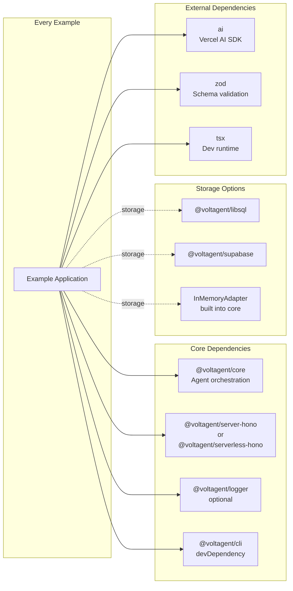
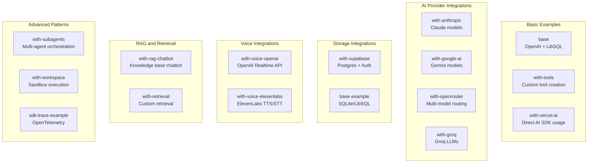
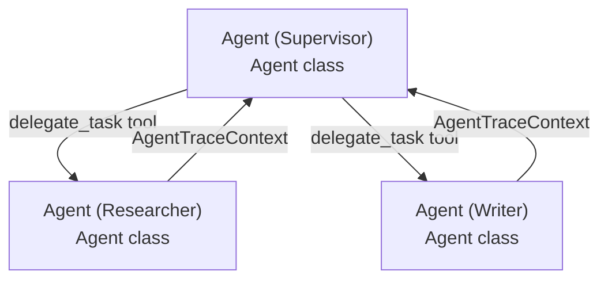
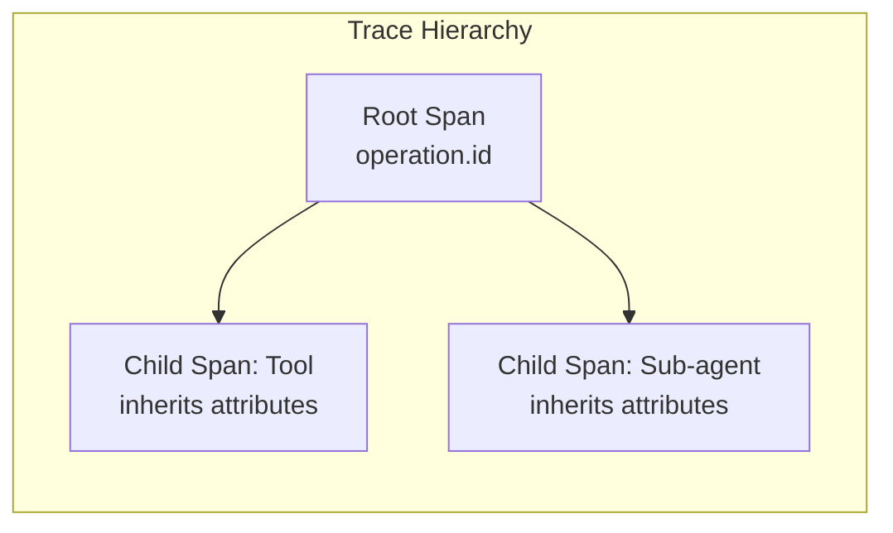

<!-- source: DeepWiki mcp.deepwiki.com · repo VoltAgent/voltagent · page 12 Examples · fetched 2026-10-26 -->

# Examples

Relevant source files

The following files were used as context for generating this wiki page:

- [examples/README.md](examples/README.md)
- [examples/base/package.json](examples/base/package.json)
- [examples/github-repo-analyzer/package.json](examples/github-repo-analyzer/package.json)
- [examples/with-openrouter/.env.example](examples/with-openrouter/.env.example)
- [examples/with-openrouter/.gitignore](examples/with-openrouter/.gitignore)
- [examples/with-openrouter/README.md](examples/with-openrouter/README.md)
- [examples/with-openrouter/src/index.ts](examples/with-openrouter/src/index.ts)
- [examples/with-openrouter/tsconfig.json](examples/with-openrouter/tsconfig.json)
- [examples/with-rag-chatbot/package.json](examples/with-rag-chatbot/package.json)
- [examples/with-retrieval/package.json](examples/with-retrieval/package.json)
- [examples/with-subagents/package.json](examples/with-subagents/package.json)
- [examples/with-supabase/package.json](examples/with-supabase/package.json)
- [examples/with-tools/package.json](examples/with-tools/package.json)
- [examples/with-vercel-ai/package.json](examples/with-vercel-ai/package.json)
- [examples/with-voice-elevenlabs/package.json](examples/with-voice-elevenlabs/package.json)
- [examples/with-voice-openai/package.json](examples/with-voice-openai/package.json)
- [packages/core/src/agent/agent-observability.spec.ts](packages/core/src/agent/agent-observability.spec.ts)
- [packages/core/src/agent/open-telemetry/trace-context.ts](packages/core/src/agent/open-telemetry/trace-context.ts)
- [packages/core/src/agent/prompt-context-usage.spec.ts](packages/core/src/agent/prompt-context-usage.spec.ts)
- [packages/core/src/agent/prompt-context-usage.ts](packages/core/src/agent/prompt-context-usage.ts)

## Purpose and Scope

This document provides an overview of the 40+ example applications in the VoltAgent repository located at [examples/](), demonstrating various integration patterns, deployment targets, and advanced features. Each example serves as both a learning resource and a production-ready template for specific use cases.

For information about the CLI tools used to scaffold new projects, see [CLI Reference](#10.1). For deployment-specific patterns, see [Deployment](#11).

---

## Example Directory Structure and Common Patterns

All examples follow a consistent structure that enables rapid development and easy migration to production environments.

### Standard Package Structure

Every example contains:

| File/Directory | Purpose |
|---------------|---------|
| `package.json` | Dependencies, scripts, and metadata |
| `src/index.ts` | Application entry point |
| `tsconfig.json` | TypeScript configuration |
| `.env` (gitignored) | Environment variables and API keys |
| `README.md` | Example-specific documentation |

### Common Dependencies

All examples depend on the core VoltAgent packages:

**Sources:** [examples/base/package.json:1-38](), [examples/with-supabase/package.json:1-38](), [examples/with-rag-chatbot/package.json:1-35]()

### Standard Scripts

All examples implement consistent npm scripts:

| Script | Command | Purpose |
|--------|---------|---------|
| `dev` | `tsx watch --env-file=.env ./src` | Hot-reload development server |
| `build` | `tsc` | Compile TypeScript to JavaScript |
| `start` | `node dist/index.js` | Run production build |
| `volt` | `volt` | Access VoltAgent CLI commands |

**Sources:** [examples/base/package.json:31-36](), [examples/with-voice-openai/package.json:35-40](), [examples/github-repo-analyzer/package.json:26-31]()

---

## Example Taxonomy

The examples are organized into functional categories based on the features and integrations they demonstrate.

### Overview Diagram

**Sources:** [examples/README.md:83-130](), [examples/with-subagents/package.json:1-39](), [examples/with-voice-openai/package.json:1-42]()

---

## Example Categories Reference

### Basic Examples

Entry-level examples demonstrating core VoltAgent concepts. For details, see [Basic Examples](#12.1).

| Example | Description | Key Features |
|---------|-------------|--------------|
| `base` | Foundational example with OpenAI and LibSQL | Agent creation, tool usage, memory persistence |
| `with-tools` | Custom tool creation and registration | Tool definition with Zod schemas |
| `with-vercel-ai` | Direct Vercel AI SDK integration | AI SDK streaming patterns |

**Sources:** [examples/base/package.json:1-38](), [examples/with-tools/package.json:1-39](), [examples/with-vercel-ai/package.json:1-38]()

### Integration Examples

Examples demonstrating provider integrations and database adapters. For details, see [Integration Examples](#12.2).

| Category | Examples | Key Packages |
|----------|----------|--------------|
| Providers | `with-anthropic`, `with-google-ai`, `with-openrouter` | `@ai-sdk/openai`, `@ai-sdk/google` |
| Storage | `with-supabase`, `base` (LibSQL) | `@voltagent/supabase`, `@voltagent/libsql` |

**Sources:** [examples/with-supabase/package.json:1-38](), [examples/with-openrouter/src/index.ts:1-50]()

### Advanced Examples

Sophisticated orchestration, voice, and RAG patterns. For details, see [Advanced Examples](#12.3).

#### Sub-Agent and Supervisor Patterns

The `with-subagents` example demonstrates hierarchical agent orchestration where a supervisor delegates tasks to specialized sub-agents.

**Sources:** [examples/with-subagents/package.json:1-39](), [packages/core/src/agent/open-telemetry/trace-context.ts:102-130]()

#### Voice and RAG

| Example | Feature | Key Dependency |
|---------|---------|----------------|
| `with-voice-openai` | Real-time voice interaction | `@voltagent/voice` |
| `with-rag-chatbot` | Retrieval Augmented Generation | `@voltagent/libsql` |
| `github-repo-analyzer` | Code analysis via Octokit | `@octokit/rest` |

**Sources:** [examples/with-voice-openai/package.json:1-42](), [examples/with-rag-chatbot/package.json:1-35](), [examples/github-repo-analyzer/package.json:1-32]()

---

## Featured Real-World Examples

The repository includes end-to-end applications that demonstrate VoltAgent in production scenarios:

*   **WhatsApp Order Agent**: A chatbot for food orders with menu management and persistent context. [examples/README.md:16-28]()
*   **YouTube to Blog Agent**: Converts videos to Markdown using supervisor/sub-agent orchestration and MCP tools. [examples/README.md:29-41]()
*   **AI Ads Generator**: Analyzes landing pages via BrowserBase Stagehand to generate visuals. [examples/README.md:42-54]()
*   **GitHub Repo Analyzer**: Reads repository code to summarize insights and issues. [examples/github-repo-analyzer/package.json:1-32]()

---

## Observability and Tracing

The `sdk-trace-example` demonstrates how `AgentTraceContext` manages trace hierarchy, ensuring that common attributes like `userId` and `conversationId` are inherited by all child spans (tools, sub-agents, etc.).

**Sources:** [packages/core/src/agent/open-telemetry/trace-context.ts:1-189](), [examples/README.md:96-96]()

---

## Next Steps

- **For basic patterns:** See [Basic Examples](#12.1)
- **For external integrations:** See [Integration Examples](#12.2)
- **For complex orchestration:** See [Advanced Examples](#12.3)
- **For deployment:** See [Deployment](#11)

---

