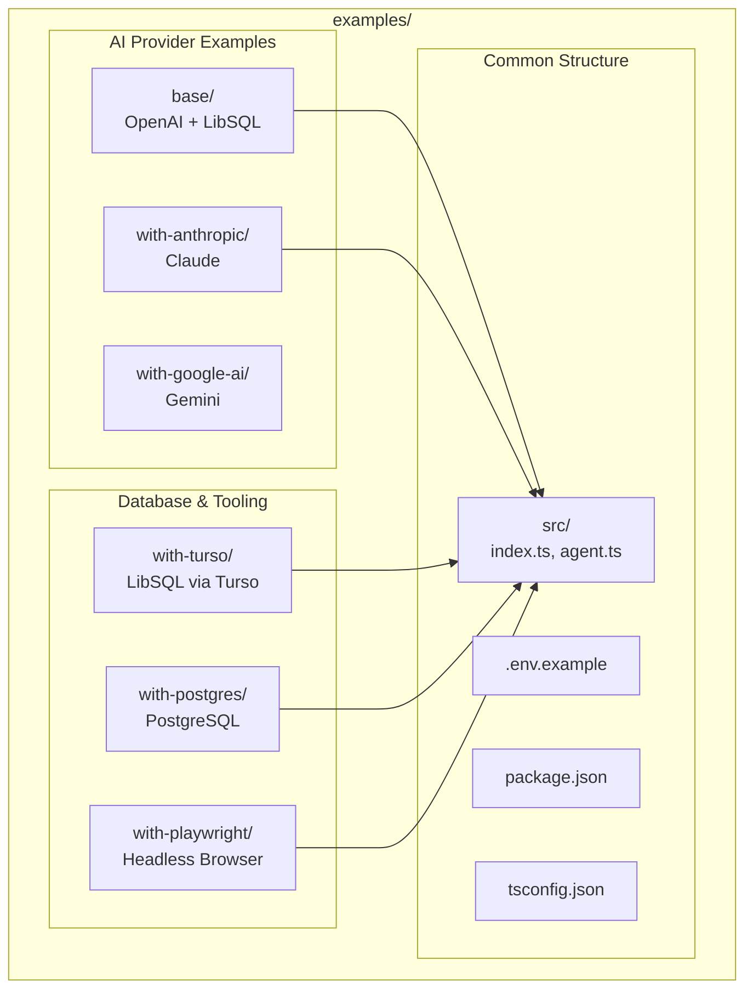
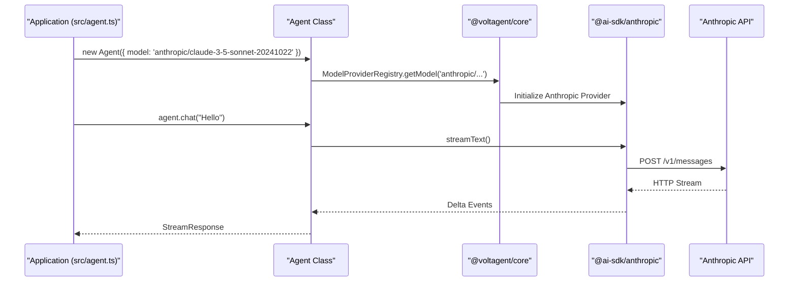
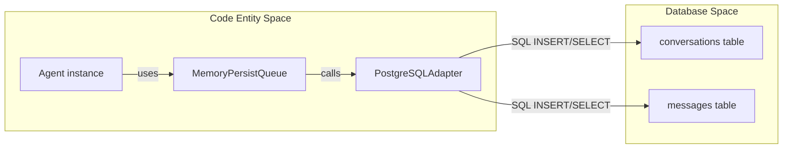
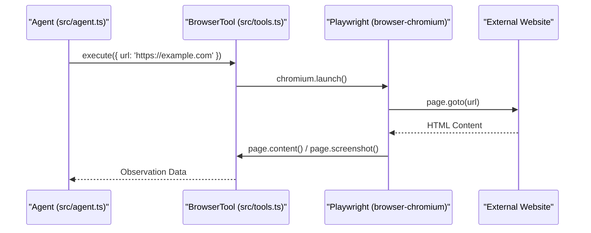

<!-- source: DeepWiki mcp.deepwiki.com · repo VoltAgent/voltagent · page 12.2 Integration Examples · fetched 2026-10-26 -->

# Integration Examples

<details>
<summary>Relevant source files</summary>

The following files were used as context for generating this wiki page:

- [examples/with-anthropic/package.json](examples/with-anthropic/package.json)
- [examples/with-playwright/package.json](examples/with-playwright/package.json)
- [examples/with-postgres/package.json](examples/with-postgres/package.json)
- [examples/with-turso/package.json](examples/with-turso/package.json)

</details>


This page documents VoltAgent examples that demonstrate integration with AI providers, database systems, and browser automation. These examples show how to configure agents with different LLM providers (Anthropic Claude, Google Gemini, Groq, etc.) and persistent storage backends (LibSQL, PostgreSQL, Turso).

For basic agent features and tool usage, see [Basic Examples](12.1). For advanced patterns like RAG, voice, and multi-agent systems, see [Advanced Examples](12.3).

---

## Overview

Integration examples demonstrate three primary integration categories:

### AI Provider Integrations

Examples showing how to configure agents with different language model providers through the Vercel AI SDK provider ecosystem. All providers use the same agent API with only configuration changes.

| Example | Provider | Key Dependencies |
|---------|----------|------------------|
| `with-anthropic` | Anthropic Claude | `@ai-sdk/anthropic` via `@voltagent/core` |
| `with-google-ai` | Google Gemini | `@ai-sdk/google` via `@voltagent/core` |
| `with-groq-ai` | Groq | `@ai-sdk/groq` via `@voltagent/core` |
| `with-amazon-bedrock` | AWS Bedrock | `@ai-sdk/amazon-bedrock` via `@voltagent/core` |

### Database Integrations

Examples demonstrating persistent memory storage with different database backends.

| Example | Database | Key Dependencies |
|---------|----------|------------------|
| `with-turso` | LibSQL (Turso Cloud) | `@voltagent/libsql` |
| `with-postgres` | PostgreSQL | `@voltagent/postgres` |
| `base` | LibSQL (Local SQLite) | `@voltagent/libsql` |

### Tooling Integrations

Examples demonstrating integration with complex external tools like headless browsers.

| Example | Tool | Key Dependencies |
|---------|----------|------------------|
| `with-playwright` | Playwright Browser | `playwright`, `@voltagent/core` |

**Sources:** [examples/with-anthropic/package.json:4-11](), [examples/with-turso/package.json:5-12](), [examples/with-postgres/package.json:5-12](), [examples/with-playwright/package.json:4-18]()

---

## Example Repository Structure

**Integration Examples Repository Layout**



All integration examples follow a consistent structure:
- `src/index.ts` - Server entry point with Hono HTTP server.
- `src/agent.ts` - Agent configuration and initialization.
- `.env.example` - Required environment variables for the specific provider or DB.
- `package.json` - Dependencies and scripts.

**Sources:** [examples/with-anthropic/package.json:1-37](), [examples/with-turso/package.json:1-41](), [examples/with-postgres/package.json:1-41]()

---

## AI Provider Integration Pattern

All VoltAgent provider integrations follow a consistent pattern enabled by the Vercel AI SDK architecture. The `@voltagent/core` package bundles all major provider SDKs as dependencies, allowing seamless provider switching.

### Anthropic Claude Integration

The `with-anthropic` example demonstrates integration with Anthropic's Claude models.

**Anthropic Integration Data Flow**



**Package Configuration:**
```json
{
  "dependencies": {
    "@voltagent/core": "^2.7.4",
    "@voltagent/server-hono": "^2.0.13",
    "ai": "^6.0.0"
  }
}
```
**Sources:** [examples/with-anthropic/package.json:4-12]()

---

## Database Integration Examples

VoltAgent supports multiple persistent storage backends for conversation memory. These are implemented as adapters that the `Agent` class uses to persist state.

### PostgreSQL Integration

The `with-postgres` example demonstrates using a PostgreSQL database for agent memory.

**PostgreSQL Memory Implementation**



**Implementation Details:**
- **Package:** `@voltagent/postgres` [examples/with-postgres/package.json:9-9]()
- **Class:** `PostgreSQLAdapter` (configured in `src/agent.ts`)
- **Key Feature:** Provides durable persistence for long-running agent conversations in standard relational databases.

### Turso (LibSQL) Integration

The `with-turso` example demonstrates using LibSQL, which is compatible with SQLite and Turso's distributed cloud database.

**Implementation Details:**
- **Package:** `@voltagent/libsql` [examples/with-turso/package.json:8-8]()
- **Key Feature:** Ideal for edge deployments and serverless environments where a lightweight SQL interface is required.

**Sources:** [examples/with-postgres/package.json:1-12](), [examples/with-turso/package.json:1-12]()

---

## Browser Automation Integration

The `with-playwright` example demonstrates how to integrate complex external capabilities like a headless browser into an agent's toolset.

### Playwright Tool Integration

**Playwright Tool Execution Flow**



**Key Dependencies:**
- `playwright`: The core browser automation library [examples/with-playwright/package.json:16-16]()
- `@playwright/browser-chromium`: The specific browser binary [examples/with-playwright/package.json:5-5]()

**Sources:** [examples/with-playwright/package.json:4-19]()

---

## Summary of Integration Scripts

All integration examples use a standardized set of scripts for development and deployment:

| Script | Command | Purpose |
|--------|---------|---------|
| `dev` | `tsx watch --env-file=.env ./src` | Runs the agent server with hot-reloading and environment variable support. |
| `build` | `tsc` | Compiles the TypeScript source code to JavaScript. |
| `volt` | `volt` | Entry point for the VoltAgent CLI to manage prompts or evaluation. |

**Sources:** [examples/with-anthropic/package.json:30-35](), [examples/with-turso/package.json:34-39](), [examples/with-playwright/package.json:38-43]()

---

