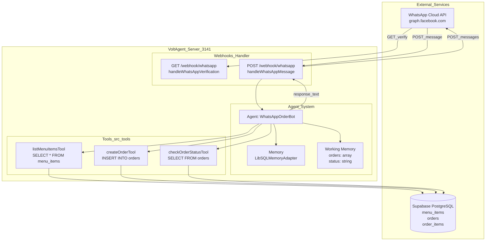
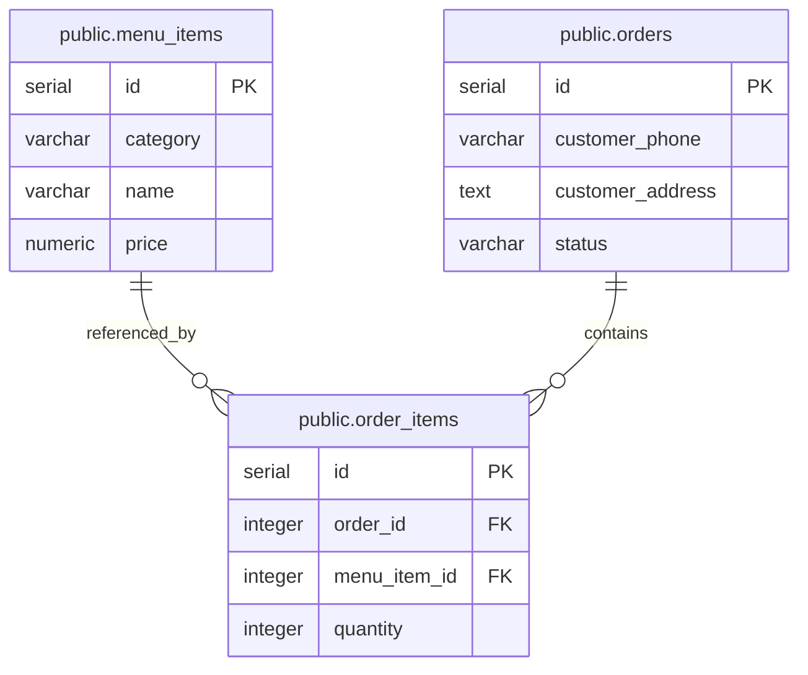
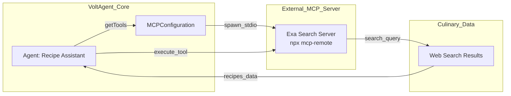

<!-- source: DeepWiki mcp.deepwiki.com · repo VoltAgent/voltagent · page 12.3 Advanced Examples · fetched 2026-10-26 -->

# Advanced Examples

<details>
<summary>Relevant source files</summary>

The following files were used as context for generating this wiki page:

- [examples/with-research-assistant/package.json](examples/with-research-assistant/package.json)
- [examples/with-resumable-streams/package.json](examples/with-resumable-streams/package.json)
- [examples/with-viteval/package.json](examples/with-viteval/package.json)
- [examples/with-whatsapp/README.md](examples/with-whatsapp/README.md)
- [examples/with-workflow/package.json](examples/with-workflow/package.json)
- [website/examples/recipe-creator.md](website/examples/recipe-creator.md)
- [website/examples/whatsapp-order.md](website/examples/whatsapp-order.md)
- [website/plugins/docusaurus-plugin-content-examples/index.js](website/plugins/docusaurus-plugin-content-examples/index.js)
- [website/src/components/blog-widgets/YouTubeEmbed.tsx](website/src/components/blog-widgets/YouTubeEmbed.tsx)
- [website/src/components/examples/Callout.tsx](website/src/components/examples/Callout.tsx)
- [website/src/components/examples/exampleCard.tsx](website/src/components/examples/exampleCard.tsx)
- [website/src/components/examples/index.tsx](website/src/components/examples/index.tsx)
- [website/src/theme/ExampleListPage/index.tsx](website/src/theme/ExampleListPage/index.tsx)
- [website/src/theme/ExampleProjectPage/index.tsx](website/src/theme/ExampleProjectPage/index.tsx)

</details>


This page documents production-ready examples that demonstrate complex multi-agent architectures, external integrations, and advanced VoltAgent features. These examples combine multiple capabilities (tools, memory, webhooks, voice, RAG) into complete applications.

For basic agent patterns, see [Basic Examples](#12.1). For framework integration patterns, see [Integration Examples](#12.2).

---

## Scope and Purpose

Advanced examples showcase:

- **Multi-tool coordination** - Agents with 3+ custom tools working together.
- **External service integration** - WhatsApp, recipe search (Exa), voice APIs.
- **Stateful conversations** - Working memory schemas tracking complex ordering or research workflows.
- **Production patterns** - Webhook verification, database transactions, and evaluation.
- **Hierarchical agents** - Sub-agent delegation and supervisor patterns.

Each example is deployable with minimal configuration and includes complete documentation.

Sources: [examples/with-whatsapp/README.md:22-36](), [website/examples/recipe-creator.md:11-20](), [examples/with-viteval/package.json:24-30]()

---

## Overview of Advanced Examples

| Example | Primary Features | Key Integrations | Core Package |
|---------|-----------------|------------------|---------------|
| **WhatsApp Order Bot** | Working memory, multi-step flows, webhooks | WhatsApp Cloud API, Supabase | `@voltagent/core` |
| **Recipe Generator** | MCP tool integration, external search | Exa MCP Server, OpenAI | `@voltagent/core` |
| **Resumable Streams** | Persistence across reconnections | Redis/VoltOps Storage | `@voltagent/resumable-streams` |
| **Workflow Chain** | Linear/Branching execution control | Custom Workflow Engine | `@voltagent/core` |
| **Viteval Testing** | Automated agent evaluation | `viteval` | `@voltagent/core` |

All examples use `@voltagent/server-hono` for the HTTP server (typically port 3141) and `@voltagent/logger` for structured logging.

Sources: [examples/with-whatsapp/package.json:4-12](), [examples/with-resumable-streams/package.json:6-12](), [examples/with-viteval/package.json:4-15](), [website/examples/recipe-creator.md:71-74]()

---

## WhatsApp Food Ordering Bot

### Architecture Overview

The WhatsApp example demonstrates a complete conversational ordering system with database integration, state management, and webhook handling.

Title: WhatsApp Integration Flow


Sources: [examples/with-whatsapp/README.md:177-197](), [website/examples/whatsapp-order.md:173-182]()

### Database Integration

The system uses three Supabase tables with foreign key relationships to manage the menu and order lifecycle.

Title: Database Entity Relationship


Sources: [examples/with-whatsapp/README.md:90-135](), [website/examples/whatsapp-order.md:75-120]()

### Webhook Implementation

The bot handles two primary WhatsApp webhook events:
1. **Verification (GET):** Validates `hub.verify_token` against `WHATSAPP_WEBHOOK_TOKEN` to establish the connection with Meta.
2. **Message (POST):** Processes incoming `WhatsAppWebhookBody`, invokes `agent.generateText()` using the user's phone number as the `userId`, and replies via the WhatsApp Graph API.

Sources: [examples/with-whatsapp/README.md:76-79](), [website/examples/whatsapp-order.md:187-202]()

---

## AI Recipe Generator (MCP Integration)

This example showcases the use of the **Model Context Protocol (MCP)** to extend an agent's capabilities with external search tools.

### Implementation Pattern

The agent is configured with an `MCPConfiguration` that connects to an Exa search server via `stdio`.

Title: MCP Data Flow


Sources: [website/examples/recipe-creator.md:75-83](), [website/examples/recipe-creator.md:119-121]()

---

## Automated Evaluation with Viteval

The `with-viteval` example demonstrates how to integrate automated testing into the agent development lifecycle.

### Key Components
- **`viteval`**: The core evaluation runner used to execute test cases against agent outputs.
- **CLI Wrapper**: A custom `cli.ts` that allows manual interaction or automated piping for evaluation.
- **Scorers**: Logic to validate if the agent response meets specific criteria (e.g., accuracy, tone, tool usage).

Sources: [examples/with-viteval/package.json:22-22](), [examples/with-viteval/package.json:41-43]()

---

## Resumable Streams

The `with-resumable-streams` example provides a pattern for handling unstable client connections in long-running agent generations.

### Persistence Mechanism
It utilizes `@voltagent/resumable-streams` to buffer agent output. If a client disconnects during a stream, the server retains the stream state in a storage adapter (like Redis), allowing the client to reconnect and resume from the last received token using a `streamId`.

Sources: [examples/with-resumable-streams/package.json:3-9](), [examples/with-resumable-streams/package.json:33-34]()

---

## Setup and Installation

### Scaffolding
All advanced examples can be initialized using the VoltAgent CLI:

```bash
# Example for WhatsApp
npm create voltagent-app@latest -- --example with-whatsapp

# Example for Recipe Generator
npm create voltagent-app@latest -- --example with-recipe-generator
```

### Environment Configuration
Most advanced examples require a combination of LLM keys and third-party integration keys:
- `OPENAI_API_KEY`: Core intelligence.
- `SUPABASE_URL` / `SUPABASE_ANON_KEY`: Database persistence.
- `WHATSAPP_ACCESS_TOKEN`: Messaging connectivity.
- `EXA_API_KEY`: Search capabilities.

Sources: [website/examples/whatsapp-order.md:33-36](), [website/examples/recipe-creator.md:27-29](), [examples/with-whatsapp/README.md:68-84]()

---

