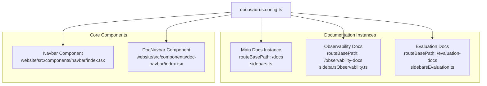
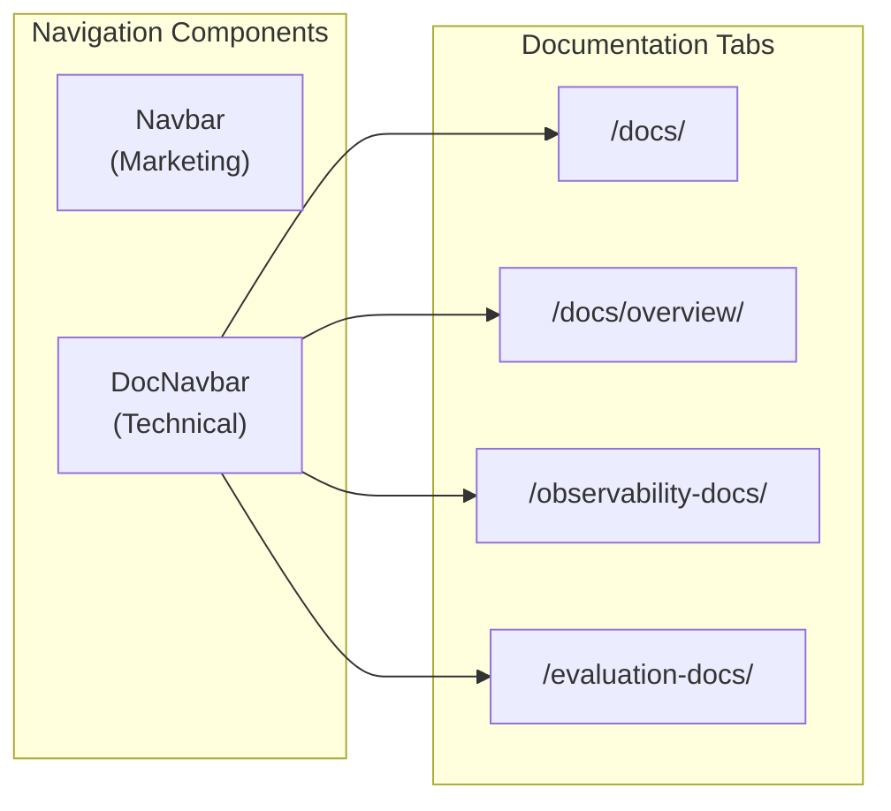

<!-- source: DeepWiki mcp.deepwiki.com · repo VoltAgent/voltagent · page 13 Website and Documentation · fetched 2026-10-26 -->

# Website and Documentation

Relevant source files

The following files were used as context for generating this wiki page:

- [website/blog/2026-01-23-tool-routing/index.md](website/blog/2026-01-23-tool-routing/index.md)
- [website/docs/index.md](website/docs/index.md)
- [website/docusaurus.config.ts](website/docusaurus.config.ts)
- [website/observability/mcp.md](website/observability/mcp.md)
- [website/sidebars.ts](website/sidebars.ts)
- [website/src/components/doc-navbar/index.tsx](website/src/components/doc-navbar/index.tsx)
- [website/src/components/doc-navbar/styles.module.css](website/src/components/doc-navbar/styles.module.css)
- [website/src/components/navbar/index.tsx](website/src/components/navbar/index.tsx)
- [website/src/components/navbar/styles.module.css](website/src/components/navbar/styles.module.css)
- [website/src/components/ops/Observability.tsx](website/src/components/ops/Observability.tsx)
- [website/src/components/supervisor-agent/index.tsx](website/src/components/supervisor-agent/index.tsx)
- [website/src/components/supervisor-agent/mobile-code-block.tsx](website/src/components/supervisor-agent/mobile-code-block.tsx)
- [website/src/components/tutorial/TutorialNavbar.tsx](website/src/components/tutorial/TutorialNavbar.tsx)
- [website/src/css/layout.css](website/src/css/layout.css)
- [website/src/data/tweets.json](website/src/data/tweets.json)
- [website/src/theme/DocSidebar/Desktop/Content/index.js](website/src/theme/DocSidebar/Desktop/Content/index.js)
- [website/src/theme/DocSidebar/Desktop/Content/styles.module.css](website/src/theme/DocSidebar/Desktop/Content/styles.module.css)
- [website/src/theme/Layout/index.js](website/src/theme/Layout/index.js)
- [website/src/theme/Navbar/Logo/index.js](website/src/theme/Navbar/Logo/index.js)
- [website/src/theme/Navbar/Logo/styles.module.css](website/src/theme/Navbar/Logo/styles.module.css)
- [website/src/theme/Root.tsx](website/src/theme/Root.tsx)
- [website/src/theme/TOC/index.js](website/src/theme/TOC/index.js)

This document covers the VoltAgent website and documentation system built with Docusaurus. It includes the website architecture, documentation organization, custom navigation components, plugin system, and marketing features that support both the VoltAgent framework and VoltOps observability platform.

For details on specific areas, see the child pages:
- [Website Architecture](#13.1) — Document Docusaurus configuration, navbar system, and component structure
- [Documentation Structure](#13.2) — Document sidebar configuration, multi-instance docs setup, and content organization
- [Marketing and Community Features](#13.3) — Document testimonials system, pricing calculator, and social proof components

## Website Architecture

The VoltAgent website is built on Docusaurus 3.x, a static site generator optimized for documentation. The architecture uses a plugin-based system with custom components and multiple documentation instances to serve both VoltAgent framework docs and VoltOps observability platform docs.

### Docusaurus Configuration

The main configuration is defined in [website/docusaurus.config.ts:5-420](), which establishes:

| Configuration Aspect | Implementation | Location |
|---------------------|----------------|----------|
| **Site Metadata** | `title: "VoltAgent"`, `tagline: "Open Source TypeScript AI Agent Framework"` | [website/docusaurus.config.ts:6-7]() |
| **Production URL** | `url: "https://voltagent.dev"` | [website/docusaurus.config.ts:16]() |
| **Markdown Features** | Mermaid diagram support via `markdown.mermaid: true` | [website/docusaurus.config.ts:36-38]() |
| **Theme** | `@docusaurus/theme-mermaid` for diagram rendering | [website/docusaurus.config.ts:39]() |

The site uses a dark-only theme with color mode switching disabled. For more technical details on the build system and CSS pipeline, see [Website Architecture](#13.1).

**Docusaurus Site Structure**

**Sources:** [website/docusaurus.config.ts:5-165](), [website/src/components/navbar/index.tsx:89-600](), [website/src/components/doc-navbar/index.tsx:95-230]()

## Documentation System

The website hosts multiple separate documentation instances with independent sidebar configurations, allowing distinct navigation structures for different product lines.

### Multi-Instance Setup

The documentation is split into specialized sections to manage complexity. Each instance is defined as a separate plugin in [website/docusaurus.config.ts:45-165]().

| Documentation ID | Route Base Path | Sidebar File |
|------------------|-----------------|--------------|
| `default` | `/docs/` | `sidebars.ts` |
| `observability` | `/observability-docs/` | `sidebarsObservability.ts` |
| `evaluation` | `/evaluation-docs/` | `sidebarsEvaluation.ts` |
| `models` | `/models-docs/` | `sidebarsModels.ts` |
| `deployment` | `/deployment-docs/` | `sidebarsDeployment.ts` |

For a deep dive into how these instances are managed and how content is organized, see [Documentation Structure](#13.2).

**Sources:** [website/docusaurus.config.ts:45-165]()

### Navigation and Routing

Navigation is handled by two primary components: the marketing-focused `Navbar` and the technical `DocNavbar`.

*   **Navbar**: Used on landing pages, includes complex dropdowns for use cases and products [website/src/components/navbar/index.tsx:89-131]().
*   **DocNavbar**: A tabbed navigation system optimized for switching between documentation instances [website/src/components/doc-navbar/index.tsx:20-69]().

**Sources:** [website/src/components/navbar/index.tsx:45-87](), [website/src/components/doc-navbar/index.tsx:20-69]()

## Marketing and Community Features

The website integrates several features to build community trust and demonstrate value, including social proof from Twitter and interactive tutorials.

### Social Proof and Testimonials
The site uses a `fetch-tweets` plugin to pull real-time feedback from the community. Data for these testimonials is stored in a structured JSON format.

**Sources:** [website/src/data/tweets.json:1-133](), [website/docusaurus.config.ts:166]()

### Interactive Learning
To onboard developers, the site includes a dedicated `TutorialNavbar` component that tracks progress through a multi-step integration guide.

**Tutorial Steps** [website/src/components/tutorial/TutorialNavbar.tsx:12-18]():
1. Introduction
2. Chatbot Problem
3. Memory
4. MCP
5. Subagents

For more details on marketing components and community integrations, see [Marketing and Community Features](#13.3).

**Sources:** [website/src/components/tutorial/TutorialNavbar.tsx:12-18](), [website/src/components/navbar/index.tsx:100-130]()

---

