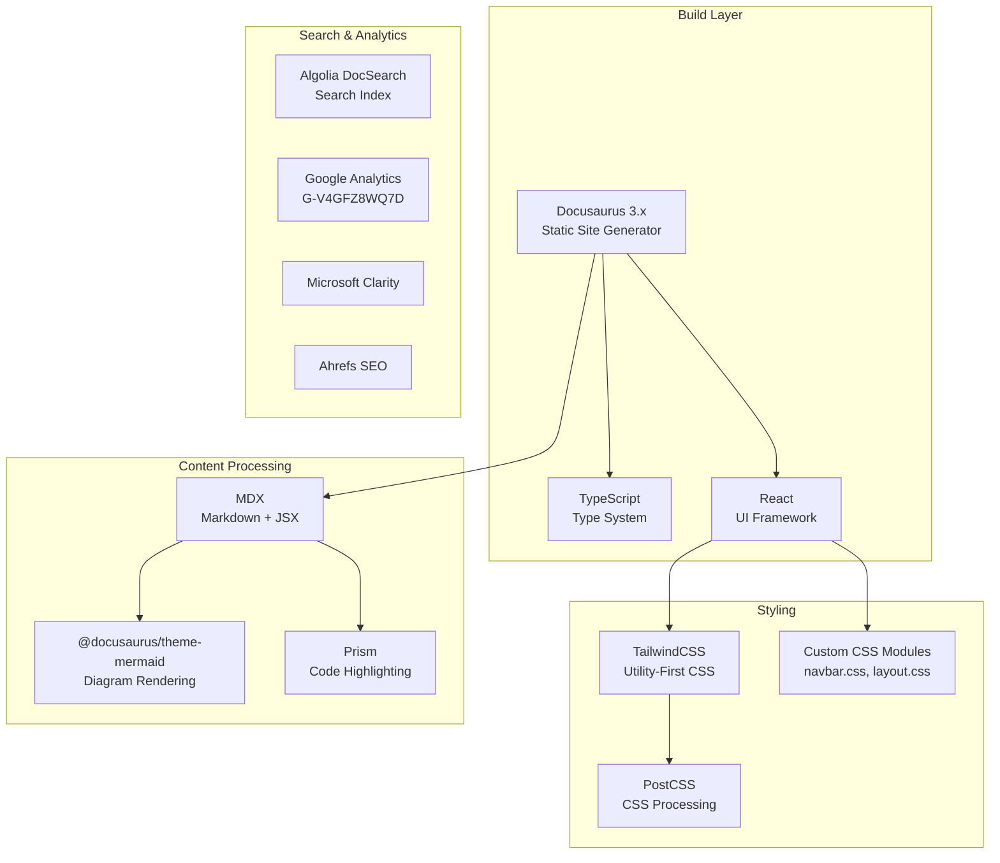
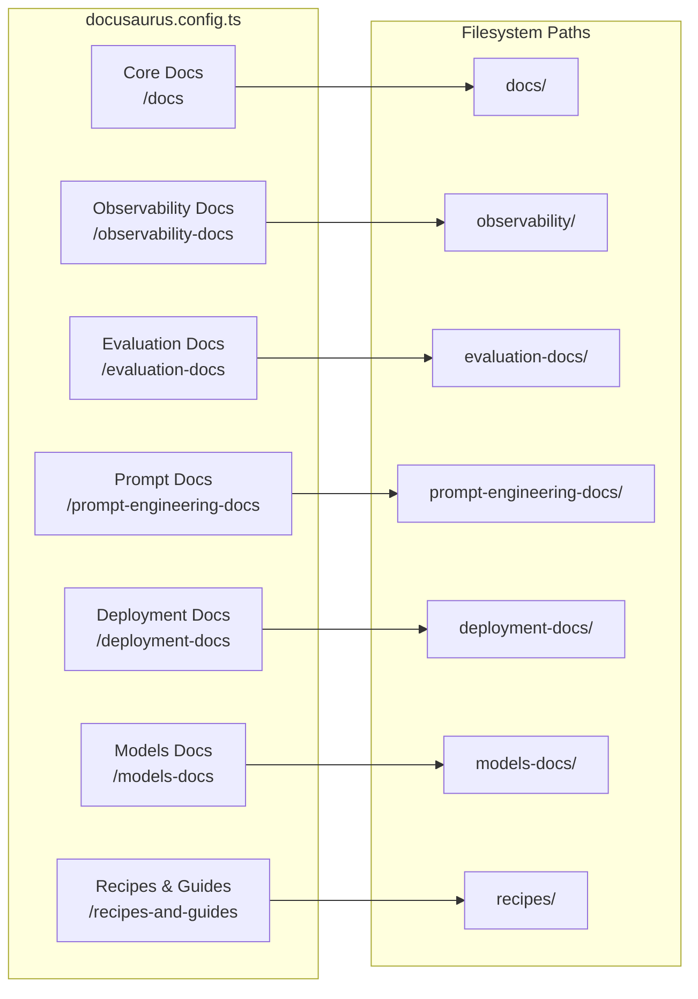

<!-- source: DeepWiki mcp.deepwiki.com · repo VoltAgent/voltagent · page 13.1 Website Architecture · fetched 2026-10-26 -->

# Website Architecture

<details>
<summary>Relevant source files</summary>

The following files were used as context for generating this wiki page:

- [website/blog/2025-04-21-introducing-developer-console/index.md](website/blog/2025-04-21-introducing-developer-console/index.md)
- [website/blog/2025-04-21-introducing-voltagent/index.md](website/blog/2025-04-21-introducing-voltagent/index.md)
- [website/blog/2026-01-23-tool-routing/index.md](website/blog/2026-01-23-tool-routing/index.md)
- [website/docusaurus.config.ts](website/docusaurus.config.ts)
- [website/observability/mental-model.md](website/observability/mental-model.md)
- [website/observability/setup.md](website/observability/setup.md)
- [website/src/components/about/index.tsx](website/src/components/about/index.tsx)
- [website/src/components/doc-navbar/index.tsx](website/src/components/doc-navbar/index.tsx)
- [website/src/components/doc-navbar/styles.module.css](website/src/components/doc-navbar/styles.module.css)
- [website/src/components/docs-widgets/DocsHome.tsx](website/src/components/docs-widgets/DocsHome.tsx)
- [website/src/components/feature-showcase/index.tsx](website/src/components/feature-showcase/index.tsx)
- [website/src/components/feature-showcase/mock-data.ts](website/src/components/feature-showcase/mock-data.ts)
- [website/src/components/navbar/index.tsx](website/src/components/navbar/index.tsx)
- [website/src/components/navbar/styles.module.css](website/src/components/navbar/styles.module.css)
- [website/src/components/ops/Observability.tsx](website/src/components/ops/Observability.tsx)
- [website/src/components/supervisor-agent/index.tsx](website/src/components/supervisor-agent/index.tsx)
- [website/src/components/supervisor-agent/mobile-code-block.tsx](website/src/components/supervisor-agent/mobile-code-block.tsx)
- [website/src/components/tutorial/TutorialNavbar.tsx](website/src/components/tutorial/TutorialNavbar.tsx)
- [website/src/css/custom.css](website/src/css/custom.css)
- [website/src/css/layout.css](website/src/css/layout.css)
- [website/src/pages/voltops/deployment.tsx](website/src/pages/voltops/deployment.tsx)
- [website/src/theme/DocItem/Layout/index.tsx](website/src/theme/DocItem/Layout/index.tsx)
- [website/src/theme/DocItem/Layout/styles.module.css](website/src/theme/DocItem/Layout/styles.module.css)
- [website/src/theme/DocSidebar/Desktop/Content/index.js](website/src/theme/DocSidebar/Desktop/Content/index.js)
- [website/src/theme/DocSidebar/Desktop/Content/styles.module.css](website/src/theme/DocSidebar/Desktop/Content/styles.module.css)
- [website/src/theme/Layout/index.js](website/src/theme/Layout/index.js)
- [website/src/theme/Navbar/Logo/index.js](website/src/theme/Navbar/Logo/index.js)
- [website/src/theme/Navbar/Logo/styles.module.css](website/src/theme/Navbar/Logo/styles.module.css)
- [website/src/theme/Root.tsx](website/src/theme/Root.tsx)
- [website/src/theme/TOC/index.js](website/src/theme/TOC/index.js)

</details>


This document describes the architecture of the VoltAgent documentation and marketing website, built using Docusaurus. It covers the static site generation pipeline, plugin system, custom components, routing structure, and content management approach.

## Overview

The VoltAgent website is a Docusaurus-based static site that serves multiple purposes:
- **Framework Documentation**: Technical documentation for the VoltAgent core framework.
- **VoltOps Documentation**: Separate documentation instance for the observability platform.
- **Marketing Content**: Landing pages, use cases, customer showcases.
- **Interactive Examples**: Live code editors and demos.
- **Community Resources**: Blog, tutorials, MCP directory.

The architecture follows a modular design with multiple plugin instances, custom React components, and a sophisticated routing system to handle diverse content types.

**Sources**: [website/docusaurus.config.ts:1-420](), [website/src/components/navbar/index.tsx:44-87]()

## Technology Stack



**Sources**: [website/docusaurus.config.ts:1-39](), [website/docusaurus.config.ts:69-81](), [website/src/css/custom.css:1-3]()

## Docusaurus Configuration

The main configuration file `website/docusaurus.config.ts` defines site metadata, plugin instances, and theme settings.

### Site Metadata

| Property | Value | Purpose |
|----------|-------|---------|
| `title` | "VoltAgent" | Browser tab title |
| `tagline` | "Open Source TypeScript AI Agent Framework" | SEO description |
| `url` | "https://voltagent.dev" | Production URL |
| `baseUrl` | "/" | Root path |
| `trailingSlash` | true | URL normalization |
| `favicon` | "img/favicon.ico" | Browser icon |

**Sources**: [website/docusaurus.config.ts:5-20]()

### Preset Configuration

The classic preset provides the main documentation instance:

```typescript
presets: [
  [
    "classic",
    {
      docs: {
        routeBasePath: "docs",
        breadcrumbs: false,
        sidebarCollapsed: false,
        sidebarPath: "./sidebars.ts",
      },
      blog: false,
      theme: {
        customCss: [
          "./src/css/custom.css",
          "./src/css/navbar.css",
          "./src/css/layout.css",
          "./src/css/variables.css",
          "./src/css/font.css",
        ],
      },
      gtag: {
        trackingID: "G-V4GFZ8WQ7D",
        anonymizeIP: true,
      },
    }
  ],
],
```

**Sources**: [website/docusaurus.config.ts:41-67]()

## Multi-Instance Documentation Architecture

VoltAgent utilizes separate documentation instances for different product pillars, managed via `@docusaurus/plugin-content-docs`.



| Instance ID | Path | Route Base Path | Sidebar Config |
|-------------|------|-----------------|----------------|
| `default` | `docs` | `docs` | `./sidebars.ts` |
| `observability` | `observability` | `observability-docs` | `./sidebarsObservability.ts` |
| `evaluation` | `evaluation-docs` | `evaluation-docs` | `./sidebarsEvaluation.ts` |
| `prompt-engineering` | `prompt-engineering-docs` | `prompt-engineering-docs` | `./sidebarsPromptEngineering.ts` |
| `deployment-standalone` | `deployment-docs` | `deployment-docs` | `./sidebarsDeployment.ts` |
| `models` | `models-docs` | `models-docs` | `./sidebarsModels.ts` |
| `recipes` | `recipes` | `recipes-and-guides` | `./sidebarsRecipes.ts` |

**Sources**: [website/docusaurus.config.ts:83-165]()

## Navbar System

VoltAgent uses a sophisticated navbar system that switches layouts based on the current route. The primary logic is contained in `website/src/components/navbar/index.tsx`.

### Dual-Navbar Implementation

The site differentiates between "marketing" pages and "documentation" pages. The `isDocsPage` boolean detects documentation routes to render a technical, multi-row navbar.

```typescript
const isDocsPage =
  normalizedPathname.includes("/docs") ||
  normalizedPathname.includes("/models-docs") ||
  normalizedPathname.includes("/observability-docs") ||
  normalizedPathname.includes("/evaluation-docs") ||
  normalizedPathname.includes("/prompt-engineering-docs") ||
  normalizedPathname.includes("/deployment-docs") ||
  normalizedPathname.includes("/actions-triggers-docs") ||
  normalizedPathname.startsWith("/recipes-and-guides/");
```

**Sources**: [website/src/components/navbar/index.tsx:133-141]()

### Documentation Navbar (`docsNavbar`)

When `isDocsPage` is true, a specialized navbar is rendered with:
- **Top Row**: Brand logo, version badge (`v2.0.x`), and a custom search button that triggers the Algolia `SearchBar`.
- **Bottom Row**: A tab-based navigation system using the `docTabs` configuration.

```typescript
const docTabs = [
  { label: "Home", href: "/docs/", match: (path: string) => path === "/docs/" },
  { label: "VoltAgent Framework", href: "/docs/overview/", match: (path: string) => path.startsWith("/docs/overview/") },
  // ... other documentation pillars
];
```

**Sources**: [website/src/components/navbar/index.tsx:45-87](), [website/src/components/navbar/index.tsx:144-235]()

### Mobile Sidebar and Tutorial Navbar

For specialized learning paths, the site uses `TutorialNavbar`, which tracks progress through the 5-step tutorial. It includes a GitHub banner and a progress bar showing completion percentage.

**Sources**: [website/src/components/tutorial/TutorialNavbar.tsx:11-140]()

## Component Structure

The website utilizes custom React components to showcase framework features.

### Feature Showcase

The `FeatureShowcase` component (`website/src/components/feature-showcase/index.tsx`) provides an interactive view of VoltAgent's capabilities. It uses `tabsData` to render different technical aspects:
- **Framework**: Code example showing `Agent` and `VoltAgent` initialization with Slack triggers.
- **Observability**: Dashboard preview for execution traces.
- **Evals**: Example of `createModerationScorer` integration.
- **Triggers & Actions**: Code snippets for Airtable, GitHub, and Webhook integrations.
- **RAG**: Implementation of `VoltAgentRagRetriever`.

**Sources**: [website/src/components/feature-showcase/index.tsx:31-156](), [website/src/components/feature-showcase/mock-data.ts:16-235]()

### Landing Page Widgets

The `DocsHome` component acts as the central hub for the documentation landing page, featuring:
- **Hero Section**: "Build · Observe · Automate · Ship AI Agents".
- **Quick Links**: Direct paths to "Quick Start", "Recipes & Guides", and "5 Steps Tutorial".
- **Feature Badges**: Highlighting Memory, RAG, Guardrails, Tools, MCP, Voice, and Workflow.

**Sources**: [website/src/components/docs-widgets/DocsHome.tsx:54-157]()

## Styling and Layout

The site uses a unified styling system combining TailwindCSS and custom Infima variable overrides.

### CSS Architecture

- **`custom.css`**: Defines core color variables for light and dark modes, Shadcn UI variables, and custom animations like `fadeIn`.
- **Infima Overrides**: Customizes Docusaurus's default layout, specifically the navbar background (`#ffffff` light / `#0a0a0a` dark) and primary emerald colors (`#10b981`).
- **Layout Logic**: Managed via `website/src/css/layout.css`, which handles sidebar sticky positioning and mobile responsiveness.

**Sources**: [website/src/css/custom.css:17-129](), [website/src/css/layout.css:1-100]()

### Markdown Customization

The site applies specific styles to `.theme-doc-markdown` to ensure readability:
- **Code Blocks**: Custom background (`#010409`) and border radius.
- **Typography**: Line height of `1.7` for paragraphs and specific colors for dark mode (`#b2b2b2`).
- **Sidebar Badges**: Custom classes like `.sidebar-badge--accent` for highlighting "New" or "Experimental" features.

**Sources**: [website/src/css/custom.css:160-211](), [website/src/css/custom.css:213-218]()

## Search and SEO

VoltAgent integrates Algolia DocSearch for high-performance indexing across all documentation instances.

```typescript
algolia: {
  appId: "C1TWP51DBB",
  apiKey: "80f0ff7c295210b58b46e0623e09654c",
  indexName: "web",
  contextualSearch: true,
}
```

**Sources**: [website/docusaurus.config.ts:328-333]()

## Redirect Management

The site maintains a robust redirect system via `@docusaurus/plugin-client-redirects` to prevent broken links during documentation restructuring.

```typescript
redirects: [
  { to: "/ai-agent-marketplace/", from: "/marketplace/" },
  { to: "/observability-docs/", from: "/voltops-llm-observability-docs/" },
  { to: "/deployment-docs/", from: "/docs/deployment/overview/" },
]
```

**Sources**: [website/docusaurus.config.ts:170-190]()

---

