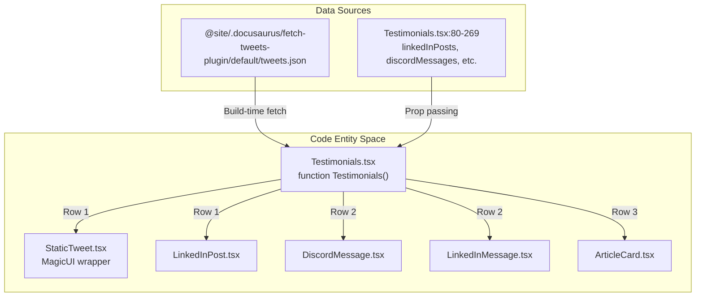
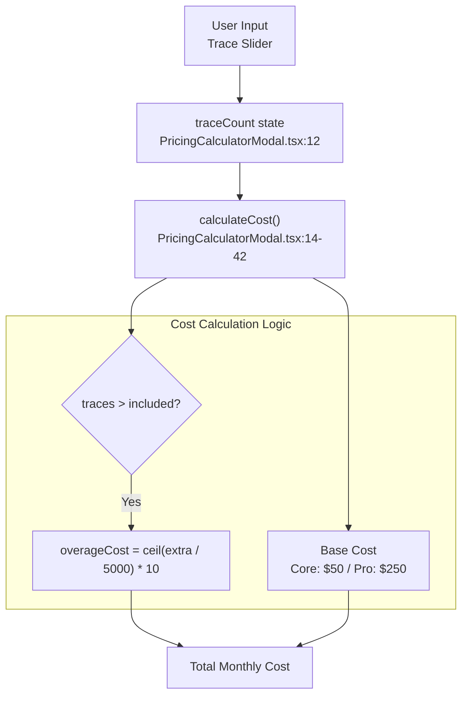

<!-- source: DeepWiki mcp.deepwiki.com · repo VoltAgent/voltagent · page 13.3 Marketing and Community Features · fetched 2026-10-26 -->

# Marketing and Community Features

Relevant source files

The following files were used as context for generating this wiki page:

- [website/docs/getting-started/comparison.mdx](website/docs/getting-started/comparison.mdx)
- [website/plugins/fetch-tweets.js](website/plugins/fetch-tweets.js)
- [website/src/components/ComparisonTable.tsx](website/src/components/ComparisonTable.tsx)
- [website/src/components/console/PricingCalculatorModal.module.css](website/src/components/console/PricingCalculatorModal.module.css)
- [website/src/components/console/PricingCalculatorModal.tsx](website/src/components/console/PricingCalculatorModal.tsx)
- [website/src/components/console/PricingSection.tsx](website/src/components/console/PricingSection.tsx)
- [website/src/components/footer/index.tsx](website/src/components/footer/index.tsx)
- [website/src/components/hero/index.tsx](website/src/components/hero/index.tsx)
- [website/src/components/live-preview/index.tsx](website/src/components/live-preview/index.tsx)
- [website/src/components/magicui/tweet-card-client.tsx](website/src/components/magicui/tweet-card-client.tsx)
- [website/src/components/magicui/tweet-card.tsx](website/src/components/magicui/tweet-card.tsx)
- [website/src/components/marketplace/agent-detail.tsx](website/src/components/marketplace/agent-detail.tsx)
- [website/src/components/marketplace/agent-list.tsx](website/src/components/marketplace/agent-list.tsx)
- [website/src/components/marketplace/index.tsx](website/src/components/marketplace/index.tsx)
- [website/src/components/supervisor-agent/workflow-code-example.tsx](website/src/components/supervisor-agent/workflow-code-example.tsx)
- [website/src/components/testimonials/ArticleCard.tsx](website/src/components/testimonials/ArticleCard.tsx)
- [website/src/components/testimonials/DiscordMessage.tsx](website/src/components/testimonials/DiscordMessage.tsx)
- [website/src/components/testimonials/LinkedInMessage.tsx](website/src/components/testimonials/LinkedInMessage.tsx)
- [website/src/components/testimonials/LinkedInPost.tsx](website/src/components/testimonials/LinkedInPost.tsx)
- [website/src/components/testimonials/StaticTweet.tsx](website/src/components/testimonials/StaticTweet.tsx)
- [website/src/components/testimonials/Testimonials.tsx](website/src/components/testimonials/Testimonials.tsx)
- [website/src/components/testimonials/index.tsx](website/src/components/testimonials/index.tsx)
- [website/src/components/two-blocks-pricing/index.tsx](website/src/components/two-blocks-pricing/index.tsx)
- [website/src/components/two-blocks/index.tsx](website/src/components/two-blocks/index.tsx)
- [website/src/pages/index.tsx](website/src/pages/index.tsx)
- [website/src/pages/pricing.tsx](website/src/pages/pricing.tsx)
- [website/static/img/avatars/the-office/angela.png](website/static/img/avatars/the-office/angela.png)
- [website/static/img/avatars/the-office/dwight.png](website/static/img/avatars/the-office/dwight.png)
- [website/static/img/avatars/the-office/jim.png](website/static/img/avatars/the-office/jim.png)
- [website/static/img/avatars/the-office/kevin.png](website/static/img/avatars/the-office/kevin.png)
- [website/static/img/avatars/the-office/michael.png](website/static/img/avatars/the-office/michael.png)
- [website/static/img/avatars/the-office/pam.png](website/static/img/avatars/the-office/pam.png)
- [website/static/img/logos/integrations/youtube/index.tsx](website/static/img/logos/integrations/youtube/index.tsx)

This document covers the community-facing features of the VoltAgent website that build trust, showcase user feedback, and facilitate engagement. The system aggregates testimonials from multiple platforms (Twitter, LinkedIn, Discord), presents pricing information with interactive calculators, and provides previews of upcoming community features like the Agent Marketplace.

**Key Components:**
- `Testimonials.tsx` - Multi-platform testimonial aggregation with animated scrolling.
- `pricing.tsx` - Pricing page with tier comparison, feature matrix, and FAQ.
- `PricingCalculatorModal.tsx` - Interactive usage and cost calculator for VoltOps.
- `Marketplace` - Preview system for sharing and monetizing AI agents.

## Testimonials and Social Proof System

The testimonials system aggregates community feedback from Twitter, LinkedIn, Discord, and community articles. The `Testimonials` component at [website/src/components/testimonials/Testimonials.tsx:271-602]() orchestrates specialized card components across three horizontally-scrolling rows.

### Component Architecture and Data Flow

**Testimonial Data Integration:**

The system uses static data arrays for LinkedIn, Discord, and articles, while tweets are fetched via a custom Docusaurus plugin at build time and imported as JSON at [website/src/components/testimonials/Testimonials.tsx:2]().

**Sources:** [website/src/components/testimonials/Testimonials.tsx:1-95](), [website/src/components/testimonials/index.tsx:1-6](), [website/src/pages/index.tsx:37]()

### Animation and Performance

The component implements infinite horizontal scrolling using CSS keyframes defined at [website/src/components/testimonials/Testimonials.tsx:11-78](). To maintain performance, an `IntersectionObserver` is used to pause animations when the section is off-screen.

| Animation Class | Duration (Desktop) | Target Content | File Reference |
|-----------------|--------------------|----------------|----------------|
| `seamless-scroll-left` | 80s | Tweets & LinkedIn Posts | [Testimonials.tsx:30-33]() |
| `seamless-scroll-right` | 100s | Discord & LinkedIn Msgs | [Testimonials.tsx:35-38]() |
| `seamless-scroll-articles` | 60s | Articles & Videos | [Testimonials.tsx:40-43]() |

**Sources:** [website/src/components/testimonials/Testimonials.tsx:11-78](), [website/src/components/testimonials/Testimonials.tsx:292-305]()

## Pricing and VoltOps Tiers

The pricing page at [website/src/pages/pricing.tsx:9-185]() defines the commercial structure for VoltOps, the observability and automation platform. It distinguishes between the open-source **VoltAgent Core Framework** and the paid **VoltOps** service.

### Pricing Tier Configuration

Tiers are defined in a `pricingTiers` array at [website/src/pages/pricing.tsx:55-134]().

| Tier | Price | Monthly Traces | Key Features |
|------|-------|----------------|--------------|
| **Developer** | $0 | 250 | 1 project, 7-day retention, 100 actions |
| **Core** | $50 | 50,000 | 3 seats, 90-day retention, 5k actions/triggers |
| **Pro** | $250 | 250,000 | 20 seats, SSO, Priority Support, 20k actions |
| **Enterprise** | Custom | Unlimited | Self-hosted, dedicated account manager |

**Sources:** [website/src/pages/pricing.tsx:55-176](), [website/src/components/console/PricingSection.tsx:22-90]()

### Interactive Pricing Calculator

The `PricingCalculatorModal` provides real-time cost estimation based on trace volume. It calculates overages for the Core and Pro plans.

**Calculator Logic Flow:**

The logic at [website/src/components/console/PricingCalculatorModal.tsx:14-42]() calculates overage costs in blocks of 5,000 traces, priced at $10 per block.

**Sources:** [website/src/components/console/PricingCalculatorModal.tsx:14-42](), [website/src/pages/pricing.tsx:6]()

## Community Marketplace (Preview)

The Marketplace component at [website/src/components/marketplace/index.tsx:14-162]() serves as a "Coming Soon" landing page to gather community interest in sharing and monetizing VoltAgent-based agents.

### Agent Listing and Detail Previews

The marketplace uses mock data to demonstrate the intended UI/UX for agent discovery.

- **`AgentList`**: Displays a grid of `AgentCard` components at [website/src/components/marketplace/agent-list.tsx:135-218](). Each card includes the creator's avatar, verification status, rating, and usage statistics.
- **`AgentDetail`**: Provides a deep dive into a specific agent's capabilities, long description, and reviews at [website/src/components/marketplace/agent-detail.tsx:72-274]().

**Key Preview Entities:**
- **Creator Metadata**: Includes `verified` status and avatar [website/src/components/marketplace/agent-list.tsx:32-36]().
- **Usage Stats**: Tracks "times used" and "last used" to provide social proof [website/src/components/marketplace/agent-list.tsx:28-29]().
- **Monetization**: Displays pricing models such as "credits per usage" or monthly subscriptions [website/src/components/marketplace/agent-list.tsx:27]().

**Sources:** [website/src/components/marketplace/agent-list.tsx:21-119](), [website/src/components/marketplace/agent-detail.tsx:95-119]()

## Hero and Social Proof Components

The `Hero` component at [website/src/components/hero/index.tsx:10-230]() features an interactive command-line preview.

- **`handleCommandClick`**: A function at [website/src/components/hero/index.tsx:24-100]() that simulates a terminal experience. When the user clicks the command, it copies `npm create voltagent-app@latest` to the clipboard and cycles through "thinking" messages like "Memory", "RAG", and "MCP" before showing a "Copied!" status.
- **`CompaniesMarquee`**: Displays logos of companies using the framework, integrated into the home page at [website/src/pages/index.tsx:35]().

**Sources:** [website/src/components/hero/index.tsx:10-100](), [website/src/pages/index.tsx:35]()

---

