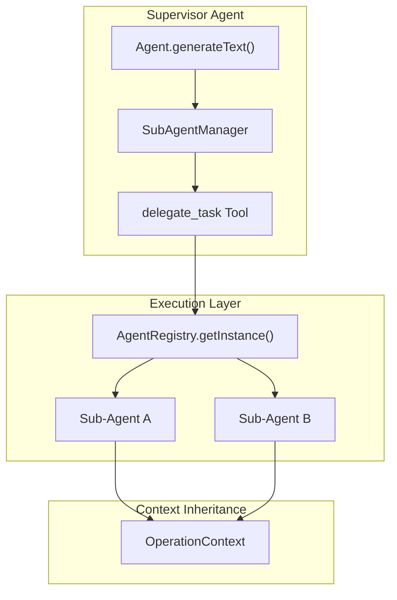
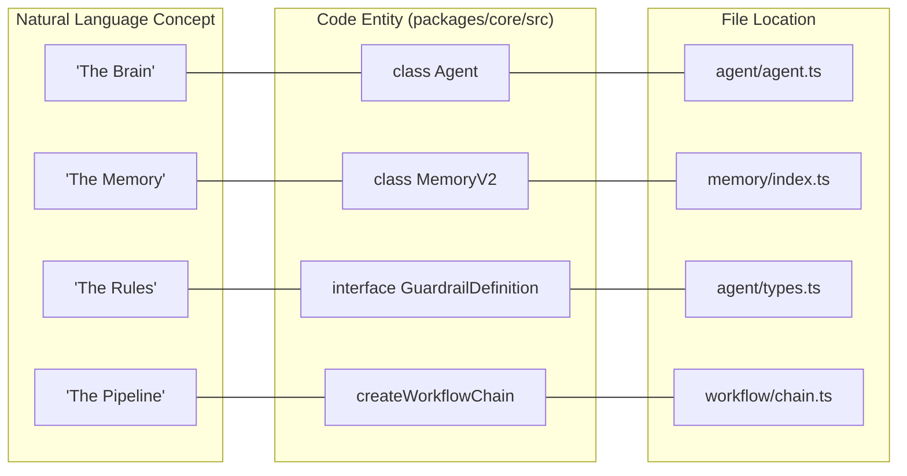

<!-- source: DeepWiki mcp.deepwiki.com · repo VoltAgent/voltagent · page 14 Glossary · fetched 2026-10-26 -->

# Glossary

Relevant source files

The following files were used as context for generating this wiki page:

- [CHANGELOG.md](CHANGELOG.md)
- [README.md](README.md)
- [changelog.sh](changelog.sh)
- [examples/base/src/index.ts](examples/base/src/index.ts)
- [examples/with-subagents/src/index.ts](examples/with-subagents/src/index.ts)
- [i18n/README-cn-bsc.md](i18n/README-cn-bsc.md)
- [i18n/README-cn-traditional.md](i18n/README-cn-traditional.md)
- [i18n/README-jp.md](i18n/README-jp.md)
- [i18n/README-kr.md](i18n/README-kr.md)
- [packages/cli/README.md](packages/cli/README.md)
- [packages/cli/package.json](packages/cli/package.json)
- [packages/core/README.md](packages/core/README.md)
- [packages/core/src/agent/index.ts](packages/core/src/agent/index.ts)
- [packages/core/src/agent/providers/base/types.ts](packages/core/src/agent/providers/base/types.ts)
- [packages/core/src/agent/subagent/index.spec.ts](packages/core/src/agent/subagent/index.spec.ts)
- [packages/core/src/agent/subagent/index.ts](packages/core/src/agent/subagent/index.ts)
- [packages/core/src/agent/subagent/stream-metadata-enricher.ts](packages/core/src/agent/subagent/stream-metadata-enricher.ts)
- [packages/core/src/agent/subagent/types.ts](packages/core/src/agent/subagent/types.ts)
- [packages/core/src/agent/types.ts](packages/core/src/agent/types.ts)
- [packages/core/src/events/types.ts](packages/core/src/events/types.ts)
- [packages/core/src/index.ts](packages/core/src/index.ts)
- [packages/core/src/utils/streams/types.ts](packages/core/src/utils/streams/types.ts)
- [packages/core/src/workflow/chain.spec.ts](packages/core/src/workflow/chain.spec.ts)
- [packages/core/src/workflow/chain.ts](packages/core/src/workflow/chain.ts)
- [packages/core/src/workflow/core.spec.ts](packages/core/src/workflow/core.spec.ts)
- [packages/core/src/workflow/core.ts](packages/core/src/workflow/core.ts)
- [packages/core/src/workflow/index.ts](packages/core/src/workflow/index.ts)
- [packages/core/src/workflow/internal/state.ts](packages/core/src/workflow/internal/state.ts)
- [packages/core/src/workflow/registry.ts](packages/core/src/workflow/registry.ts)
- [packages/core/src/workflow/steps/types.ts](packages/core/src/workflow/steps/types.ts)
- [packages/core/src/workflow/stream.spec.ts](packages/core/src/workflow/stream.spec.ts)
- [packages/core/src/workflow/stream.ts](packages/core/src/workflow/stream.ts)
- [packages/core/src/workflow/suspend-resume.spec.ts](packages/core/src/workflow/suspend-resume.spec.ts)
- [packages/core/src/workflow/types.ts](packages/core/src/workflow/types.ts)
- [packages/create-voltagent-app/CHANGELOG.md](packages/create-voltagent-app/CHANGELOG.md)
- [packages/create-voltagent-app/package.json](packages/create-voltagent-app/package.json)
- [packages/supabase/README.md](packages/supabase/README.md)
- [packages/voice/CHANGELOG.md](packages/voice/CHANGELOG.md)
- [packages/voice/README.md](packages/voice/README.md)
- [packages/voice/package.json](packages/voice/package.json)
- [website/docs/agents/overview.md](website/docs/agents/overview.md)
- [website/docs/agents/subagents.md](website/docs/agents/subagents.md)
- [website/docs/index.md](website/docs/index.md)
- [website/docs/workflows/overview.md](website/docs/workflows/overview.md)
- [website/docs/workflows/streaming.md](website/docs/workflows/streaming.md)
- [website/docs/workflows/suspend-resume.md](website/docs/workflows/suspend-resume.md)
- [website/observability/mcp.md](website/observability/mcp.md)
- [website/sidebars.ts](website/sidebars.ts)
- [website/src/data/tweets.json](website/src/data/tweets.json)

This page provides definitions and technical implementation details for codebase-specific terms, abbreviations, and domain concepts within the VoltAgent ecosystem.

## Core Concepts

### Agent
An `Agent` is the primary orchestration unit in VoltAgent. It wraps a Large Language Model (LLM) with specific instructions, a set of tools, memory persistence, and lifecycle hooks [packages/core/src/agent/agent.ts:44-55](). Agents can operate independently or as part of a multi-agent hierarchy [website/docs/agents/overview.md:8-15]().

### VoltAgent (Instance)
The `VoltAgent` class serves as the root container and registry for a project. It manages the lifecycle of multiple agents and workflows, and optionally attaches a server (e.g., Hono) to expose them via REST API [README.md:115-124]().

### OperationContext
A request-scoped state container that travels through the agent's message processing pipeline. It carries metadata, trace information, and custom context maps shared across tools and hooks [packages/core/src/agent/types.ts:207-207]().

---

## Workflow System Terms

### Workflow Chain
A declarative sequence of execution steps created via `createWorkflowChain`. It allows for complex control flow including branching, looping, and parallel execution [packages/core/src/workflow/core.ts:2-20]().

### Step
The atomic unit of execution within a workflow. Steps are identified by a unique `id` and can be standard logic (`andThen`), agent calls (`andAgent`), or control flow constructs [packages/core/src/workflow/steps/types.ts:1-10]().

### Suspend & Resume
A mechanism for "Human-in-the-loop" interactions. Workflows can enter a `suspended` state, persisting their current execution context to storage, and wait for an external signal or validation to `resume` [packages/core/src/workflow/core.ts:151-152]().

### Workflow State Map
A bridge between Natural Language intent and Code execution.

| Code Entity | Purpose | Implementation Pointer |
| :--- | :--- | :--- |
| `WorkflowStateStore` | Interface for persisting workflow progress | [packages/core/src/workflow/types.ts:35-35]() |
| `andBranch` | Conditional routing based on data | [CHANGELOG.md:87-106]() |
| `andForEach` | Parallel processing of collections | [CHANGELOG.md:114-121]() |
| `WorkflowBailSignal` | Internal error used to exit a workflow early | [packages/core/src/workflow/core.ts:66-74]() |

**Sources:** [packages/core/src/workflow/core.ts:1-100](), [CHANGELOG.md:64-230](), [packages/core/src/index.ts:1-41]()

---

## Multi-Agent Architecture

### Supervisor
An agent configured with a `SubAgentManager` that coordinates tasks among specialized "Sub-Agents" [packages/core/src/agent/subagent/index.ts:55-70](). It uses a specialized system message template to describe the capabilities of its subordinates to the LLM [packages/core/src/agent/subagent/index.ts:231-233]().

### Sub-Agent
A specialized agent that performs specific tasks delegated by a Supervisor. Sub-agents are registered in the `AgentRegistry` with a parent-child relationship [packages/core/src/agent/subagent/index.ts:102-103]().

### Delegation (delegate_task)
The mechanism by which a Supervisor hands off work. This is implemented as a tool generated by the `SubAgentManager` which, when called by the LLM, triggers the execution of the target sub-agent [packages/core/src/agent/subagent/index.ts:53-54]().

### Multi-Agent Interaction Flow
The following diagram illustrates how a Supervisor coordinates with Sub-Agents.

**Multi-Agent Coordination Diagram**

**Sources:** [packages/core/src/agent/subagent/index.ts:55-150](), [packages/core/src/registries/agent-registry.ts:1-20]()

---

## Memory and Storage

### Conversation Persistence
The strategy for saving and retrieving message history. VoltAgent supports `InMemory`, `LibSQL`, `PostgreSQL`, and `Supabase` adapters [README.md:59-62]().

### Working Memory
A short-term memory buffer used during a single execution run to maintain state across multiple tool calls and LLM iterations [packages/core/src/memory/types.ts:165-167]().

### Summarization
A strategy to handle context window limits by condensing older messages into a "system summary" while keeping the $N$ most recent messages intact [website/docs/agents/overview.md:220-222]().

---

## Technical Abbreviations & Jargon

| Term | Full Name | Definition |
| :--- | :--- | :--- |
| **MCP** | Model Context Protocol | An open standard for connecting LLMs to external data sources and tools [README.md:57-57](). |
| **RAG** | Retrieval-Augmented Generation | A technique where agents retrieve relevant documents before generating a response to ground the answer in facts [README.md:61-62](). |
| **A2A** | Agent-to-Agent | A protocol for standardized communication between independent agent servers [website/sidebars.ts:92-92](). |
| **VoltOps** | Volt Operations | The observability and management platform for VoltAgent (Cloud or Self-Hosted) [README.md:46-46](). |
| **PII** | Personally Identifiable Information | Refers to guardrails designed to detect or redact sensitive data like emails and phone numbers [packages/core/src/index.ts:75-87](). |

---

## Code Entity Mapping

This diagram bridges natural language concepts to the specific TypeScript classes and files that implement them.

**System Entity Mapping**

**Sources:** [packages/core/src/index.ts:1-250](), [packages/core/src/agent/agent.ts:44-55](), [packages/core/src/workflow/chain.ts:1-10]()