<!-- source: DeepWiki mcp.deepwiki.com · repo VoltAgent/voltagent · page 2 Core Agent System · fetched 2026-10-26 -->

# Core Agent System

<details>
<summary>Relevant source files</summary>

The following files were used as context for generating this wiki page:

- [examples/with-subagents/src/index.ts](examples/with-subagents/src/index.ts)
- [packages/core/src/agent/agent.spec-d.ts](packages/core/src/agent/agent.spec-d.ts)
- [packages/core/src/agent/agent.spec.ts](packages/core/src/agent/agent.spec.ts)
- [packages/core/src/agent/agent.ts](packages/core/src/agent/agent.ts)
- [packages/core/src/agent/hooks/index.spec.ts](packages/core/src/agent/hooks/index.spec.ts)
- [packages/core/src/agent/hooks/index.ts](packages/core/src/agent/hooks/index.ts)
- [packages/core/src/agent/index.ts](packages/core/src/agent/index.ts)
- [packages/core/src/agent/providers/base/types.ts](packages/core/src/agent/providers/base/types.ts)
- [packages/core/src/agent/subagent/index.spec.ts](packages/core/src/agent/subagent/index.spec.ts)
- [packages/core/src/agent/subagent/index.ts](packages/core/src/agent/subagent/index.ts)
- [packages/core/src/agent/types.ts](packages/core/src/agent/types.ts)
- [packages/core/src/events/types.ts](packages/core/src/events/types.ts)
- [packages/core/src/index.ts](packages/core/src/index.ts)
- [packages/server-core/src/handlers/agent.handlers.spec.ts](packages/server-core/src/handlers/agent.handlers.spec.ts)
- [packages/server-core/src/handlers/agent.handlers.ts](packages/server-core/src/handlers/agent.handlers.ts)
- [packages/server-core/src/schemas/agent.schemas.spec.ts](packages/server-core/src/schemas/agent.schemas.spec.ts)
- [packages/server-core/src/schemas/agent.schemas.ts](packages/server-core/src/schemas/agent.schemas.ts)
- [packages/server-core/src/utils/options.ts](packages/server-core/src/utils/options.ts)
- [packages/server-elysia/src/routes/agent.routes.ts](packages/server-elysia/src/routes/agent.routes.ts)
- [website/docs/agents/context.md](website/docs/agents/context.md)
- [website/docs/agents/hooks.md](website/docs/agents/hooks.md)
- [website/docs/agents/overview.md](website/docs/agents/overview.md)
- [website/docs/agents/prompts.md](website/docs/agents/prompts.md)
- [website/docs/agents/subagents.md](website/docs/agents/subagents.md)
- [website/docs/agents/tools.md](website/docs/agents/tools.md)
- [website/docs/api/endpoints/agents.md](website/docs/api/endpoints/agents.md)
- [website/docs/ui/ai-sdk-integration.md](website/docs/ui/ai-sdk-integration.md)

</details>


The `Agent` class in `@voltagent/core` is the central orchestrator for AI-powered conversations and task execution. It manages the complete lifecycle of agent operations: coordinating language model calls, executing tools, persisting conversation history, applying validation rules, and emitting telemetry. The class exposes primary execution methods (`generateText()`, `streamText()`, `generateObject()`, `streamObject()`) that follow a consistent request-response pipeline.

## What is an Agent?

An `Agent` instance represents a configured AI assistant with a specific personality (instructions), capabilities (tools), and operational constraints (guardrails, hooks). Agents are stateful in that they can persist conversation history through memory adapters, but individual operations are isolated through per-request `OperationContext` instances.

The Agent class coordinates several specialized subsystems:
- **Model execution** via AI SDK language model abstraction.
- **Tool management** for extending agent capabilities. For details, see [Tools and Toolkits](#2.3).
- **Memory persistence** for conversation continuity. For details, see [Memory System](#2.4) and [Memory Storage Adapters](#2.5).
- **Lifecycle hooks** for observability and customization. For details, see [Lifecycle Hooks](#2.6).
- **Guardrails and middleware** for validation and transformation. For details, see [Guardrails and Middleware](#2.7).
- **Sub-agent delegation** for task routing. For details, see [Sub-Agent and Supervisor Patterns](#4).

## Agent Instantiation

Agents are created by passing an `AgentOptions` configuration object to the constructor [packages/core/src/agent/agent.ts:782-938](). The configuration specifies the agent's identity, model, instructions, and optional capabilities.

### Basic Agent Creation

```typescript
import { Agent } from "@voltagent/core";

const agent = new Agent({
  name: "customer-support",
  instructions: "You are a helpful customer support agent",
  model: "openai/gpt-4o-mini",
  tools: [searchTool],
  memory: memoryInstance,
});
```

The constructor initializes internal managers (`MemoryManager`, `ToolManager`, `SubAgentManager`) and normalizes configuration (guardrails, hooks, instructions). For details, see [Agent Fundamentals](#2.1).

### Agent Component Architecture

The Agent orchestrates several specialized subsystems through manager objects. Each manager is responsible for a specific domain and exposes methods called during execution.

```mermaid
graph TB
    subgraph "Code Entity: Agent Class [packages/core/src/agent/agent.ts]"
        AgentCore["Agent"]
        id["id: string"]
        name["name: string"]
        instructions["instructions: InstructionsDynamicValue"]
        model["model: AgentModelValue"]
        hooks["hooks: AgentHooks"]
    end
    
    subgraph "Code Entity: Managers [packages/core/src/agent/agent.ts]"
        MemoryManager["MemoryManager [packages/core/src/memory/manager/memory-manager.ts]"]
        ToolManager["ToolManager [packages/core/src/tool/manager.ts]"]
        SubAgentManager["SubAgentManager [packages/core/src/agent/subagent/index.ts]"]
    end
    
    subgraph "Code Entity: Operation Context [packages/core/src/agent/types.ts]"
        OperationContext["OperationContext (request-scoped)"]
        ConversationBuffer["ConversationBuffer [packages/core/src/agent/conversation-buffer.ts]"]
        MemoryPersistQueue["MemoryPersistQueue [packages/core/src/agent/memory-persist-queue.ts]"]
        AgentTraceContext["AgentTraceContext [packages/core/src/agent/open-telemetry/trace-context.ts]"]
    end
    
    subgraph "Natural Language: External Services"
        LanguageModel["LLM Provider (OpenAI, Anthropic, etc.)"]
        Memory["Storage Adapter (SQLite, PG, etc.)"]
        VoltAgentObservability["Observability / Telemetry"]
    end
    
    AgentCore --> MemoryManager
    AgentCore --> ToolManager
    AgentCore --> SubAgentManager
    AgentCore --> LanguageModel
    AgentCore --> Memory
    AgentCore --> VoltAgentObservability
    
    AgentCore -.creates per-request.-> OperationContext
    OperationContext --> ConversationBuffer
    OperationContext --> MemoryPersistQueue
    OperationContext --> AgentTraceContext
```



**Sources:** [packages/core/src/agent/agent.ts:782-938](), [packages/core/src/agent/types.ts:204-207](), [packages/core/src/agent/agent.ts:349-365]()

## Core Execution Methods

The Agent class provides methods for interacting with language models. Each method creates an `OperationContext`, executes a request-response pipeline, and returns results with the operation context attached [packages/core/src/agent/agent.ts:944-1541]().

| Method | Return Type | Use Case |
|--------|-------------|----------|
| `generateText()` | `Promise<GenerateTextResultWithContext>` | Complete text generation (batch) |
| `streamText()` | `Promise<StreamTextResultWithContext>` | Real-time text streaming |
| `generateObject()` | `Promise<GenerateObjectResultWithContext>` | Structured data extraction |
| `streamObject()` | `Promise<StreamObjectResultWithContext>` | Streaming structured data |

All methods accept input as `string`, `UIMessage[]`, or `BaseMessage[]`. For details, see [Agent Fundamentals](#2.1) and [Message Processing Pipeline](#2.8).

**Sources:** [packages/core/src/agent/agent.ts:944-1148](), [packages/core/src/agent/agent.ts:1150-1541](), [packages/core/src/agent/types.ts:677-776]()

## Operation Lifecycle Overview

Every agent execution follows a multi-phase pipeline managed by the Agent class.

### High-Level Execution Pipeline

```mermaid
graph LR
    subgraph "Phase 1: Setup"
        CreateContext["createOperationContext()"]
        InitTrace["AgentTraceContext.start()"]
    end
    
    subgraph "Phase 2: Pre-Processing"
        OnStart["hooks.onStart()"]
        InputGuardrails["executeInputGuardrails()"]
        InputMiddlewares["runInputMiddlewares()"]
    end
    
    subgraph "Phase 3: Preparation"
        LoadMemory["MemoryManager.retrieveMessages()"]
        PrepareTools["ToolManager.prepareForExecution()"]
    end
    
    subgraph "Phase 4: Execution"
        AISDKCall["generateText / streamText"]
        ToolLoop["Tool Execution Loop"]
        StepPersist["MemoryPersistQueue.scheduleSave()"]
    end
    
    subgraph "Phase 5: Post-Processing"
        OutputGuardrails["executeOutputGuardrails()"]
        OnEnd["hooks.onEnd()"]
    end
    
    CreateContext --> InitTrace
    InitTrace --> OnStart
    OnStart --> InputGuardrails
    InputGuardrails --> InputMiddlewares
    InputMiddlewares --> LoadMemory
    LoadMemory --> PrepareTools
    PrepareTools --> AISDKCall
    AISDKCall --> ToolLoop
    ToolLoop --> StepPersist
    StepPersist --> OutputGuardrails
    OutputGuardrails --> OnEnd
```



**Sources:** [packages/core/src/agent/agent.ts:944-1148](), [packages/core/src/agent/agent.ts:1939-2037](), [packages/core/src/agent/agent.ts:2127-2187]()

## Subsystem Overviews

### Operation Context
The `OperationContext` is a request-scoped state container passed through the entire pipeline. It includes a `context` Map for cross-component data flow [packages/core/src/agent/types.ts:204-207](). For details, see [Operation Context](#2.2).

### Tools and Toolkits
The `ToolManager` handles tool registration and execution logic, including multi-step loops and tool routing [packages/core/src/tool/manager.ts](). For details, see [Tools and Toolkits](#2.3).

### Memory System
Conversation history is managed by `MemoryManager` [packages/core/src/memory/manager/memory-manager.ts](). It utilizes a `ConversationBuffer` for in-memory accumulation and a `MemoryPersistQueue` for debounced storage [packages/core/src/agent/conversation-buffer.ts:36-104](). For details, see [Memory System](#2.4) and [Memory Storage Adapters](#2.5).

### Lifecycle Hooks
The `AgentHooks` system provides over 12 interception points (e.g., `onStart`, `onToolStart`, `onEnd`) allowing developers to inject logic into the execution pipeline [packages/core/src/agent/hooks/index.ts:1-128](). For details, see [Lifecycle Hooks](#2.6).

### Guardrails and Middleware
The system supports `InputGuardrail` and `OutputGuardrail` for validation, alongside a middleware pipeline for pre-processing transformations [packages/core/src/agent/guardrail.ts](). For details, see [Guardrails and Middleware](#2.7).

### Sub-Agent and Supervisor Patterns
Agents can delegate tasks to sub-agents via the `SubAgentManager` [packages/core/src/agent/subagent/index.ts](). This allows for complex hierarchical agent structures. For details, see [Sub-Agent and Supervisor Patterns](#4).

### Observability and Tracing
The system integrates OpenTelemetry through `AgentTraceContext` [packages/core/src/agent/open-telemetry/trace-context.ts](). Standardized attributes are applied to spans for monitoring model usage, tool calls, and agent performance. For details, see [VoltOps Platform](#9).

**Sources:** [packages/core/src/agent/agent.ts:782-938](), [packages/core/src/agent/hooks/index.ts](), [packages/core/src/agent/subagent/index.ts](), [packages/core/src/agent/open-telemetry/trace-context.ts]()

---

