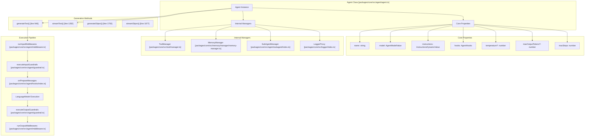
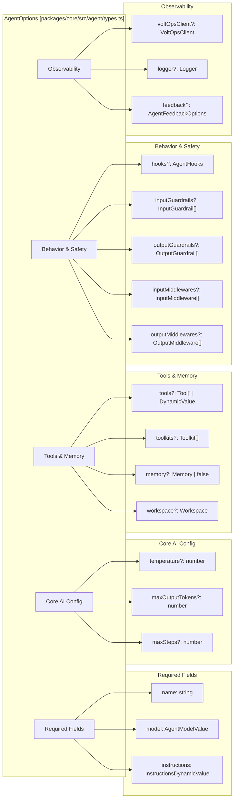
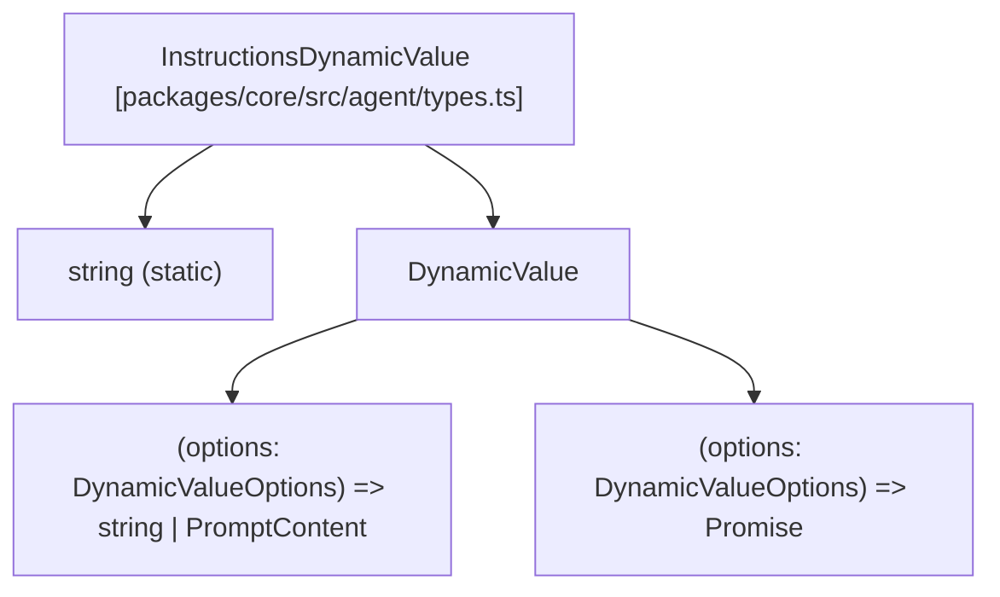
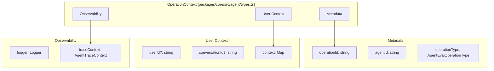

<!-- source: DeepWiki mcp.deepwiki.com · repo VoltAgent/voltagent · page 2.1 Agent Fundamentals · fetched 2026-10-26 -->

# Agent Fundamentals

<details>
<summary>Relevant source files</summary>

The following files were used as context for generating this wiki page:

- [examples/with-subagents/src/index.ts](examples/with-subagents/src/index.ts)
- [packages/core/src/agent/agent.spec-d.ts](packages/core/src/agent/agent.spec-d.ts)
- [packages/core/src/agent/agent.spec.ts](packages/core/src/agent/agent.spec.ts)
- [packages/core/src/agent/agent.ts](packages/core/src/agent/agent.ts)
- [packages/core/src/agent/hooks/index.spec.ts](packages/core/src/agent/hooks/index.spec.ts)
- [packages/core/src/agent/hooks/index.ts](packages/core/src/agent/hooks/index.ts)
- [packages/core/src/agent/index.ts](packages/core/src/agent/index.ts)
- [packages/core/src/agent/providers/base/types.ts](packages/core/src/agent/providers/base/types.ts)
- [packages/core/src/agent/subagent/index.spec.ts](packages/core/src/agent/subagent/index.spec.ts)
- [packages/core/src/agent/subagent/index.ts](packages/core/src/agent/subagent/index.ts)
- [packages/core/src/agent/types.ts](packages/core/src/agent/types.ts)
- [packages/core/src/events/types.ts](packages/core/src/events/types.ts)
- [packages/core/src/index.ts](packages/core/src/index.ts)
- [packages/core/src/types.ts](packages/core/src/types.ts)
- [packages/core/src/voltagent.spec.ts](packages/core/src/voltagent.spec.ts)
- [packages/core/src/voltagent.ts](packages/core/src/voltagent.ts)
- [packages/server-core/src/handlers/agent.handlers.spec.ts](packages/server-core/src/handlers/agent.handlers.spec.ts)
- [packages/server-core/src/handlers/agent.handlers.ts](packages/server-core/src/handlers/agent.handlers.ts)
- [packages/server-core/src/schemas/agent.schemas.spec.ts](packages/server-core/src/schemas/agent.schemas.spec.ts)
- [packages/server-core/src/schemas/agent.schemas.ts](packages/server-core/src/schemas/agent.schemas.ts)
- [packages/server-core/src/utils/options.ts](packages/server-core/src/utils/options.ts)
- [packages/server-elysia/src/routes/agent.routes.ts](packages/server-elysia/src/routes/agent.routes.ts)
- [website/docs/agents/context.md](website/docs/agents/context.md)
- [website/docs/agents/hooks.md](website/docs/agents/hooks.md)
- [website/docs/agents/overview.md](website/docs/agents/overview.md)
- [website/docs/agents/prompts.md](website/docs/agents/prompts.md)
- [website/docs/agents/subagents.md](website/docs/agents/subagents.md)
- [website/docs/agents/tools.md](website/docs/agents/tools.md)
- [website/docs/api/endpoints/agents.md](website/docs/api/endpoints/agents.md)
- [website/docs/ui/ai-sdk-integration.md](website/docs/ui/ai-sdk-integration.md)

</details>


## Purpose and Scope

This document covers the core `Agent` class in VoltAgent: how to instantiate agents, configure their options, and invoke text generation methods. It explains the fundamental building blocks including `AgentOptions`, instruction configuration, model specification, and the `OperationContext` that flows through agent operations.

For information about tools and toolkits, see [Tools and Toolkits](#2.3). For memory persistence and conversation history, see [Memory System](#2.4). For lifecycle hooks and interception points, see [Lifecycle Hooks](#2.6).

## Agent Class Overview

The `Agent` class ([packages/core/src/agent/agent.ts:782-2900]()) is the primary orchestration layer for AI-powered operations. An agent wraps a language model with instructions, tools, memory, and execution policies, providing a unified interface for text generation and structured output.

**Core Responsibilities:**

| Responsibility | Description |
|---|---|
| **Model Orchestration** | Manages model selection, fallback, and retry logic |
| **Context Management** | Maintains `OperationContext` with request-scoped state |
| **Tool Execution** | Coordinates tool calls and approval workflows |
| **Memory Integration** | Persists conversation history and manages summarization |
| **Pipeline Control** | Executes guardrails, middleware, and lifecycle hooks |
| **Observability** | Integrates OpenTelemetry tracing and logging |

### Agent Architecture Diagram

This diagram bridges the natural language concept of an "Agent" to the specific code entities in the `@voltagent/core` package.



Sources: [packages/core/src/agent/agent.ts:782-2900](), [packages/core/src/agent/types.ts:641-730](), [packages/core/src/agent/middleware.ts:168-169](), [packages/core/src/agent/guardrail.ts:152-153]()

## Creating an Agent

Agents are instantiated using the `Agent` constructor with an `AgentOptions` object. Three fields are required: `name`, `instructions`, and `model`.

### Minimal Agent Example

```typescript
import { Agent } from "@voltagent/core";

const agent = new Agent({
  name: "Assistant",
  instructions: "You are a helpful assistant.",
  model: "openai/gpt-4o-mini"
});
```

The constructor ([packages/core/src/agent/agent.ts:832-938]()) initializes internal managers, resolves configuration, and registers the agent in the `AgentRegistry`.

### AgentOptions Structure

The `AgentOptions` interface defines the configuration surface for an agent.



Sources: [packages/core/src/agent/types.ts:641-730](), [packages/core/src/agent/agent.ts:832-938]()

## Agent Configuration Options

### Core Configuration Fields

| Field | Type | Default | Description |
|---|---|---|---|
| `name` | `string` | Required | Agent identifier |
| `id` | `string?` | `name` | Unique ID (defaults to `name`) |
| `purpose` | `string?` | - | Brief purpose description (used in supervisor context) |
| `instructions` | `InstructionsDynamicValue` | Required | Behavior guidelines (static or dynamic) |
| `model` | `AgentModelValue` | Required | Model reference or fallback list |
| `temperature` | `number?` | - | Creativity parameter (0-1) |
| `maxOutputTokens` | `number?` | - | Token generation limit |
| `maxSteps` | `number?` | `5` (or `100` with workspace) | Maximum tool-use iterations |
| `maxRetries` | `number?` | `3` | Retry attempts before fallback |

The `maxSteps` default changes based on workspace configuration ([packages/core/src/agent/agent.ts:848-849]()):

```typescript
const defaultMaxSteps = this.workspace ? 100 : 5;
this.maxSteps = options.maxSteps ?? defaultMaxSteps;
```

### Sub-Agent Configuration

When an agent has `subAgents`, it operates as a supervisor using the `SubAgentManager` ([packages/core/src/agent/subagent/index.ts:55]()).

| Field | Type | Description |
|---|---|---|
| `subAgents` | `SubAgentConfig[]?` | Sub-agents for task delegation |
| `supervisorConfig` | `SupervisorConfig?` | Supervisor behavior customization |

The `supervisorConfig` controls delegation behavior and stream event forwarding ([packages/core/src/agent/types.ts:319-386]()).

Sources: [packages/core/src/agent/types.ts:641-730](), [packages/core/src/agent/agent.ts:832-938](), [packages/core/src/agent/subagent/index.ts:55-91]()

## Instructions Configuration

Instructions define agent behavior and can be static strings, dynamic functions, or managed prompts from VoltOps.

### InstructionsDynamicValue Type



### Dynamic Instructions

Instructions can be a function that receives `DynamicValueOptions` ([packages/core/src/voltops/types.ts:15-17]()) and returns text based on runtime context:

```typescript
const agent = new Agent({
  name: "Assistant",
  instructions: ({ context }) => {
    const tier = context?.get("tier") || "free";
    return tier === "premium"
      ? "You are a premium assistant."
      : "You are a basic assistant.";
  },
  model: "openai/gpt-4o-mini"
});
```

### VoltOps Prompt Management

When a `VoltOpsClient` is configured, instructions can reference managed prompts. The prompt helper is initialized in the constructor ([packages/core/src/agent/agent.ts:937]()).

```typescript
const agent = new Agent({
  name: "Assistant",
  instructions: async ({ prompts }) => {
    return await prompts?.get("assistant-instructions", { version: "2.1.0" });
  },
  model: "openai/gpt-4o-mini",
  voltOpsClient: new VoltOpsClient({ ... })
});
```

Sources: [packages/core/src/agent/types.ts:226](), [packages/core/src/voltops/types.ts:15-44](), [packages/core/src/agent/agent.ts:836-937]()

## Model Configuration

The `model` field specifies which language model(s) to use. VoltAgent supports multiple specification methods to enable fallback and retry strategies.

### Model Specification Methods

**1. Model String:** Resolved by `ModelProviderRegistry` ([packages/core/src/registries/model-provider-registry.ts]()).

```typescript
const agent = new Agent({
  name: "Assistant",
  model: "openai/gpt-4o-mini"
});
```

**2. Fallback List:** Configured via `AgentModelConfig[]` ([packages/core/src/agent/types.ts:241-265]()).

```typescript
const agent = new Agent({
  name: "Assistant",
  model: [
    { model: "openai/gpt-4o", maxRetries: 2 },
    { model: "anthropic/claude-3-5-sonnet", maxRetries: 3 }
  ]
});
```

Model resolution happens in `resolveModel()` ([packages/core/src/agent/agent.ts:2151-2272]()).

Sources: [packages/core/src/agent/types.ts:229-265](), [packages/core/src/agent/agent.ts:2151-2272]()

## Generation Methods

The `Agent` class provides core methods for text generation.

### generateText

Generates complete text response synchronously ([packages/core/src/agent/agent.ts:946-1216]()):

```typescript
const result = await agent.generateText("What is TypeScript?");
console.log(result.text);
```

### streamText

Streams text response incrementally ([packages/core/src/agent/agent.ts:1282-1682]()):

```typescript
const response = await agent.streamText("Explain async/await");
for await (const chunk of response.textStream) {
  process.stdout.write(chunk);
}
```

**Return Type Fields:**
- `textStream`: AsyncIterable of text chunks.
- `fullStream`: AsyncIterable of detailed events (`text-delta`, `tool-call`, `tool-result`, `finish`) ([packages/core/src/agent/subagent/types.ts:24-27]()).

Sources: [packages/core/src/agent/agent.ts:946-1682](), [packages/core/src/agent/types.ts:759-776]()

## OperationContext

`OperationContext` ([packages/core/src/agent/types.ts:865]()) is the request-scoped state container that flows through all agent operations.

### OperationContext Structure



The `context` map enables passing custom data. It is initialized in `createOperationContext()` ([packages/core/src/agent/agent.ts:2008-2136]()).

Sources: [packages/core/src/agent/types.ts:865-937](), [packages/core/src/agent/agent.ts:2008-2136]()

---

