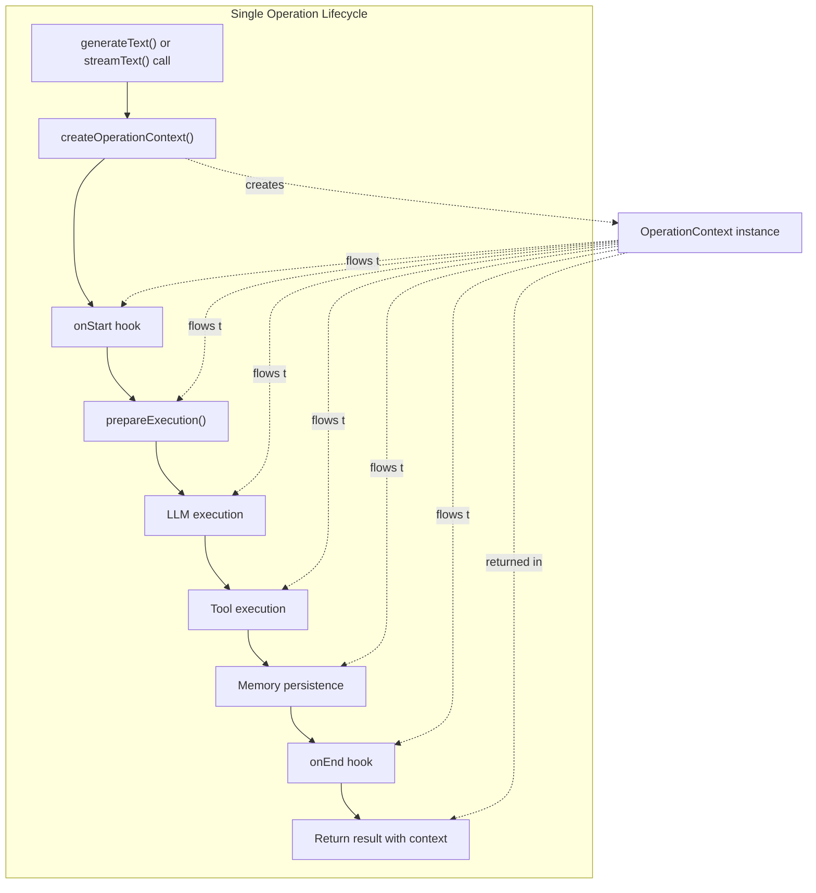
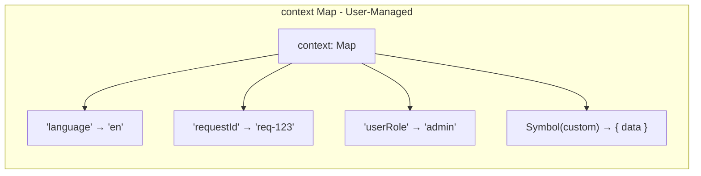
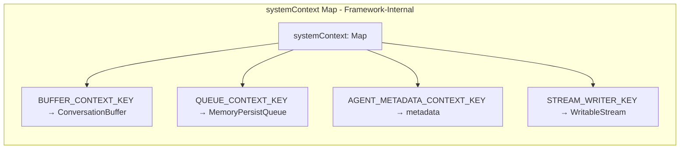
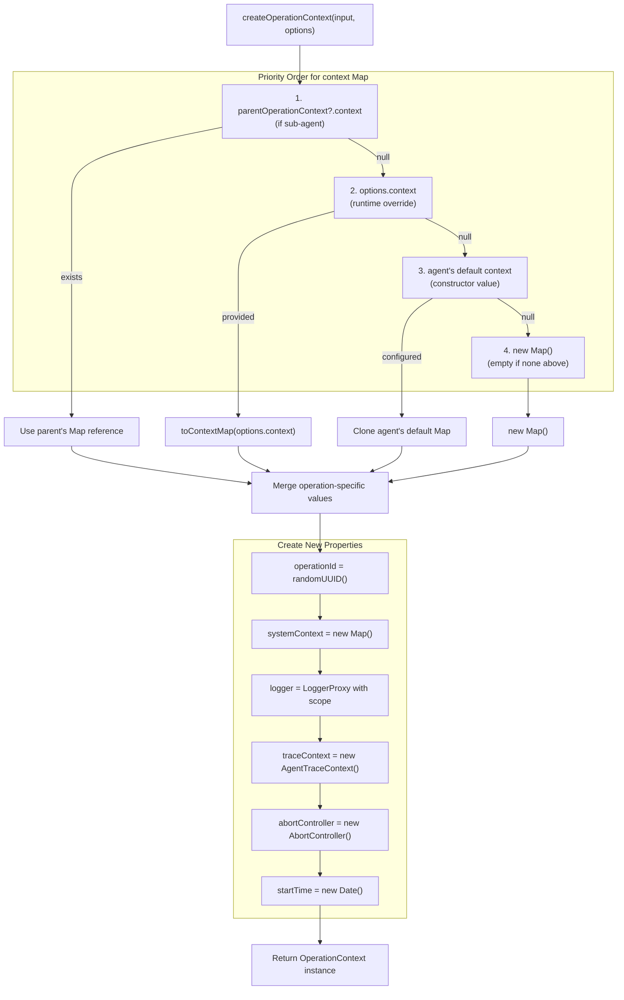
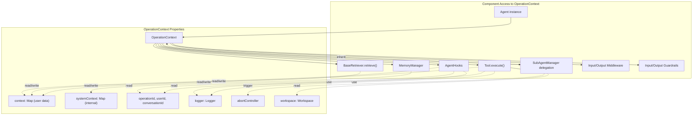
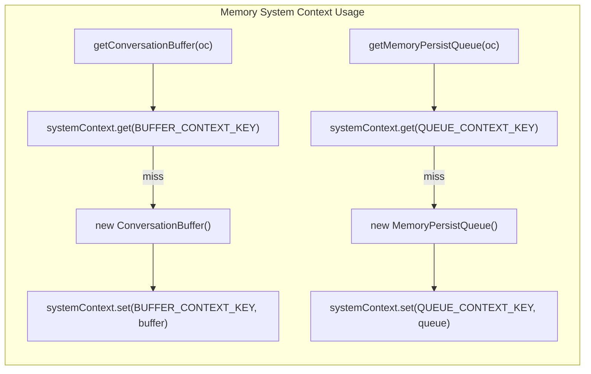
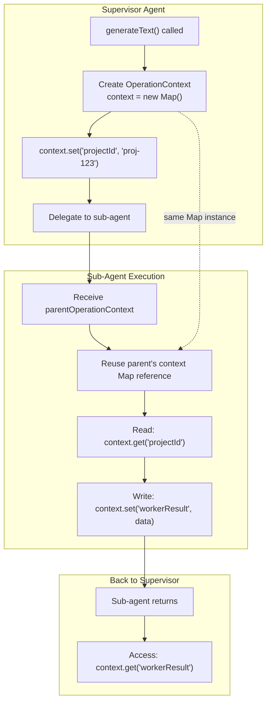
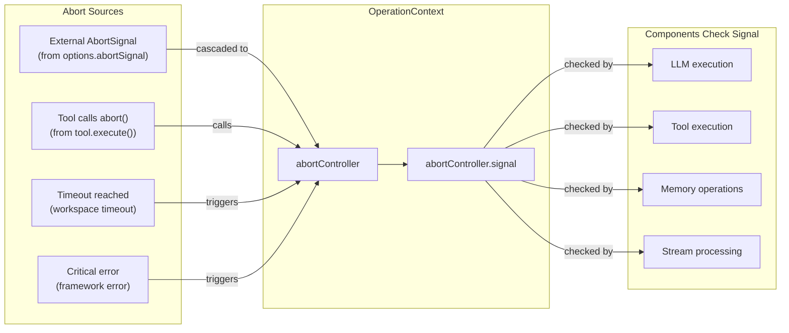

<!-- source: DeepWiki mcp.deepwiki.com · repo VoltAgent/voltagent · page 2.2 Operation Context · fetched 2026-10-26 -->

# Operation Context

Relevant source files

The following files were used as context for generating this wiki page:

- [examples/with-subagents/src/index.ts](examples/with-subagents/src/index.ts)
- [packages/core/src/agent/agent.spec-d.ts](packages/core/src/agent/agent.spec-d.ts)
- [packages/core/src/agent/agent.spec.ts](packages/core/src/agent/agent.spec.ts)
- [packages/core/src/agent/agent.ts](packages/core/src/agent/agent.ts)
- [packages/core/src/agent/hooks/index.spec.ts](packages/core/src/agent/hooks/index.spec.ts)
- [packages/core/src/agent/hooks/index.ts](packages/core/src/agent/hooks/index.ts)
- [packages/core/src/agent/index.ts](packages/core/src/agent/index.ts)
- [packages/core/src/agent/providers/base/types.ts](packages/core/src/agent/providers/base/types.ts)
- [packages/core/src/agent/subagent/index.spec.ts](packages/core/src/agent/subagent/index.spec.ts)
- [packages/core/src/agent/subagent/index.ts](packages/core/src/agent/subagent/index.ts)
- [packages/core/src/agent/types.ts](packages/core/src/agent/types.ts)
- [packages/core/src/events/types.ts](packages/core/src/events/types.ts)
- [packages/core/src/index.ts](packages/core/src/index.ts)
- [packages/server-core/src/handlers/agent.handlers.spec.ts](packages/server-core/src/handlers/agent.handlers.spec.ts)
- [packages/server-core/src/handlers/agent.handlers.ts](packages/server-core/src/handlers/agent.handlers.ts)
- [packages/server-core/src/schemas/agent.schemas.spec.ts](packages/server-core/src/schemas/agent.schemas.spec.ts)
- [packages/server-core/src/schemas/agent.schemas.ts](packages/server-core/src/schemas/agent.schemas.ts)
- [packages/server-core/src/utils/options.ts](packages/server-core/src/utils/options.ts)
- [packages/server-elysia/src/routes/agent.routes.ts](packages/server-elysia/src/routes/agent.routes.ts)
- [website/docs/agents/context.md](website/docs/agents/context.md)
- [website/docs/agents/hooks.md](website/docs/agents/hooks.md)
- [website/docs/agents/overview.md](website/docs/agents/overview.md)
- [website/docs/agents/prompts.md](website/docs/agents/prompts.md)
- [website/docs/agents/subagents.md](website/docs/agents/subagents.md)
- [website/docs/agents/tools.md](website/docs/agents/tools.md)
- [website/docs/api/endpoints/agents.md](website/docs/api/endpoints/agents.md)
- [website/docs/ui/ai-sdk-integration.md](website/docs/ui/ai-sdk-integration.md)

**Purpose**: This document explains the `OperationContext` type, which serves as a request-scoped state container that flows through all components during a single agent operation. It describes the two context maps (`context` and `systemContext`), their lifecycle, and how data propagates across hooks, tools, memory, retrievers, and sub-agents.

**Related Pages**: For agent lifecycle hooks that receive `OperationContext`, see [Lifecycle Hooks](#2.6). For tool execution that accesses context, see [Tools and Toolkits](#2.3). For memory persistence that uses context, see [Memory System](#2.4).

---

## Overview

`OperationContext` is the central state container for a single agent operation (e.g., one `generateText()` or `streamText()` call). The framework creates a fresh `OperationContext` at the start of each operation and passes it through every component that participates in that operation.

Title: Operation Context Lifecycle

**Sources**: [packages/core/src/agent/agent.ts:954-1124](), [packages/core/src/agent/agent.ts:3343-3438]()

---

## Context Structure

`OperationContext` contains two distinct `Map` instances for storing state:

### User Context Map (`context`)

A `Map<string | symbol, unknown>` for application-defined data. Users set values in three ways:

1. **Agent-level default**: Passed to `Agent` constructor.
2. **Operation-level**: Passed to `generateText()`, `streamText()`, etc.
3. **Runtime modification**: Written by hooks, tools, or retrievers during execution.

Title: User Context Mapping

### System Context Map (`systemContext`)

A `Map<string | symbol, unknown>` for internal framework state. VoltAgent uses symbols as keys to avoid collisions. Examples include:

- `BUFFER_CONTEXT_KEY`: `ConversationBuffer` instance.
- `QUEUE_CONTEXT_KEY`: `MemoryPersistQueue` instance.
- Stream writers for sub-agent forwarding.
- Tool routing state.

**Code Symbols**:
- `BUFFER_CONTEXT_KEY` at [packages/core/src/agent/agent.ts:141]()
- `QUEUE_CONTEXT_KEY` at [packages/core/src/agent/agent.ts:160]()
- `AGENT_METADATA_CONTEXT_KEY` at [packages/core/src/agent/memory-persist-queue.ts:158]()

Title: System Context Mapping

**Sources**: [packages/core/src/agent/agent.ts:140-161](), [packages/core/src/agent/memory-persist-queue.ts:158-161]()

---

## OperationContext Type Definition

The `OperationContext` type is defined at [packages/core/src/agent/types.ts:250]().

| Property | Type | Purpose |
|----------|------|---------|
| `operationId` | `string` | Unique identifier for this operation |
| `context` | `Map<string \| symbol, unknown>` | User-managed state |
| `systemContext` | `Map<string \| symbol, unknown>` | Internal framework state |
| `userId` | `string?` | Optional user identifier |
| `conversationId` | `string?` | Optional conversation identifier |
| `workspace` | `Workspace?` | Workspace instance if configured |
| `logger` | `Logger` | Operation-scoped logger with context |
| `traceContext` | `AgentTraceContext` | OpenTelemetry span management |
| `abortController` | `AbortController` | For operation cancellation |
| `input` | `string \| UIMessage[] \| BaseMessage[]?` | Original request input |
| `output` | `string \| object?` | Generated response |
| `startTime` | `Date` | Operation start timestamp |
| `isActive` | `boolean` | Whether operation is still active |
| `parentAgentId` | `string?` | Parent agent ID if sub-agent |
| `conversationSteps` | `StepWithContent[]?` | Full conversation history |

**Sources**: [packages/core/src/agent/types.ts:250-250](), [website/docs/agents/context.md:10-152]()

---

## Context Creation and Initialization

The `createOperationContext()` method instantiates context with priority-based initialization:

Title: createOperationContext Priority Flow

**Key Implementation Details**:

1. **Sub-agent inheritance**: If `parentOperationContext` is provided, the parent's `context` Map reference is reused (not cloned). This enables bidirectional updates between parent and sub-agent [packages/core/src/agent/agent.ts:3343-3371]().
2. **Context merging**: The framework populates missing keys from lower-priority sources without overriding existing values.
3. **Fresh system state**: `systemContext`, `operationId`, `logger`, `traceContext`, and `abortController` are always created fresh per operation.

**Sources**: [packages/core/src/agent/agent.ts:3343-3438](), [packages/core/src/agent/agent.ts:471-474]()

---

## Cross-Component Data Flow

`OperationContext` flows through all components that participate in an operation:

Title: Operation Context Data Flow

### Hooks Access Pattern

Hooks receive `OperationContext` as part of their argument objects. The `OnStartHookArgs`, `OnEndHookArgs`, and `OnToolStartHookArgs` include a `context: OperationContext` field [packages/core/src/agent/hooks/index.ts:10-60]().

### Tools Access Pattern

Tools receive `Partial<OperationContext>` as their second `options` parameter. The `ToolExecuteOptions` type provides access to all operation metadata [packages/core/src/agent/agent.ts:677-678]().

### Memory System Access Pattern

The `MemoryManager` and `MemoryPersistQueue` access `systemContext` to store internal state:
- `ConversationBuffer` instance stored under `BUFFER_CONTEXT_KEY`.
- `MemoryPersistQueue` instance stored under `QUEUE_CONTEXT_KEY`.

Title: Memory System Context Logic

**Sources**: [packages/core/src/agent/agent.ts:3540-3584](), [packages/core/src/agent/memory-persist-queue.ts:158-161]()

---

## Context Inheritance in Sub-Agents

When a supervisor agent delegates to a sub-agent via `SubAgentManager`, the parent's `OperationContext` is passed down [packages/core/src/agent/subagent/index.ts:22-50]().

Title: Sub-Agent Context Inheritance

**Sources**: [packages/core/src/agent/agent.ts:3343-3371](), [packages/core/src/agent/subagent/index.ts:55-148]()

---

## AbortController Integration

The `abortController` field enables operation cancellation from multiple sources [packages/core/src/agent/agent.ts:3385-3416]().

Title: Abort Propagation Flow

**Sources**: [packages/core/src/agent/agent.ts:3385-3416](), [website/docs/agents/context.md:191-244]()

---

## Key Context Access Methods

The `Agent` class provides internal methods to retrieve and manage context state:

| Method | Purpose | Defined At |
|--------|---------|------------|
| `getConversationBuffer(oc)` | Retrieve or create conversation buffer | [packages/core/src/agent/agent.ts:3540]() |
| `getMemoryPersistQueue(oc)` | Retrieve or create memory persist queue | [packages/core/src/agent/agent.ts:3558]() |
| `setupAbortSignalListener(oc)` | Wire external abort signal | [packages/core/src/agent/agent.ts:3385]() |

---

## Context Keys and Symbols

VoltAgent uses exported symbols to avoid key collisions in the `systemContext`:

- `BUFFER_CONTEXT_KEY`: `Symbol("conversationBuffer")` [packages/core/src/agent/agent.ts:141]()
- `QUEUE_CONTEXT_KEY`: `Symbol("memoryPersistQueue")` [packages/core/src/agent/agent.ts:160]()
- `AGENT_METADATA_CONTEXT_KEY`: `Symbol("agentMetadata")` [packages/core/src/agent/memory-persist-queue.ts:158]()
- `TRIGGER_CONTEXT_KEY`: `Symbol("trigger")` [packages/core/src/observability/context-keys.ts:1]()

**Sources**: [packages/core/src/agent/agent.ts:141-161](), [packages/core/src/agent/memory-persist-queue.ts:158-161](), [packages/core/src/observability/context-keys.ts:1-2]()

---

