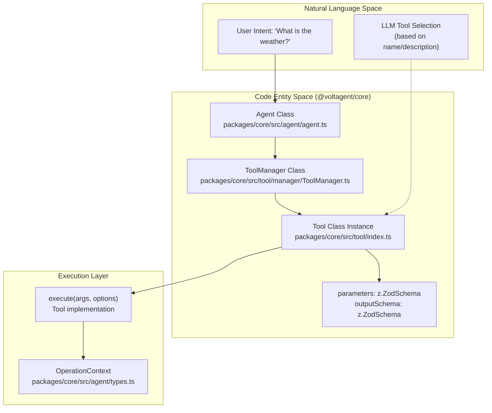
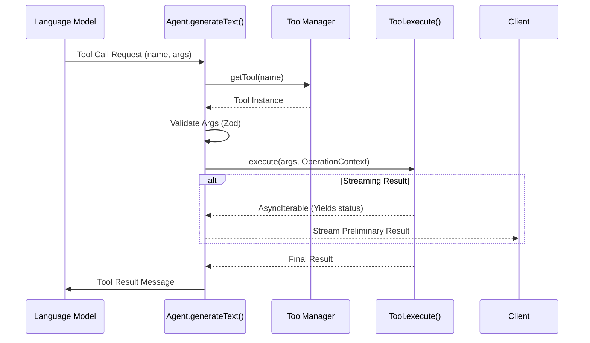
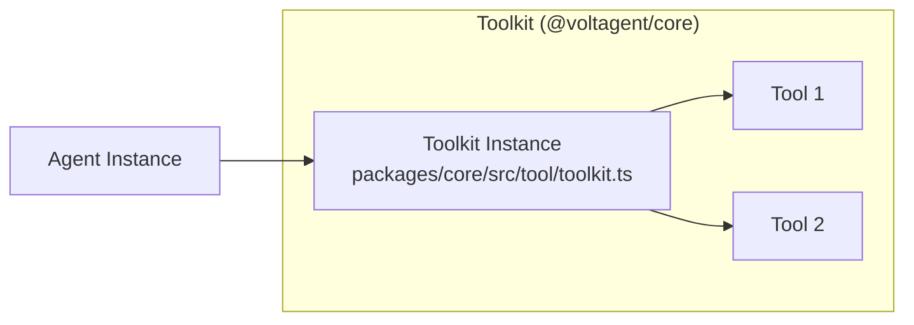

<!-- source: DeepWiki mcp.deepwiki.com · repo VoltAgent/voltagent · page 2.3 Tools and Toolkits · fetched 2026-10-26 -->

# Tools and Toolkits

<details>
<summary>Relevant source files</summary>

The following files were used as context for generating this wiki page:

- [CONSOLE.md](CONSOLE.md)
- [examples/with-tools/src/tools/calendar.ts](examples/with-tools/src/tools/calendar.ts)
- [examples/with-tools/src/tools/search.ts](examples/with-tools/src/tools/search.ts)
- [examples/with-tools/src/tools/weather.ts](examples/with-tools/src/tools/weather.ts)
- [packages/core/src/agent/agent.spec-d.ts](packages/core/src/agent/agent.spec-d.ts)
- [packages/core/src/agent/agent.spec.ts](packages/core/src/agent/agent.spec.ts)
- [packages/core/src/agent/agent.ts](packages/core/src/agent/agent.ts)
- [packages/core/src/agent/hooks/index.spec.ts](packages/core/src/agent/hooks/index.spec.ts)
- [packages/core/src/agent/hooks/index.ts](packages/core/src/agent/hooks/index.ts)
- [packages/core/src/agent/test-utils.ts](packages/core/src/agent/test-utils.ts)
- [packages/core/src/tool/index.spec.ts](packages/core/src/tool/index.spec.ts)
- [packages/core/src/tool/index.ts](packages/core/src/tool/index.ts)
- [packages/core/src/tool/manager/BaseToolManager.ts](packages/core/src/tool/manager/BaseToolManager.ts)
- [packages/core/src/tool/manager/ToolManager.ts](packages/core/src/tool/manager/ToolManager.ts)
- [packages/core/src/tool/manager/ToolkitManager.ts](packages/core/src/tool/manager/ToolkitManager.ts)
- [packages/core/src/tool/manager/index.spec.ts](packages/core/src/tool/manager/index.spec.ts)
- [packages/core/src/tool/manager/index.ts](packages/core/src/tool/manager/index.ts)
- [packages/server-core/src/handlers/agent.handlers.spec.ts](packages/server-core/src/handlers/agent.handlers.spec.ts)
- [packages/server-core/src/handlers/agent.handlers.ts](packages/server-core/src/handlers/agent.handlers.ts)
- [packages/server-core/src/schemas/agent.schemas.spec.ts](packages/server-core/src/schemas/agent.schemas.spec.ts)
- [packages/server-core/src/schemas/agent.schemas.ts](packages/server-core/src/schemas/agent.schemas.ts)
- [packages/server-core/src/utils/options.ts](packages/server-core/src/utils/options.ts)
- [packages/server-elysia/src/routes/agent.routes.ts](packages/server-elysia/src/routes/agent.routes.ts)
- [website/docs/agents/context.md](website/docs/agents/context.md)
- [website/docs/agents/hooks.md](website/docs/agents/hooks.md)
- [website/docs/agents/prompts.md](website/docs/agents/prompts.md)
- [website/docs/agents/tools.md](website/docs/agents/tools.md)
- [website/docs/api/endpoints/agents.md](website/docs/api/endpoints/agents.md)
- [website/docs/getting-started/manual-setup.md](website/docs/getting-started/manual-setup.md)
- [website/docs/getting-started/overview.md](website/docs/getting-started/overview.md)
- [website/docs/getting-started/quick-start.md](website/docs/getting-started/quick-start.md)
- [website/docs/tools/overview.md](website/docs/tools/overview.md)
- [website/docs/ui/ai-sdk-integration.md](website/docs/ui/ai-sdk-integration.md)
- [website/src/components/docs-widgets/EnterpriseCard.tsx](website/src/components/docs-widgets/EnterpriseCard.tsx)
- [website/src/components/docs-widgets/WorkflowDiagramFlow.tsx](website/src/components/docs-widgets/WorkflowDiagramFlow.tsx)
- [website/src/theme/DocHeaderMobile/index.tsx](website/src/theme/DocHeaderMobile/index.tsx)
- [website/src/theme/DocRoot/Layout/Main/index.tsx](website/src/theme/DocRoot/Layout/Main/index.tsx)
- [website/src/theme/DocRoot/Layout/Main/styles.module.css](website/src/theme/DocRoot/Layout/Main/styles.module.css)
- [website/src/theme/Navbar/Content/index.js](website/src/theme/Navbar/Content/index.js)
- [website/src/theme/Navbar/index.js](website/src/theme/Navbar/index.js)
- [website/tailwind.config.js](website/tailwind.config.js)

</details>


## Purpose and Scope

This document describes the VoltAgent tool system, which enables agents to extend their capabilities by invoking functions with validated parameters. It covers tool creation using `createTool`, execution logic, approval workflows, and Model Context Protocol (MCP) integration.

The tool system is built to be type-safe, using Zod for parameter and output validation, and integrates directly with the Vercel AI SDK and VoltOps observability platform.

---

## Tool Architecture Overview

The following diagram illustrates the relationship between tool definitions, the `ToolManager`, and the `Agent` runtime.

### Tool System Components



**Sources:** [packages/core/src/tool/index.ts:198-261](), [packages/core/src/agent/agent.ts:63-66](), [packages/core/src/tool/manager/ToolManager.ts:1-50]()

---

## Tool Creation and Definition

Tools are defined using the `createTool` factory function. This ensures that the `execute` function's arguments are correctly inferred from the provided Zod schema.

### Core Properties

| Property | Type | Description |
|----------|------|-------------|
| `name` | `string` | Unique identifier used by the LLM to call the tool. |
| `description` | `string` | Natural language description used by the LLM for reasoning. |
| `parameters` | `ZodSchema` | Schema for input validation and type inference. |
| `outputSchema` | `ZodSchema` | (Optional) Validates the data returned by the tool. |
| `execute` | `Function` | The logic to run. Can be `async` or an `AsyncIterable` for streaming. |
| `tags` | `string[]` | Labels for organization and observability filtering. |
| `needsApproval` | `boolean \| Function` | Enables human-in-the-loop approval workflows. |

**Sources:** [packages/core/src/tool/index.ts:100-193](), [website/docs/agents/tools.md:10-47]()

### Implementation Example

```typescript
import { createTool } from "@voltagent/core";
import { z } from "zod";

const weatherTool = createTool({
  name: "get_weather",
  description: "Get current weather for a location",
  parameters: z.object({
    location: z.string().describe("The city name"),
  }),
  execute: async ({ location }, options) => {
    // Access OperationContext via options
    const userId = options?.userId;
    const response = await fetch(`https://api.weather.com/current?city=${location}`);
    return await response.json();
  },
});
```

**Sources:** [website/docs/agents/tools.md:14-36](), [packages/core/src/tool/index.ts:184-187]()

---

## Tool Execution and Streaming

VoltAgent supports both synchronous and streaming tool results. If a tool returns an `AsyncIterable`, the agent emits preliminary results to the client.

### Tool Execution Flow



**Sources:** [packages/core/src/agent/agent.ts:119-123](), [website/docs/agents/tools.md:82-132]()

### Streaming Tool Example
By yielding values in a generator, tools can provide "loading" states or progress updates to the UI before the final result is ready.

```typescript
const searchTool = createTool({
  name: "search",
  parameters: z.object({ query: z.string() }),
  async *execute({ query }) {
    yield { status: "searching", query }; // Preliminary
    const results = await performSearch(query);
    yield { status: "complete", results }; // Final
  }
});
```

**Sources:** [website/docs/agents/tools.md:107-132]()

---

## Approval Workflows

The `needsApproval` property enables human-in-the-loop constraints. When a tool requires approval, the agent execution pauses, and the tool call is flagged in the stream.

### Dynamic Approval
Approval can be a static boolean or a function that evaluates the arguments.

```typescript
const paymentTool = createTool({
  name: "send_payment",
  parameters: z.object({ amount: z.number() }),
  needsApproval: ({ amount }) => amount > 100, // Only approve large amounts
  execute: async ({ amount }) => { /* ... */ }
});
```

**Sources:** [packages/core/src/tool/index.ts:135-138](), [packages/core/src/tool/index.ts:231-233]()

---

## Toolkits and Organization

A `Toolkit` is a logical grouping of tools. Agents can accept both individual tools and toolkits in their configuration.

### Toolkit Structure
Toolkits simplify sharing sets of tools (e.g., "Database Tools", "Slack Tools") across multiple agents.



**Sources:** [packages/core/src/tool/toolkit.ts:1-20](), [packages/core/src/agent/agent.ts:383-385]()

---

## Model Context Protocol (MCP) Integration

VoltAgent provides native support for MCP, allowing agents to connect to external MCP servers and automatically ingest their tools.

### MCP Tool Flow
When an MCP client is connected, the tools exposed by the MCP server are dynamically registered into the Agent's `ToolManager`.

1. **Discovery**: Agent queries MCP server for available tools.
2. **Registration**: MCP tools are wrapped as `ProviderTool` instances.
3. **Execution**: When the LLM calls an MCP tool, the Agent forwards the request to the MCP server via the protocol.

**Sources:** [packages/core/src/tool/manager/index.ts:65-66](), [packages/core/src/agent/agent.ts:63-66]()

---

## Observability and Tracing

Tool executions are automatically instrumented with OpenTelemetry. VoltOps captures:
- Tool input arguments (sanitized).
- Execution duration.
- Success/Failure status and error messages.
- Custom `tags` assigned to the tool.

**Sources:** [website/docs/agents/tools.md:185-189](), [packages/core/src/agent/open-telemetry/trace-context.ts:111-112]()

---

