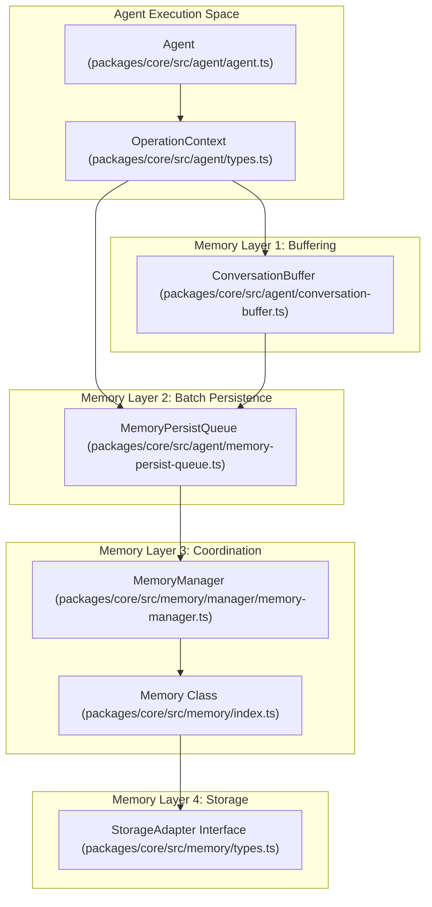
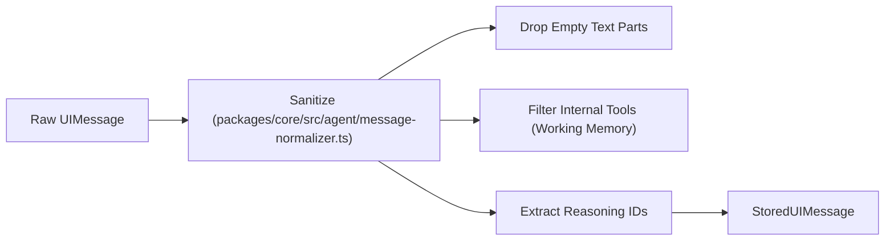

<!-- source: DeepWiki mcp.deepwiki.com · repo VoltAgent/voltagent · page 2.4 Memory System · fetched 2026-10-26 -->

# Memory System

<details>
<summary>Relevant source files</summary>

The following files were used as context for generating this wiki page:

- [.github/workflows/prerelease.yml](.github/workflows/prerelease.yml)
- [.github/workflows/pull-request.yml](.github/workflows/pull-request.yml)
- [.github/workflows/release.yml](.github/workflows/release.yml)
- [docs/structure.md](docs/structure.md)
- [examples/with-nextjs/app/api/messages/route.ts](examples/with-nextjs/app/api/messages/route.ts)
- [package.json](package.json)
- [packages/core/src/agent/conversation-buffer.spec.ts](packages/core/src/agent/conversation-buffer.spec.ts)
- [packages/core/src/agent/conversation-buffer.ts](packages/core/src/agent/conversation-buffer.ts)
- [packages/core/src/agent/memory-persist-queue.spec.ts](packages/core/src/agent/memory-persist-queue.spec.ts)
- [packages/core/src/agent/memory-persist-queue.ts](packages/core/src/agent/memory-persist-queue.ts)
- [packages/core/src/agent/memory-persistence.integration.spec.ts](packages/core/src/agent/memory-persistence.integration.spec.ts)
- [packages/core/src/agent/message-normalizer.spec.ts](packages/core/src/agent/message-normalizer.spec.ts)
- [packages/core/src/agent/message-normalizer.ts](packages/core/src/agent/message-normalizer.ts)
- [packages/core/src/agent/step-persistence.spec.ts](packages/core/src/agent/step-persistence.spec.ts)
- [packages/core/src/memory/index.spec-d.ts](packages/core/src/memory/index.spec-d.ts)
- [packages/core/src/memory/index.ts](packages/core/src/memory/index.ts)
- [packages/core/src/memory/manager/memory-manager.spec.ts](packages/core/src/memory/manager/memory-manager.spec.ts)
- [packages/core/src/memory/manager/memory-manager.ts](packages/core/src/memory/manager/memory-manager.ts)
- [packages/core/src/memory/semantic-search.spec.ts](packages/core/src/memory/semantic-search.spec.ts)
- [packages/core/src/memory/types.ts](packages/core/src/memory/types.ts)
- [packages/core/src/utils/message-converter.spec.ts](packages/core/src/utils/message-converter.spec.ts)
- [packages/core/src/utils/message-converter.ts](packages/core/src/utils/message-converter.ts)
- [packages/e2e/src/message-persistence.libsql.e2e.spec.ts](packages/e2e/src/message-persistence.libsql.e2e.spec.ts)
- [pnpm-workspace.yaml](pnpm-workspace.yaml)
- [website/docs/agents/memory.md](website/docs/agents/memory.md)
- [website/docs/agents/memory/in-memory.md](website/docs/agents/memory/in-memory.md)
- [website/docs/agents/memory/overview.md](website/docs/agents/memory/overview.md)
- [website/docs/agents/memory/semantic-search.md](website/docs/agents/memory/semantic-search.md)
- [website/docs/agents/voltagent-instance.md](website/docs/agents/voltagent-instance.md)

</details>


## Purpose and Scope

The Memory System manages conversation state and message persistence for VoltAgent agents. It provides a multi-layered architecture that balances performance (in-memory buffers), efficiency (batched writes), and intelligence (summarization and semantic search). This page covers the core memory architecture, message flow, and memory types. For details on storage adapter implementations (PostgreSQL, LibSQL, Supabase, etc.), see [Memory Storage Adapters](#2.5).

---

## Architecture Overview

The memory system consists of four primary layers that work together to manage conversation state:



**Sources:** [packages/core/src/agent/agent.ts:37-38](), [packages/core/src/memory/manager/memory-manager.ts:28-57](), [packages/core/src/agent/conversation-buffer.ts:56-61]()

---

## Memory Manager

The `MemoryManager` class coordinates conversation management and observability. It acts as the bridge between the agent's execution and the `Memory` instance.

### Responsibilities

| Responsibility | Description |
|----------------|-------------|
| **Message Persistence** | Saves messages with contextual metadata through `saveMessage` [packages/core/src/memory/manager/memory-manager.ts:105-110]() |
| **Conversation Lifecycle** | Handles creation of new conversations and resolving titles [packages/core/src/memory/manager/memory-manager.ts:137-164]() |
| **Background Operations** | Uses a `BackgroundQueue` for non-blocking memory operations [packages/core/src/memory/manager/memory-manager.ts:94-98]() |
| **Telemetry Integration** | Creates OpenTelemetry spans for memory writes (`memory.write`) [packages/core/src/memory/manager/memory-manager.ts:123-130]() |

### Initialization Logic
The `MemoryManager` handles three memory states:
1. **Explicitly Disabled**: `memory: false` results in no conversation memory [packages/core/src/memory/manager/memory-manager.ts:75-77]().
2. **Provided Instance**: Uses a pre-configured `Memory` instance [packages/core/src/memory/manager/memory-manager.ts:78-80]().
3. **Default**: Falls back to `InMemoryStorageAdapter` [packages/core/src/memory/manager/memory-manager.ts:87-91]().

**Sources:** [packages/core/src/memory/manager/memory-manager.ts:62-99]()

---

## Conversation Buffer

The `ConversationBuffer` is a lightweight buffer that manages message state during a single turn. It is responsible for merging tool call/result pairs and maintaining the sequence of `UIMessage` objects.

### Key Mechanisms

- **Tool Merging**: It automatically pairs tool results with their corresponding tool calls to maintain a clean history for the model [packages/core/src/agent/conversation-buffer.ts:54-55]().
- **Pending State**: Messages added during a turn are marked as "pending" until they are drained for persistence [packages/core/src/agent/conversation-buffer.ts:114-141]().
- **Metadata Enrichment**: Allows adding metadata (like usage or operation IDs) to the last assistant message before it is saved [packages/core/src/agent/conversation-buffer.ts:147-177]().

**Sources:** [packages/core/src/agent/conversation-buffer.ts:56-141]()

---

## Memory Persist Queue

The `MemoryPersistQueue` provides controlled persistence of messages. It supports both debounced saving and immediate flushing.

### Persistence Modes

| Mode | Behavior |
|------|----------|
| **Step Mode** (`mode: "step"`) | Persists incremental checkpoints after every LLM step or tool result [packages/core/src/agent/step-persistence.spec.ts:113-146](). |
| **Finish Mode** (`mode: "finish"`) | Only persists at the end of the entire agent turn [packages/core/src/agent/step-persistence.spec.ts:148-156](). |

### Flush Behavior
- **Debounced Save**: Non-tool steps are scheduled with a debounce (default 200ms) to avoid database thrashing [packages/core/src/agent/step-persistence.spec.ts:113-124]().
- **Immediate Flush**: Tool results trigger an immediate flush (`flushOnToolResult: true`) to ensure critical tool data is not lost if the process crashes [website/docs/agents/memory/overview.md:79-80]().

**Sources:** [packages/core/src/agent/memory-persist-queue.ts:1-50](), [packages/core/src/agent/step-persistence.spec.ts:108-156]()

---

## Conversation Summarization & Titles

VoltAgent can automatically generate titles for conversations based on the initial user message.

### Title Generation Logic
- **Trigger**: Runs only when a conversation is first created [website/docs/agents/memory/overview.md:31-32]().
- **Model Selection**: Uses the agent's main model by default, but can be overridden via `generateTitle.model` [website/docs/agents/memory/overview.md:50-51]().
- **Configurability**: Supports custom system prompts, max length, and temperature settings [packages/core/src/memory/types.ts:104-111]().

```ts
const memory = new Memory({
  storage: new LibSQLMemoryAdapter({ url: "file:./memory.db" }),
  generateTitle: {
    enabled: true,
    maxLength: 60,
    systemPrompt: "Generate a short title (max 6 words)."
  },
});
```

**Sources:** [website/docs/agents/memory/overview.md:29-71](), [packages/core/src/memory/types.ts:104-111]()

---

## Message Normalization

Before persistence, messages are processed by the `message-normalizer` to ensure they are compatible with both storage and future LLM context.



### Normalization Rules
1. **Internal Tools**: Tool calls for `update_working_memory` and `get_working_memory` are stripped before saving to the main history [packages/core/src/agent/message-normalizer.ts:11-15]().
2. **Reasoning Extraction**: Extracts reasoning traces (e.g., OpenAI `reasoning_trace_id`) and maps them to `reasoningId` for consistent storage [packages/core/src/agent/message-normalizer.ts:103-132]().
3. **Empty Parts**: Text parts containing only whitespace are removed [packages/core/src/agent/message-normalizer.ts:68-71]().

**Sources:** [packages/core/src/agent/message-normalizer.ts:1-132](), [packages/core/src/agent/message-normalizer.spec.ts:16-35]()

---

## Working Memory

Working memory provides a way to store compact, structured context across turns without cluttering the main conversation history.

### Key Features
- **Scopes**: Can be scoped to a `conversation` (default) or a `user` [packages/core/src/memory/types.ts:222]().
- **Formats**: Supports Markdown templates, Zod schemas for JSON, or free-form text [packages/core/src/memory/types.ts:241-248]().
- **Agent Tools**: The agent is automatically equipped with `get_working_memory`, `update_working_memory`, and `clear_working_memory` tools [website/docs/agents/memory/overview.md:94]().

**Sources:** [packages/core/src/memory/types.ts:216-249](), [website/docs/agents/memory/overview.md:89-96]()

---

