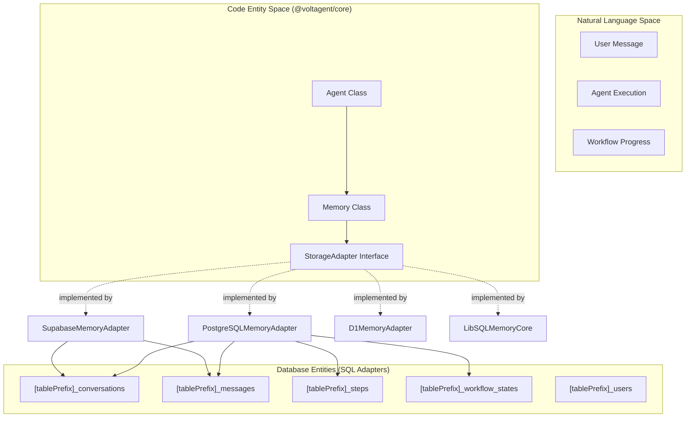
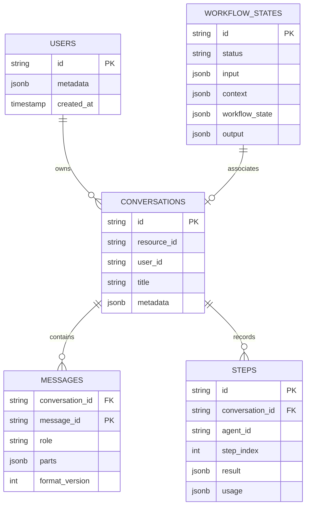

<!-- source: DeepWiki mcp.deepwiki.com · repo VoltAgent/voltagent · page 2.5 Memory Storage Adapters · fetched 2026-10-26 -->

# Memory Storage Adapters

<details>
<summary>Relevant source files</summary>

The following files were used as context for generating this wiki page:

- [examples/with-voltagent-managed-memory/package.json](examples/with-voltagent-managed-memory/package.json)
- [packages/cloudflare-d1/src/memory-adapter.spec.ts](packages/cloudflare-d1/src/memory-adapter.spec.ts)
- [packages/cloudflare-d1/src/memory-adapter.ts](packages/cloudflare-d1/src/memory-adapter.ts)
- [packages/core/src/memory/adapters/storage/in-memory.spec.ts](packages/core/src/memory/adapters/storage/in-memory.spec.ts)
- [packages/core/src/memory/adapters/storage/in-memory.ts](packages/core/src/memory/adapters/storage/in-memory.ts)
- [packages/libsql/package.json](packages/libsql/package.json)
- [packages/libsql/src/memory-core.ts](packages/libsql/src/memory-core.ts)
- [packages/libsql/src/memory-v2-adapter.spec.ts](packages/libsql/src/memory-v2-adapter.spec.ts)
- [packages/libsql/src/memory-v2-adapter.ts](packages/libsql/src/memory-v2-adapter.ts)
- [packages/postgres/src/index.integration.test.ts](packages/postgres/src/index.integration.test.ts)
- [packages/postgres/src/index.ts](packages/postgres/src/index.ts)
- [packages/postgres/src/memory-adapter.spec.ts](packages/postgres/src/memory-adapter.spec.ts)
- [packages/postgres/src/memory-adapter.ts](packages/postgres/src/memory-adapter.ts)
- [packages/supabase/CHANGELOG.md](packages/supabase/CHANGELOG.md)
- [packages/supabase/package.json](packages/supabase/package.json)
- [packages/supabase/src/index.ts](packages/supabase/src/index.ts)
- [packages/supabase/src/memory-adapter.spec.ts](packages/supabase/src/memory-adapter.spec.ts)
- [packages/supabase/src/memory-adapter.ts](packages/supabase/src/memory-adapter.ts)
- [packages/voltagent-memory/src/index.ts](packages/voltagent-memory/src/index.ts)
- [website/docs/agents/memory/libsql.md](website/docs/agents/memory/libsql.md)
- [website/docs/agents/memory/postgres.md](website/docs/agents/memory/postgres.md)
- [website/docs/agents/memory/supabase.md](website/docs/agents/memory/supabase.md)

</details>


This page documents the storage adapter implementations for VoltAgent's memory system. Storage adapters provide persistent storage backends for conversation history, agent execution history, and workflow state across different database technologies and deployment environments.

For information about the in-memory conversation buffer and summarization logic, see [Memory System](#2.4). For VoltOps managed memory service for serverless deployments, see [Managed Memory Integration](#9.4).

## Overview

Storage adapters implement the persistence layer for VoltAgent's memory system. The `Memory` class accepts a `storage` configuration option that determines where conversation data, agent history, and workflow execution records are stored. Each adapter implements the `StorageAdapter` interface defined in `@voltagent/core` [packages/postgres/src/memory-adapter.ts:74-74]().

## Storage Adapter Architecture

The following diagram shows how storage adapters integrate with the Memory system and the specific table names used in the codebase:

**Diagram: Memory Storage Data Flow and Entity Mapping**


**Sources:** [packages/postgres/src/memory-adapter.ts:74-233](), [packages/supabase/src/memory-adapter.ts:90-220](), [packages/cloudflare-d1/src/memory-adapter.ts:68-231]()

## Available Storage Adapters

### InMemoryAdapter
The default in-memory adapter stores all data in JavaScript `Map` objects within the Node.js process. Data is lost when the process terminates.

**Use Cases:**
- Development and testing.
- Ephemeral agents that don't require persistence.

**Sources:** [packages/core/src/memory/adapters/storage/in-memory.ts:1-20]()

### LibSQLMemoryAdapter
Uses LibSQL (SQLite-compatible) for file-based persistence. It supports both Node.js and Edge environments via `LibSQLMemoryCore` [packages/libsql/src/memory-core.ts:52-52]().

**Configuration:**
```typescript
import { LibSQLMemoryAdapter } from "@voltagent/libsql";

const adapter = new LibSQLMemoryAdapter({
  url: "file:./memory.db",
  tablePrefix: "my_agent"
});
```
**Key Features:**
- Supports `PRAGMA journal_mode=WAL` for better concurrency [packages/libsql/src/memory-core.ts:126-126]().
- Implements `executeWithRetry` to handle `SQLITE_BUSY` errors [packages/libsql/src/memory-core.ts:75-108]().

**Sources:** [packages/libsql/src/memory-core.ts:1-222](), [packages/libsql/package.json:1-68]()

### PostgreSQLMemoryAdapter
Production-ready adapter for PostgreSQL. It manages a connection pool using the `pg` library [packages/postgres/src/memory-adapter.ts:88-93]().

**Configuration:**
```typescript
import { PostgreSQLMemoryAdapter } from "@voltagent/postgres";

const storage = new PostgreSQLMemoryAdapter({
  connection: process.env.DATABASE_URL!,
  schema: "public",
  tablePrefix: "voltagent_memory"
});
```

**Implementation Details:**
- Uses `Pool` from `pg` for efficient connection management [packages/postgres/src/memory-adapter.ts:23-23]().
- Automatically creates tables and schemas if they do not exist during `initialize()` [packages/postgres/src/memory-adapter.ts:132-150]().
- Supports `JSONB` for metadata and message parts [packages/postgres/src/memory-adapter.ts:175-189]().

**Sources:** [packages/postgres/src/memory-adapter.ts:28-218](), [packages/postgres/src/index.ts:1-15]()

### SupabaseMemoryAdapter
Optimized for Supabase users, wrapping the `@supabase/supabase-js` client [packages/supabase/src/memory-adapter.ts:7-7]().

**Configuration:**
```typescript
import { SupabaseMemoryAdapter } from "@voltagent/supabase";

const storage = new SupabaseMemoryAdapter({
  supabaseUrl: process.env.SUPABASE_URL!,
  supabaseKey: process.env.SUPABASE_KEY!,
});
```

**Implementation Details:**
- Validates if a migration to "Memory V2" is needed by checking for specific columns like `parts` and `format_version` [packages/supabase/src/memory-adapter.ts:178-208]().
- Deduplicates conversation steps before performing batch `upsert` operations to avoid Postgres conflict errors [packages/supabase/CHANGELOG.md:70-75]().

**Sources:** [packages/supabase/src/memory-adapter.ts:28-132](), [packages/supabase/package.json:1-56]()

### Cloudflare D1 Adapter
Designed for Cloudflare Workers using the D1 SQL database [packages/cloudflare-d1/src/memory-adapter.ts:6-6]().

**Implementation Details:**
- Uses `db.batch()` for atomic schema initialization [packages/cloudflare-d1/src/memory-adapter.ts:183-231]().
- Implements exponential backoff retry logic for `SQLITE_BUSY` scenarios [packages/cloudflare-d1/src/memory-adapter.ts:122-154]().

**Sources:** [packages/cloudflare-d1/src/memory-adapter.ts:28-180]()

### VoltOps Managed Memory
A managed service provided via `@voltagent/voltagent-memory` for serverless environments where managing a database is not desired [examples/with-voltagent-managed-memory/package.json:9-9]().

## Database Schema and Data Models

All SQL-based adapters (PostgreSQL, Supabase, LibSQL, D1) follow a unified schema structure to ensure parity across environments.

**Diagram: Unified SQL Schema Entity Relationship**


**Sources:** [packages/postgres/src/memory-adapter.ts:159-231](), [website/docs/agents/memory/supabase.md:47-114](), [packages/cloudflare-d1/src/memory-adapter.ts:184-245]()

## Storage Adapter Comparison

| Feature | PostgreSQL | Supabase | LibSQL/D1 | Managed |
| :--- | :--- | :--- | :--- | :--- |
| **Package** | `@voltagent/postgres` | `@voltagent/supabase` | `@voltagent/libsql` | `@voltagent/voltagent-memory` |
| **Primary Use** | Self-hosted Prod | Managed Cloud | Edge/Local | Serverless |
| **JSON Support** | Native JSONB | Native JSONB | Stringified JSON | API-based |
| **Concurrency** | High (Pool) | High (API) | Medium (WAL) | High (Managed) |
| **Migrations** | Auto-init | SQL Script/Auto | Auto-init | N/A |

**Sources:** [packages/postgres/src/memory-adapter.ts:88-93](), [packages/supabase/src/memory-adapter.ts:108-116](), [packages/libsql/src/memory-core.ts:126-131](), [packages/cloudflare-d1/src/memory-adapter.ts:128-148]()

## Core Functionality

### Initialization
Most adapters implement an `initialize()` or `ensureInitialized()` method that runs on the first request or during constructor execution. This method creates the necessary tables (`conversations`, `messages`, `steps`, `workflow_states`, `users`) [packages/postgres/src/memory-adapter.ts:132-150](), [packages/cloudflare-d1/src/memory-adapter.ts:156-170]().

### Workflow State Persistence
Adapters store complete workflow execution contexts, including `input`, `context`, `workflow_state`, `suspension` (for human-in-the-loop), and `events` [packages/postgres/src/memory-adapter.ts:200-218](), [packages/supabase/CHANGELOG.md:7-9]().

### Multi-Tenant Filtering
The adapters support filtering workflow executions by `userId` and `metadata` (e.g., `metadata.tenantId`), enabling multi-tenant isolation at the storage layer [packages/supabase/CHANGELOG.md:15-34]().

**Sources:** [packages/postgres/src/memory-adapter.ts:74-233](), [packages/supabase/src/memory-adapter.ts:90-220](), [packages/libsql/src/memory-core.ts:113-220]()

---

