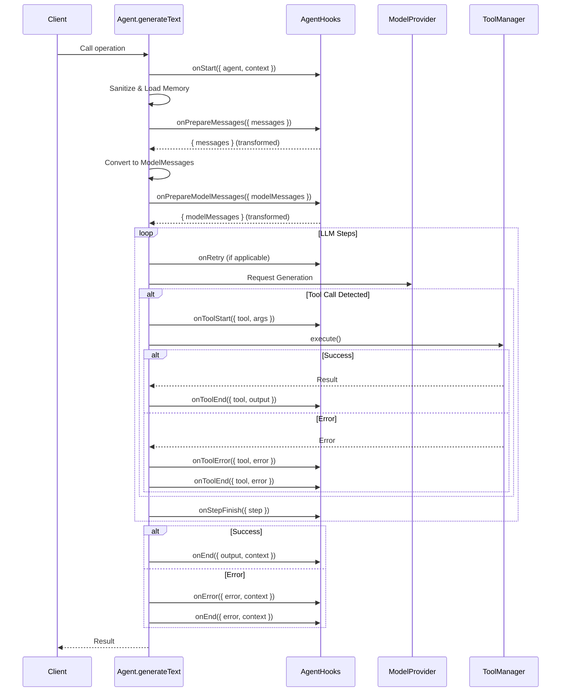
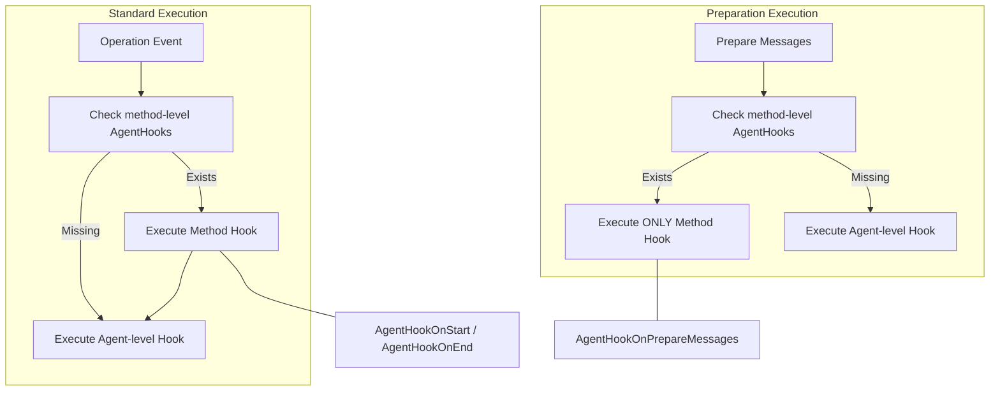

<!-- source: DeepWiki mcp.deepwiki.com · repo VoltAgent/voltagent · page 2.6 Lifecycle Hooks · fetched 2026-10-26 -->

# Lifecycle Hooks

<details>
<summary>Relevant source files</summary>

The following files were used as context for generating this wiki page:

- [examples/with-hooks/package.json](examples/with-hooks/package.json)
- [packages/core/src/agent/agent.spec-d.ts](packages/core/src/agent/agent.spec-d.ts)
- [packages/core/src/agent/agent.spec.ts](packages/core/src/agent/agent.spec.ts)
- [packages/core/src/agent/agent.ts](packages/core/src/agent/agent.ts)
- [packages/core/src/agent/hooks/index.spec.ts](packages/core/src/agent/hooks/index.spec.ts)
- [packages/core/src/agent/hooks/index.ts](packages/core/src/agent/hooks/index.ts)
- [packages/server-core/src/handlers/agent.handlers.spec.ts](packages/server-core/src/handlers/agent.handlers.spec.ts)
- [packages/server-core/src/handlers/agent.handlers.ts](packages/server-core/src/handlers/agent.handlers.ts)
- [packages/server-core/src/schemas/agent.schemas.spec.ts](packages/server-core/src/schemas/agent.schemas.spec.ts)
- [packages/server-core/src/schemas/agent.schemas.ts](packages/server-core/src/schemas/agent.schemas.ts)
- [packages/server-core/src/utils/options.ts](packages/server-core/src/utils/options.ts)
- [packages/server-elysia/src/routes/agent.routes.ts](packages/server-elysia/src/routes/agent.routes.ts)
- [website/docs/agents/context.md](website/docs/agents/context.md)
- [website/docs/agents/hooks.md](website/docs/agents/hooks.md)
- [website/docs/agents/prompts.md](website/docs/agents/prompts.md)
- [website/docs/agents/tools.md](website/docs/agents/tools.md)
- [website/docs/api/endpoints/agents.md](website/docs/api/endpoints/agents.md)
- [website/docs/ui/ai-sdk-integration.md](website/docs/ui/ai-sdk-integration.md)

</details>


Lifecycle hooks provide interception points throughout the agent execution pipeline. Hooks enable observability, custom logic injection, message transformation, and error handling at specific stages of operation processing. All hooks receive a single argument object containing relevant context and data.

This document covers the complete hook system available in the `Agent` class. For information about tool-specific hooks that execute within tool execution, see [Tools and Toolkits](#2.3). For information about how hooks access operation data, see [Operation Context](#2.2).

---

## Hook System Overview

VoltAgent provides 13 lifecycle hooks that intercept execution at different stages:

| Hook | Execution Point | Primary Use Case |
|------|----------------|------------------|
| `onStart` | Before operation begins | Initialization, logging, context setup |
| `onPrepareMessages` | After sanitization, before LLM | Message transformation, content injection |
| `onPrepareModelMessages` | After conversion to `ModelMessage` | Provider-specific adjustments |
| `onRetry` | Before retry attempt | Retry tracking, alerts |
| `onFallback` | Before fallback model selection | Fallback diagnostics, monitoring |
| `onToolStart` | Before tool execution | Tool usage logging, argument validation |
| `onToolEnd` | After tool execution (success or error) | Result post-processing, override |
| `onToolError` | Only on tool error | Custom error payload construction |
| `onHandoff` | When task delegated to sub-agent | Delegation tracking |
| `onHandoffComplete` | After sub-agent completes | Result inspection, supervisor bypass |
| `onStepFinish` | After each LLM step | Step-level observability |
| `onEnd` | After operation completes | Cleanup, final logging, storage |
| `onError` | On any error | Error handling, logging |

**Sources:** [packages/core/src/agent/hooks/index.ts:9-230](), [packages/core/src/agent/agent.ts:109-123]()

---

## Hook Definition and Registration

### Defining Hooks

Use the `createHooks` helper to define hooks with type safety. This helper ensures that your hook functions receive the correct argument objects.

```typescript
import { createHooks, type OnStartHookArgs, type OnEndHookArgs } from "@voltagent/core";

const hooks = createHooks({
  onStart: async ({ agent, context }: OnStartHookArgs) => {
    console.log(`Starting ${agent.name} operation ${context.operationId}`);
  },
  
  onEnd: async ({ agent, output, error, context }: OnEndHookArgs) => {
    if (error) {
      console.error(`Failed: ${error.message}`);
    } else {
      console.log(`Completed: ${output?.text}`);
    }
  },
});
```

### Registering Hooks

Hooks can be registered at two levels:

**Agent-level (applies to all operations):**
Passed via the `AgentOptions` in the constructor.

```typescript
const agent = new Agent({
  name: "MyAgent",
  instructions: "...",
  model: "openai/gpt-4o",
  hooks: hooks,
});
```

**Method-level (applies to single invocation):**
Passed via the options object in methods like `generateText`, `streamText`, `generateObject`, or `streamObject`.

```typescript
await agent.generateText("input", {
  hooks: {
    onEnd: async ({ context }) => {
      // Method-specific logic
    },
  },
});
```

**Sources:** [packages/core/src/agent/agent.ts:194-230](), [packages/core/src/agent/hooks/index.ts:253-270](), [website/docs/agents/hooks.md:10-178]()

---

## Hook Execution Order

The following diagram shows the complete lifecycle of an agent operation with all hook execution points:

### Agent Execution Lifecycle


**Sources:** [packages/core/src/agent/agent.ts:1045-1159](), [packages/core/src/agent/agent.ts:1853-1943]()

---

## Hook Composition and Priority

### Agent-Level vs Method-Level Hooks

When hooks are provided at both levels, the execution behavior depends on the hook type:

**Standard Hooks (Sequential Execution):**
For hooks like `onStart`, `onEnd`, `onToolStart`, etc., both levels execute. The **method-level hook executes first**, followed by the agent-level hook.

**Preparation Hooks (Replacement):**
For `onPrepareMessages` and `onPrepareModelMessages`, the **method-level hook replaces the agent-level hook entirely** if provided. This allows callers to completely override message formatting for a specific request.

### Natural Language Space to Code Entity Space: Hook Logic


**Sources:** [packages/core/src/agent/agent.ts:358-378](), [website/docs/agents/hooks.md:180-235]()

---

## Core Lifecycle Hooks

### onPrepareMessages

**Execution:** After message sanitization and memory injection, but before conversion to provider-specific formats.

**Arguments (`OnPrepareMessagesHookArgs`):**
- `messages: UIMessage[]` - The current list of messages.
- `rawMessages?: UIMessage[]` - The messages before sanitization.
- `agent: Agent` - The agent instance.
- `context: OperationContext` - The shared operation context.

**Return:** `{ messages?: UIMessage[] }` - Transformed messages.

```typescript
onPrepareMessages: ({ messages }) => {
  // Add a dynamic system reminder to every call
  return {
    messages: [
      ...messages,
      { role: 'system', content: 'Always mention the current weather.' }
    ]
  };
}
```

**Sources:** [packages/core/src/agent/hooks/index.ts:97-111](), [packages/core/src/agent/agent.ts:1071-1082]()

---

### onToolEnd

**Execution:** After a tool completes execution, whether it succeeded or failed.

**Arguments (`OnToolEndHookArgs`):**
- `tool: AgentTool` - The tool that was called.
- `output: unknown` - The result returned by the tool (if successful).
- `error: VoltAgentError | AbortError` - The error (if failed).

**Return:** `{ output?: unknown }` - An optional replacement for the tool result.

**Use Case:** Truncating large tool outputs before they are sent back to the LLM to save tokens.

```typescript
onToolEnd: ({ tool, output }) => {
  if (tool.name === 'fetch_logs' && typeof output === 'string') {
    return { output: output.slice(0, 1000) };
  }
}
```

**Sources:** [packages/core/src/agent/hooks/index.ts:62-76](), [packages/core/src/agent/agent.ts:1907-1929]()

---

## Sub-Agent and Handoff Hooks

VoltAgent includes specific hooks for multi-agent orchestration.

### onHandoffComplete

**Execution:** After a sub-agent has finished its task, but before the result is returned to the supervisor agent.

**Arguments (`OnHandoffCompleteHookArgs`):**
- `agent: Agent` - The sub-agent.
- `sourceAgent: Agent` - The supervisor agent.
- `result: string` - The text result produced by the sub-agent.
- `bail: (transformedResult?: string) => void` - A function to "bail" out of the supervisor's loop.

**Bail Pattern:** If `bail()` is called, the supervisor stops processing and immediately returns the sub-agent's result (or the `transformedResult`) to the end user.

**Sources:** [packages/core/src/agent/hooks/index.ts:33-52](), [packages/core/src/agent/subagent/index.ts:203-223]()

---

## Error and Retry Hooks

### onRetry

**Execution:** Triggered when the system attempts to retry a failed LLM call or a middleware failure.

**Arguments (`OnRetryHookArgs`):**
This is a union type: `OnRetryLLMHookArgs` or `OnRetryMiddlewareHookArgs`.
- `source: "llm" | "middleware"`
- `attempt: number`
- `maxRetries: number`
- `error: unknown`

**Sources:** [packages/core/src/agent/hooks/index.ts:143-171]()

---

## Code Reference: Hook Definitions

### Natural Language Space to Code Entity Space: Hooks Interface
| Hook Name | Code Identifier (Hook Type) | Argument Interface |
|-----------|-----------------------------|--------------------|
| Start | `AgentHookOnStart` | `OnStartHookArgs` |
| End | `AgentHookOnEnd` | `OnEndHookArgs` |
| Tool Start | `AgentHookOnToolStart` | `OnToolStartHookArgs` |
| Tool End | `AgentHookOnToolEnd` | `OnToolEndHookArgs` |
| Tool Error | `AgentHookOnToolError` | `OnToolErrorHookArgs` |
| Prepare UI | `AgentHookOnPrepareMessages` | `OnPrepareMessagesHookArgs` |
| Prepare Model | `AgentHookOnPrepareModelMessages` | `OnPrepareModelMessagesHookArgs` |
| Handoff | `AgentHookOnHandoff` | `OnHandoffHookArgs` |
| Handoff Done | `AgentHookOnHandoffComplete` | `OnHandoffCompleteHookArgs` |
| Error | `AgentHookOnError` | `OnErrorHookArgs` |

**Sources:** [packages/core/src/agent/hooks/index.ts:190-213]()

---

