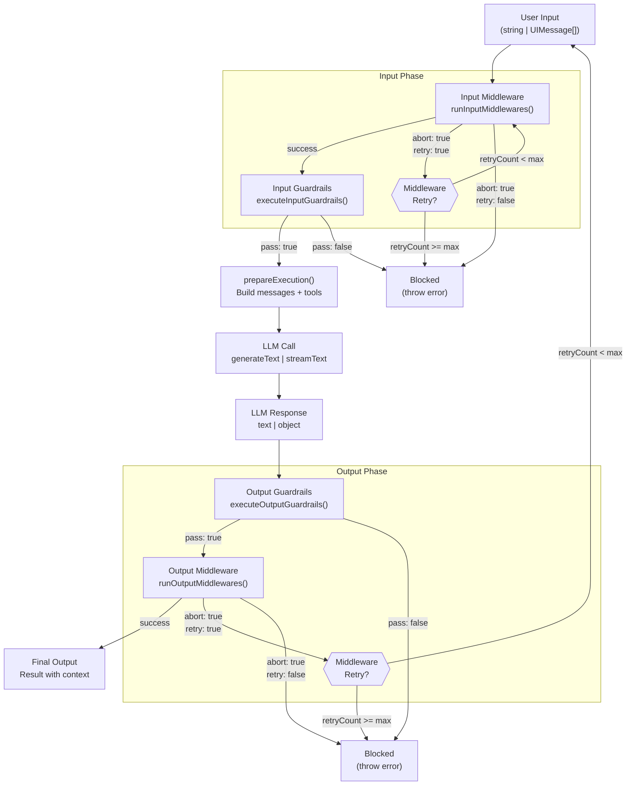
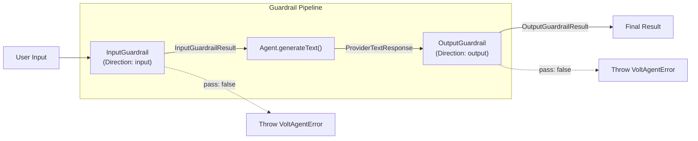

<!-- source: DeepWiki mcp.deepwiki.com · repo VoltAgent/voltagent · page 2.7 Guardrails and Middleware · fetched 2026-10-26 -->

# Guardrails and Middleware

<details>
<summary>Relevant source files</summary>

The following files were used as context for generating this wiki page:

- [examples/with-guardrails/package.json](examples/with-guardrails/package.json)
- [examples/with-middleware/package.json](examples/with-middleware/package.json)
- [examples/with-retries-fallback/package.json](examples/with-retries-fallback/package.json)
- [examples/with-subagents/src/index.ts](examples/with-subagents/src/index.ts)
- [packages/core/src/agent/index.ts](packages/core/src/agent/index.ts)
- [packages/core/src/agent/providers/base/types.ts](packages/core/src/agent/providers/base/types.ts)
- [packages/core/src/agent/subagent/index.spec.ts](packages/core/src/agent/subagent/index.spec.ts)
- [packages/core/src/agent/subagent/index.ts](packages/core/src/agent/subagent/index.ts)
- [packages/core/src/agent/types.ts](packages/core/src/agent/types.ts)
- [packages/core/src/events/types.ts](packages/core/src/events/types.ts)
- [packages/core/src/index.ts](packages/core/src/index.ts)
- [website/docs/agents/overview.md](website/docs/agents/overview.md)
- [website/docs/agents/subagents.md](website/docs/agents/subagents.md)

</details>


Guardrails and middleware are validation, transformation, and control flow mechanisms that execute before and after LLM calls. While both can validate and transform content, they serve distinct purposes in the agent execution pipeline.

**Guardrails** enforce hard constraints and validation rules. They pass/block/modify content based on policies (e.g., profanity detection, PII redaction, length limits).

**Middleware** provides flexible preprocessing and postprocessing with retry capabilities. They can transform input/output, add context, implement circuit breakers, or abort and retry operations based on runtime conditions.

For information about hooks (lifecycle interception points), see [Lifecycle Hooks](/docs/agents/hooks). For information about tools (function calling), see [Tools and Toolkits](/docs/agents/tools).

---

## Guardrails vs Middleware

| Feature | Guardrails | Middleware |
|---------|-----------|------------|
| **Purpose** | Enforce validation policies | Transform and control flow |
| **Retry Capability** | No - block or pass | Yes - can abort and retry with feedback |
| **Execution Order** | After input middleware, before output middleware | First (input) and last (output) |
| **Return Actions** | `allow`, `modify`, `block` | `abort` with optional `retry` |
| **Primary Use Cases** | Content filtering, safety checks, PII redaction | Context injection, rate limiting, error recovery |
| **State Management** | Stateless per request | Can use context for retry state |

**Sources:** [packages/core/src/agent/types.ts:229-250](), [packages/core/src/agent/types.ts:273-280]()

---

## Complete Execution Pipeline

This diagram illustrates the flow from `UserInput` through the middleware and guardrail layers, associating the conceptual stages with internal system functions like `runInputMiddlewares` and `executeInputGuardrails`.



**Execution order:**
1. **Input Middleware** - Transform input, add context, implement rate limiting.
2. **Input Guardrails** - Validate input, block malicious content.
3. **LLM Execution** - Model generates response via `Agent.generateText` or `Agent.streamText`.
4. **Output Guardrails** - Validate output, redact sensitive data.
5. **Output Middleware** - Post-process output, log metrics, or trigger retries.

**Sources:** [packages/core/src/agent/types.ts:240-250](), [packages/core/src/agent/types.ts:282-315]()

---

## Middleware Architecture

### Input Middleware

Input middleware executes before input guardrails and receives the raw user input. It is defined by the `InputMiddleware` type [packages/core/src/agent/types.ts:240]().

**Type Definition:**

```typescript
type InputMiddleware = MiddlewareConfig<InputMiddlewareArgs, InputMiddlewareResult>

interface InputMiddlewareArgs extends MiddlewareContext {
  input: string | UIMessage[] | BaseMessage[];
  inputText: string;
  retryCount: number;
  retryFeedback?: MiddlewareRetryFeedback;
}

interface InputMiddlewareResult {
  abort?: boolean;           // Stop execution
  retry?: boolean;           // Retry from beginning (requires abort: true)
  retryFeedback?: MiddlewareRetryFeedback;  // Data for next attempt
  modifiedInput?: string | UIMessage[] | BaseMessage[];  // Transform input
}
```

**Sources:** [packages/core/src/agent/types.ts:240-245](), [packages/core/src/agent/middleware.ts]()

### Output Middleware

Output middleware executes after output guardrails and receives the final LLM response. It is defined by the `OutputMiddleware` type [packages/core/src/agent/types.ts:241]().

**Type Definition:**

```typescript
type OutputMiddleware<TOutput = unknown> = MiddlewareConfig<
  OutputMiddlewareArgs<TOutput>,
  OutputMiddlewareResult<TOutput>
>

interface OutputMiddlewareArgs<TOutput = unknown> extends MiddlewareContext {
  output: TOutput;
  outputText?: string;
  usage?: UsageInfo;
  finishReason?: string | null;
  retryCount: number;
  retryFeedback?: MiddlewareRetryFeedback;
}

interface OutputMiddlewareResult<TOutput = unknown> {
  abort?: boolean;
  retry?: boolean;
  retryFeedback?: MiddlewareRetryFeedback;
  modifiedOutput?: TOutput;
}
```

**Sources:** [packages/core/src/agent/types.ts:241-245](), [packages/core/src/agent/middleware.ts]()

---

## Creating Custom Middleware

### Input Middleware Example

```typescript
import { createInputMiddleware } from "@voltagent/core";

const rateLimitMiddleware = createInputMiddleware({
  id: "rate-limiter",
  name: "Rate Limiter",
  handler: async ({ input, context, retryCount }) => {
    // Logic to check limits using OperationContext
    return {};  // Continue execution
  },
});
```

### Output Middleware with Retry

```typescript
import { createOutputMiddleware } from "@voltagent/core";

const qualityCheckMiddleware = createOutputMiddleware({
  id: "quality-check",
  name: "Output Quality Checker",
  handler: async ({ output, outputText, retryCount }) => {
    if (typeof outputText === "string" && outputText.length < 10 && retryCount < 2) {
      return {
        abort: true,
        retry: true,
        retryFeedback: { reason: "Response too short" },
      };
    }
    return {};
  },
});
```

**Sources:** [packages/core/src/agent/middleware.ts](), [packages/core/src/index.ts:90]()

---

## Guardrail Architecture

The following diagram maps the guardrail types to their code entities and shows the data flow from `UserInput` to `FinalOutput`.



**Sources:** [packages/core/src/agent/types.ts:231-239](), [packages/core/src/agent/types.ts:346-421]()

### Guardrail Actions and Results

Every guardrail returns a `GuardrailBaseResult` [packages/core/src/agent/types.ts:273]() that controls subsequent execution.

| Action | Effect |
|--------|--------|
| `allow` | Pass content through unchanged. |
| `modify` | Transform content (e.g., redact PII) before the next stage. |
| `block` | Stop execution and throw a `VoltAgentError`. |

**Sources:** [packages/core/src/agent/types.ts:229-230](), [packages/core/src/agent/types.ts:273-280]()

---

## Built-in Guardrails

VoltAgent provides production-ready guardrails via the `defaults.ts` module [packages/core/src/agent/guardrails/defaults.ts]().

### Default Safety Suites
- `createDefaultInputSafetyGuardrails()`: Combines profanity, PII, and prompt injection detection for inputs.
- `createDefaultPIIGuardrails()`: Redacts email, phone, and sensitive numbers in outputs.
- `createDefaultSafetyGuardrails()`: A general-purpose output safety suite.

### Specific Validators
- `createEmailRedactorGuardrail()`: Specifically targets email patterns.
- `createPromptInjectionGuardrail()`: Inspects input for common jailbreak patterns.
- `createMaxLengthGuardrail(limit)`: Enforces hard character limits.

**Sources:** [packages/core/src/agent/guardrails/defaults.ts](), [packages/core/src/index.ts:74-88]()

---

## Streaming Guardrails

Output guardrails support real-time validation via `OutputGuardrailStreamHandler` [packages/core/src/agent/types.ts:296]().

```typescript
const streamingRedactor = createOutputGuardrail({
  id: "stream-redactor",
  name: "Stream Redactor",
  streamHandler: ({ part, abort }) => {
    if (part.type === "text-delta" && part.textDelta.includes("SECRET")) {
      return { ...part, textDelta: part.textDelta.replace("SECRET", "[REDACTED]") };
    }
    return part;
  },
  handler: async () => ({ pass: true }) // Final check
});
```

**Sources:** [packages/core/src/agent/types.ts:282-315](), [packages/core/src/agent/types.ts:413-416]()

---

## Agent State Representation

Guardrails and middleware are represented in the `AgentFullState` [packages/core/src/agent/types.ts:202]() to allow for platform observability.

```typescript
export interface AgentGuardrailState {
  id?: string;
  name: string;
  direction: "input" | "output";
  severity?: GuardrailSeverity;
  node_id: string;
}

export interface AgentFullState {
  // ... other fields
  guardrails?: AgentGuardrailStateGroup;
}
```

**Sources:** [packages/core/src/agent/types.ts:220-221](), [packages/core/src/agent/types.ts:324-344]()

---

