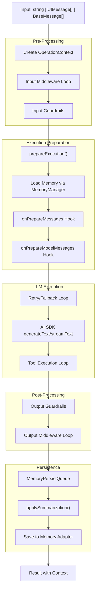
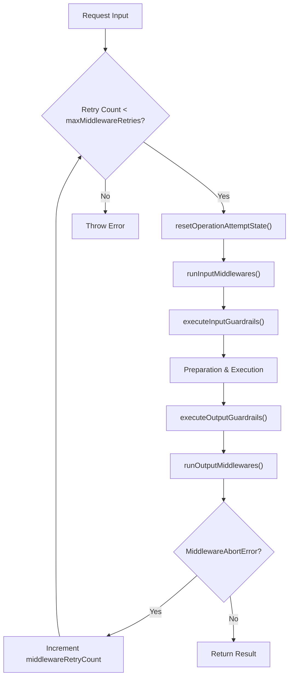
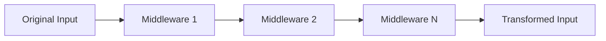
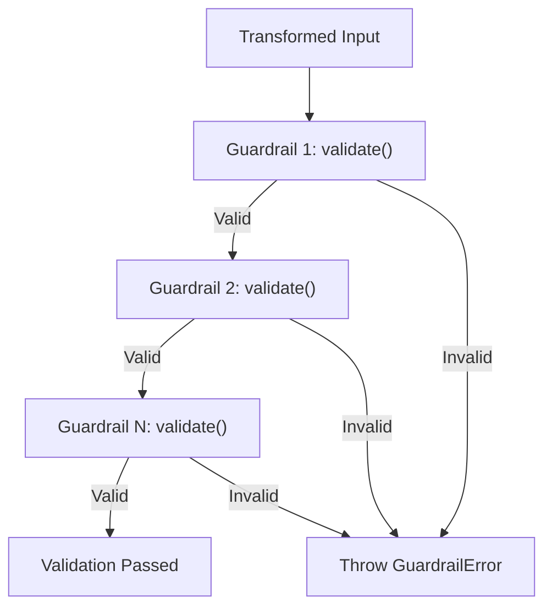
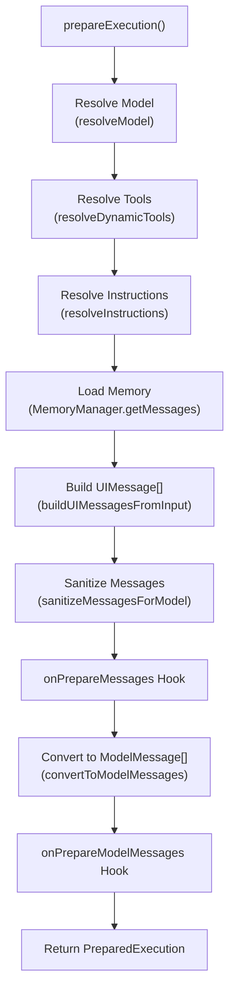
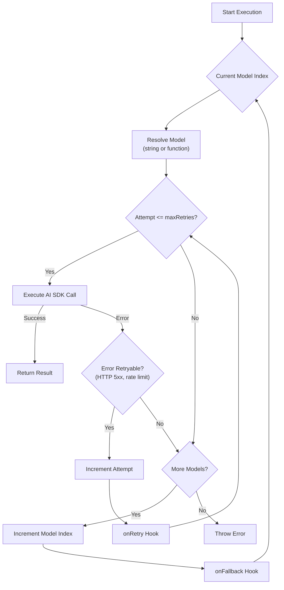
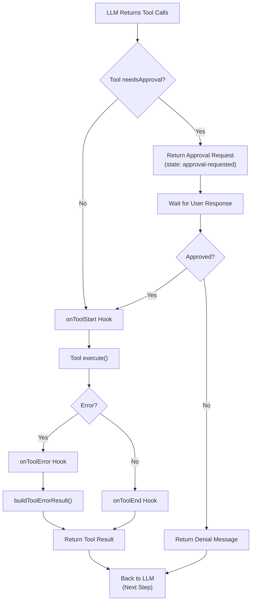
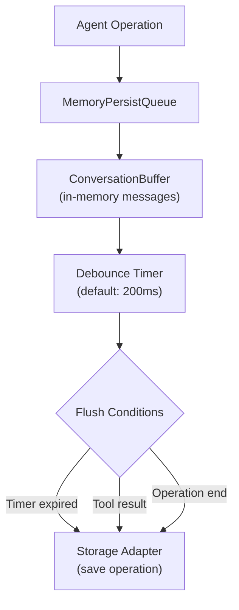
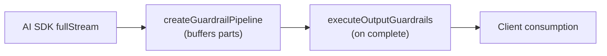

<!-- source: DeepWiki mcp.deepwiki.com · repo VoltAgent/voltagent · page 2.8 Message Processing Pipeline · fetched 2026-10-26 -->

# Message Processing Pipeline

Relevant source files

The following files were used as context for generating this wiki page:

- [docs/structure.md](docs/structure.md)
- [examples/with-nextjs/app/api/messages/route.ts](examples/with-nextjs/app/api/messages/route.ts)
- [packages/core/src/agent/agent.spec-d.ts](packages/core/src/agent/agent.spec-d.ts)
- [packages/core/src/agent/agent.spec.ts](packages/core/src/agent/agent.spec.ts)
- [packages/core/src/agent/agent.ts](packages/core/src/agent/agent.ts)
- [packages/core/src/agent/hooks/index.spec.ts](packages/core/src/agent/hooks/index.spec.ts)
- [packages/core/src/agent/hooks/index.ts](packages/core/src/agent/hooks/index.ts)
- [packages/core/src/agent/memory-persist-queue.spec.ts](packages/core/src/agent/memory-persist-queue.spec.ts)
- [packages/core/src/agent/memory-persist-queue.ts](packages/core/src/agent/memory-persist-queue.ts)
- [packages/core/src/agent/message-normalizer.spec.ts](packages/core/src/agent/message-normalizer.spec.ts)
- [packages/core/src/agent/message-normalizer.ts](packages/core/src/agent/message-normalizer.ts)
- [packages/core/src/agent/step-persistence.spec.ts](packages/core/src/agent/step-persistence.spec.ts)
- [packages/core/src/memory/index.spec-d.ts](packages/core/src/memory/index.spec-d.ts)
- [packages/core/src/utils/message-converter.spec.ts](packages/core/src/utils/message-converter.spec.ts)
- [packages/core/src/utils/message-converter.ts](packages/core/src/utils/message-converter.ts)
- [packages/server-core/src/handlers/agent.handlers.spec.ts](packages/server-core/src/handlers/agent.handlers.spec.ts)
- [packages/server-core/src/handlers/agent.handlers.ts](packages/server-core/src/handlers/agent.handlers.ts)
- [packages/server-core/src/schemas/agent.schemas.spec.ts](packages/server-core/src/schemas/agent.schemas.spec.ts)
- [packages/server-core/src/schemas/agent.schemas.ts](packages/server-core/src/schemas/agent.schemas.ts)
- [packages/server-core/src/utils/options.ts](packages/server-core/src/utils/options.ts)
- [packages/server-elysia/src/routes/agent.routes.ts](packages/server-elysia/src/routes/agent.routes.ts)
- [website/docs/agents/context.md](website/docs/agents/context.md)
- [website/docs/agents/hooks.md](website/docs/agents/hooks.md)
- [website/docs/agents/prompts.md](website/docs/agents/prompts.md)
- [website/docs/agents/tools.md](website/docs/agents/tools.md)
- [website/docs/api/endpoints/agents.md](website/docs/api/endpoints/agents.md)
- [website/docs/ui/ai-sdk-integration.md](website/docs/ui/ai-sdk-integration.md)

This page details the complete request-response lifecycle within the `Agent` class, from receiving input through producing output. It covers input processing, message preparation, LLM execution with retry logic, tool execution loops, output processing, and memory persistence.

For information about the configuration options and lifecycle hooks that intersect with this pipeline, see [Lifecycle Hooks](2.6) and [Guardrails and Middleware](2.7). For details on memory persistence mechanisms, see [Memory System](2.4).

---

## Pipeline Overview

Every agent operation (`generateText`, `streamText`, `generateObject`, `streamObject`) flows through a standardized pipeline with multiple stages. The pipeline enforces consistent behavior, observability, and error handling across all operations.

**Pipeline Stages**

**Sources:** [packages/core/src/agent/agent.ts:944-1159]()

---

## Input Processing Stage

The input processing stage transforms and validates the user input before it reaches the LLM. This stage consists of sequential sub-stages: input middleware and input guardrails.

### Middleware Retry Loop

The entire pipeline from input middleware through output middleware can be retried if a middleware requests it by throwing `MiddlewareAbortError`. The retry counter is tracked separately from LLM retries.

**Sources:** [packages/core/src/agent/agent.ts:967-1159](), [packages/core/src/agent/middleware.ts:1-200](), [packages/core/src/agent/errors.ts:100-100]()

### Input Middleware Execution

Input middleware can transform the input, add metadata, or abort the request. Middlewares execute in sequence, with each receiving the output of the previous one.

The `runInputMiddlewares` function iterates through normalized middleware objects.

**Key Functions:**
- `normalizeInputMiddlewareList`: Converts middleware definitions to `NormalizedInputMiddleware` objects [packages/core/src/agent/middleware.ts:155-155]()
- `runInputMiddlewares`: Executes middleware sequence, passing `OperationContext` [packages/core/src/agent/middleware.ts:159-159]()

**Sources:** [packages/core/src/agent/agent.ts:982-989](), [packages/core/src/agent/middleware.ts:155-160]()

### Input Guardrails Validation

Input guardrails validate the (potentially transformed) input. If validation fails, the operation aborts immediately by throwing a `GuardrailError`.

**Key Functions:**
- `normalizeInputGuardrailList`: Converts guardrail definitions to `NormalizedInputGuardrail` objects [packages/core/src/agent/guardrail.ts:154-154]()
- `executeInputGuardrails`: Runs all guardrails in sequence [packages/core/src/agent/guardrail.ts:152-152]()

**Sources:** [packages/core/src/agent/agent.ts:991-997](), [packages/core/src/agent/guardrail.ts:140-160]()

---

## Message Preparation Stage

After input processing, the agent prepares messages for the LLM. This includes loading conversation history, resolving dynamic values, and applying hooks.

### Execution Preparation

The `prepareExecution` method orchestrates all preparation steps, from model resolution to final hook execution.

**Sources:** [packages/core/src/agent/agent.ts:2983-3214]()

### Memory Loading and Message Sanitization

The `MemoryManager` loads conversation history based on `userId` and `conversationId`. Before hooks run, messages are sanitized via `sanitizeMessagesForModel` to remove empty or invalid content.

- Empty user messages and whitespace-only parts are removed [packages/core/src/agent/message-normalizer.ts:4-30]().
- Tool approval messages without valid structure are removed [packages/core/src/agent/message-normalizer.ts:195-218]().
- Dangling OpenAI reasoning tokens are stripped via `stripDanglingOpenAIReasoningFromModelMessages` [packages/core/src/agent/model-message-normalizer.ts:110-110]().

**Sources:** [packages/core/src/agent/agent.ts:3051-3115](), [packages/core/src/agent/message-normalizer.ts:1-250]()

### Hooks: onPrepareMessages and onPrepareModelMessages

The `onPrepareMessages` hook receives sanitized `UIMessage[]` and can transform them before they are converted to provider-specific formats. After conversion via AI SDK's `convertToModelMessages`, the `onPrepareModelMessages` hook runs for final provider-level adjustments.

**Sources:** [packages/core/src/agent/agent.ts:3127-3154](), [packages/core/src/agent/hooks/index.ts:97-127]()

---

## LLM Execution Stage

The LLM execution stage wraps AI SDK calls with retry logic, fallback handling, and observability.

### Retry and Fallback Architecture

VoltAgent supports single models with retries and fallback arrays. If a model fails with a retryable error (e.g., HTTP 5xx or rate limit), the agent increments the attempt counter and calls the `onRetry` hook. If max retries are reached, it moves to the next model in the fallback array and calls `onFallback`.

**Sources:** [packages/core/src/agent/agent.ts:1683-1930](), [packages/core/src/agent/agent.ts:3647-3826]()

---

## Tool Execution Loop

When the LLM requests tool calls, VoltAgent wraps the AI SDK tool execution with approval checks, hooks, and error handling.

### Tool Execution Flow

Tools receive the full `OperationContext` through the `options` parameter [website/docs/agents/context.md:191-193](). If a tool requires approval, the agent returns an `approval-requested` state and waits for user response.

**Sources:** [packages/core/src/agent/agent.ts:2192-2451](), [packages/core/src/agent/error-utils.ts:1-50](), [website/docs/agents/tools.md:450-556]()

---

## Output Processing and Persistence

After LLM execution completes, the output flows through guardrails and middleware before being persisted.

### Memory Persist Queue and Summarization

The `MemoryPersistQueue` batches memory updates to reduce storage adapter calls [packages/core/src/agent/memory-persist-queue.ts:1-100](). In `step` mode, the agent flushes immediately on tool results or errors [packages/core/src/agent/step-persistence.spec.ts:126-146]().

When conversation token count exceeds the threshold, `applySummarization` replaces older messages with a summary [packages/core/src/agent/apply-summarization.ts:1-50]().

**Sources:** [packages/core/src/agent/agent.ts:1133-1159](), [packages/core/src/agent/memory-persist-queue.ts:1-100](), [packages/core/src/agent/step-persistence.spec.ts:108-160]()

---

## Streaming Architecture

For streaming operations (`streamText`), VoltAgent uses a `guardrail-stream` pipeline to buffer output parts and validate them against guardrails once the stream completes.

**Sources:** [packages/core/src/agent/agent.ts:1161-1400](), [packages/core/src/agent/streaming/guardrail-stream.ts:1-100]()

---

