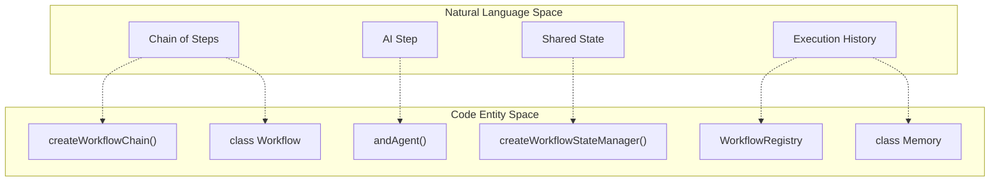
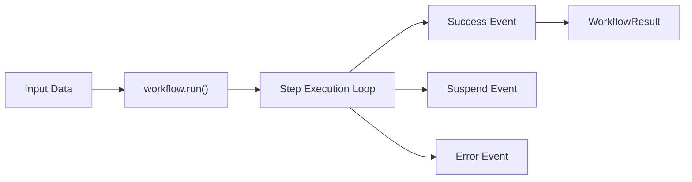
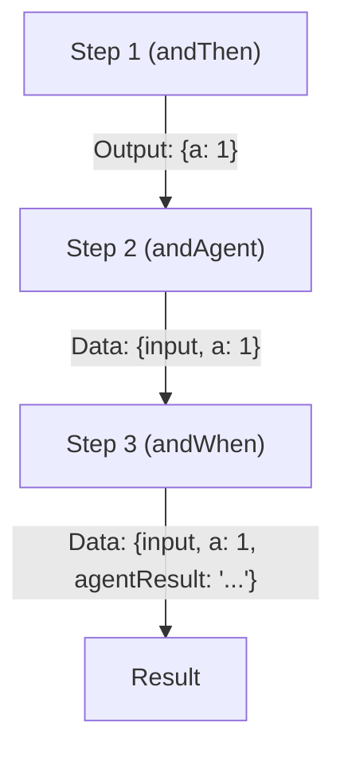

<!-- source: DeepWiki mcp.deepwiki.com · repo VoltAgent/voltagent · page 3 Workflow System · fetched 2026-10-26 -->

# Workflow System

Relevant source files

The following files were used as context for generating this wiki page:

- [packages/core/src/agent/subagent/stream-metadata-enricher.ts](packages/core/src/agent/subagent/stream-metadata-enricher.ts)
- [packages/core/src/agent/subagent/types.ts](packages/core/src/agent/subagent/types.ts)
- [packages/core/src/utils/streams/types.ts](packages/core/src/utils/streams/types.ts)
- [packages/core/src/workflow/chain.spec.ts](packages/core/src/workflow/chain.spec.ts)
- [packages/core/src/workflow/chain.ts](packages/core/src/workflow/chain.ts)
- [packages/core/src/workflow/core.spec.ts](packages/core/src/workflow/core.spec.ts)
- [packages/core/src/workflow/core.ts](packages/core/src/workflow/core.ts)
- [packages/core/src/workflow/index.ts](packages/core/src/workflow/index.ts)
- [packages/core/src/workflow/internal/state.ts](packages/core/src/workflow/internal/state.ts)
- [packages/core/src/workflow/registry.ts](packages/core/src/workflow/registry.ts)
- [packages/core/src/workflow/steps/types.ts](packages/core/src/workflow/steps/types.ts)
- [packages/core/src/workflow/stream.spec.ts](packages/core/src/workflow/stream.spec.ts)
- [packages/core/src/workflow/stream.ts](packages/core/src/workflow/stream.ts)
- [packages/core/src/workflow/suspend-resume.spec.ts](packages/core/src/workflow/suspend-resume.spec.ts)
- [packages/core/src/workflow/types.ts](packages/core/src/workflow/types.ts)
- [website/docs/workflows/overview.md](website/docs/workflows/overview.md)
- [website/docs/workflows/streaming.md](website/docs/workflows/streaming.md)
- [website/docs/workflows/suspend-resume.md](website/docs/workflows/suspend-resume.md)

The Workflow System provides orchestration capabilities for multi-step agent operations. It enables deterministic, code-defined execution pipelines where steps can be agents, functions, conditional branches, parallel operations, or loops. Unlike the agent-to-agent pattern where the LLM decides which agents to invoke, workflows define the execution flow explicitly in code using a fluent API.

For details on specific control flow operations, see [Workflow Control Flow](#3.1). For human-in-the-loop patterns, see [Workflow Suspend and Resume](#3.2). For observability and lifecycle tracking, see [Workflow Hooks and History](#3.3).

---

## Core Architecture

The workflow system is built around the `WorkflowChain` class, which provides a builder pattern to construct execution graphs. Each workflow maintains an execution context (`WorkflowExecutionContext`) that flows through steps, manages state persistence via `WorkflowState`, and tracks token usage across agent calls.

### Bridge: Natural Language to Code Entities

The following diagram maps high-level workflow concepts to the specific classes and functions in the codebase.

**Sources:** [packages/core/src/workflow/chain.ts:71-110](), [packages/core/src/workflow/core.ts:31-58](), [packages/core/src/workflow/registry.ts:42-63]()

---

## Workflow Definition and Execution

Workflows are defined using `createWorkflowChain` (fluent API) or `createWorkflow` (functional API). They require a unique `id`, `input` schema, and `result` schema for type-safe execution.

### Execution Flow

### Execution Methods

The system supports multiple execution patterns depending on the required responsiveness and persistence:

| Method | Return Type | Description |
|--------|-------------|-------------|
| `run()` | `Promise<WorkflowExecutionResult>` | Standard execution that resolves when the workflow finishes or suspends. [packages/core/src/workflow/core.ts:503-515]() |
| `stream()` | `AsyncIterable<WorkflowStreamEvent>` | Real-time execution emitting events for every step and agent token. [packages/core/src/workflow/core.ts:730-745]() |
| `startAsync()` | `Promise<WorkflowStartAsyncResult>` | Fire-and-forget execution that returns an `executionId` immediately. [packages/core/src/workflow/core.ts:681-692]() |
| `timeTravel()` | `Promise<WorkflowExecutionResult>` | Replays a workflow from a specific historical step using stored state. [packages/core/src/workflow/core.ts:1141-1155]() |

**Sources:** [packages/core/src/workflow/types.ts:143-203](), [website/docs/workflows/streaming.md:43-111]()

---

## State and Context Management

Workflows maintain two types of state:
1.  **Step Data**: The output of every individual step is indexed by `stepId` and can be retrieved using `getStepData(id)`. [packages/core/src/workflow/core.ts:217-228]()
2.  **Workflow State**: A shared, mutable object accessible across all steps via `setWorkflowState`. This is persisted to the `Memory` adapter. [packages/core/src/workflow/core.spec.ts:101-105]()

### Data Flow Pattern

The output of one step is automatically merged into the `data` object passed to the next step, creating a cumulative state object.

**Sources:** [website/docs/workflows/overview.md:197-208](), [packages/core/src/workflow/core.spec.ts:138-187]()

---

## Streaming and Observability

The `WorkflowStreamController` manages real-time event emission. When using `.stream()`, the workflow emits granular events that can be consumed by UI components or external monitors.

### Event Types
- `workflow-start` / `workflow-complete`: Lifecycle of the entire run.
- `step-start` / `step-complete`: Granular step tracking.
- `step-suspend`: Emitted when a step triggers a human-in-the-loop pause.
- `custom`: Emitted via the `writer.write()` API within a step.

**Sources:** [packages/core/src/workflow/stream.ts:9-48](), [website/docs/workflows/streaming.md:26-41]()

---

## Child Pages

- **[Workflow Control Flow](#3.1)**: Detailed documentation on `andThen`, `andBranch`, `andForEach`, `andMap`, `andWhen`, `andSleep`, and loop constructs.
- **[Workflow Suspend and Resume](#3.2)**: Guide to building human-in-the-loop workflows, handling `WorkflowSuspendController`, and using `suspendSchema` for data validation.
- **[Workflow Hooks and History](#3.3)**: How to use `WorkflowHooks` for logging and how the `WorkflowRegistry` tracks execution history across the system.

---

